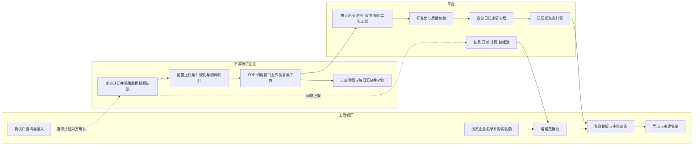
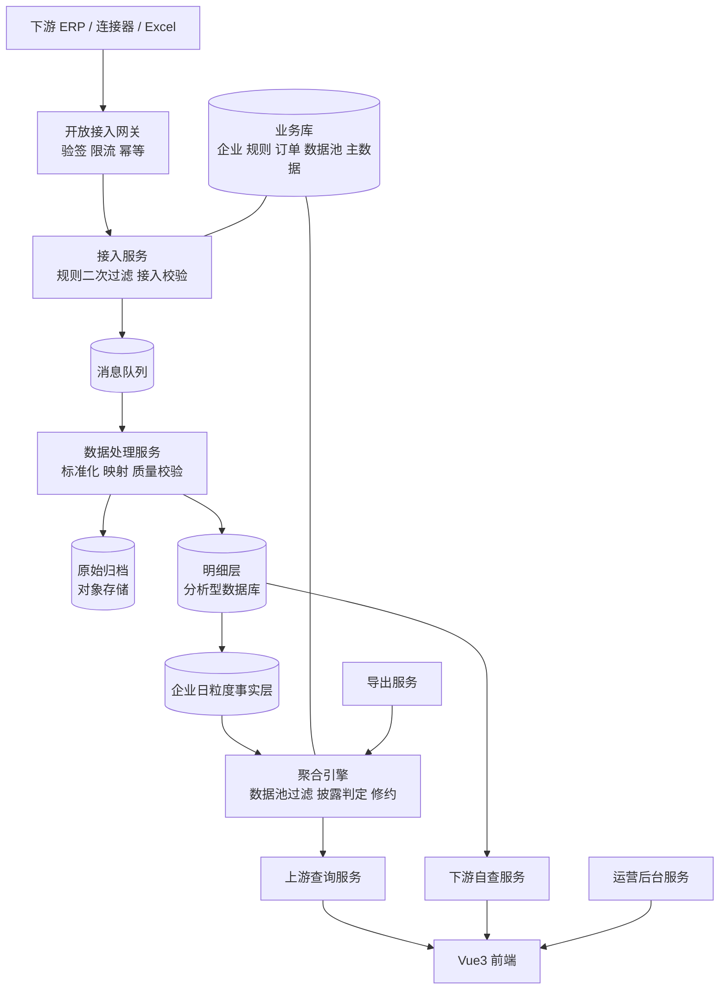

---
cursor:
  subagentId: "bc-231b2ae0-3297-531b-abc4-80bfa9280d3d"
---

# 钢贸上下游数据平台（货袋子平台·数据板块）需求文档

| 项 | 内容 |
|---|---|
| 文档版本 | V0.7（按 2026-11-26 提出的两项修改要求修订：端名称改为“上游厂家端”；多维查询的规格段层级带出第二个统计维度） |
| 编写日期 | 2026-11-24 |
| 适用范围 | 货袋子平台新增“上下游数据板块”的产品功能需求、设计需求、技术方案约束 |
| 文档状态 | 部分已确认。第 21 章 24 项拍板事项中 12 项已确认（其中 D-02 于 2026-11-25 修订）、12 项待确认；21.1 节 23 项中 8 项随分成取消而取消，15 项仍有效；21.2 节 5 项待确认；21.3 节 24 项中 4 项已确认（N-29、N-35、N-36、N-46）、20 项待确认；21.4 节 4 项中 2 项已确认（N-53、N-54）、2 项待确认；21.5 节（V0.6）4 项新待确认；21.6 节（V0.7）3 项新待确认；第 22 章货袋子现状问题 24 项有效，均未答复 |

> **【已确认前提 D-01】** 原始需求中两次写到“上游企业”。业务方已于 2026-11-24 确认：
>
> - **下游钢贸企业（数据上传方）≥ 20,000 家**；
> - **上游钢厂（数据购买方）≥ 500 家**。

**修订记录**

| 版本 | 日期 | 内容 |
|---|---|---|
| V0.1 | 2026-11-24 | 需求评审稿 |
| V0.2 | 2026-11-24 | 按业务方决策修订（决策记录见同目录 `project-context.md`）。已确认 D-01、D-02、D-03、D-05、D-06、D-07、D-08、D-14、D-19、D-20、D-23、D-24。其中三项与原建议不同并已贯穿全文：D-06 下游可选上传价格和金额；D-19 行级与按日汇总两种上传粒度并存；D-24 全品类起步。D-02 新增收益分成 |
| V0.3 | 2026-11-25 | 按原型评审中确认的两项规则修订（记录见同目录 `project-context.md`）。R-01：订阅期内加购名额从新增下游企业生效日起计费，下单到生效之间不收费，新增企业仍在下一个数据池调整周期生效。R-02：价格功能未对上游开放时，选购名录和数据来源企业名单中的“是否提供价格数据”字段隐藏，开放后显示，UP-01 与 UP-70 的冲突按此统一。新增 8.9、21.2 和 BL-21 至 BL-23、N-24 至 N-28；修订条目见 21.2 |
| V0.4 | 2026-11-25 | 按业务方 2026-11-25 的决策修订（记录见同目录 `project-context.md` 的“激励与推广模式调整”和“分品类的统计维度与计量单位”两节）。R-03：取消下游现金收益分成，下游激励改为钢厂带动加免费行业对标数据，原分成预算改为奖励带动入驻的钢厂（名额或折扣）。R-04：推广由钢厂发起，钢厂批量邀请协议户并把数据报送写进年度代理协议，一级代理可邀请二级经销商，平台运营只做支持和审核。R-05：钢厂对带动的协议户只能看聚合数据，另可看每家是否已接入、报送是否达标。R-06：销量和库存量按品类使用不同的统计维度，钢材按吨位、非钢材按数量，两者不合并相加，格子不足时按段或上一级维度上卷。取消与新增的条目清单见 21.3 |
| V0.5 | 2026-11-25 | 按 V0.4 评审中确认的四项修订（记录见同目录 `project-context.md` 的“V0.4 评审中确认的四项”一节）。N-29：带动的协议户照常占用付费名额，带动奖励的名额或折扣可以抵用。N-35：不认可零申报，只有实际数据才算报送；落地方式为每日库存快照也算实际数据，钢厂只见周期二值结果。N-36：钢厂可见已接入、是否达标，以及报送中断、已暂停、已退出。N-46：型材第二维度按品名固定，在品类主数据里逐个品名配置公斤段或负差段。其中 N-35 与文档原设计相反，零申报和日结申报的设计已改写，判定规则和残余风险见 9.10 末。修订与新增的条目清单见 21.4 |
| V0.6 | 2026-11-25 | 按 V0.5 评审中确认的两项修订（记录见同目录 `project-context.md` 的“V0.5 评审中确认的两项”一节）。N-53：库存快照或销售数据任一即可算当日已报送，与 V0.5 写法一致，由暂定改为已确认；“库存快照为必要条件”的建议未被采纳，相关建议文字已收起，残余风险保留并注明靠 N-34 的阈值缓解。N-54：常年不落库的企业经企业申报、运营核实后标记为“无库存经营”，达标显示“不适用”，申报时告知企业钢厂会看到这个标记；已落实为完整需求（7.12、9.12、OP-23 等）。另外三处：统一 UP-86 与 18.2 的矛盾，钢厂可见全部协议户的汇总达标率，参与评定的协议户不足 5 户时只显示户数，单家不出现任何百分比；给出 N-34 在现行口径下的建议取值范围（9.10 末）；把原型采用的暂定口径中属于规则的部分补入文档或列为待定（21.5）。修订与新增的条目清单见 21.5 |
| V0.7 | 2026-11-26 | 按 2026-11-26 提出的两项修改要求修订。一、端名称：原型中的“上游钢厂端”改称“上游厂家端”，文中原来的“上游端”“钢厂端”随之替换；只改端的名称，购买方角色仍称钢厂（N-61）。二、多维查询：规格段层级带出品类的第二个统计维度。管材在规格段上增加壁厚，即规格段 × 壁厚段，并可按壁厚段设查询条件；板材在厚度段的基础上增加宽度段。管材的披露层级路径相应调整。其中“板材要增加的规格段”按宽度段理解，是本文档的解释，待确认（N-62）。修订与新增的条目清单见 21.6 |

**V0.2 修订约定**：原有章节编号、小节编号、需求编号均未改动。新增内容一律追加为各章末尾的新小节（3.12–3.14、6.8、7.7–7.9、8.7–8.8、9.8–9.9、10.4、12.7、14.6、16.3、21.1）或使用新的需求编号。少数原有需求的优先级随决策调整，已在该行注明。3.6 的小节标题随 D-06 改写，编号不变。

**V0.3 修订约定**：同样不改动任何原有编号。新增小节 8.9、21.2；被修订的原有条目在该处以“V0.3”标出。R-01、R-02 是本文档为两项评审规则自编的引用编号。

**V0.4 修订约定**：不改动任何原有编号。被取消的章节和需求保留原编号，标注“V0.4 已取消”并写明原因，编号不再复用。3.14、7.9、8.7、8.8 四个小节的标题随取消改写，编号不变。新增小节 3.15、3.16、6.9、6.10、7.10、7.11、8.10、8.11、9.10、9.11、10.5、11.3、12.8、14.7、16.4、21.3，新增需求使用新编号。R-03 至 R-06 是本文档为本轮决策自编的引用编号。UP-79、DN-98、DN-99 未使用，新增需求从 UP-80、DN-100 起编。功能名称与原型统一：上游端“协议户邀请与接入”，下游端“邀请下级经销商”，运营后台“带动奖励规则”。

**V0.5 修订约定**：不改动任何原有编号。与零申报、日结申报有关的条目保留编号，标注“V0.5 已修订”或“V0.5 已取消”，编号和字段名不再复用：PV-65、DN-104、DQ-22 为已修订；术语“日结申报”和 12.8 的 `salesClosed`、`zeroSales`、`zeroInventory` 三个字段为已取消。12.8 的标题随之改写，编号不变。新增小节 21.4；新增 PV-93 至 PV-96、MD-24、DN-119、DQ-24、N-53 至 N-56。

**V0.6 修订约定**：不改动任何原有编号。新增小节 7.12、9.12、21.5，9.10 末尾新增两个无编号小节；新增 UP-101 至 UP-103、DN-120 至 DN-126、BL-32、BL-33、PV-97 至 PV-105、MD-25、DQ-25、OP-23、AUTH-11、N-57 至 N-60。被修订的原有条目在该处以“V0.6”标出。V0.5 中建议把库存快照定为必要条件的文字已删去，只保留“曾建议、未采纳”的记录（21.4 的 N-53 一行和 21.5）。

**V0.7 修订约定**：不改动任何原有编号。端名称属于名称替换：除修订记录和各版修订约定保留原文外，文中的“上游端”一律改为“上游厂家端”，“钢厂端”一律改为“厂家端”，不逐处标注。第 6 章、18.2 的标题和需求编号前缀 `UP` 不变。新增小节 6.11、21.6；新增 UP-104 至 UP-106、PV-106、PV-107、N-61 至 N-63。被修订的原有条目在该处以“V0.7”标出。

**阅读指引**

- 需求编号规则：`UP` 上游侧、`DN` 下游侧、`OP` 运营后台、`BL` 计费订单、`PV` 防反推、`MD` 主数据、`DQ` 数据质量、`API` 接口、`NFR` 非功能、`SEC` 安全合规、`INT` 平台融合。
- 优先级：**P0** 一期必须；**P1** 二期；**P2** 三期及以后。
- 文中“建议值”均为可在运营后台配置的参数默认值，不是写死的常量。
- 标注 **【行业判断】** 的内容，是从钢厂运营排产、营销管理经验出发对原始需求做的补充或矛盾判断。
- 标注 **【已确认 D-xx】** 的内容业务方已决策；标注 **【待拍板 D-xx】** 的内容仍待决策，暂按建议值设计；标注 **【新增待确认 N-xx】** 的内容由已确认决策引出。三类事项汇总在第 21 章。标注 **【已确认 R-xx】** 的内容是 2026-11-25 确认的规则，R-01、R-02 见 21.2，R-03 至 R-06 见 21.3。
- 标注 **V0.4 已取消** 的章节和需求不再建设，保留编号只为与原型和历史版本对照。
- 标注 **V0.5 已修订**、**V0.5 已取消** 的条目是按 2026-11-25 确认的 N-35 改写或取消的零申报、日结申报相关内容。

---

## 1. 背景、目标与范围

### 1.1 背景

货袋子平台已有业务不含“上下游数据服务”。本板块要在钢厂与钢贸商之间建立一个**数据中介**：下游钢贸企业通过 ERP 接口上传销售与库存数据；上游钢厂付费查看其所选下游企业的**聚合**数据，用于判断区域需求、渠道库存和资源投放。

### 1.2 双边价值主张

| 角色 | 核心诉求（行业视角） | 平台提供 |
|---|---|---|
| 上游钢厂（付费方） | 排产与资源投放缺少“社会库存、渠道动销”的真实样本；目前依赖经销商手工报表和第三方资讯样本，口径不一、滞后、不可下钻 | 按地区 × 品类规格的销量、库存聚合数据，可查询、可导出、可知样本构成。V0.4：可通过“协议户邀请与接入”带动自己的协议户入驻，并查看每家是否已接入、报送是否达标；带动入驻可获得名额或折扣奖励 |
| 下游钢贸企业（数据提供方） | 担心钢厂借数据查窜货、压返利、绕过自己直供终端；担心同行看到自己的客户与量价 | 上传范围、上传粒度、是否上传价格都由自己定；上传内容自己可查；对外只以聚合形态出现；可随时暂停或退出；获得免费行业对标数据。V0.4：不再有现金收益分成 |
| 平台（货袋子） | 新增可持续收入；增强两端用户粘性 | 向上游按“下游企业数”收费。V0.4：不向下游分成；对带动协议户入驻的钢厂给予名额或折扣奖励 |

### 1.3 范围

**本期范围内**

- 下游数据接入（开放 API、上传条件规则、自查与每日汇总）；支持单据行级和按日汇总两种上传粒度（D-19）。
- 钢材成品全品类的销量、库存数据（D-24）；下游自愿上传的销售成交价格与金额（D-06）。
- 上游数据消费（聚合看板、多维查询、导出、数据来源企业名单、价格聚合指标）。
- 交易闭环（企业名录选购、批量购买、订单、支付、发票、续费）。
- V0.4 已取消：下游收益分成的计提、展示与结算。原因：业务方取消下游现金收益分成（R-03）。
- V0.4 新增：钢厂发起的推广（上游厂家端“协议户邀请与接入”、下游端“邀请下级经销商”）、报送达标评定、带动奖励规则（R-03 至 R-05）。
- V0.4 新增：分品类的统计维度、分段与自动上卷；非钢材品类按数量统计（R-06）。
- 运营后台、主数据标准化、数据质量、防反推引擎。
- 与货袋子平台的账号、企业认证、权限、支付、菜单对接。

**本期范围外（建议）**

- 成本、毛利、库存金额，以及报价、意向价等未成交价格的采集与展示（理由见 3.6）。
- 终端客户名称等客户身份信息的采集（理由见 3.5）。
- 钢坯、生铁、废钢、铁合金等原料类商品（见【新增待确认 N-10】）。V0.4：业务方已确认非钢材品类按数量统计，哪些非钢材品类纳入、原料类是否纳入，见【新增待确认 N-48】。
- V0.4 新增：向下游支付现金收益；向钢厂提供任何单家协议户的数据内容（销量、库存、价格）。
- 基于数据的预测、定价建议等智能分析（可作为三期增值能力）。
- 下游企业之间的数据交易。

### 1.4 成功标准（建议的验收口径）

| 维度 | 指标 |
|---|---|
| 供给 | 稳定上传（近 30 日上传天数 ≥ 20）的下游企业数、覆盖的地级市数、覆盖的品类数。V0.4：经钢厂带动接入的协议户数、邀请到接入的转化率、报送达标率 |
| 需求 | 付费钢厂数、在订名额数（企业·月）、续费率 |
| 数据质量 | 分品类的标准映射率、上传及时率、校验通过率、选填字段（流向地、客户类型、价格）填报率 |
| 信任 | 下游企业主动暂停或退出率、数据相关投诉数、反推测试用例通过率 100% |

---

## 2. 术语

| 术语 | 定义 |
|---|---|
| 上游 / 购买方 | 钢铁生产企业（钢厂），付费查看聚合数据。V0.7：面向上游购买方的端称“上游厂家端”（UP-104） |
| 下游 / 提供方 | 钢贸企业，通过 ERP 上传销售、库存数据 |
| 企业名录 | 已同意上架、可被上游选购的下游企业清单及其画像 |
| 名额 | 计费单位。1 个名额在 1 个计费周期内对应 1 家下游企业的数据使用权 |
| 数据池 | 某上游企业当前已购且生效的下游企业集合，是其所有聚合计算的范围 |
| 单元格 | 一次查询中由一组维度取值确定的一个聚合结果（如“苏州 × 螺纹钢 Φ16–25 × 2026-11-20 的销量”） |
| 贡献企业数 | 对某单元格数值有非零贡献的下游企业数量 |
| k 门槛 | 单元格可披露所需的最小贡献企业数 |
| 优势度 | 单元格中最大一家（或前两家）企业贡献占单元格总量的比例 |
| 屏蔽 | 单元格不满足披露条件时不展示数值的处理 |
| 上传条件规则 | 下游企业自行配置的、决定哪些数据可以上传到平台的条件 |
| T+1 | 业务日期的数据在次日对上游可见 |
| 旬 | 钢铁行业常用统计周期，每月上、中、下旬 |
| 行级模式 | 下游按销售出库单据的每一行上传 |
| 日汇总模式 | 下游在 ERP 侧先按日和规定维度汇总，再上传汇总记录，平台不接收单据 |
| 有价样本 | 某单元格内上传了价格或金额的那部分销售数据 |
| 加权均价 | 有价样本的含税金额合计 ÷ 有价样本的结算重量合计，单位元/吨 |
| 名额日台账 | 按“名额 × 自然日”记录该名额当天对应哪家下游企业、是否生效、名额来源（付费或奖励）。V0.4：用途改为按日确认收入、加购按日计费的勾稽和奖励名额的核算，不再用于分成计提 |
| 收益分成 | V0.4 已取消。原指平台把上游支付的数据服务费按规则分给被订阅的下游企业 |
| 协议户（V0.4 新增） | 与某钢厂签有年度代理或经销协议的下游钢贸企业，通常是一级代理 |
| 二级经销商（V0.4 新增） | 从一级代理进货的下级经销商，与钢厂没有直接的代理协议 |
| 带动关系（V0.4 新增） | 钢厂邀请协议户、协议户确认后建立的关系。它只让钢厂看到该协议户是否已接入、报送是否达标，不构成数据授权 |
| 报送达标（V0.4 新增） | 按达标周期评定的二值结果，只反映协议户是否按时、连续地完成了报送动作，不反映报送了多少（9.10）。V0.5：“报送”指按时上传了实际数据，不认可零申报（N-35） |
| 日结申报（V0.4 新增） | V0.5 已取消。原指下游声明“某业务日期的数据已报送完毕”的动作，当日没有数据时可做零申报。原因：业务方不认可零申报，只有实际数据才算报送（N-35） |
| 实际数据（V0.5 新增） | 某业务日期经上传条件过滤后入库、通过字段校验且量不为零的库存快照行或销售记录。是判定当日是否报送的唯一依据（PV-93） |
| 无库存经营（V0.6 新增） | 企业常年不落库，货物由钢厂或上游直接发给客户，本企业不持有现货库存。经企业申报、运营核实后成为企业的一个标记；标记生效期间不参加报送达标评定，厂家端显示“不适用”（9.12） |
| 汇总达标率（V0.6 新增） | 某钢厂在某达标周期内，达标的协议户数 ÷ 参与评定的协议户数。是多家协议户的汇总数，不是单家的数值（PV-97） |
| 上游厂家端（V0.7 新增） | 面向上游购买方的端的名称，简称“厂家端”。V0.6 及以前文中称“上游端”“钢厂端”，原型中称“上游钢厂端”。购买方角色仍称钢厂（N-61） |
| 规格段层级（V0.7 新增） | 多维查询的品类下钻中，品名之下、单规格之上的一级。管材为规格段 × 壁厚段，板材为厚度段 × 宽度段，建材和其他品类为规格段（UP-105） |
| 带动奖励（V0.4 新增） | 平台给带动协议户入驻的钢厂的奖励，形式为名额或折扣（8.10） |
| 统计维度模板（V0.4 新增） | 按品类规定的销量、库存统计维度组合，如管材为规格加壁厚（10.5） |
| 段（V0.4 新增） | 把壁厚、厚度、宽度、公斤数、负差率等取值归并成的区间，是默认的披露层级 |
| 自动上卷（V0.4 新增） | 格子不满足披露条件时，沿固定路径合并到段或上一级维度后再披露（9.11） |
| 计量类型（V0.4 新增） | 品名的主数据属性：钢材按吨位，非钢材按数量。两者是独立的度量，不换算、不相加 |

---

## 3. 对原始需求的关键判断（行业视角）

本章集中写明对原始需求的补充和矛盾判断。每项包含：问题、理由、建议方案。

### 3.1 “能看到数据来源企业”与“看不到单家企业详情”存在反推风险

**问题**：若上游既知道数据来自哪几家，又能任意切片，就可以把聚合数拆回单家。典型手法：

1. **小池反推**：只买 1–3 家，聚合数等于或接近单家数。
2. **差分反推**：先看 A、B、C、D、E 五家合计，再把 E 换成 F，或用“全部”减“除某市以外”，两次结果相减得到单家或单市数据。
3. **维度穷举**：池内只有一家企业在兰州有仓库，筛选“兰州”即为该企业数据。
4. **优势度反推**：池内 20 家中 1 家占 90% 的量，聚合数基本就是这家的数。
5. **成员关系泄露**：如果每个单元格都列出贡献企业名称，筛选“竞品品牌 × 某地区”就能直接看到“哪些代理商在卖竞品、在跨区销售”。**这恰恰是钢贸商最怕的窜货稽查场景**，即使不暴露任何数值，名单本身就是敏感信息。
6. **结合自有信息**：钢厂掌握自己发给每家代理商的发货量，可与聚合数交叉推断。

**建议方案**（细则见第 9 章）：

- “数据来源企业名单”只在**数据池级别**展示（“你的数据来自这 N 家”），**单元格级别只展示贡献企业数区间**，不展示名称。
- 设最小数据池规模、单元格 k 门槛、优势度门槛、补充屏蔽、数据池变更约束、数值修约、查询审计七道防线。
- 残余风险（第 6 种）无法靠技术完全消除，通过合同约束（禁止再识别条款及违约责任）和下游知情同意处理。

### 3.2 “上游自选企业”要求下游身份在购买前可见，必须取得下游的上架同意

**理由**：上游要“看哪些家的数据就付哪些家的费”，就必须在购买前看到候选企业。企业名称出现在名录里本身是一次对外披露。

**建议方案**：下游入驻时在《数据授权协议》中选择上架方式：**实名上架** / **匿名上架**（只展示地区、主营品类、规模档等画像，不展示名称）/ **定向可见**（只对指定钢厂可见；“对指定钢厂不可见”不在本次确认范围内，暂列二期）。名录画像一律采用**企业自主申报并确认**的信息，不由上传数据自动推导后直接展示。**【已确认 D-03】** 由下游在实名上架、匿名上架、只对指定钢厂可见三种方式中自选。

### 3.3 “下游可自设上传条件”会削弱数据代表性，需要让上游知情

**理由**：下游若只上传部分品类、部分仓库，上游看到的“销量”不是该企业的全量。钢厂做资源投放判断时若把部分样本当全量，会误判。

**建议方案**：

- 名录中展示粗粒度的“数据覆盖声明”（覆盖哪些大类、是否全量），不展示规则细节。**【待拍板 D-10】**
- 看板固定标注“本数据为所购样本企业上传数据的聚合，不代表区域全市场”。
- 平台提供企业级“数据质量与连续性评级”，作为上游选购依据。

### 3.4 原始需求未提下游的上传动力，这是业务能否启动的首要风险

**理由**：下游承担改造 ERP 的成本和数据泄露的心理风险，但收费只面向上游。20,000 家规模靠“放心”不够，需要“有利”。

**【已确认 D-02，2026-11-25 修订】** 下游激励为两项：钢厂带动、免费行业对标数据。2026-11-24 曾确认的收益分成已取消，原分成预算改为奖励带动入驻的钢厂（R-03）。

| 方案 | 说明 | 适用 | 状态 |
|---|---|---|---|
| 钢厂带动 | 钢厂批量邀请自己的协议户入驻并上传，把数据报送写进年度代理协议；一级代理可继续邀请二级经销商。行业内钢厂向代理商要进销存报表本就是常规做法，平台把手工报表变成接口。功能见 6.9、7.10，行业判断见 3.15 | 推广主路径 | 已确认（R-04） |
| 对标回馈 | 下游免费获得“本企业 vs 所在区域聚合水平”的对标看板（同样受 k 门槛保护） | 所有下游 | 已确认提供；提供时点与范围见【新增待确认 N-22】。分成取消后它是下游唯一的直接回馈 |
| 收益分成 | V0.4 已取消。原因见 3.14 | — | 已取消（R-03） |
| 带动奖励 | 奖励对象是带动入驻的钢厂，不是下游。形式为名额或折扣，规则见 8.10 | 带动入驻的钢厂 | 已确认结构（R-03）；数值待定 |
| 平台权益 | 与货袋子现有业务挂钩的权益 | — | 未采纳 |

### 3.5 不采集客户名称，改采“客户类型”和“流向地区”

**理由**：

- 客户名单是钢贸商的核心商业秘密，采集会直接劝退。
- 但只有销量没有流向，对钢厂价值有限。钢厂最关心的是**货最终去了哪个区域、去了终端还是在贸易商之间流转**。
- 贸易商之间的转手交易（一批货在同一仓库内多次过户）会使“销量”虚增。若池内既有一级代理又有二级分销，同一批货会被计多次。

**建议方案**：销售数据不含客户名称，但包含可选字段 **客户类型**（终端 / 贸易商）、**下游行业**（房建、基建、机械、汽车、家电等）、**流向地区**（收货地，到地级市）。看板提供“终端销量”和“流通销量”两个口径。**【已确认 D-07】** 三个字段均为选填，填报率计入数据质量评分。

### 3.6 价格和金额：下游可选上传（已确认，与原建议不同）

**【已确认 D-06】** 下游可以选择上传价格和金额。原建议是一期不采集，现按决策调整，并保留原判断中的两项风险作为设计约束。

**仍然成立的两项风险**：

- 价格是下游最敏感的数据。强制或默认上传会降低整体上传意愿。
- 平台向存在竞争关系的多家钢厂提供成交价格信息，存在《反垄断法》下“为经营者达成垄断协议提供实质性帮助”的合规风险。风险随数据的即时性、细颗粒度、可归属到具体企业的程度上升。

**【行业判断】** 钢材“价格”不是一个数，不统一口径就不可比。同一天同一规格的成交价会因以下条件不同而相差几十到上百元每吨：是否含税、理计还是磅计、仓库自提价还是送到价（含运费）、现款还是账期（含资金成本）、是否为后结算的暂估价。

**方案**：

| 方面 | 设计 | 位置 |
|---|---|---|
| 自愿原则 | 价格上传默认关闭，由下游企业管理员主动开启；可按品类、品牌、仓库限定上传价格的范围；可随时关闭 | 7.7 |
| 采集范围 | 只采集销售成交的单价与金额。不采集成本、毛利、库存金额、报价 | 12.3、12.7、【新增待确认 N-01】 |
| 口径字段 | 是否含税、价格条件（自提 / 送到）、是否暂估价、计重方式，随价格一并上传。默认聚合口径为含税、自提、非暂估 | 12.3、附录 A、【新增待确认 N-05】 |
| 上游指标 | 只提供加权均价及其涨跌、价格覆盖率区间。不提供金额合计、最高最低价、价格分布 | 6.8 |
| 防反推 | 价格指标采用比量指标更严的门槛，并禁止通过“总销量 − 有价销量”反推未上传价格企业的销量 | 9.8 |
| 合规缓解 | 上游价格指标设法务闸口，默认关闭，取得法务意见后由运营后台开启；延迟披露、修约、竞品品牌合并、合同禁止用于协同定价 | 16.3、【新增待确认 N-02】 |

### 3.7 “地区”需要明确口径

**理由**：“各地区的销售量”至少有三种理解：企业注册地、出库仓库所在地、货物流向地。三者对钢厂的意义不同：仓库所在地反映**渠道库存分布**，流向地反映**终端需求分布**。钢材跨市、跨省销售普遍，三者差异很大。

**建议方案**：

- 销量默认按**出库仓库所在地**统计（必填、最可靠），同时支持按**流向地**统计（选填，填报率作为质量指标）。
- 库存按**仓库所在地**统计。
- 行政区划采用国家标准代码，到地级市；并支持上游自定义“销售大区”分组（各钢厂的大区划分不同）。

**【已确认 D-20】** 销量默认按仓库所在地统计，支持切换到流向地。

### 3.8 销量与库存需要统一统计口径

| 口径问题 | 建议 |
|---|---|
| 上传粒度 | 行级与日汇总两种模式并存（D-19）。两种模式在“企业日粒度事实层”归一，上游看到的口径完全相同（见 3.12） |
| 价格口径 | 加权均价默认按含税、自提、非暂估的有价样本计算（见 3.6、附录 A） |
| 销量按订单还是按出库 | 以**销售出库（实提）**为主口径；退货冲减。订单口径不采集 |
| 计重方式 | 螺纹钢等品种存在理计与磅计差异。上传 ERP 结算重量并带计重方式标识，一期不做换算，只在口径说明中标注 |
| 库存类型 | 主口径为**货权属于本企业的账面实物库存**；可选拆分“已售未提”“在途”。代管他人货物不计入 |
| 库存采集方式 | **每日日末全量快照**（按仓库 × 物料）。不靠出入库流水反算，避免期初不准和漏单 |
| 时间粒度 | 日、周、**旬**、月。旬是钢厂定价与结算的常用周期 |
| 同比环比失真 | 新接入企业没有去年数据，同比会虚高。二期提供“固定样本”口径 |

### 3.9 品牌（钢厂）维度是价值最高也最敏感的维度

**理由**：钢厂最想看“本厂资源在各区域的动销与渠道库存”以及“竞品份额”。但对下游，按品牌切片会暴露其代理结构；对其他钢厂客户，自家品牌销量被竞争对手查看会引发抵触；对平台，有 3.6 所述合规风险。

**【已确认 D-08】** 本厂品牌实名展示，其他品牌合并为“其他品牌”。该规则同样适用于价格指标：上游只能看到本厂品牌均价和“其他品牌”合并均价，看不到任何一家竞品钢厂的品牌均价。

### 3.10 20,000 家下游多数是中小贸易商，IT 能力弱，只有开放 API 不够

**理由**：中小钢贸商普遍使用通用进销存或行业 ERP 的标准版，没有自研能力，无法自行对接 API。

**建议方案**：接入方式分三层，一期做第一层，二期起补齐：

1. 开放 API（有开发能力的企业或 ERP 厂商调用）。
2. ERP 厂商预置连接器（平台与主流钢贸 ERP 厂商合作，客户在 ERP 内一键开通）。
3. Excel 模板导入（兜底，适合过渡期和小微企业）。

具体合作哪些 ERP 厂商需结合货袋子现有下游用户的 ERP 分布确定。**【待拍板 D-13】**

### 3.11 购买资格需要限定

**理由**：如果贸易商也能以“上游”身份购买，就能看到同行的聚合数据；钢厂集团下属多个法人分别购买不同数据池，可以互相差分。

**建议方案**：购买资格限定为经认证的钢铁生产企业；同一集团的关联企业视为**同一购买主体**，共用一个数据池校验口径。**【待拍板 D-04】**

### 3.12 行级与日汇总两种上传粒度并存（已确认，与原建议不同）

**【已确认 D-19】** 单据行级和按日汇总两种粒度都支持，由下游自选。原建议是一期只做行级。

**【行业判断】** 日汇总模式让数据在离开企业前就失去单据形态，对下游的安全感提升明显，对中小贸易商的对接也更简单。代价有三项，需要用设计补上：

| 问题 | 理由 | 设计 |
|---|---|---|
| 同一天的数据被两种模式各传一次，销量翻倍 | 企业切换模式或多套系统并行时容易发生 | 粒度按“企业 + 来源系统”设置，按业务日期切换；同一来源系统同一业务日期只接受一种粒度（DN-82、DQ-11） |
| 平台无法对汇总数据做单据级校验 | 没有单据号就无法去重，也无法判断单笔异常 | 日汇总采用“按日整批替换”语义；增加批内维度唯一性、控制总数对账、相对自身历史的合理性校验（12.7、DQ-10） |
| 部分上传条件规则平台无法兜底 | 单笔吨位上下限、按客户或部门编码排除，只能在汇总之前执行 | 这类条件在日汇总模式下标注为“仅在 ERP 端执行”，平台二次过滤只覆盖汇总记录里存在的维度（DN-83） |

**口径一致性原则**：日汇总记录的维度不得粗于企业日粒度事实层的必备维度（日、仓库所在市、品名、材质、规格、钢厂）。V0.4：其中“规格”按品类的统计维度模板展开（如管材为规格加壁厚），汇总键见 12.8；材质是否保留见【新增待确认 N-47】。两种模式的数据在事实层合并后，上游的任何出口都不区分、也不能按上传粒度筛选（PV-60）。最低维度要求是否放宽见【新增待确认 N-07】。

### 3.13 全品类起步（已确认，与原建议不同）

**【已确认 D-24】** 首批覆盖全品类。原建议是先做建筑钢材和热轧板卷。

**【行业判断】** 各品类的标准化难度差别很大。建筑钢材的牌号和规格只有几十种组合；优特钢和不锈钢的牌号在千级，同一钢种有国标、美标、日标、欧标多种写法，还带交货状态、表面等属性；管材和型钢的规格组合多，且常按支、米计量而不是按吨。如果要求所有品类上线时都做到规格级标准化，主数据会成为一期的瓶颈。

**方案：全品类接入，分级标准化**（细则见 10.4）

- 上线时所有品类都能上传、都能在**品名级**聚合披露。
- 标准化深度按品类分级推进：贸易量大、标准化程度高的品类先做到规格段，长尾品类先做到品名或材质级，再逐步加深。
- 上游可查询的最细粒度随该品类的标准化深度开放，未达到的层级不提供下钻。

**连带影响**：

- 品类越多，单元格越稀疏。特钢、不锈钢等品类在单个城市往往只有几家贸易商，屏蔽率会明显高于建材。这些品类的默认披露粒度应更粗（如到省、到旬或月），见 PV-61。
- 数据质量规则必须分品类配置（规格取值范围、单行吨位上限、价格合理区间、计量单位），见第 11 章。
- “全品类”的边界需要明确，见【新增待确认 N-10】。
- V0.4：业务方已确认分品类的统计维度和计量单位（R-06），全品类包含按数量统计的非钢材品类。各品类的规格层级按统计维度模板展开，行业判断见 3.16，主数据见 10.5，分段与上卷见 9.11。

### 3.14 收益分成（V0.4 已取消）

**V0.4 已取消**（已确认 R-03，2026-11-25）。本节原为下游现金收益分成的行业判断（刷量、分成金额泄露上游折扣、选择性上传、财税处理）。取消原因：业务方判断分成金额对钢贸企业不构成动力，还会把关系变成“卖数据”，加重其对钢厂查窜货、压返利的顾虑。下游激励改为钢厂带动加免费行业对标数据；原分成预算改为奖励带动入驻的钢厂（8.10）。替代的行业判断见 3.15。

### 3.15 钢厂发起推广与对协议户的可见边界（V0.4 新增）

**【已确认 R-04、R-05】** 推广由钢厂自己发起：钢厂批量邀请自己的协议户，并把数据报送写进年度代理协议；一级代理可继续邀请自己的二级经销商；平台运营只做支持和审核。钢厂对自己带动入驻的协议户只能看聚合数据，另外可以看每家是否已接入、报送是否达标，看不到单家数据内容。

**【行业判断】** 这条路径在行业里走得通：钢厂对协议户有年度协议、资源分配和返利政策，要求代理商报进销存本来就是常规做法；平台靠运营逐家推动 2 万家下游不现实。但它把下游最担心的一方变成了推动方，下面几处需要用设计守住。

| 问题 | 理由 | 设计 |
|---|---|---|
| 协议压力会削弱下游的自主权 | 写进代理协议后，“自设上传条件、暂停、退出”在商业上更难行使；钢厂直接推动也会加重查窜货、压返利的顾虑 | 平台层面下游的权利不变（PV-71）；邀请落地页明示钢厂看得到和看不到什么（DN-100）；带动关系与数据授权分别确认，都可撤回 |
| 达标信号可能被用来反推数量 | 钢厂若能看到某家哪一天没报，就能把它与聚合数的日间变化对照 | 达标只按周期给二值结果，不给日级状态，也不给任何与业务量相关的数（9.10） |
| 没有销售的日子怎么算 | 若“有数据才算报送”，达标率就反映了有销售的天数 | V0.5 修订：业务方不认可零申报（N-35），V0.4 的“零申报视同报送”取消。改为每日库存快照也算实际数据，当天没有销售的企业报了库存就算报送。这对每天都有库存的企业有效；对无库存经营、只报销售、上传范围很窄的企业仍有残余风险，见 9.10 末。V0.6：库存快照或销售数据任一即可已确认（N-53）；常年不落库的企业可申报“无库存经营”，核实后不参加评定（N-54，9.12）；只报销售、上传范围很窄两类企业的残余风险保留，靠从宽的达标阈值缓解（N-34） |
| 池内成员多为本厂协议户 | 钢厂掌握对每家协议户的发货量，先验信息最强（3.1 第 6 种手法） | 门槛不因带动关系放宽，不提供按协议户分组的聚合（PV-68、PV-69）；是否加严参数见【新增待确认 N-40】 |
| 多品牌代理 | 一家贸易商常同时是几家钢厂的协议户，它为钢厂 A 报送的数据里也有钢厂 B 的货 | 品牌仍按“本厂实名、其他合并”（D-08）；多家钢厂邀请同一协议户时的奖励归属见【新增待确认 N-32】 |
| 二级经销商被“穿透” | 下级网络是一级代理的核心资源，一级代理担心钢厂拿到名单后绕过自己 | 钢厂默认看不到二级经销商名单和逐户状态（UP-91、DN-111）；规则见【新增待确认 N-37】 |
| 套取带动奖励 | 奖励按带动户数计，会诱发空壳协议户，或用极少量、虚假的数据凑数（V0.5：零申报已取消） | 有效带动的认定、反套取校验、奖励只给汇总户数（8.10、DQ-09） |
| 合规 | 钢厂以协议要求经销商向平台报送经营数据，涉及纵向关系和同意是否自愿 | 见 16.4，需法务确认 |

对 3.4 的影响：下游的直接回馈只剩免费行业对标数据，它的提供时点和范围（N-22）比 V0.3 时更重要。

### 3.16 分品类的统计维度与计量单位（V0.4 新增）

**【已确认 R-06】** 销量和库存量按品类使用不同的统计维度：管材为规格加壁厚，板材为厚度加宽度，建材为规格，型材为规格加公斤段或负差段，其他品类为规格。钢材按吨位统计，非钢材按数量统计，两者不合并相加。维度细化后防反推规则照常适用，格子不足时按段或上一级维度上卷。分段方式待定。

**【行业判断】**

| 问题 | 理由 | 设计 |
|---|---|---|
| 决策中的五类与本文档的大类不是一一对应 | “板材”在行业里涵盖热轧、冷轧及涂镀、中厚板；不锈钢和优特钢按形态又可分属板、管、型、棒 | 引入“统计维度模板”，每个品名归属一个模板（10.5）；归属方案见【新增待确认 N-44】 |
| 管材的“规格”叫法不统一 | 外径、公称口径、英制叫法并存，方矩管按截面边长 | 主数据做规格归一（MD-20） |
| 型材的公斤段与负差段是同一件事的两种说法 | 同一型号的实际重量低于理论重量的程度，决定了货的档次和价格。行业里有的按单支或每米的公斤数叫，有的按负差百分比叫；给定型号和长度后两者可以互相换算 | **已确认 N-46**（V0.5）：按品名固定，在品类主数据里逐个品名配置公斤段或负差段（MD-24）。接口两者都接收，上传的不是配置的那一种时按理论重量表换算 |
| 负差与计重方式相关 | 负差大的货按理计卖和按过磅卖，吨位会相差几个百分点 | 吨位口径见【新增待确认 N-49】 |
| 吨位与数量不能相加 | 钢材按吨，非钢材按数量；非钢材不同品名的数量单位也不同 | 两个度量分列存储，任何合计、占比、图表都不跨计量类型和数量单位（UP-97、DQ-21） |
| 维度变细后格子更稀疏 | 一个城市里同一规格再按壁厚或宽度细分，单格往往只有一两家企业 | 默认按段披露，不足时沿固定路径自动上卷（9.11） |
| 只看规格段不够用（V0.7 新增） | 同一规格的管材，壁厚不同就是不同的货，单重和价格都不同；板材只看厚度、不看宽度同理。查询停在只有第一维度的规格段上，看不出这些差别 | 规格段层级带出第二维度：管材为规格段 × 壁厚段，板材为厚度段 × 宽度段（UP-105、PV-106） |
| 决策的维度里没有材质 | 现有设计把材质作为采集字段和上游维度。建材和板材的材质差别对钢厂有意义 | 暂保留现状；是否作为统计维度见【新增待确认 N-47】 |
| 非钢材进入范围 | N-10 原建议只做钢材成品。按数量统计的规则说明平台会有非钢材品类 | 范围与数量单位见【新增待确认 N-48】；N-10 相应更新 |

---

## 4. 角色与权限

### 4.1 角色定义

| 侧 | 角色 | 主要权限 |
|---|---|---|
| 上游企业 | 企业管理员 | 成员与角色管理、购买与续费、数据池调整、查看全部数据、导出 |
| 上游企业 | 数据分析员 | 看板、多维查询、导出（受配额约束）、保存查询方案 |
| 上游企业 | 只读成员 | 看板与查询，不可导出 |
| 上游企业 | 财务 | 订单、支付、发票，不可看数据 |
| 上游企业 | 渠道管理员（V0.4 新增） | “协议户邀请与接入”：导入协议户名单、发送邀请、查看接入状态与报送达标、催办、查看带动奖励。该角色本身不含聚合数据的查看和导出权限 |
| 下游企业 | 企业管理员 | 签署授权协议、上架方式、成员管理、暂停与退出；开关价格上传、选择上传粒度（V0.2 新增）；确认或解除与钢厂的带动关系、邀请下级经销商（V0.4 新增）；申报或撤销无库存经营（V0.6 新增） |
| 下游企业 | 数据管理员 | 上传条件规则、物料映射、查看每日汇总与明细、对账 |
| 下游企业 | 接口对接员 | 应用密钥、IP 白名单、沙箱调试、查看接口日志，默认不可看业务明细 |
| 下游企业 | 只读成员 | 查看每日汇总 |
| 下游企业 | 财务（V0.2 新增） | V0.4 已取消。原因：下游现金收益分成取消，下游侧不再有收益、结算和收款功能 |
| 平台 | 运营 | 企业审核、名录管理、接入辅导、断传跟进。V0.4：对钢厂发起的协议户邀请只做支持和审核（OP-20），不逐家邀请 |
| 平台 | 主数据管理员 | 品类、材质、规格、钢厂、地区、仓库字典及映射审核 |
| 平台 | 数据质量专员 | 质量监控、异常数据隔离与处置 |
| 平台 | 财务 | 定价、订单、对公到账核销、发票、退款。V0.4：分成结算已取消；新增带动奖励的发放复核 |
| 平台 | 安全审计员 | 审计日志、防反推参数、异常查询处置。与运营角色互斥 |
| 平台 | 超级管理员 | 系统配置与授权 |
| 第三方 | ERP 服务商（P2） | 代多家下游企业管理接入，需逐家获得企业授权 |

### 4.2 权限设计要求

| 编号 | 需求 | 优先级 |
|---|---|---|
| AUTH-01 | 采用“企业（租户）+ 角色 + 数据范围”三层权限。所有数据访问强制带企业标识，后端校验，不信任前端参数 | P0 |
| AUTH-02 | 一家企业可同时具有上游、下游身份（如钢厂的销售子公司）。两种身份的菜单与数据完全隔离，切换身份需显式操作 | P0 |
| AUTH-03 | 关联关系管理：同一集团的企业登记为关联企业。购买主体按集团归并；钢厂关联的贸易公司在名录中标注“关联企业” | P1 |
| AUTH-04 | 平台人员默认**不可查看下游企业上传明细**。排障需要时走工单申请，下游企业授权后限时开放，全程留痕并在下游侧可见 | P0 |
| AUTH-05 | 上游成员的导出、数据池调整等敏感操作支持二次验证（短信或企业管理员审批），可配置 | P1 |
| AUTH-06 | 账号、企业认证、基础角色体系复用货袋子平台，本板块只扩展板块内角色和数据权限（见第 17 章） | P0 |
| AUTH-07 | 下游侧“查看价格与金额”为独立权限点，默认只授予企业管理员，可由其授予数据管理员。未授权成员在明细和汇总中看不到价格列 | P0 |
| AUTH-08 | **V0.4 已取消**。原“下游侧收益、结算单、收款账户的可见范围”。原因：下游现金收益分成取消 | — |
| AUTH-09 | “协议户邀请与接入”为上游侧独立的功能权限，默认授予企业管理员和渠道管理员。该功能内只有名单、邀请状态、接入状态、报送达标和带动奖励，不含任何数据内容 | P0 |
| AUTH-10 | 带动关系须由协议户的企业管理员确认才成立，平台人员和钢厂都不能代为确认；任一方可单方解除 | P0 |
| AUTH-11 | 无库存经营的申报、到期确认和主动撤销须由该企业的企业管理员操作（V0.6 新增）。平台不提供由钢厂或平台人员代为申报的途径；运营只能核实、驳回或依据复核结论撤销，操作留痕 | P0 |

---

## 5. 业务流程总览

主流程说明：

1. **下游入驻**：认证 → 签协议并选择上架方式 → 选择上传粒度（行级或日汇总）和是否上传价格 → 申请应用密钥 → 沙箱联调 → 配置规则与映射 → 正式上传。V0.4：经钢厂邀请入驻的协议户在入驻时另行确认带动关系（第 7 步）。
2. **数据处理**：接入网关验签、限流 → 按企业规则二次过滤 → 标准化映射 → 质量校验 → 写入明细层（行级表或日汇总表）→ 每日生成企业日粒度事实（两种粒度在此归一）→ 供聚合引擎使用。
3. **上游购买**：认证 → 浏览名录 → 选企业或买名额包 → 池可用性预估 → 下单支付 → 数据池生效。
4. **上游使用**：看板 → 多维查询 → 导出 → 查看数据池来源名单。
5. **持续运营**：断传预警、名额补偿、续费提醒、数据池周期调整。
6. **收益分成**（V0.2 新增）：V0.4 已取消。原因：下游现金收益分成取消（R-03）。
7. **钢厂发起推广**（V0.4 新增）：钢厂导入协议户名单 → 生成邀请链接或邀请码并发送 → 协议户注册认证、签署数据授权协议、确认带动关系 → 接入并报送 → 平台按周期评定报送达标 → 钢厂查看每家是否已接入、是否达标并催办 → 一级代理可继续邀请二级经销商。平台运营在其中只做审核、辅导和争议处理。
8. **带动奖励**（V0.4 新增）：平台按考核期核算各钢厂的有效带动户数 → 按带动奖励规则生成奖励建议 → 运营审核 → 发放奖励名额或折扣 → 钢厂在续费、加购或分配名额时使用。

---

## 6. 上游侧功能需求

V0.7：本章各功能所在的端称为“上游厂家端”，简称“厂家端”（UP-104）。章节标题和需求编号前缀 `UP` 不变。

### 6.1 企业名录与选购

| 编号 | 需求 | 优先级 |
|---|---|---|
| UP-01 | 名录列表：展示已上架下游企业。字段：企业名称（匿名上架显示为编号，如“华东·建材·A0321”；V0.4：编号按上游主体分别生成，见 PV-73）、所在省市、主营大类、规模档（企业自主申报的年销量区间）、数据覆盖声明、接入时长、数据质量评级、近 3 个月活跃等级。另有“是否提供价格数据”一列（企业确认后的申报信息）：**仅在价格功能已对上游开放（UP-70 闸口开启）时显示，未开放时隐藏**（V0.3，已确认 R-02） | P0 |
| UP-02 | 名录筛选：地区、主营大类、代理品牌（企业自主申报）、规模档、质量评级、接入时长、是否已在我的数据池中 | P0 |
| UP-03 | 名录中**不展示**任何由上传数据计算的企业级数值（销量、库存、每日是否上传）。活跃度只给月度等级（活跃 / 一般 / 停更），不给日级状态 | P0 |
| UP-04 | 购物清单：勾选企业加入清单，实时显示已选家数、适用价格阶梯、应付金额 | P0 |
| UP-05 | 池可用性预估：下单前按“已选企业 + 现有数据池”预估**标准维度组合下可披露单元格比例**，并提示“再增加 X 家某地区企业可使该地区可披露”。不展示任何实际数值。V0.4：预估按统计维度模板和披露层级分别给出（PV-90） | P1 |
| UP-06 | 条件圈选：按筛选条件一键全选（如“江苏省全部建材类企业”），配合名额包使用 | P0 |
| UP-07 | 平台预置组合包：按区域、品类编排的推荐组合（如“华东建材样本包”），由运营维护 | P1 |
| UP-08 | V0.4 修订（已确认 R-04）：钢厂通过“协议户邀请与接入”自行批量邀请协议户（6.9），不再由平台运营逐家跟进。原“提交线索由运营跟进邀请”只保留为补充：钢厂没有对方联系方式时可提交线索，由运营协助联系 | P0（V0.4 调整：协议户邀请由 P1 提前；线索协助仍为 P1） |

### 6.2 数据池管理

| 编号 | 需求 | 优先级 |
|---|---|---|
| UP-10 | 数据池页面：展示当前生效企业名单（即“数据来源企业名单”）、每家的生效起止日期、状态、名额占用 | P0 |
| UP-11 | 数据池不满足最小规模（建议 20 家）时，不提供聚合数据，页面提示差多少家 | P0 |
| UP-12 | 数据池调整（替换、增加、减少）按第 9.5 节规则执行：按周期生效、成员按日期版本化、历史默认不重算。V0.3（已确认 R-01）：加购新增的企业同样在下一个调整周期生效；生效前在数据池页面以“待生效”列出并显示计划生效日，不参与聚合；计费见 8.9 | P0 |
| UP-13 | 数据池变更记录：每次变更的时间、操作人、变更企业数、生效日期 | P0 |
| UP-14 | 池内企业状态异常（断传、暂停、退出）时通知上游，并按 8.6 节规则补偿 | P0 |

### 6.3 聚合看板

| 编号 | 需求 | 优先级 |
|---|---|---|
| UP-20 | 概览：数据池企业数、数据日期、昨日销量、昨日日末库存、近 7 日日均销量、库存可销天数，以及各项的环比与同比。V0.4：以上指标针对按吨位统计的钢材；非钢材另设一组，按数量和数量单位展示，不与吨位合计（UP-97） | P0 |
| UP-21 | 地区分布：省、市两级地图热力与排行，指标可切换销量、库存、可销天数 | P0 |
| UP-22 | 品类结构：大类 → 品名 → 规格段的销量与库存占比，可下钻。V0.4：品名以下的下钻路径按统计维度模板提供（UP-95）；占比只在同一计量类型、同一数量单位内计算 | P0 |
| UP-23 | 趋势：销量、库存的日、周、旬、月趋势，可叠加同比 | P0 |
| UP-24 | 本厂品牌视图：本厂品牌在各地区、各规格段的销量、渠道库存、可销天数，及占数据池总量的份额。其他品牌合并为“其他品牌”（已确认 D-08） | P0 |
| UP-25 | 流向视图：销量按流向地区、客户类型、下游行业分布。依赖下游填报率，页面显示填报覆盖率（已确认 D-07、D-20） | P1 |
| UP-26 | 自定义销售大区：把省市组合成本厂的销售大区，看板与查询可按大区聚合。大区内企业数仍受 k 门槛约束 | P1 |
| UP-27 | 预警订阅：对指定地区 × 品类的库存可销天数、销量环比设阈值，触达站内信、短信、邮件 | P2 |
| UP-28 | 所有图表固定展示：数据日期、样本企业数、口径说明、“样本聚合数据，不代表全市场”提示；被屏蔽的数据点显示为“—”并可悬停查看原因 | P0 |
| UP-29 | 数据池变更日在趋势图上显示“口径变更”标记 | P0 |

### 6.4 多维查询

| 编号 | 需求 | 优先级 |
|---|---|---|
| UP-30 | 维度：时间（日、周、旬、月、自定义区间）、仓库所在地（省、市）、流向地（省、市）、大类、品名、材质、规格段、品牌（本厂 / 其他）、客户类型、下游行业。V0.4：规格类维度按品类的统计维度模板提供（UP-95）；材质是否保留为统计维度见【新增待确认 N-47】。V0.7：“规格段”不再是只有第一维度的一级，管材和板材在这一级带第二维度（UP-105） | P0（流向地、客户类型、行业为 P1） |
| UP-31 | 指标：销量、库存量、日均销量、库存可销天数、环比、同比、贡献企业数区间、占比。价格类指标见 6.8。V0.4：销量、库存量各有吨位和数量两个度量，由品名的计量类型决定，不可互相换算或相加 | P0 |
| UP-32 | 交互：维度拖拽为行、列，逐级下钻与上卷，排序，结果以表格和图表两种形式展示 | P0 |
| UP-33 | **不提供“按企业”维度，不提供按企业筛选或排除的条件** | P0 |
| UP-34 | 筛选只支持层级选择和多选包含，不支持“排除某项”。多选时，自身不满足披露条件的成员不计入结果并提示（规则见 9.4）。V0.7：选定品名后另提供按段的品类维度条件（UP-106），判定见 PV-107 | P0 |
| UP-35 | 保存查询方案、设为看板卡片、定时发送到邮箱（发送内容同样受导出规则约束） | P1 |
| UP-36 | 固定样本口径开关：只统计对比期和本期都有数据的企业。固定样本集合与全池的差集须为 0 或 ≥ k | P1 |
| UP-37 | 查询结果行数上限与分页；超过上限引导使用导出 | P0 |

### 6.5 导出

| 编号 | 需求 | 优先级 |
|---|---|---|
| UP-40 | 支持导出当前查询结果和看板数据，格式 Excel、CSV。V0.4：导出增加维度列、单位列和披露层级列（UP-99） | P0 |
| UP-41 | 导出内容与页面展示完全一致：同样的屏蔽、修约、口径说明。不存在“导出能看到更细数据”的路径 | P0 |
| UP-42 | 大数据量导出异步生成，在“导出中心”下载，文件保留期可配置（建议 7 天） | P0 |
| UP-43 | 导出文件带水印信息（企业、账号、时间、导出编号）和使用条款页 | P0 |
| UP-44 | 导出配额：按企业、按账号设日次数与行数上限，超限需企业管理员审批 | P1 |
| UP-45 | 数据来源企业名单可导出，内容只有名单及画像字段，不含任何数值。V0.3：导出的画像字段与页面一致，“是否提供价格数据”同样只在 UP-70 闸口开启时导出 | P0 |
| UP-46 | 面向钢厂自有 BI 系统的聚合数据拉取接口，规则同导出 | P2 |
| UP-47 | 所有导出记录审计日志：谁、何时、查询条件、行数、文件指纹 | P0 |

### 6.6 数据来源企业名单

| 编号 | 需求 | 优先级 |
|---|---|---|
| UP-50 | 数据池级名单：展示全部在池企业的名称（或匿名编号）、地区、主营大类、覆盖声明、生效期。V0.3（已确认 R-02）：UP-70 闸口开启时增加“是否提供价格数据”一列，闸口关闭时隐藏 | P0 |
| UP-51 | 单元格级只展示**贡献企业数区间**（如 5–9、10–19、20–49、50+），不展示名称，不展示精确家数 | P0 |
| UP-52 | 看板和导出文件的口径说明中列出“本数据池共 N 家企业，名单见数据池页面” | P0 |

**设计理由**：见 3.1。精确家数配合新企业加入时间也可用于差分，因此用区间。

### 6.7 订单与账务（上游视角）

| 编号 | 需求 | 优先级 |
|---|---|---|
| UP-60 | 我的订单：订单列表、详情、支付状态、合同下载 | P0 |
| UP-61 | 名额总览：已购名额数、已分配数、未分配数、各批次到期日。V0.3：另列待生效名额数及其计划生效日（即计费起始日） | P0 |
| UP-62 | 续费与扩容：到期前提醒（建议提前 30、7、1 天），一键续费，周期内加购名额。V0.3（已确认 R-01）：加购从新增企业生效日起计费，下单到生效之间不收费；下单页展示计划生效日、计费起止日、计费天数和应付金额（8.9、BL-21） | P0 |
| UP-63 | 发票申请与下载 | P0 |
| UP-64 | 试用：未购买时可查看基于模拟数据的演示看板。不提供真实数据试用（已确认 D-23） | P0 |

### 6.8 价格聚合指标（V0.2 新增，对应 D-06）

价格指标只基于下游自愿上传的有价样本。防反推规则见 9.8，合规要求见 16.3。

| 编号 | 需求 | 优先级 |
|---|---|---|
| UP-70 | 功能闸口：上游侧全部价格功能由运营后台的统一开关控制，**默认关闭**。关闭时上游侧不显示任何价格入口、指标和导出列。V0.3（已确认 R-02）：闸口范围包含选购名录（UP-01）、数据来源企业名单（UP-10、UP-50）及其导出（UP-45）中的“是否提供价格数据”字段，关闭时该字段隐藏，也不提供按它的筛选和排序；由后端控制，关闭时接口不返回该字段。闸口开启后显示，再次关闭后恢复隐藏。开启条件见【新增待确认 N-02】 | P0 |
| UP-71 | 指标范围：加权均价（元/吨）、均价环比涨跌额与涨跌幅、价格覆盖率区间、有价企业数区间。**不提供**销售金额合计、最高价、最低价、价格分布、有价样本的精确销量 | P0 |
| UP-72 | 可用维度：时间（日、周、旬、月）、仓库所在地（省、市）、大类、品名、材质、规格段、品牌（本厂 / 其他品牌）。按客户类型（终端价与贸易商价）拆分为二期能力。V0.4：规格类维度按统计维度模板提供；价格指标暂只对按吨位统计的品类提供，非钢材见【新增待确认 N-52】 | P0（客户类型为 P1） |
| UP-73 | 价格口径：默认含税、自提、非暂估。可按计重方式（理计、磅计）分别查看。送到价作为独立口径在二期提供，不与自提价混算 | P0（送到价为 P1） |
| UP-74 | 量价联动视图：同一图中展示销量与加权均价的趋势；展示本厂品牌均价与“其他品牌”合并均价的价差；可叠加库存可销天数 | P0 |
| UP-75 | 展示要求：价格取整到 10 元/吨；每个价格数旁显示价格覆盖率区间；固定提示“样本成交均价，不是市场报价”；被屏蔽的价格显示“—” | P0 |
| UP-76 | 导出、定时发送、数据拉取接口中的价格内容与页面完全一致，同样受闸口和防反推规则约束 | P0 |
| UP-77 | 若价格数据单独计价（【新增待确认 N-04】），未购买价格权益的上游不显示价格入口，并在入口位置提供购买引导 | P1 |
| UP-78 | 使用条款确认：上游成员首次进入价格视图须确认使用条款（不得用于与其他经营者协同定价，不得对外传播） | P0 |

说明：UP-70 至 UP-78 的优先级指功能建设的期次。即使一期建成，是否对上游开放仍取决于 UP-70 的闸口。

### 6.9 协议户邀请与接入（V0.4 新增，对应 R-04、R-05）

上游厂家端的功能名称统一为“协议户邀请与接入”。可见边界和报送达标的定义见 9.10，带动奖励规则见 8.10。

| 编号 | 需求 | 优先级 |
|---|---|---|
| UP-80 | 入口与权限：上游厂家端一级菜单“协议户邀请与接入”，面向经认证的钢厂，由企业管理员和渠道管理员使用（AUTH-09）。页面分四块：协议户名单与邀请、接入状态、报送达标、我的带动奖励 | P0 |
| UP-81 | 协议户名单导入：Excel 模板批量导入和逐条添加。字段：企业名称、统一社会信用代码、联系人、手机号、所属销售大区（选填）、协议年度。校验格式并在名单内去重，逐行返回导入结果。名单是钢厂的渠道信息，只对本厂可见，平台不向其他钢厂展示，也不用于推荐 | P0 |
| UP-82 | 不回显入驻状态：导入和发送邀请时，不提示对方是否已在平台、是否已上架、是否已与其他钢厂建立带动或订阅关系。对已入驻的企业，平台在对方账号内生成“带动关系确认请求”，厂家端在对方确认前一律显示“已发送”。理由见 PV-72 | P0 |
| UP-83 | 邀请方式：每家协议户一个专属邀请链接（带一次性令牌和有效期）；钢厂级邀请码，可印在通知或协议附件里，协议户注册时填写；二维码。可由平台按固定模板发送短信、邮件，也可由钢厂自行转发。模板内容固定，包含“钢厂能看到什么、看不到什么”的说明入口。支持重发、撤回、作废 | P0 |
| UP-84 | 邀请状态跟踪：待发送、已发送、已确认带动关系、已注册认证、已签署数据授权协议；分支为已拒绝、已过期、已撤回。对方确认带动关系之前只显示到“已发送”，确认之后才显示后续节点。通过专属链接新注册的企业在落地页上一并确认（DN-100） | P0 |
| UP-85 | 接入状态：逐户显示未接入、接入中（已创建应用或联调中）、已接入（已有首次有效报送）、报送中断、已暂停、已退出、已解除关联。汇总显示已邀请、已确认、已接入的户数和接入率，可按销售大区、协议年度分组。V0.5（已确认 N-36）：钢厂可见的状态为已接入、报送中断、已暂停、已退出，另加报送是否达标。“未接入”是“已接入”的反面；“接入中”和“已解除关联”不在决策原文的列举之内，按与原设计一致保留 | P0 |
| UP-86 | 报送达标：逐户显示各达标周期的结果（达标、未达标、不适用）和连续达标周期数；汇总显示达标户数和达标率。指标定义和不得展示的内容见 9.10。V0.5（已确认 N-36）：单家只给周期的二值结果，不显示单家的及时率数值；判定口径按 N-35 修订。V0.6：与 18.2 的矛盾按以下口径统一（PV-97）。汇总区显示达标、未达标、不适用三类的户数，以及本厂全部协议户的汇总达标率（达标户数 ÷ 参与评定的户数）；参与评定的协议户不足 5 户（待定参数）时不显示汇总达标率，只显示户数；按销售大区、协议年度分组时每组同样适用。单家一行里不出现任何百分比。“不适用”注明原因类别：尚未接入、带动关系中途成立或应报送天数不足、无库存经营（UP-101） | P0 |
| UP-87 | 催办：对未确认、未接入、未达标、报送中断的协议户发送提醒。使用平台固定模板，有频率上限，保留催办记录。V0.6：不对已标记无库存经营的协议户发送“未达标”催办 | P1 |
| UP-88 | 不提供的内容：本功能内不出现任何单家的销量、库存、价格、条数、吨位、数量、金额、批次数、上传时间、日级报送情况、上传条件规则、过滤条数、质量明细。不提供从本功能跳转到“按该企业筛选的聚合数据”的入口。聚合数据只能在看板和查询中按数据池整体查看 | P0 |
| UP-89 | 协议户与数据池：带动关系不等于数据授权，也不等于选购。协议户进入本厂数据池，须该企业对本厂上架可见，并占用名额（V0.5，已确认 N-29：照常占用付费名额，带动奖励的名额或折扣可以抵用），按数据池调整周期生效。列表显示“是否对本厂上架”“是否已在我的数据池”，并提供“加入数据池”入口。匿名上架且未确认与协议户身份对应的企业不显示这两项（PV-73）。V0.6：未对本厂上架的企业，与匿名上架且未确认对应的企业，这两列统一显示“—”，不区分是哪一种。理由：若只有后者显示“—”，钢厂就能推知该协议户以匿名方式出现在名录中 | P0 |
| UP-90 | 年度代理协议的数据报送条款：平台提供条款参考模板下载，内容包括报送范围的约定方式、报送频率和达标定义（与 9.10 一致）、钢厂可见范围的声明、协议户保留的权利。钢厂可登记协议年度和是否已约定报送条款，用于按协议年度统计。平台不是协议当事方，不负责执行协议后果。模板须法务审定（N-39） | P0 |
| UP-91 | 二级经销商：默认只显示全厂范围内经一级代理带动接入的二级经销商总户数，不显示名单，不按一级代理拆分。二级经销商本人确认与本厂建立带动关系后，才进入逐户视图。规则见【新增待确认 N-37】 | P1 |
| UP-92 | 我的带动奖励：展示当前奖励规则摘要、本考核期计入奖励的带动户数、已获得的奖励名额或折扣、有效期和使用记录。只给汇总户数，不逐户标注是否计入奖励（理由见 8.10 第 9 条） | P0 |
| UP-93 | 名单与状态导出：可导出协议户名单及其邀请、接入、达标状态，不含任何数值。导出带水印并留痕。V0.6：导出含“无库存经营”标签和“不适用”的原因类别，不含单家的任何百分比 | P1 |
| UP-94 | 解除：钢厂可移除协议户，协议户也可单方解除带动关系。解除后钢厂不再看到该企业的新状态；已发布的历史周期结果保留多久见【新增待确认 N-41】 | P0 |
| UP-101 | 无库存经营的显示（V0.6 新增，已确认 N-54）：标记已生效的协议户，在协议户列表和报送达标页带“无库存经营”标签，达标结果显示“不适用”，原因类别为“无库存经营”。汇总区单列这类户数；它们不计入汇总达标率的分子和分母。接入状态照常显示。标签随达标周期结果在发布日更新。不显示申报时间、申报材料和核实过程，也不显示某户曾经申请、被驳回或被撤销的原因（PV-103） | P0 |
| UP-102 | 对标记提出异议（V0.6 新增）：钢厂认为某协议户实际持有库存时，可对其“无库存经营”标记提出异议并说明理由，转入运营复核（OP-23）。平台只回复“维持”或“已撤销”，不提供核实依据和任何数据内容。同一协议户的异议有频率上限。是否提供见 N-60 | P1 |

### 6.10 分品类维度与计量单位的展示（V0.4 新增，对应 R-06）

维度模板和分段见 10.5，上卷规则见 9.11。

| 编号 | 需求 | 优先级 |
|---|---|---|
| UP-95 | 维度随品类切换：在看板或查询中选定品名（或同属一个统计维度模板的多个品名）后，出现该模板的维度。管材：规格、壁厚段；板材：厚度段、宽度段；建材：规格；型材：规格，加该品名配置的公斤段或负差段（V0.5，已确认 N-46）；其他品类：规格。跨模板查询只提供公共维度（时间、地区、大类、品名、品牌等）。V0.5：一次查询同时选中配置为公斤段和配置为负差段的型材品名时，第二维度不合并展示，按品名分别展示或只到规格一级。V0.6：一期只在选定单一品名后提供该模板的维度；同时选中多个品名时只提供公共维度并提示原因，V0.5 所写“按品名分别展示或只到规格一级”一期统一为只提供公共维度。同族多品名合并查询见 UP-103。V0.7：多维查询中模板维度不再作为单独的行维度入口，并入品类下钻路径，在规格段层级带出（UP-105）；选定品名后可按段设查询条件（UP-106） | P0 |
| UP-96 | 计量单位：钢材的量指标单位为吨；非钢材的量指标按数量，并显示该品名的数量单位。列头或数值旁始终显示单位 | P0 |
| UP-97 | 不合并相加：合计行、指标卡、图表系列、占比、库存可销天数都不跨计量类型；非钢材不同数量单位之间也不相加。概览分“钢材（吨）”和“非钢材（数量）”两组。一次查询同时选中钢材和非钢材时，结果分表展示，不出总计 | P0 |
| UP-98 | 上卷标识：自动上卷后的行显示上卷后的层级名称和“已上卷”标识，悬停说明“样本不足，已合并到上一级”。不显示被合并的原始格子的任何数值，也不说明差几家 | P0 |
| UP-99 | 导出：增加按模板的维度列、单位列、披露层级列（原始值、段、已上卷）。钢材和非钢材分工作表 | P0 |
| UP-100 | 分段说明：页面可查看当前生效的分段方案（各段边界）及其版本；分段变更日在趋势图上标注口径变更。V0.5：型材同时显示该品名用的是公斤段还是负差段 | P0 |
| UP-103 | 同族多品名的维度合并查询（V0.6 新增）：多个品名同属一个模板、共用同一套分段字典（同一品名族，MD-19），型材还须第二维度类型和公斤数口径相同时，可合并为一组按模板维度查询。合并后的格子按合并后的贡献企业判定披露，品名与合并组之间按父子关系检查（PV-85）。不满足条件的只提供公共维度。是否提供随品名族方案确定（N-45） | P1 |
| UP-105 | 规格段层级带出第二维度（V0.7 新增）：多维查询的品类下钻只有一条路径，大类 → 品名 → 规格段层级 → 单规格层级，不再把“品类统计维度”作为单独的行维度入口。下钻到规格段层级时，按该品名的模板带出第二个统计维度。管材：规格段 × 壁厚段，壁厚段默认展开；管材在规格段及更细的层级上始终带壁厚，不带壁厚的规格段只在自动上卷后出现，或由用户主动收起到上一级时出现。板材：规格段层级就是厚度段，在厚度段的基础上增加宽度段，即厚度段 × 宽度段。建材、其他品类：只有规格段。型材暂不变（N-63）。结果以交叉表展示，第一维度为行、第二维度为列，也可平铺为行。披露判定和上卷按 PV-106。未达到 L4 的品名不提供规格段层级（MD-23） | P0 |
| UP-106 | 品类维度的查询条件（V0.7 新增）：在筛选区选定单一品名后，按模板提供品类维度的查询条件。管材：规格段、壁厚段；板材：厚度段、宽度段；建材和其他品类：规格段；型材：规格段，以及该品名配置的公斤段或负差段。条件只支持按段多选包含，不支持排除，不能输入自定义的数值范围（PV-78）；按具体的壁厚或厚度数值查询，取决于是否开放原始取值（N-45）。条件在任何行维度下都生效，包括以地区或时间为行维度时，结果的判定按 PV-107。同时选中多个品名时，只有共用同一套分段字典的品名才提供这些条件（UP-103），否则只提供公共条件并说明原因。当前条件显示在结果区上方，随查询方案保存，并写入导出文件的查询条件说明（UP-35、UP-99） | P0 |

### 6.11 端名称（V0.7 新增）

| 编号 | 需求 | 优先级 |
|---|---|---|
| UP-104 | 端名称：面向上游购买方的端统一称“上游厂家端”，简称“厂家端”。适用于端的切换入口、顶栏、页面标题、站内通知和短信邮件模板、帮助文档，以及协议文本中对该端的称呼。下游端和运营后台的名称不变。本条只改端的名称，不改变购买资格（D-04），也不改变文中“钢厂”这一角色称谓；二者是否随之调整见 N-61 | P0 |

---

## 7. 下游侧功能需求

### 7.1 入驻与授权

| 编号 | 需求 | 优先级 |
|---|---|---|
| DN-01 | 复用货袋子企业认证；本板块另需在线签署《数据授权协议》，明确数据权属、使用范围、聚合披露规则、撤回权利 | P0 |
| DN-02 | 上架设置（已确认 D-03）：实名上架 / 匿名上架 / 只对指定钢厂可见，三种方式由下游自选。“对指定钢厂不可见”（黑名单）不在已确认范围内，暂列二期。“不上架（只上传不出售，仅用于自身对标）”是否保留见【新增待确认 N-21】 | P0（V0.2 调整：只对指定钢厂可见由 P1 提前到 P0；黑名单为 P1） |
| DN-03 | 企业画像自主申报：所在地、主营大类、代理品牌、规模档、覆盖声明、是否提供价格数据。上架前企业确认，修改需重新确认。V0.3（已确认 R-02）：“是否提供价格数据”在价格功能对上游开放之前不对上游展示，下游侧画像页在该项旁标明“暂不对上游展示” | P0 |
| DN-04 | 入驻引导：分步清单显示完成进度（认证 → 协议 → 粒度与价格设置 → 密钥 → 联调 → 规则 → 映射 → 首次上传）。V0.4：经钢厂邀请入驻的企业在引导开头增加“确认带动关系”（DN-100） | P0 |

### 7.2 ERP 接口接入

| 编号 | 需求 | 优先级 |
|---|---|---|
| DN-10 | 应用管理：创建应用，获取应用标识和密钥；密钥只在创建时完整展示一次；支持轮换（新旧并行期可配置）和停用 | P0 |
| DN-11 | IP 白名单配置（可选开启） | P0 |
| DN-12 | 沙箱环境：独立地址和密钥，数据不进入正式库；提供在线调试页、示例报文、签名校验工具 | P0 |
| DN-13 | 接口文档中心：在线文档、字段字典、错误码、变更日志；Java 和 .NET 示例代码 | P0 |
| DN-14 | 接口调用日志：近 N 天每次调用的时间、接口、批次号、条数、结果，可按批次查看逐行处理结果 | P0 |
| DN-15 | Excel 模板导入：下载模板、上传、预校验、确认入库。与接口走同一套规则过滤与质量校验 | P1 |
| DN-16 | ERP 厂商连接器：厂商在 ERP 内集成，企业在平台授权某连接器代为上传 | P1 |
| DN-17 | 多 ERP 来源：一家企业可登记多个来源系统（如总部和分公司用不同 ERP），按来源系统区分幂等键 | P1 |

### 7.3 上传条件规则配置

**【行业判断】** 规则在哪里执行决定了下游的安全感。“ERP 发了全部数据、平台说没存”不如“不符合条件的数据根本没离开企业”。建议双层执行：

- **源头过滤（推荐）**：ERP 或连接器调用规则拉取接口，在本地过滤后只发送符合条件的数据。
- **平台入口二次过滤（兜底）**：接入网关在落库前按同一规则再过滤一次。不符合规则的数据**不落盘**，只记录被过滤条数用于汇总展示。

| 编号 | 需求 | 优先级 |
|---|---|---|
| DN-20 | 规则按数据类型分别配置：销售、库存 | P0 |
| DN-21 | 可用条件维度：大类、品名、材质、规格范围、品牌（钢厂）、仓库、仓库所在地、流向地、客户类型、业务日期起点（只上传某日之后的数据）、单笔吨位上下限。日汇总模式下各条件的执行位置见 DN-83；价格字段的上传范围单独在 7.7 配置。V0.4：增加按品类统计维度的条件，见 DN-113 | P0 |
| DN-22 | 规则模式：白名单（只上传符合条件的）和黑名单（排除符合条件的）；多条规则可组合，优先级为“排除优先” | P0 |
| DN-23 | 按 ERP 内部编码排除：可填入 ERP 的客户编码、部门编码、业务员编码清单，匹配到的单据不上传。平台只保存这些编码的不可逆摘要，接口不接收对应的名称 | P1 |
| DN-24 | 规则试算：保存前显示“按新规则，近 7 日已上传数据中将有 X 条、Y 吨不再上传”，或上传样例文件试算。V0.4：试算结果按吨位和数量分列（DN-114） | P0 |
| DN-25 | 规则版本与生效：每次修改生成新版本，可指定生效时间；版本历史可查、可回滚 | P0 |
| DN-26 | 规则变更只影响生效后上传的数据。是否同时清理已上传的历史数据由企业单独操作（见 DN-45） | P0 |
| DN-27 | 规则模板：提供“全量上传”“仅建材”“仅指定品牌”“仅指定仓库”等预置模板 | P1 |
| DN-28 | 规则变更导致覆盖范围明显变化时，提示企业同步更新名录中的覆盖声明 | P1 |
| DN-29 | 规则的任何变更写入审计日志，企业管理员可见 | P0 |

### 7.4 上传数据自查

| 编号 | 需求 | 优先级 |
|---|---|---|
| DN-30 | 明细查询：按业务日期、上传日期、数据类型、单据号、仓库、品名、材质、规格、品牌、状态（已入库、校验失败、待映射、已作废）查询本企业上传的数据。行级模式展示单据行；日汇总模式展示汇总记录，无单据号（见 DN-86）。有权限的成员可见价格与金额列（见 DN-75）。V0.4：按品类显示对应的统计维度和单位（DN-115） | P0 |
| DN-31 | 明细同时展示“原始上传值”和“平台标准化后的值”（如 ERP 品名 → 标准品名），让企业知道平台如何理解其数据 | P0 |
| DN-32 | 批次查询：每个上传批次的接收条数、入库条数、过滤条数、失败条数及失败原因，可下载失败明细 | P0 |
| DN-33 | 本企业数据导出（Excel、CSV），仅本企业授权角色可操作 | P0 |
| DN-34 | 手动作废：对已上传的单条或批量记录发起作废，作废后不再参与后续聚合计算。仅适用于行级模式；日汇总模式通过重传当日批次更正（见 DN-85） | P1 |

### 7.5 每日上传汇总

| 编号 | 需求 | 优先级 |
|---|---|---|
| DN-40 | 日汇总页：选定日期，展示当日上传批次数、接收条数、入库条数与吨位、规则过滤条数、校验失败条数、待映射条数。页面标明当前上传粒度；日汇总模式下“条数”指汇总记录数，若上传了单据行数则一并展示。开启价格上传的企业另展示带价格的条数占比、金额合计、当日均价。V0.4：钢材吨位与非钢材数量分列（DN-116）；显示当日是否已收到实际数据、是否计为报送（DN-104，V0.5 修订） | P0 |
| DN-41 | 日汇总分组：按品类、仓库、地区、品牌展示当日销量吨位和日末库存吨位；有价格权限的成员可见各分组的金额与均价。V0.4：非钢材分组展示销售数量和库存数量，不与吨位合计 | P0 |
| DN-42 | 对账：ERP 可通过接口申报当日控制总数（条数、吨位、金额），平台与实际入库数比对，显示“一致 / 差异”及差异明细入口。日汇总模式没有单据级校验，对账是主要的完整性保障。V0.4：控制总数按钢材（条数、吨位）和非钢材（条数、数量）分列。V0.5：V0.4 的“对账申报同时作为日结申报，可做零申报”已取消（N-35）。控制总数为零的对账申报仍可提交，只供平台和企业自己区分“当日无销售”与“尚未上传”，不计为报送 | P0（V0.2 调整：由 P1 提前） |
| DN-43 | 日历视图：按月显示每天的上传状态（正常、部分失败、未上传），点击进入当日汇总 | P0 |
| DN-44 | 每日汇总推送：每日固定时间通过站内信、短信、邮件或微信推送摘要；未上传或失败率超过阈值时发告警 | P0（微信为 P1） |
| DN-45 | 月度报告：当月上传天数、总量、质量评分、被订阅情况。V0.4：增加各达标周期的报送达标结果 | P1 |

### 7.6 信任与安全感机制

| 编号 | 机制 | 说明 | 优先级 |
|---|---|---|---|
| DN-50 | 字段最小化 | 接口不设客户名称、业务员、成本、毛利字段，收到直接丢弃并提示。价格与金额字段仅在企业主动开启价格上传且在其设定范围内时才接收，否则同样丢弃不落盘（见 7.7） | P0 |
| DN-51 | 上游视角预览 | 下游可查看“钢厂能看到什么”的示例页面：只有聚合数、区间企业数、被屏蔽的单元格 | P0 |
| DN-52 | 披露规则公示 | 在下游侧固定入口公示当前生效的 k 门槛、优势度门槛、最小数据池规模。参数调整前通知全部下游 | P0 |
| DN-53 | 数据使用透明账本 | 展示本企业当前被多少家上游订阅、历史订阅变化。**【已确认 D-05】** 只显示订阅的钢厂家数，不显示名称 | P0 |
| DN-54 | 暂停上传 | 一键暂停，暂停期间接口拒收数据；已上传数据保留 | P0 |
| DN-55 | 退出与数据撤回 | 申请退出后停止对外提供，并按协议删除明细数据。已生成并已披露的历史聚合结果不回溯修改（见 **【待拍板 D-12】**） | P0 |
| DN-56 | 延迟披露 | 企业可选择本企业数据延迟若干天才进入聚合（建议可选 T+1、T+3、T+7） | P2 |
| DN-57 | 访问留痕可见 | 平台人员经授权查看本企业明细的每次记录，对企业可见 | P0 |
| DN-58 | 安全资质展示 | 展示平台安全等级保护备案、加密与审计措施、协议文本 | P0 |
| DN-59 | 行业对标看板 | 本企业销量、库存可销天数与所在地区、品类聚合水平的对比。对标群体同样须满足 k 门槛。已确认提供（D-02）；是否提前到一期、是否包含价格对标见【新增待确认 N-22】。V0.4：分成取消后，对标是下游唯一的直接回馈，建议基础版提前到一期；对标的规格类维度同样按统计维度模板提供 | P1（V0.4 建议提前到 P0，待 N-22 确认） |
| DN-60 | 收益查看 | **V0.4 已取消**。原因：下游现金收益分成取消（R-03） | — |

### 7.7 价格与金额上传控制（V0.2 新增，对应 D-06）

| 编号 | 需求 | 优先级 |
|---|---|---|
| DN-70 | 价格上传开关：企业级，**默认关闭**。仅企业管理员可开启，开启时须阅读并确认价格数据授权条款（用途、披露形式、披露门槛） | P0 |
| DN-71 | 价格上传范围：开启后可按大类、品名、品牌、仓库限定哪些数据带价格。范围外的数据即使 ERP 传了价格字段，平台也丢弃不落盘 | P0 |
| DN-72 | 开关关闭时，接口收到价格、金额字段一律丢弃不落盘，并在批次结果中提示“价格字段未接收” | P0 |
| DN-73 | 披露用途选择：企业可选择价格“参与对上游的聚合披露”或“仅用于本企业自查与行业对标”（【新增待确认 N-06】） | P1 |
| DN-74 | 关闭与清除：可随时关闭，关闭后不再接收价格。可一键清除已上传数据中的价格与金额字段，销量数据保留。已披露的历史价格聚合不回溯修改 | P0 |
| DN-75 | 自查中的价格：明细、每日汇总中展示本企业上传的单价、金额、均价、带价格的条数占比。只有具备“查看价格与金额”权限的成员可见（AUTH-07） | P0 |
| DN-76 | 价格口径默认值：企业可设置本企业默认的是否含税、价格条件（自提 / 送到）、计重方式。接口未传对应字段时按默认值处理 | P0 |
| DN-77 | 上游视角预览中增加价格示例，说明价格只以加权均价和区间形式出现，且受更严的披露门槛保护 | P0 |
| DN-78 | 开关、范围、用途的每次变更写入审计日志并通知企业管理员 | P0 |

### 7.8 上传粒度（V0.2 新增，对应 D-19）

| 编号 | 需求 | 优先级 |
|---|---|---|
| DN-80 | 粒度选择：按“企业 + 来源系统”选择**行级模式**或**日汇总模式**。入驻引导中并列说明两者差异：上传什么、平台能看到什么、可用的规则条件、自查能看到什么 | P0 |
| DN-81 | 库存：库存本身是日末快照，两种模式的接口相同。日汇总模式下可只报仓库所在市，不报仓库编码与名称（【新增待确认 N-07】） | P0 |
| DN-82 | 防重复：同一来源系统、同一业务日期只接受一种粒度的销售数据，另一种粒度的数据拒收并返回明确错误码 | P0 |
| DN-83 | 规则适用性：规则配置页按当前粒度标识每个条件的执行位置，“ERP 端与平台双重执行”或“仅 ERP 端执行”。日汇总模式下，单笔吨位上下限、按内部编码排除只能在 ERP 端执行 | P0 |
| DN-84 | 粒度切换：切换须指定生效业务日期（不早于次日）。生效日之前的数据保持原粒度。切换记录留痕。切换频率限制见【新增待确认 N-09】 | P0 |
| DN-85 | 日汇总模式的更正：重传该业务日期的完整汇总批次，平台整批替换。不支持单条作废 | P0 |
| DN-86 | 自查差异：行级模式展示单据行；日汇总模式展示汇总记录及其来源批次。自查和每日汇总页面顶部显示当前粒度 | P0 |
| DN-87 | 上传粒度不作为上游的维度或筛选条件（PV-60）。是否在企业名录中展示见【新增待确认 N-08】 | P0 |

### 7.9 收益分成：下游侧（V0.4 已取消）

**V0.4 已取消**（已确认 R-03）。原因：下游现金收益分成取消，下游侧不再有收益、结算单、开票和收款账户功能。下游端新增的功能见 7.10、7.11。

| 编号 | 需求 | 优先级 |
|---|---|---|
| DN-90 | **V0.4 已取消**。原“收益总览”。原因同上 | — |
| DN-91 | **V0.4 已取消**。原“收益明细”。原因同上 | — |
| DN-92 | **V0.4 已取消**。原“分成规则说明”。原因同上 | — |
| DN-93 | **V0.4 已取消**。原“结算单”。原因同上 | — |
| DN-94 | **V0.4 已取消**。原“开票与收款账户”。原因同上 | — |
| DN-95 | **V0.4 已取消**。原“提升收益指引”。原因同上 | — |
| DN-96 | **V0.4 已取消**。原“分成资格状态”。原因同上 | — |
| DN-97 | **V0.4 已取消**。原“不上架的企业不参与分成的提示”。原因同上 | — |

### 7.10 带动关系与邀请下级经销商（V0.4 新增，对应 R-04、R-05）

本节包含两部分：协议户被钢厂邀请后的知情、确认和自查（DN-100 至 DN-106、DN-112）；一级代理“邀请下级经销商”（DN-107 至 DN-111）。下游端的功能名称统一为“邀请下级经销商”。

| 编号 | 需求 | 优先级 |
|---|---|---|
| DN-100 | 邀请落地页与知情确认：通过钢厂的邀请链接或邀请码进入时，首屏明示四件事：邀请方是谁；钢厂能看到什么（聚合数据，以及本企业是否已接入、报送是否达标）；钢厂看不到什么（销量、库存、价格等任何单家数据内容，上传条件规则，日级报送情况）；本企业保留的权利（自设上传条件、暂停、退出、解除带动关系、选择上架方式）。须主动勾选确认，带动关系才成立。V0.5：页面同时说明报送达标按实际数据判定，没有数据的日子不算报送。V0.6：页面提供“本企业常年不落库”的入口，说明可申报无库存经营及其后果（DN-120） | P0 |
| DN-101 | 带动关系管理：查看与本企业有带动关系的钢厂列表（一家企业可与多家钢厂建立）；逐家确认、拒绝、解除。已入驻企业收到的关联请求以站内待办呈现；不确认，钢厂得不到任何状态 | P0 |
| DN-102 | 我的报送达标：展示本企业各达标周期的结果、当前周期的进度（应报送天数、已按时完成天数、缺报日期）和未达标原因。这些明细只对本企业可见，钢厂只看到周期结果。V0.5：缺报的日子显示原因（未上传、全部被上传条件过滤、整批被拒、超过截止时点），原因同样只对本企业可见（PV-96）。V0.6：标记无库存经营期间显示“不适用（无库存经营）”，不显示当期进度和缺报日历（DN-125） | P0 |
| DN-103 | 带动钢厂可见内容预览：在数据安全中心增加“带动钢厂能看到什么”，内容与厂家端的实际视图一致 | P0 |
| DN-104 | **V0.5 已修订**（已确认 N-35）。原“日结申报与零申报”取消。改为当日报送状态与提醒：每日汇总页显示当日是否已计为报送，并分别标出库存快照和销售数据是否已收到实际数据；页面说明“没有实际数据的日子不算报送，不能用申报代替”。临近截止时点仍未收到实际数据时提醒企业。V0.6：提醒的提前量由企业设置，默认截止前 2 小时。已标记无库存经营的企业不做缺报提醒（DN-125） | P0 |
| DN-105 | 暂停、退出与达标：暂停和退出的权利不因带动关系或代理协议受限。暂停期间按未报送计入达标评定；厂家端显示“已暂停”或“已退出”。操作前提示“与你有带动关系的 N 家钢厂将看到此状态” | P0 |
| DN-106 | 带动关系与上架设置：确认带动关系时，引导设置是否对该钢厂上架可见（默认勾选，可取消）。匿名上架的企业对带动钢厂以实名出现在其协议户视图和数据池名单中，对其他钢厂仍为匿名，须单独确认（N-38） | P0 |
| DN-107 | 邀请下级经销商：下游端菜单“邀请下级经销商”。已接入的企业可批量导入下级经销商名单、生成邀请链接或邀请码、发送邀请。同样不回显对方是否已入驻 | P1 |
| DN-108 | 下级邀请状态跟踪：待发送、已发送、已确认、已接入；分支为已拒绝、已过期、已撤回 | P1 |
| DN-109 | 对下级的可见边界：邀请方只能看到邀请状态和对方是否已接入；是否可见报送达标见【新增待确认 N-37】。不提供下级的任何数据内容。邀请方不是数据购买方，不因邀请获得下级的聚合数据 | P1 |
| DN-110 | 下级经销商的知情确认：落地页明示邀请方和可见范围。下级经销商可自行选择是否同时与上游钢厂建立带动关系，须指定具体钢厂，默认不建立 | P1 |
| DN-111 | 下级名单保密：企业导入的下级经销商名单只对本企业可见，不向钢厂展示，平台不用于向钢厂推荐。理由：下级网络是一级代理的核心资源 | P1 |
| DN-112 | 留痕与通知：带动关系的确认、解除和可见范围变化写入审计日志，并通知企业管理员 | P0 |

### 7.11 分品类维度与计量单位：下游侧（V0.4 新增，对应 R-06）

| 编号 | 需求 | 优先级 |
|---|---|---|
| DN-113 | 上传条件增加品类维度：壁厚范围（管材）、厚度范围和宽度范围（板材）、公斤数范围或负差范围（型材，V0.5：按该品名配置的那一种）、计量类型（可整体排除非钢材）。“单笔吨位上下限”对非钢材对应为“单笔数量上下限”。日汇总模式下各条件的执行位置仍按 DN-83 | P0 |
| DN-114 | 规则试算分单位：钢材显示条数和吨位，非钢材显示条数和数量，不合并 | P0 |
| DN-115 | 自查按品类显示维度：明细按统计维度模板显示对应的维度列（原始上传值、平台解析后的值、所属段）和单位列。缺少必填维度的行有标识和原因。V0.5：型材显示该品名配置的第二维度；上传的是另一种时，同时显示上传值和换算值 | P0 |
| DN-116 | 每日汇总分单位：当日摘要和分组表中，钢材吨位与非钢材数量分列分计，不出跨单位合计 | P0 |
| DN-117 | 维度填报情况：展示各品类必填维度的可得率（直接上传、由规格原文解析得到、缺失），以及型材第二维度（V0.5：该品名配置的公斤数或负差率）的填报率和换算率；提示缺失会使这些数据只能参与更粗层级的聚合 | P0 |
| DN-118 | 物料映射支持维度：在物料映射页可为 ERP 物料补充结构化维度（如为型材物料维护公斤数或负差；V0.5：按该品名配置的那一种），维护一次后同一物料自动带出 | P1 |
| DN-119 | 规则试算的达标影响提示（V0.5 新增，对应 N-35）：保存上传条件之前的试算（DN-24）增加一项，按近期数据估算此规则下有多少天没有可报送的数据，并提示可能影响报送达标。只对本企业可见。V0.6：估算窗口为参数，默认近 30 个自然日，与 DN-24 的近 7 日窗口相互独立。分别给出没有销售数据的天数、没有库存快照的天数、两者都没有的天数；只有两者都没有的日子才是缺报（N-53）。已标记无库存经营的企业不显示本提示 | P0 |

### 7.12 无库存经营的申报：下游侧（V0.6 新增，对应 N-54）

**【已确认 N-54】** 常年不落库的企业（直发、订单贸易）由企业申报、运营核实后标记为“无库存经营”，达标显示“不适用”；申报时告知企业，钢厂会看到这个标记。规则见 9.12，运营核实见 OP-23。

| 编号 | 需求 | 优先级 |
|---|---|---|
| DN-120 | 申报入口：在企业设置（企业画像）页、“带动关系与报送达标”页、确认带动关系的落地页和接入引导中提供“申报无库存经营”。由企业管理员操作（AUTH-11）。入口处说明适用对象：常年不落库，货物由钢厂或上游直接发给客户，本企业不持有现货库存。有库存但暂时不想报送的企业不适用。认定标准见 N-57 | P0 |
| DN-121 | 告知与确认：提交之前完整展示告知文案（见下），逐项勾选确认，不做默认勾选。文案中当前有带动关系的钢厂家数由系统填入。记录文案版本、确认人和确认时间，写入审计日志。文案变更后，已生效的标记在下一次到期确认时按新文案重新确认 | P0 |
| DN-122 | 申报内容：经营模式（厂家直发、订单或期货订货、代理撮合、其他，可多选）；是否有自有或租用的仓库；持续不落库的起始时间；承诺情况变化后在规定期限内更新；补充说明和佐证材料（选填，是否必填见 N-57）。申报内容和材料只对本企业和平台运营可见 | P0 |
| DN-123 | 申报状态与通知：待核实、已生效（显示生效的达标周期和到期日）、已驳回（显示理由，可补充后重新提交）、已撤销、已到期。状态变化通知企业管理员。待核实期间达标照常评定，页面有提示 | P0 |
| DN-124 | 撤销与情况变化：企业可随时撤销，自下一个达标周期起恢复评定。开始持有库存的，应在规定期限内撤销并上传库存快照。标记期间上传了含实际数据的库存快照时，页面提示“已收到库存数据，与无库存经营的申报不一致，平台将复核”（DQ-25） | P0 |
| DN-125 | 标记期间的页面：“我的报送达标”显示“不适用（无库存经营）”，不显示当期进度和缺报日历；每日汇总页不做缺报提醒，改为说明“贵企业不参加报送达标评定，销售数据仍应照常上传”；“带动钢厂能看到什么”预览（DN-103）同步显示厂家端看到的标签 | P0 |
| DN-126 | 到期确认：标记到期前提醒企业管理员确认情况未变。确认后延续；逾期未确认的标记到期，自下一个达标周期起恢复评定 | P0 |

**告知文案**（V0.6 草案，上线前须法务审定，见 N-39）

> 申报“无库存经营”之前，请确认以下事项：
>
> 1. 标记生效后，与贵企业有带动关系的钢厂（当前 N 家，以及今后与贵企业建立带动关系的钢厂）会在其协议户列表中看到贵企业带有“无库存经营”标签，报送达标一栏显示“不适用”。
> 2. 钢厂仍然看不到贵企业的销量、库存、价格等任何数据内容，也看不到贵企业哪一天报送了数据。
> 3. 标记期间贵企业不参加报送达标评定，不会被评为达标或未达标。贵企业与钢厂在代理协议中关于数据报送的约定，由双方自行处理，平台不参与。
> 4. 标记期间贵企业仍应照常上传销售数据。连续多日没有任何数据时，钢厂会看到贵企业的状态为“报送中断”。
> 5. 贵企业开始持有库存后，应及时撤销本标记并上传库存快照。
> 6. 平台会核实申报内容。标记期间如收到库存数据，或发现情况与申报不符，平台将复核并可能撤销标记；申报不实被撤销的，一段时间内不能再次申报。
> 7. 贵企业可随时撤销本标记，撤销自下一个达标周期起生效。标记有有效期，到期前需要确认情况未变。

---

## 8. 计费与订单模型

### 8.1 计费原则

- **只向上游收费**，计费依据是数据池内下游企业数量。
- 计费单位：**企业·周期**（1 个名额 = 1 家下游企业 × 1 个计费周期）。
- 采用**订阅制**而非一次性买断。理由：数据持续产生；订阅可随下游退出、断传做调整；便于续费收入预测。**【已确认 D-14】** 订阅制，年付为主，批量购买为名额包加数量阶梯。
- V0.4 已取消：平台按规则把部分收入分给被订阅的下游企业。原因：下游现金收益分成取消（R-03）。
- V0.4 新增（已确认 R-03）：原分成预算改为奖励带动协议户入驻的钢厂，形式为名额或折扣。奖励是平台对上游的收入让渡，不改变计费单位。规则见 8.10，对计费和定价的影响见 8.11。

### 8.2 商品形态

| 商品 | 说明 | 优先级 |
|---|---|---|
| 单选订阅 | 从名录中逐家选择，按家数 × 周期计费 | P0 |
| 名额包（批量购买） | 一次购买 N 个名额，有效期内自由分配给名录中的企业；N 越大单价越低 | P0 |
| 预置组合包 | 平台编排的区域或品类组合，整体定价 | P1 |
| 全量包 | 订阅全部已上架企业，新上架企业自动加入 | P1 |
| 试用 | 只提供模拟数据的演示看板，不提供真实数据试用（已确认 D-23） | P0 |
| 价格数据权益（V0.2 新增） | 上游查看价格聚合指标的权益。包含在名额价格内还是单独加价，见【新增待确认 N-04】 | 随 UP-70 闸口 |
| 奖励名额（V0.4 新增） | 按带动奖励规则发放给钢厂的名额，不计费，来源标识为“奖励”。使用规则见 8.10 | P0 |

### 8.3 价格结构（参数由业务方确定，【待拍板 D-15】）

应付金额 = Σ（名额数 × 周期数 × 该阶梯单价 × 企业等级系数）− 优惠

| 参数 | 说明 | 建议 |
|---|---|---|
| 基础单价 | 每名额每月价格 | 业务方定 |
| 周期 | 月、季、年 | 年付为主，给折扣 |
| 数量阶梯 | 按名额数分档折扣 | 档位示例：20–49、50–99、100–199、200–499、500–999、1000+ |
| 企业等级系数 | 头部样本企业可设更高系数 | 一期统一为 1，保留字段 |
| 最小购买量 | 首次购买的最少名额数 | 等于最小数据池规模（建议 20） |
| 历史数据深度 | 购买后可回看多久的历史 | 建议随订阅赠送 12 个月，更长另计 |
| 价格数据加价（V0.2 新增） | 查看价格指标是否加价及加价方式 | 待定（N-04） |
| 带动奖励（V0.4 新增） | 奖励名额的数量、折扣的幅度及其与数量阶梯、合同价的叠加方式 | 待定（N-30、N-33） |

V0.2 说明：收益分成已确认，定价时需要把分成成本计入（见 8.8）。V0.4：该说明已取消，分成成本不再存在；定价时改为计入带动奖励的收入让渡（见 8.11）。

### 8.4 订单与名额状态

**订单状态**：待支付 → 已支付（待生效）→ 生效中 → 已到期；分支：已取消、退款中、已退款。

**名额状态**：未分配 → 已分配（待生效）→ 生效中 → 冻结（对应企业暂停或断传）→ 已释放（可重新分配）→ 已到期。

V0.3 说明（已确认 R-01）：加购名额在“已分配（待生效）”期间不计费，对应企业的数据不进入聚合（V0.4：原文中“不计提分成”随分成取消删去）；加购订单在“已支付（待生效）”期间同理。计费起始日等于生效日（8.9）。

V0.4 说明：名额增加“来源”属性，取值为付费或奖励。奖励名额的状态流转与付费名额相同，但不产生订单金额。

| 编号 | 需求 | 优先级 |
|---|---|---|
| BL-01 | 下单：支持购物清单下单和名额包下单；生成订单与电子合同 | P0 |
| BL-02 | 支付：在线支付走货袋子支付能力；支持对公转账（上传凭证，平台财务核销后生效）。钢厂采购以对公转账和合同付款为主 | P0 |
| BL-03 | 发票：增值税发票申请、开具状态、下载；能力优先复用货袋子 | P0 |
| BL-04 | 续费：到期前续费保持数据池不变；到期未续费则数据池失效，停止访问 | P0 |
| BL-05 | 周期内扩容（V0.3 按已确认 R-01 改写）：加购名额**从新增下游企业的生效日起计费，下单日到生效日之间不收费**；按日折算，计费天数为生效日至原订单到期日（含首尾）；到期日与原订单对齐。新增企业按数据池调整规则在下一个调整周期生效。细则见 8.9 | P0 |
| BL-06 | 降配：只能在续费时减少名额，下一周期生效 | P1 |
| BL-07 | 退款：未生效订单可全额退；已生效订单的退款规则由业务方确定并写入合同 | P0 |
| BL-08 | 优惠：折扣码、合同价（大客户一客一价），由运营后台配置 | P1 |
| BL-09 | 账单与对账：按月出具账单，支持导出 | P1 |
| BL-10 | **V0.4 已取消**。原“下游分成结算”。原因：下游现金收益分成取消（R-03） | — |

### 8.5 名额分配与替换规则

- 名额包购买后可分批分配；未分配名额不延长有效期。
- V0.3 说明：把已购名额包内的未分配名额分配给企业不属于加购，不产生新费用；这些名额的费用自名额包订单生效日起已经计算，分配后同样在下一个调整周期生效。它与加购的计费起点不同，是否保持这一差别见【新增待确认 N-26】。
- 替换（把名额从企业 A 改给企业 B）受数据池变更规则约束（9.5 节）：按周期统一生效，不可随时替换。替换不产生新费用。
- V0.3（已确认 R-01）：增加（加购）同样按周期统一生效，计费自生效日起算（8.9）。加购是新增名额而不是替换，不占用下面的替换比例额度。
- 减少只能在续费时进行（BL-06）。
- V0.4：奖励名额的分配、生效和替换适用与付费名额相同的规则，同样在数据池调整周期统一生效。
- 每周期可替换比例设上限（建议不超过在用名额的 20%），防止用“轮换”方式低成本遍历全部企业。**【待拍板 D-16】**

### 8.6 下游状态变化时的补偿规则

| 情形 | 判定 | 处理 |
|---|---|---|
| 下游断传 | 连续 N 天无有效上传（建议 N=10） | 名额冻结；上游可免费替换（不占替换额度），或剩余天数顺延 |
| 下游主动暂停 | 企业点击暂停 | 同上 |
| 下游退出平台 | 完成退出流程 | 名额释放，上游可免费替换 |
| 下游收紧上传规则 | 覆盖声明降级 | 通知上游；是否触发免费替换由业务方定 |
| 数据池因上述原因低于最小规模 | 池内有效企业数 < 最小规模 | 聚合数据暂停提供，通知上游补足；暂停天数顺延 |

V0.4 说明：奖励名额对应的企业断传、暂停或退出时，暂按“可免费替换、不顺延有效期”处理，是否如此见【新增待确认 N-33】。

### 8.7 收益分成模型（V0.4 已取消）

**V0.4 已取消**（已确认 R-03）。本节原为下游现金收益分成的模型：依据名额日台账，把上游支付的数据服务费按比例分给被订阅的下游企业，经结算单、开票、对公付款支付。取消原因见 3.14。原分成预算改为带动奖励，规则见 8.10。

本节原有需求的处置：BL-11 的名额日台账保留并缩减用途，其余取消。

| 编号 | 需求 | 优先级 |
|---|---|---|
| BL-11 | 名额日台账（V0.4 保留并修订）：每日生成，记录名额、所属订单、名额来源（付费或奖励）、对应下游企业、状态（生效、冻结、未分配、待生效）。用途改为按日确认收入、支持加购按日计费的勾稽（BL-23）、核算奖励名额的使用，不再记录日分成基数。付费名额的台账自计费起始日起生成，加购名额自生效日起生成；奖励名额自生效日起生成，金额为零。台账不可修改，只能冲正 | P0 |
| BL-12 | **V0.4 已取消**。原“分成规则配置与版本”。原因：下游现金收益分成取消。带动奖励规则的配置见 BL-24 | — |
| BL-13 | **V0.4 已取消**。原“每日计提”。原因同上 | — |
| BL-14 | **V0.4 已取消**。原“组合包、全量包的实收摊分”。原因同上 | — |
| BL-15 | **V0.4 已取消**。原“结算单”。原因同上 | — |
| BL-16 | **V0.4 已取消**。原“分成资格、冻结与追回”。原因同上。带动奖励的反套取见 BL-30 | — |
| BL-17 | **V0.4 已取消**。原“分成冲正”。原因同上 | — |
| BL-18 | **V0.4 已取消**。原“向下游付款”。原因同上 | — |
| BL-19 | **V0.4 已取消**。原“下游开票后付款”。原因同上 | — |
| BL-20 | **V0.4 已取消**。原“分成报表”。原因同上。奖励报表见 BL-31 | — |

### 8.8 收益分成对计费模型的影响（V0.4 已取消）

**V0.4 已取消**。原因：下游现金收益分成取消，本节原列的影响（分成成本计入定价、折扣与分成基数的关系、退款冲正分成等）不再适用。带动奖励对计费模型和定价的影响见 8.11。

### 8.9 订阅期内加购名额的计费规则（V0.3 新增，对应评审规则 R-01）

**【已确认 R-01】**（2026-11-25 原型评审）订阅期内加购名额，从新增下游企业的生效日起计费，下单日到生效日之间不收费。新增企业仍按数据池调整规则在下一周期生效。

这里的“周期”指**数据池调整周期**（9.1 的池变更频率，D-16 的建议值为每自然月一次，D-16 仍待确认），不是订单的计费周期。

#### 规则

| 项 | 规则 |
|---|---|
| 适用范围 | 订阅生效期内新增名额并用于新增下游企业。不改变首次购买和续费的起止日。已购名额包内未分配名额的后续分配、替换、补偿性免费替换都不属于加购，不产生新费用（8.5、8.6） |
| 生效日 | 新增企业在下一个数据池调整周期的生效日进入数据池（PV-35）。按 D-16 的建议值即下一个自然月的首日 |
| 计费起始日 | 等于生效日。下单日至生效日前一日不计费 |
| 计费终止日 | 原订单到期日，到期日对齐 |
| 计费天数 | 生效日至原订单到期日，含首尾两日 |
| 应付金额 | 加购名额数 × 适用日单价 × 计费天数 × 企业等级系数 − 优惠。日单价的折算口径见【新增待确认 N-24】，适用的数量阶梯见【新增待确认 N-25】 |
| 支付与生效 | 款项须在该调整周期的截单时点前完成支付或对公核销，新增企业才能在计划生效日生效。逾期的顺延到下一个生效日，并按新的生效日重新计算计费天数和金额。截单时点和差额处理见【新增待确认 N-27】 |
| 待生效期间 | 名额状态为“已分配（待生效）”。新增企业的数据不进入聚合，上游看不到；不计费；下游侧的被订阅家数（DN-53）不增加。V0.4：原文中关于分成计提和 DN-91 的表述随分成取消删去 |
| 生效前取消 | 生效日之前可取消，全额退款（BL-07）。此时没有台账行 |
| 生效后的历史数据 | 新增企业的数据从生效日起计入聚合，生效日之前的历史不重算（PV-32）。上游在生效日之前得不到该企业的任何数据，这是从生效日起计费的依据 |
| 临近到期 | 下一个生效日晚于原订单到期日时不提供加购，引导在续费时扩容 |
| 替换额度 | 加购不占用 8.5 的替换比例额度 |
| 加购时未指定企业 | 规则以“新增下游企业的生效日”为计费起点，因此暂按“加购下单时须指定新增企业”设计，金额在下单时即可确定。是否允许加购未指定企业的名额见【新增待确认 N-26】 |

#### 示例

日期按 D-16 的建议值（每自然月调整一次，次月首日生效）举例，不含价格数值。

- 原订单服务期：2026-07-01 至 2027-06-30。
- 2026-11-10 下单加购 10 个名额并指定 10 家企业，截单时点前完成支付。
- 生效日和计费起始日：2026-12-01。
- 不收费期间：2026-11-10 至 2026-11-30，共 21 天。
- 计费天数：2026-12-01 至 2027-06-30，共 212 天。
- 应付金额 = 10 × 适用日单价 × 212（未计企业等级系数和优惠）。

#### 与分成计提（8.7）的一致性核对（V0.4 已取消）

V0.4 已取消。原因：分成计提取消，本核对不再适用。加购的计费起始日与名额日台账起始日一致的要求仍然有效，由 BL-23 保证。

#### 功能需求

| 编号 | 需求 | 优先级 |
|---|---|---|
| BL-21 | 加购计价：下单页展示计划生效日、计费起止日、计费天数、适用单价和应付金额，并明示“下单日至生效日之间不收费”。订单和合同记载上述日期 | P0 |
| BL-22 | 逾期顺延：截单时点前未完成支付或核销的加购订单，自动顺延到下一个生效日并重新计价，通知上游。已付金额与重算金额的差额处理见 N-27 | P0 |
| BL-23 | 计费与台账同日起算：加购名额的名额日台账自生效日起生成，台账行数等于计费天数，作为每日勾稽校验项 | P0 |

### 8.10 带动奖励规则（V0.4 新增，对应 R-03）

**【已确认 R-03】** 原计划分给下游的预算改为奖励带动入驻的钢厂，形式为名额或折扣，具体数值待定。运营后台的功能名称统一为“带动奖励规则”。本节只定义结构，**所有数值均为待定参数**。

#### 结构

1. **奖励对象**：发起邀请并与协议户建立带动关系的钢厂，按购买主体归并（与 D-04 的归并口径一致）。下游不获得现金奖励。
2. **奖励依据**：有效带动户数。有效带动户是指经本厂邀请并确认带动关系、完成首次有效报送、且在考核期内达到规定达标周期数的协议户。认定细则见 N-31。
3. **奖励形式**：奖励名额，或折扣（订阅费的折扣率或抵扣额）。二者取一还是由钢厂选择，见 N-30。
4. **计算方式**：按考核期核算；可按有效带动户数分档；设单个钢厂的奖励上限和平台总预算上限。
5. **归属**：同一协议户被多家钢厂邀请时，带动户算给谁，见 N-32。
6. **奖励名额的属性**：来源标识为“奖励”，不计费；有有效期；不可转让、不可折现；分配后同样在数据池调整周期统一生效，同样受替换规则和防反推规则约束。使用范围（只能用于本厂带动的协议户，还是可用于名录中任意企业）见 N-33。V0.5：可抵用协议户占用的名额已确认（N-29），能否用于其他企业仍待确认。V0.6：名额的使用顺序见 BL-32。
7. **持续条件**：协议户此后不达标、解除带动关系或退出时，已发放奖励如何处理，见 N-33。
8. **核发流程**：系统按规则生成奖励建议 → 运营审核 → 发放 → 通知钢厂。异议和调整留痕。
9. **实质数据条件与披露方式**：V0.5 修订。零申报已取消（N-35），但报送达标只看当日有没有实际数据，不看多少，协议户每天上传一条记录也能达标。若奖励只看达标，钢厂可以让协议户用极少量或虚假的数据来套取奖励。因此平台内部可以要求有效带动户在考核期内有实质数据，这一判断只在平台内部进行。对钢厂只给“计入奖励的带动户数”这一汇总数，不逐户标注，避免“某户是否有实质数据”成为可逐户观察的信号。是否启用见 N-31。
10. **二级经销商**：一级代理带动二级经销商是否给钢厂计入带动户、是否给一级代理非现金回馈，见 N-37。
11. **无库存经营企业**（V0.6 新增，对应 N-54）：标记生效的周期没有达标结果，不计为达标周期。一期这类企业不计入有效带动户（BL-33，是否如此见 N-59）。理由：有效带动的核心条件是连续达标若干周期，这类企业没有达标结果，替代条件只能看数据量或有销售的天数，等于在奖励上重新引入与业务量相关的成分；不计入也使标记不会成为套取奖励的通道。副作用：钢厂带动这类企业得不到奖励。已发放的奖励不因协议户此后被标记而收回。

#### 待定参数

| 参数 | 含义 | 取值 |
|---|---|---|
| 奖励形式 | 名额、折扣，或二者可选 | 待定（N-30） |
| 奖励量 | 每个有效带动户对应多少奖励名额或多大折扣；是否分档 | 待定（N-30） |
| 上限与预算 | 单个钢厂的奖励上限；平台总预算上限 | 待定（N-30） |
| 考核期 | 按季、按年或按协议年度核算 | 待定（N-30） |
| 有效带动的认定 | 需要连续达标的周期数；已在平台的企业被关联是否算；是否要求实质数据 | 待定（N-31） |
| 多钢厂归属 | 首个邀请方、各计一次或按其他规则 | 待定（N-32） |
| 奖励名额的使用 | 使用范围、有效期、是否计入数量阶梯的名额数 | 待定（N-33） |
| 叠加规则 | 奖励折扣与数量阶梯、折扣码、合同价能否叠加 | 待定（N-33） |
| 失效与收回 | 协议户不达标、解除或退出后，奖励是否在下一周期失效或收回 | 待定（N-33） |
| 关联贸易公司 | 钢厂带动自己的关联贸易公司是否计入 | 待定（N-42） |
| 名额使用顺序（V0.6 新增） | 已购未分配名额、奖励名额、加购名额的先后 | 暂定见 BL-32（N-33） |
| 无库存经营企业（V0.6 新增） | 是否计入有效带动户 | 暂定不计入（N-59） |

#### 功能需求

| 编号 | 需求 | 优先级 |
|---|---|---|
| BL-24 | 带动奖励规则的配置与版本：上表各参数可在运营后台“带动奖励规则”中配置，带生效日期，修改需双人复核。历史考核期按当时生效的规则核算 | P0 |
| BL-25 | 有效带动户核算：每个考核期按规则计算各钢厂的有效带动户数。核算可在平台内部追溯到带动关系和达标周期结果。V0.6：无库存经营企业的处理见 BL-33 | P0 |
| BL-26 | 奖励名额的发放与使用：生成来源为“奖励”的名额，在名额总览中单独列示。分配、生效、冻结、到期与付费名额同规则，不产生订单金额 | P0 |
| BL-27 | 奖励折扣的发放与使用：生成折扣资格或抵扣额，在续费、加购下单时使用。叠加规则可配置 | P1 |
| BL-28 | 审核与发放流程：系统建议、运营审核、发放、通知；钢厂可提出异议，处理过程留痕 | P0 |
| BL-29 | 失效与收回：按规则使奖励在下一周期失效，或收回未使用部分 | P1 |
| BL-30 | 反套取：识别空壳协议户（V0.5 修订：长期只上传极少量或内容不变的数据、同一实际控制人多个主体、数据与申报的规模档严重不符）。命中后暂缓发放并转人工核查，与 DQ-09 联动。V0.6：增加用长期不变的库存快照凑达标的识别；无库存经营标记与申报不符的识别见 DQ-25 | P1 |
| BL-31 | 奖励报表：奖励名额和折扣的发放量、使用量，以及对应的收入让渡估算，用于预算控制 | P1 |
| BL-32 | 名额的使用顺序（V0.6 新增，暂定，随 N-33 确定）：钢厂把企业选入数据池时，依次使用已购名额中尚未分配的名额、奖励名额（先到期的先用）、加购名额。奖励名额的抵用在购物清单和订单确认页单列一行，钢厂可以关闭本次抵用。奖励名额不计费，不计入已购名额数和数量阶梯 | P0 |
| BL-33 | 无库存经营企业与有效带动户（V0.6 新增，暂定，随 N-59 确定）：标记生效的周期不计为达标周期，这类企业一期不计入有效带动户。标记撤销或到期后，自恢复评定的周期起重新累计达标周期。此前已计入并发放的奖励不因标记而收回，持续条件按 N-33。核算只在平台内部进行，对钢厂仍只给汇总户数 | P0 |

### 8.11 带动奖励对计费模型和定价的影响（V0.4 新增）

| 影响点 | 说明 |
|---|---|
| 分成成本取消 | D-15 的价格参数不再需要计入分成成本，改为计入带动奖励的收入让渡 |
| 奖励是收入让渡，不是现金支出 | 奖励名额相当于少收的名额费，折扣相当于少收的订阅费。平台不需要向下游付款，也不需要接收下游发票，Q-23、Q-24 不再需要 |
| 协议户是否占用付费名额 | **已确认 N-29**（V0.5）：协议户进入带动它的钢厂的数据池，照常占用付费名额，带动奖励的名额或折扣可以抵用。钢厂最想看的正是自己的协议户，这一决定保住了付费基础。奖励名额能否用于协议户以外的企业仍见 N-33 |
| 最小数据池与最小购买量 | 最小数据池规模按在池企业数判断，奖励名额对应的企业计入。首次购买时尚无奖励，最小购买量仍须付费满足 |
| 数量阶梯 | 奖励名额是否计入阶梯档位的名额数，见 N-33 |
| 订阅期内加购（R-01） | 用奖励名额新增企业，同样在下一个数据池调整周期生效；不计费，不涉及按日折算 |
| 名额日台账（BL-11） | 保留并增加名额来源。奖励名额有台账行但金额为零；台账与订单实收的勾稽只针对付费名额 |
| 补偿规则（8.6） | 奖励名额对应企业断传或退出时的处理见 8.6 的 V0.4 说明 |
| 退款（D-18） | 退款按实付金额处理。订单用过的奖励折扣是否返还，随 D-18 一并确定 |
| 数据池替换（D-16） | V0.2 中“替换上限影响下游收益稳定性”的考虑不再适用 |
| 价格数据加价（N-04） | V0.2 中“加价收入只在上传价格的下游之间分配”的建议不再适用 |
| 多家钢厂订阅同一下游 | 多品牌代理商可以被多家钢厂各占一个名额，这是按下游企业数收费模式下的重要收入来源。带动户的归属规则（N-32）不应妨碍其他钢厂订阅该企业 |
| 财务核算 | 赠送名额和折扣的收入确认与税务处理须财务确认，随 N-30 一并确定 |

---

## 9. 数据聚合与防反推规则

本章是整个板块的信任基础。所有面向上游的数据出口（看板、查询、导出、定时邮件、拉取接口）**必须经过同一个聚合引擎**，不允许任何绕过引擎直接访问企业级数据的路径。

### 9.1 参数总表（均可配置，【待拍板 D-09】）

| 参数 | 含义 | 建议默认值 |
|---|---|---|
| N_min | 最小数据池企业数 | 20 |
| k | 单元格最小贡献企业数 | 5 |
| 优势度 1 | 单元格内最大一家占比上限 | 50% |
| 优势度 2 | 单元格内前两家合计占比上限 | 80% |
| 最细时间粒度 | 上游可查询的最细时间 | 日，T+1 |
| 最细地区粒度 | 上游可查询的最细地区 | 地级市 |
| 最细规格粒度 | 上游可查询的最细规格 | 规格段（满足门槛时可到单规格） |
| 数值修约 | 吨位展示精度 | 取整到 1 吨 |
| 企业数展示 | 单元格贡献企业数 | 区间：5–9、10–19、20–49、50+ |
| 池变更频率 | 数据池调整生效频率 | 每自然月 1 次，下一周期起生效 |
| 最小变更批量 | 触发历史重算所需的差集企业数 | 10 |

V0.2 新增的价格类参数（对应 D-06，取值见【新增待确认 N-03】）：

| 参数 | 含义 | 建议默认值 |
|---|---|---|
| k_价 | 价格单元格最小有价企业数 | 8，且不得低于 k |
| 价格优势度 | 按有价销量计算的最大一家、前两家占比上限 | 50%、80%，可单独收紧 |
| 其他品牌构成 | “其他品牌”合并价格至少包含的品牌数 | 3 个，且单一品牌占比不超过 50% |
| 价格最细时间粒度与延迟 | 上游可查询价格的最细时间与发布延迟 | 日，T+1；备选为 T+3 或只到周、旬，待法务意见 |
| 价格修约 | 均价展示精度 | 取整到 10 元/吨 |
| 价格覆盖率展示 | 有价销量占总销量的比例 | 区间：低于 30%、30%–60%、高于 60% |

V0.4 新增的参数（对应 R-05、R-06，取值均待定）：

| 参数 | 含义 | 建议默认值 |
|---|---|---|
| 分段字典 | 壁厚段、厚度段、宽度段、公斤段、负差段的边界 | 待定（N-45）。V0.5：型材每个品名固定用公斤段或负差段中的一种，已确认（N-46） |
| 默认披露层级 | 连续型维度（壁厚、厚度、宽度、公斤数、负差率）对上游的最细层级 | 段；是否开放原始取值见 N-45 |
| 上卷保留成员数 | 同一父节点下经合并后至少保留几个可单独展示的成员，少于该数则整组上卷 | 待定（N-50） |
| 数量修约 | 非钢材数量的展示精度 | 按品名配置，待定（N-50） |
| 达标周期、截止时点、及时率阈值、连续缺报上限 | 报送达标的评定参数（9.10） | 待定（N-34）。V0.6：建议取值范围见 9.10 末 |
| 达标结果发布日 | 周期结束后统一发布达标结果的日期 | 待定（N-34） |
| 汇总达标率最小户数（V0.6 新增） | 参与评定的协议户少于该数时，不显示汇总达标率，只显示户数（PV-97） | 5（暂定，随 N-34 确定） |
| 无库存经营标记的参数（V0.6 新增） | 申报截止日、核实时限、有效期、再次申报的间隔、触发复核的库存快照天数、报送中断天数（9.12） | 待定（N-58） |

### 9.2 披露判定（每个单元格都要判定）

| 编号 | 规则 | 优先级 |
|---|---|---|
| PV-01 | 数据池有效企业数 < N_min 时，不提供任何聚合数据 | P0 |
| PV-02 | 单元格贡献企业数 < k 时屏蔽 | P0 |
| PV-03 | 单元格内最大一家占比 > 优势度 1，或前两家合计占比 > 优势度 2 时屏蔽 | P0 |
| PV-04 | 比率类指标（可销天数、占比、同比环比）的分子、分母任一被屏蔽，则该指标屏蔽 | P0 |
| PV-05 | 销量与库存分别判定；库存按库存吨位计算优势度。V0.4：非钢材按数量计算优势度；吨位和数量的单元格分别判定（PV-89） | P0 |
| PV-06 | 屏蔽的单元格显示“—”，提示“样本不足，不予披露”，不区分是因 k 还是因优势度（避免泄露结构信息） | P0 |

### 9.3 补充屏蔽（防止用合计倒推）

| 编号 | 规则 | 优先级 |
|---|---|---|
| PV-10 | 同一层级内若只有 1 个单元格被屏蔽，且合计值可见，则该单元格可由“合计 − 其余”推出。此时须追加屏蔽：把被屏蔽项与该层级内最小的可见项合并为“其他（合并披露）”一行展示 | P0 |
| PV-11 | “其他（合并披露）”行本身也须满足 PV-02、PV-03；仍不满足则继续合并下一个最小项 | P0 |
| PV-12 | 合并规则在表格、图表、导出中一致 | P0 |

### 9.4 查询形态约束（防止差分）

| 编号 | 规则 | 优先级 |
|---|---|---|
| PV-20 | 不提供企业维度、企业筛选、企业排除 | P0 |
| PV-21 | 筛选不支持“排除某项”，只支持层级选择与多选包含 | P0 |
| PV-22 | 多选包含时，自身被屏蔽的成员不计入求和，并提示“所选项中有 X 项因样本不足未计入”。只有当整个上级层级被完整选中时，才按上级层级整体计算 | P0 |
| PV-23 | 自定义分组（如销售大区）视为新的层级成员，按分组整体判定；同一上游的两个自定义分组若只相差少量成员，差集须满足 k 和优势度，否则后创建的分组不可用 | P1 |
| PV-24 | 时间区间查询同理：任意两个可查区间的差（如“1–20 日”减“1–19 日”）就是某一天的数据，因此日粒度本身须满足披露条件，否则该日数据只并入更长周期展示 | P0 |
| PV-25 | 展示与导出的吨位取整，降低用多次查询做精确差分的可行性。V0.4：非钢材的数量同样修约，精度按品名配置 | P0 |

### 9.5 数据池变更约束（防止跨版本差分）

**【行业判断】** 这是最容易被忽视的漏洞：上游今天导出 20 家的历史数据，明天把其中 1 家换掉再导出一遍，两份相减就是被换企业的全部历史。

| 编号 | 规则 | 优先级 |
|---|---|---|
| PV-30 | 每个购买主体（含其关联企业）同一时间只有一个生效数据池 | P0 |
| PV-31 | 数据池成员**按日期版本化**：某业务日期的聚合值，只按该日期当天生效的成员集合计算 | P0 |
| PV-32 | 池变更默认**不重算历史**：变更生效日之前的数据仍按旧成员集合展示，趋势图标注口径变更点 | P0 |
| PV-33 | 仅当新旧成员集合的差集企业数 ≥ 最小变更批量，且差集整体满足优势度门槛时，允许上游选择“按新成员重算历史” | P1 |
| PV-34 | 首次购买的数据池，按初始成员计算所赠送历史期的数据 | P0 |
| PV-35 | 池变更按周期集中生效，周期内不可反复调整 | P0 |
| PV-36 | 下游退出或暂停造成的被动减员，同样按日期版本化处理，不重算历史 | P0 |

### 9.6 审计与对抗

| 编号 | 规则 | 优先级 |
|---|---|---|
| PV-40 | 记录上游每次查询的条件、命中单元格数、屏蔽单元格数 | P0 |
| PV-41 | 异常模式识别：短时间内大量仅相差一个筛选项的查询、高比例命中屏蔽边界的查询。触发后限流并通知安全审计员 | P1 |
| PV-42 | 上游合同含“禁止再识别”条款：不得通过任何方式推算单家企业数据，违约可终止服务并追责 | P0 |
| PV-43 | **反推测试用例集**作为上线验收项：覆盖小池、单维穷举、合计倒推、多选差分、时间差分、池变更差分、自定义分组差分、导出与页面不一致八类场景，全部通过方可上线；参数或引擎变更后回归。V0.4：增加“带动关系与报送达标”“分段与自动上卷”两类场景（PV-76、PV-92） | P0 |

### 9.7 残余风险说明

- 钢厂结合自己掌握的对代理商发货量做推断，技术上无法完全阻止。k 和优势度门槛保证其推断不能精确到单家。
- 屏蔽会让小地区、小品类“买了看不到”。通过池可用性预估（UP-05）在购买前告知，并引导扩大数据池。**这同时是批量购买的自然驱动力。**
- V0.2 补充：全品类起步（D-24）后，特钢、不锈钢、管材等品类的屏蔽率会明显高于建材。UP-05 的池可用性预估需要分品类给出。
- V0.2 补充：钢厂知道自己给代理商的结算价，把它与“本厂品牌均价”对比，可以估算渠道的平均加价水平。这是价格数据对钢厂的价值所在，也是下游的顾虑所在。k_价与优势度门槛保证这种估算不能落到单家企业。
- V0.4 补充：钢厂的数据池成员多为本厂协议户时，钢厂对每家的发货量都有数，先验信息比面对一般企业时更强。k 和优势度门槛照常适用，是否对这种数据池加严参数见【新增待确认 N-40】。
- V0.4 补充：钢厂知道哪些协议户在某个周期未达标。未达标只说明缺报天数较多，不说明是哪几天，也不说明数量。这个信号不足以定位单家数据，但属于新增的边信息，纳入反推测试用例（PV-76）。
- V0.5 补充：不认可零申报（N-35）之后，当日是否报送取决于有没有实际数据。对每天都有库存的企业，达标仍只反映报送行为；对无库存经营、只报销售、上传范围很窄的企业，达标结果会反映有业务的天数是否足够。逐类分析和建议见 9.10 末。
- V0.6 补充：经核实的无库存经营企业不参加评定（N-54），钢厂由此得知该户的经营模式，这是企业确认后的披露。只报销售不报库存、上传范围很窄两类企业，达标结果仍会反映有业务的天数是否足够；业务方保留这一残余风险，靠从宽的达标阈值缓解（N-34）。
- V0.4 补充：匿名上架的企业同时是某钢厂的协议户时，钢厂可能凭地区、品类、规模档猜测名录中的哪个匿名编号是它。PV-73 降低但不能消除这种猜测。
- V0.4 补充：统计维度细化后屏蔽和上卷会明显增多，小城市的管材、型材可能长期只能看到品名级。池可用性预估（UP-05、PV-90）要让钢厂在购买前看到这一点。

### 9.8 价格指标的防反推规则（V0.2 新增，对应 D-06）

| 编号 | 规则 | 优先级 |
|---|---|---|
| PV-50 | 价格单元格独立判定。只统计上传了价格且同意参与披露的企业。有价企业数 < k_价时屏蔽 | P0 |
| PV-51 | 价格优势度按有价销量计算。最大一家或前两家占比超过上限时屏蔽 | P0 |
| PV-52 | **不披露有价样本的精确销量和金额合计，价格覆盖率只以区间展示。** 理由：若同时给出全部销量和有价销量，两者相减就是“未上传价格的企业”的销量，等于凭空多出一个可差分的企业子集 | P0 |
| PV-53 | 量指标被屏蔽的单元格，价格一并屏蔽。价格被屏蔽不影响量指标披露 | P0 |
| PV-54 | 9.3 补充屏蔽、9.4 查询形态约束、9.5 数据池变更约束同样适用于价格指标。涨跌额、价差等派生指标的任一操作数被屏蔽，则派生指标屏蔽 | P0 |
| PV-55 | 均价取整到 10 元/吨；涨跌幅保留一位小数 | P0 |
| PV-56 | 价格的最细时间粒度和发布延迟独立配置，不得比量指标更细、更早 | P0 |
| PV-57 | 品牌维度只有“本厂”和“其他品牌”（D-08）。“其他品牌”的价格须由不少于规定数量的品牌构成且无单一品牌占优，否则屏蔽。理由：某城市若只有两家钢厂的货在流通，“其他品牌均价”就是那一家竞品的渠道成交价 | P0 |
| PV-58 | 有价企业集合按日期版本化。下游开启、关闭价格上传或清除历史价格，都不回溯已披露的历史价格聚合。理由与 PV-31、PV-32 相同，防止用开关前后的差异反推单家价格 | P0 |
| PV-59 | 反推测试用例集增加价格类用例（附录 C），与 PV-43 一同作为上线验收项 | P0 |

### 9.9 上传粒度与全品类相关的披露规则（V0.2 新增，对应 D-19、D-24）

| 编号 | 规则 | 优先级 |
|---|---|---|
| PV-60 | 上传粒度不作为上游可见的维度、筛选条件或单元格属性。理由：按粒度筛选等于把数据池切成两个企业子集，可用于差分 | P0 |
| PV-61 | 分品类配置披露粒度：各品类最细可查的地区、时间、规格层级可单独配置。样本稀疏的品类默认更粗（如地区到省、时间到旬）。上游下钻到未开放层级时提示“该品类暂不提供此粒度”。V0.4：规格层级的路径由统计维度模板决定，不足门槛时自动上卷（9.11） | P0 |
| PV-62 | 两种上传粒度的数据在企业日粒度事实层合并后再做披露判定，判定逻辑不区分数据来源粒度 | P0 |
| PV-63 | 规格层级的开放与该品类的标准化深度挂钩（MD-11）。未完成规格段标准化的品类不开放规格段下钻。V0.4：模板第二维度的段同样在该品类达到 L4 后开放（MD-23） | P0 |

### 9.10 钢厂对协议户的可见边界与报送达标（V0.4 新增，对应 R-05）

**【已确认 R-05】** 钢厂对自己带动入驻的协议户只能看聚合数据，另外可以看每家是否已接入、报送是否达标，看不到单家数据内容。达标指标只反映报送行为。

**【已确认 N-35、N-36】**（V0.5）不认可零申报，只有实际数据才算报送；每日库存快照也算实际数据；钢厂可见已接入、是否达标，以及报送中断、已暂停、已退出，达标只给周期二值结果。本节的定义和 PV-65 已按此改写，新增的判定规则和残余风险分析在本节末。

**【已确认 N-53、N-54】**（V0.6）库存快照或销售数据任一即可算当日已报送，“每日库存快照也算实际数据”不再是暂定。常年不落库的企业经申报和核实后标记为“无库存经营”，达标显示“不适用”，钢厂会看到这个标记，规则见 9.12。

#### 可见边界

| 内容 | 钢厂是否可见 | 说明 |
|---|---|---|
| 数据池的聚合数据 | 可见 | 协议户与其他企业一样，经对方上架、钢厂选入数据池后进入聚合，受本章全部规则约束 |
| 每家是否已接入 | 可见 | 接入状态见 UP-85。V0.5（已确认 N-36）：含报送中断、已暂停、已退出 |
| 每家报送是否达标 | 可见 | 只有达标周期的二值结果。V0.6：“不适用”注明原因类别；全部协议户的汇总达标率可见（PV-97） |
| 每家是否标记为无库存经营（V0.6 新增） | 可见 | 只有已生效的标记，企业申报时已确认（N-54、PV-103） |
| 单家的销量、库存、价格、金额 | 不可见 | 任何出口都不提供 |
| 单家的条数、吨位、数量、批次数、品类数、仓库数 | 不可见 | 这些都与业务规模相关 |
| 单家的上传时间、日级报送情况、缺报日期、及时率数值 | 不可见 | 日级信号可与聚合数的日间变化对照 |
| 单家是否设置了上传条件、规则内容、被过滤的比例 | 不可见 | 属于下游的自主权范围 |
| 单家的质量评分明细、映射率、隔离情况 | 不可见 | 名录中已有的质量评级不变 |
| 单家是否上传价格 | 按 R-02 | 价格闸口开放前隐藏 |

#### 报送达标的定义

以下为结构，所有阈值待定（N-34）。V0.5：“当日按时完成报送”和“报送中断”两行按 N-35 改写。

| 概念 | 定义 |
|---|---|
| 达标周期 | 评定的时间单位，建议为自然月 |
| 应报送日 | 达标周期内需要报送的业务日期。按自然日还是工作日待定。带动关系成立之前的日期不计入 |
| 截止时点 | 某业务日期的数据最晚应在何时报送完毕，如次日某时刻 |
| 当日按时完成报送 | V0.5 修订（已确认 N-35）：截止时点之前，平台收到该业务日期的实际数据，库存快照或销售数据任一即可（PV-93、PV-94）。没有实际数据的日子计为缺报，不能用申报代替。V0.4 的日结申报、零申报和“申报无库存”取消 |
| 及时率 | 按时完成报送的天数 ÷ 应报送天数 |
| 最长连续缺报天数 | 周期内连续未按时完成报送的最长天数 |
| 达标 | 及时率不低于阈值，且最长连续缺报天数不超过上限 |
| 不适用 | 带动关系在周期中途成立、应报送天数不足规定下限，或企业尚未接入。V0.6（已确认 N-54）：标记为无库存经营且在该周期生效的企业也是不适用（9.12）。厂家端注明原因类别 |
| 参与评定的协议户（V0.6 新增） | 某周期结果为达标或未达标的协议户。不含不适用的户 |
| 汇总达标率（V0.6 新增） | 达标的协议户数 ÷ 参与评定的协议户数，按钢厂、按周期计算（PV-97） |
| 报送中断 | 连续多日没有收到任何实际数据，天数阈值沿用 8.6 的断传天数。V0.5：零申报已取消，原“零申报属于报送动作，不构成中断”删去 |

#### 规则

| 编号 | 规则 | 优先级 |
|---|---|---|
| PV-64 | 可见边界：钢厂对带动协议户的可见内容限于上表的三项。带动关系不构成数据授权，不产生任何单家数据的访问路径。“协议户邀请与接入”各页面和导出不经过聚合引擎，也不读取事实数据，只读取名单、关系、接入状态和达标结果 | P0 |
| PV-65 | **V0.5 已修订**（已确认 N-35）。达标只使用报送行为记录（DQ-22），即各业务日期在截止时点前是否收到实际数据（PV-93、PV-94）。只使用“有或没有”这一个二值，不使用条数、吨位、数量、金额、品类数、仓库数、批次数、报文大小、映射率、校验通过率、质量评分。V0.4 的“零申报视同报送”取消。说明：“有没有数据”本身与有无业务相关。对每天都有库存的企业它恒为“有”，达标仍只反映报送行为；对其他企业的影响见本节末 | P0 |
| PV-66 | 展示粒度：只按达标周期给出达标、未达标、不适用。不向钢厂展示及时率数值、缺报天数、缺报日期、上传时间、日级状态和当前周期的进度。理由：知道某家哪一天没报，就可以与聚合数的日间变化对照。V0.5：二值展示已确认（N-36）。V0.6：单家不出现任何百分比；多家的汇总达标率按 PV-97 展示 | P0 |
| PV-67 | 滞后发布：达标结果在周期结束后的固定日期统一发布。发布后不因补传自动改变；企业提出异议的，经运营复核后更正并留痕（OP-20） | P0 |
| PV-68 | 不提供按协议户属性切分的聚合：聚合数据不提供“是否协议户、是否达标、接入状态、邀请批次、协议年度”作为维度、筛选或分组，也不提供“只看我的协议户”的数据池视图切换。理由与 PV-20、PV-60 相同：这些属性把数据池切成企业子集，可用于差分。V0.6：“是否无库存经营”同样不作为维度、筛选或分组（PV-104） | P0 |
| PV-69 | 门槛不放宽：N_min、k、优势度、补充屏蔽不因带动关系放宽。数据池全部是本厂协议户时同样适用。数据池不足 N_min 时不提供聚合数据，接入状态和达标结果照常可见 | P0 |
| PV-70 | 进入聚合按周期生效：协议户完成接入的日期与其数据进入钢厂聚合的日期脱钩。进入数据池仍按数据池调整周期统一生效（PV-31、PV-35），防止用“某户接入前后的聚合差”反推 | P0 |
| PV-71 | 下游权利优先：自设上传条件、暂停、退出、解除带动关系、关闭价格上传，都不因带动关系或代理协议在平台上受限。平台不向钢厂披露协议户是否设置了上传条件及其内容。V0.5：权利不变，披露规则不变。但按 N-35，上传条件把某日数据全部过滤掉时该日计为缺报（PV-95），规则过窄会间接影响达标结果 | P0 |
| PV-72 | 不回显入驻状态：钢厂导入名单或发送邀请时，平台不提示对方是否已入驻、是否已被其他钢厂邀请或订阅。对方确认之前，状态一律为“已发送”。理由：否则名单导入会变成查询“某企业是否在平台、是否与竞争钢厂有关系”的工具 | P0 |
| PV-73 | 实名范围与匿名编号：带动关系本身是实名的，名单由钢厂提供。匿名上架的企业在该钢厂的名录和数据池名单中是否与其协议户身份对应，由企业单独确认（DN-106）；未确认时，协议户视图不显示“是否对本厂上架”“是否已在我的数据池”。匿名编号按上游主体分别生成，不同钢厂看到的编号不同。名录中的匿名企业不展示可与邀请时间对照的精确入驻日期。V0.6：未对本厂上架与匿名未确认对应两种情况，在协议户视图中统一显示“—”，不加区分（UP-89） | P0 |
| PV-74 | 状态变化不携带数量信息：接入状态每日更新一次，不实时。“已接入”以首次有效报送为准，不显示首次报送的内容和规模。“报送中断”只表示连续多日没有任何报送动作。V0.5：“报送动作”指收到实际数据。V0.6：无库存经营标签只随周期结果在发布日更新；这类企业的报送中断天数见 PV-102 | P0 |
| PV-75 | 奖励不成为逐户信号：带动奖励若启用“实质数据”条件，只在平台内部判断，对钢厂只给计入奖励的汇总户数（8.10 第 9 条） | P0 |
| PV-76 | 反推测试用例集增加带动类用例（附录 C），与 PV-43 一同作为上线验收项。V0.5：增加无数据声明、全部被过滤、缺报原因、待映射四个用例。V0.6：增加无库存经营类和汇总达标率类用例 | P0 |

#### 与其他规则的相容性

| 相关规则 | 是否相容 | 如何相容 |
|---|---|---|
| 下游自设上传条件（7.3） | 部分相容（V0.5 修订） | 达标不看数量。钢厂看不到规则内容，也看不到是否设置了规则。V0.5：零申报取消后，按条件过滤后当日没有数据的日子计为缺报（PV-95），V0.4 的“做零申报即计为按时报送”不再成立。上传范围越窄，越容易出现无数据的日子，达标结果因此间接受上传条件影响；钢厂只看到未达标，分不出原因（PV-96）。钢厂若在协议里约定了报送范围（如“本厂品牌的全部销售”），平台不核验、不披露；是否提供下游自愿作出的范围声明见【新增待确认 N-56】 |
| 暂停与退出（D-23） | 相容，但状态可见 | 权利不受限。暂停期间按未报送计入达标评定；厂家端显示“已暂停”或“已退出”，这是接入状态的一部分。已披露的历史聚合仍按 PV-36 不重算。协议约定的后果由协议双方处理，平台不执行 |
| 名称可见性（D-03） | 相容，需单独确认 | 带动关系中的企业名称来自钢厂自己的名单，对该钢厂本来就是实名。匿名上架只在“名录和数据池名单中是否与协议户身份对应”这一点上受影响，按 PV-73 处理。对其他钢厂的匿名不变 |
| 最小数据池与 k、优势度（9.2） | 相容 | 不放宽（PV-69） |
| 禁止企业维度（PV-20）、粒度不可筛选（PV-60） | 相容 | 协议户属性同样不作为聚合维度（PV-68） |
| 数据池版本化（9.5） | 相容 | 协议户进入和离开数据池同样按日期版本化、按周期生效（PV-70） |
| 断传补偿（8.6） | 相容 | “报送中断”与断传使用同一天数阈值。8.6 已规定上游可得知名额企业断传，本节没有增加新的日级信号 |
| 价格数据（R-02、9.8） | 相容 | 协议户视图不显示价格相关字段，价格规则不变 |

#### 不认可零申报后的报送判定与残余风险（V0.5 新增，对应 N-35）

**判定规则**

| 编号 | 规则 | 优先级 |
|---|---|---|
| PV-93 | 实际数据的认定：实际数据是指某业务日期经上传条件过滤后入库、通过字段校验且量不为零的记录，包括属于完整批次的库存快照行、行级销售行和销售日汇总记录。处理状态为已入库、待映射、隔离待确认的都算。校验失败的行、被上传条件过滤的行、被接入校验整批拒绝的批次、不完整的库存快照批次、不含任何行的空批次都不算。对账申报和任何形式的“无数据声明”都不算。口径是否如此见 N-55 | P0 |
| PV-94 | 当日报送的判定：截止时点之前收到该业务日期至少一条实际数据，即为当日已报送。库存快照和销售数据任一即可；有多个来源系统的企业，任一来源系统有即可。判定只看有没有，不看多少。到达时间以平台受理时间为准。**已确认 N-53**（V0.6）：任一即可，库存快照不是必要条件 | P0 |
| PV-95 | 上传条件与报送判定：以过滤之后的数据为准。过滤发生在 ERP 端还是平台端，结果相同，当日没有实际数据入库即为缺报。平台端“收到但全部被过滤”的批次不计为报送。理由：否则是变相的零申报，而且同一条规则在两个执行位置会得到不同的达标结果 | P0 |
| PV-96 | 缺报原因只对企业自己可见：缺报的原因（未上传、全部被上传条件过滤、整批被拒、超过截止时点）只在下游端展示（DN-102）。厂家端只有达标或未达标，不区分原因，也不提示协议户是否只报了一类数据。V0.6（已确认 N-54）：经核实的无库存经营企业是例外，钢厂会看到这个标记，由企业在申报时确认（DN-121） | P0 |

**各种情形的判定、残余风险和建议**

“判定”一列是按上述规则得到的结果。V0.6：N-53、N-54 已确认，“建议”一列中与这两项有关的内容已改为确认后的处理方式。

| 情形 | 判定 | 残余风险 | 建议 |
|---|---|---|---|
| 有库存，当日没有销售 | 上传了库存快照即为已报送 | 无。达标不反映有销售的天数，落地方式的目的达到 | 维持 |
| 既无销售又无库存：偶发（清库后的个别日子） | 当日缺报 | 很小。靠及时率阈值和连续缺报上限容忍 | 阈值从宽（N-34） |
| 既无销售又无库存：常态（不落库，厂家直发或订单贸易为主） | 已标记无库存经营的：不参加评定，显示“不适用”。未申报的：没有销售的日子全部缺报 | 标记向带动钢厂披露了该户的经营模式，这是企业确认后的披露。未申报的企业，达标结果等于“有销售的天数是否足够” | **已确认 N-54**（V0.6）：企业申报、运营核实后标记，规则见 9.12。不允许空库存快照或其他变相的零申报 |
| 只报销售，不报库存 | 有销售的日子已报送，没有销售的日子缺报 | 达标结果反映有销售的天数是否足够。钢厂不知道该户是否报库存，无法确定未达标是这个原因，但信号存在。业务方保留这一风险 | **已确认 N-53**（V0.6）：任一即可，库存快照不作为必要条件。靠从宽的达标阈值缓解（N-34，建议范围见本节末）；平台内部提醒企业补报库存快照（DQ-24），报了库存就每天计为已报送 |
| 上传条件把当日数据全部过滤掉 | 当日缺报，过滤发生在 ERP 端或平台端都一样（PV-95） | 达标间接反映“上传范围内当日有没有货”，上传范围越窄越明显。例如只上传某一品牌的企业，该品牌既无库存又无销售的日子缺报。V0.4 中“钢厂看不出协议户是否设了上传条件”的保护因此变弱。企业同时与多家钢厂有带动关系时，各钢厂看到同一结果 | 判定维持。保存规则前的试算提示无数据天数（DN-119）；阈值从宽（N-34，建议范围见本节末）；厂家端不显示原因（PV-96）。代理协议约定的报送范围与上传条件是否一致，由协议双方自行处理 |
| 只报库存，不报销售 | 每天已报送，可以达标 | 没有反推风险。但达标不保证有销售数据 | 平台内部监控并提醒企业和运营（DQ-24），带动奖励加实质数据条件（8.10）。不建议加“周期内须有销售数据”的条件，它会让达标反映当月是否有销售 |
| 每天上传一条虚假或无意义的记录凑数 | 已报送 | 不认可零申报不能阻止凑数，只是把凑数的方式从声明变成假数据，而假数据会进入聚合，比零申报更坏 | 反套取校验（DQ-09）识别库存长期不变且销售为零、与规模档严重不符等情况，只在平台内部处理 |
| 当日数据全部处于待映射或隔离 | 已报送 | 可用无法映射的数据凑数 | 维持。映射是平台与企业共同的工作，不应把映射率带进达标；凑数由 DQ-09 处理（N-55） |
| 截止时点之后补传 | 当日缺报，补传的数据照常入库 | 无 | 维持，与 PV-67 一致 |
| 暂停上传期间 | 缺报，厂家端显示“已暂停” | 无新增 | 维持（DN-105） |

**残余风险的结论**

- 判定依据从“是否做了报送动作”变成“是否有至少一条数据”。后者是一个与有无业务相关的二值，V0.4 中“达标不含任何与业务量相关的成分”不再完全成立。
- 对每天都有库存的企业，这个二值恒为“有”，达标仍只反映报送行为。以现货库存经营的贸易商属于这一类，它们在协议户中占多大比例需用种子数据核实。
- V0.5 指出三类企业的达标结果会反映有业务的天数是否足够：无库存经营的、只报销售不报库存的、上传范围很窄的。V0.6：第一类经申报和核实后不参加评定（N-54）；后两类的风险保留。
- 这个信号是粗的：钢厂只看到周期的达标或未达标，看不到天数、日期和原因，也分不出是系统故障、范围过窄还是没有业务。它不足以推出单家的数量，但属于 V0.4 没有的边信息。
- “报送中断”同理。对上述三类企业，报送中断可能意味着连续多日没有业务。8.6 的断传通知原本就有这一性质，不是新增的出口。
- 14.2 提到二期可评估“仅上传库存变化、由平台补全快照”。它与“按库存快照到达判定报送”相冲突，若采用，须保留每日一条快照确认记录。

**V0.6 结论**（N-53、N-54 已确认）

- 当日是否报送的判定不变：库存快照或销售数据任一即可。
- 无库存经营的企业走标记，不参加评定（9.12）。
- 保留的残余风险：只报销售不报库存的企业、上传范围很窄的企业，达标结果仍会反映有业务的天数是否足够。
- 缓解手段是从宽的达标阈值（N-34），建议范围见本节末。阈值只能降低这一信号出现的频率，不能消除它：有业务的天数低于阈值的企业仍会未达标。
- 这两类企业自己有办法达标：补报库存快照，或放宽上传条件。平台在内部提醒（DQ-24、DN-119），不向钢厂提示。

#### 汇总达标率的展示（V0.6 新增）

V0.5 中 UP-86 写“汇总显示达标户数和达标率”，18.2 写达标页“不显示百分比”，两处矛盾。按以下口径统一，原型同此。

| 编号 | 规则 | 优先级 |
|---|---|---|
| PV-97 | 汇总达标率：钢厂可以看到本厂全部协议户在某达标周期的汇总达标率，即达标户数 ÷ 参与评定的户数。不适用的户（含无库存经营）不计入分子和分母。参与评定的协议户少于“汇总达标率最小户数”（暂定 5，待定参数）时，不显示汇总达标率，只显示各类户数；按销售大区、协议年度分组时每组同样适用。单家一行里不出现任何百分比，包括及时率、达标周期占比和进度条。页面、导出和接口响应同此。说明：逐户的达标结果本来就对钢厂可见，最小户数是展示规则，用来避免户数很少时的百分比被当作有统计意义的数，不是防反推措施 | P0 |

#### 达标参数的建议取值范围（V0.6 新增，对应 N-34）

口径前提：库存快照或销售数据任一即可（N-53）；无库存经营企业不参加评定（N-54）；只报销售、上传范围很窄两类企业的残余风险靠阈值缓解。以下范围按行业常识给出，没有种子数据支持，数值仍由业务方与种子钢厂确定。

| 参数 | 建议范围 | 起步建议 | 理由 |
|---|---|---|---|
| 达标周期 | 自然月 | 自然月 | 与数据池调整周期、协议考核的习惯一致 |
| 应报送日 | 工作日（周一至周五，剔除法定节假日，含调休上班日），或周一至周六 | 工作日。日历由运营维护，可设免评日（如春节前后的行业休市期）。非应报送日上传的数据照常接收，不计入分子和分母 | 只报销售的企业周末和节假日通常没有销售。按自然日计，这类企业每月有 8 至 10 天必然缺报，及时率上限约 70% 至 75%，阈值高于这个水平就必然未达标，等于事实上把库存快照变成必要条件，与 N-53 不符 |
| 截止时点 | 业务日期次日 06:00 至 10:00 | 与每日聚合的数据截取时点取同一时刻；D-11 按早 8 点前发布时约为次日 06:00 | 这样按时到达的数据都能进入当日发布。截止时点晚于数据截取时点时，按时到达的数据有一部分要等下一次发布 |
| 及时率阈值 | 70% 至 85% | 80%。按 22 个应报送日计，容许缺报 4 天 | 高于 90% 时，只报销售的企业每月有 3 天没有销售就未达标，达标结果接近销售天数的直接读数。低于 70% 时，每周固定少报一两天的企业也能达标，达标失去约束 |
| 最长连续缺报上限 | 3 至 5 个应报送日 | 3 个应报送日 | 按应报送日的序列计算，非应报送日跳过。须小于及时率容许的缺报天数，否则这一条件不起作用 |
| 周期内最少应报送天数 | 10 至 12 个应报送日 | 10 | 不足的周期为“不适用”。工作日口径下每月有 17 至 23 个应报送日，春节所在月份可能更少 |
| 结果发布日 | 次月 5 日至 10 日 | 次月 5 日 | 须晚于周期最后一个业务日的截止时点，并留出当期无库存经营申报的核实时间（PV-100） |
| 报送中断天数 | 沿用 8.6 的断传天数 | 连续 10 个自然日（8.6 的建议值）；无库存经营企业另设，见 N-58 | 与断传使用同一天数，不增加新的信号 |
| 汇总达标率最小户数 | 5 至 10 | 5 | 见 PV-97 |

**校准方法**：上线前用种子企业的历史数据统计“应报送日中有实际数据的天数占比”，分别看有库存的企业、只报销售的企业和上传范围窄的企业。及时率阈值应取在后两类中正常经营的企业绝大多数能达到的水平之下。前一至两个周期可以只对企业自己显示结果、不对钢厂发布，用来检验阈值；是否设这样的试运行期由业务方确定（N-34）。

**阈值缓解的限度**：阈值越宽，达标对“每天报送”的约束越弱。起步建议下，一家每周固定缺报一天的企业仍然达标；而有业务的天数长期低于阈值的企业仍会未达标。两者不能同时消除，取值是在“约束力”和“不反映业务天数”之间取舍。

### 9.11 分品类维度的分段与自动上卷（V0.4 新增，对应 R-06）

**【已确认 R-06】** 维度细化后防反推规则照常适用，格子不足时按段或上一级维度上卷。分段方式待定。

**【行业判断】** 维度变细后，单格的贡献企业数会大幅下降。一个地级市里做某一外径焊管的贸易商可能有十几家，再细到某一壁厚往往只剩一两家。如果只做屏蔽，上游看到的会是大片“—”。因此默认按段披露，并在不足时自动合并到上一级。上卷本身也可能被用来差分，下面的规则要保证同一份数据只有一种划分方式。

#### 各模板的披露层级路径

自细到粗。品名级仍不满足门槛时按 PV-02 屏蔽。

| 模板 | 最细层级 | 上卷第一步 | 上卷第二步 | 终点 |
|---|---|---|---|---|
| 管材 | 规格 × 壁厚段 | 规格段 × 壁厚段（V0.7 修订：原为“规格（不分壁厚）”，见 PV-106） | 规格段（不分壁厚） | 品名 |
| 板材 | 厚度段 × 宽度段 | 厚度段（不分宽度）。V0.7：厚度段即板材的规格段层级 | — | 品名 |
| 建材 | 规格 | 规格段 | — | 品名 |
| 型材 | 规格 × 该品名配置的公斤段或负差段（V0.5） | 规格（不分段） | 规格段（型号系列） | 品名 |
| 其他品类 | 规格 | 规格段（如已定义） | — | 品名 |

V0.7 说明：多维查询的“规格段层级”（UP-105）在本表中对应的格子，管材是规格段 × 壁厚段，板材是厚度段 × 宽度段，建材和其他品类是规格段，型材是规格段（型号系列）。

#### 规则

| 编号 | 规则 | 优先级 |
|---|---|---|
| PV-77 | 层级路径由模板决定：每个品名的披露层级路径由其统计维度模板确定（上表），每个模板只有一条路径。V0.7：管材的路径已调整（PV-106），仍只有一条 | P0 |
| PV-78 | 分段由平台统一定义：分段字典带版本和生效日期（MD-19）。上游不能自定义分段，也不能自选边界。理由：允许自选边界等于提供了差分工具，两次查询的边界相差一点就能切出单家 | P0 |
| PV-79 | 分段的形式：各段互不重叠并覆盖全部取值；区间左闭右开；首段和末段为开口区间（“以下”“以上”） | P0 |
| PV-80 | “未分段”成员：缺少第二维度取值的数据归入“未分段”。它作为该维度下的一个普通成员参与披露判定，不满足门槛时同样被合并或上卷 | P0 |
| PV-81 | 默认披露层级：连续型维度（壁厚、厚度、宽度、公斤数、负差率）以段为最细披露层级，不披露原始取值。离散的第一维度（规格、型号）在满足门槛时可到单规格。是否对常用的标准厚度、壁厚开放原始取值见【新增待确认 N-45】 | P0 |
| PV-82 | 自动上卷的步骤：对同一父节点下的一组格子，（1）全部满足 PV-02、PV-03 则按该层级披露；（2）有不满足的，先按 PV-10、PV-11 把不满足的格子与最小的可见格子合并为“其他（合并披露）”；（3）合并后可单独展示的成员数少于“上卷保留成员数”，或合并行仍不满足，则该父节点整组上卷，只展示父节点一行；（4）父节点仍不满足的，在上一层级重复以上步骤，直到品名级。V0.7：管材各级的父节点见 PV-106 | P0 |
| PV-83 | 上卷顺序固定：先去掉第二维度，再把第一维度合并到规格段，最后到品名。不由用户选择上卷方向。V0.7：管材例外，先把规格合并到规格段、保留壁厚，再去掉壁厚（PV-106）。理由：同一规格的管材壁厚不同就是不同的货，去掉壁厚后的合计用处不大 | P0 |
| PV-84 | 只在品类维度内上卷：品类维度不足时，不自动把地区或时间变粗。上游可以自己改选更粗的地区或时间粒度。理由：多个方向同时自动变粗会产生交叉的划分，口径也难以理解 | P0 |
| PV-85 | 父子不可差出：上卷和合并之后仍按 PV-10 检查。任何被屏蔽或被合并的格子，都不能由父级合计减去可见的兄弟格子得到 | P0 |
| PV-86 | 时间序列使用同一层级：一次查询中，同一条系列在全部时间点使用同一披露层级，取各时间点所需层级中最粗的一个。时间方向上的差分仍按 PV-24 处理 | P0 |
| PV-87 | 结果确定且各出口一致：相同的数据范围和相同的请求层级，得到的划分方式相同。看板、查询、导出、定时邮件、拉取接口使用同一结果。不提供让用户在多种合并方案之间选择的选项。理由：同一份数据若有两种互相交叉的划分，两份结果相减即可解出小格子 | P0 |
| PV-88 | 标识不泄露结构：上卷后的行只显示上卷后的层级和“已上卷”标识。不说明原因是企业数不足还是占比过高，不显示差几家，不显示被合并格子的个数 | P0 |
| PV-89 | 计量类型分开判定：吨位和数量的单元格各自判定 k 和优势度。非钢材不提供跨数量单位的合计，因此不同数量单位的品名之间不存在合计行，也不存在由合计倒推的问题；数量单位相同的品名是否提供合计见【新增待确认 N-48】 | P0 |
| PV-90 | 池可用性预估按模板给出：UP-05 的预估按统计维度模板和披露层级给出“可披露比例”，让钢厂在购买前知道所选数据池能看到多细 | P0 |
| PV-91 | 分段字典变更：同一业务日期的数据对上游只按一个分段版本披露。变更默认不重算历史，历史数据按业务日期当时生效的版本展示，趋势图标注口径变更（与 PV-32 同理）。需要重算历史时，新旧分段须互相嵌套（只合并相邻段，或在既有边界内细分），且旧分段要作为一个层级保留在补充屏蔽的判定中 | P0 |
| PV-92 | **V0.5 已修订**（已确认 N-46）。型材的第二维度按品名固定，每个品名只有公斤段或负差段中的一种（MD-24），不向上游提供把同一品名换成另一种维度查看的选项。V0.4 关于“两者并存时一次查询只能选用一种、两套分段边界须互相对应”的规则不再需要。一次查询同时包含配置为公斤段和配置为负差段的品名时，第二维度不合并展示，按品名分别展示或只到规格一级。品名的第二维度类型变更视同分段字典变更（PV-91）；公斤段与负差段互不嵌套，历史数据一律不按新类型重算。反推测试用例集增加分段与上卷类用例（附录 C）。V0.6：一期同时选中多个品名时统一为只提供公共维度（UP-95）。公斤段的定义方式见 MD-25 | P0 |
| PV-98 | 成员筛选不改变划分（V0.6 新增）：对品类维度成员（规格、段）的筛选只收窄展示的行，合并与上卷仍按该父节点下的全部成员判定，不因筛选而重新划分；被合并的成员不能通过筛选单独显示。交叉表在两个维度方向上的合计都按 PV-10、PV-85 检查，一期可以不提供第二维度方向的合计。理由：筛选后重新划分，会得到与未筛选时互相交叉的两种划分（PV-87）。V0.7：品类维度条件与其他行维度组合时的判定见 PV-107 | P0 |
| PV-106 | 规格段层级的第二维度与管材的路径（V0.7 新增）：管材的披露层级路径改为“规格 × 壁厚段 → 规格段 × 壁厚段 → 规格段 → 品名”，新增“规格段 × 壁厚段”一级。上卷时先把规格合并到规格段、保留壁厚，再去掉壁厚。父子关系：“规格 × 壁厚段”格子的父节点是它所在的“规格段 × 壁厚段”格子，后者的父节点是规格段。V0.4 路径中的“规格（不分壁厚）”不再是上卷的一步，只可能作为“规格 × 壁厚段”交叉表的行合计出现，按 PV-98 处理，一期不提供。板材的路径不变，规格段层级即厚度段。交叉表列方向的合计（品名 × 壁厚段、品名 × 宽度段）不在路径上，一期不提供。每个模板仍只有一条路径（PV-77） | P0 |
| PV-107 | 品类维度条件与其他行维度组合时的判定（V0.7 新增）：按规格段、壁厚段等条件筛选后，以地区、时间等为行维度时，每个结果单元格的值等于该单元格范围内、所选成员在路径上各自可见的格子之和。判定在“该行 × 路径上的格子”上逐格进行，门槛不变。被屏蔽、被合并或已上卷的成员不计入，并提示“所选项中有 X 项因样本不足未计入”（PV-22）。只选第二维度的成员、不限定规格段时，同样按各规格段下可见的格子求和，不另算“品名 × 壁厚段”这一格。所选成员恰好是某个父节点的全部成员时，按父节点整体计算。理由：这样得到的任何数都是本来就可以单独查到的格子之和，筛选不产生新的划分（PV-87）。时间序列仍按 PV-86 使用同一层级。第二维度条件可以组合到多细的地区和时间粒度，按品类配置（PV-61，N-63） | P0 |

### 9.12 无库存经营标记（V0.6 新增，对应 N-54）

**【已确认 N-54】** 常年不落库的企业（直发、订单贸易）由企业申报、运营核实后标记为“无库存经营”，达标显示“不适用”；申报时告知企业，钢厂会看到这个标记。

**【行业判断】** 钢贸里有一部分企业以厂提直发、订单或期货订货为主，货不进自己的仓库。它们有销售、没有库存快照，在“任一即可”的口径下，达标结果等于有销售的天数是否足够。标记的作用是让这类企业不按销售天数被评定，代价是向带动钢厂披露“不落库”这一项经营模式，所以必须由企业自己申报并确认。标记同时是一个免评的出口，有库存的企业可能借它逃避达标，下面的规则有一半是为了防这一点。

#### 流程

企业申报并确认告知文案（DN-120 至 DN-122）→ 运营核实（OP-23）→ 生效（PV-100）→ 标记期间持续核验（DQ-25）→ 到期确认、撤销或到期（PV-101、DN-126）。

| 状态 | 含义 | 钢厂是否可见 |
|---|---|---|
| 未申报 | 默认状态，照常评定 | — |
| 待核实 | 已提交，运营尚未作出结论。达标照常评定 | 不可见 |
| 已生效 | 核实通过。生效的周期起显示“不适用” | 可见（随周期结果发布） |
| 已驳回 | 核实未通过，照常评定 | 不可见 |
| 已撤销 | 企业主动撤销，或运营依据复核结论撤销 | 只看到标签消失、恢复评定，看不到原因 |
| 已到期 | 到期未确认 | 同上 |

#### 规则

| 编号 | 规则 | 优先级 |
|---|---|---|
| PV-99 | 标记的性质与范围：无库存经营是企业一级的属性，一家企业只有一个标记状态，对与它有带动关系的全部钢厂一致。它只影响报送达标的评定和厂家端的达标显示，不改变数据的接收、校验和聚合，不改变名额、计费和数据池。标记由企业自愿申报（AUTH-11） | P0 |
| PV-100 | 生效：须经运营核实通过。申报在达标周期的“申报截止日”及以前提交、并在该周期结果发布之前核实通过的，自该周期起为“不适用”；其余的自下一个周期起。已发布的周期结果不因标记改变（与 PV-67 一致）。待核实期间照常记录报送行为、照常评定。因运营超过核实时限而错过当期的，企业可按达标异议申请更正（OP-20）。申报截止日和核实时限为参数（N-58） | P0 |
| PV-101 | 撤销、到期与恢复评定：企业主动撤销或到期未确认的，自下一个周期起恢复评定。运营因情况变化（如开始持有库存）撤销的，自下一个周期起恢复评定；因申报不实撤销的，自当前尚未发布的周期起恢复评定，并在禁止期内不得再次申报。主动撤销后再次申报须间隔规定的周期数。任何情况下都不追溯改评已发布的周期。撤销之前通知企业，企业可以申辩 | P0 |
| PV-102 | 标记期间：达标结果为“不适用”，不计入汇总达标率。接入状态照常显示，暂停、退出不受影响。销售数据仍应上传。报送中断的天数对这类企业单独配置，8.6 的断传判定对它们使用同一天数；理由是这类企业没有库存快照，连续若干天没有数据比有库存的企业更常见（N-58） | P0 |
| PV-103 | 钢厂可见内容：只有已生效的标记，以“无库存经营”标签和“不适用”的原因类别呈现，随达标周期结果在发布日更新。申报时间、申报内容和材料、核实依据、待核实和已驳回的状态、撤销的原因，钢厂都看不到。标记只对与该企业有带动关系的钢厂显示，不进入企业名录，不对其他钢厂显示（N-60）。对邀请它的一级代理是否显示，随 N-37 | P0 |
| PV-104 | 不作为聚合属性：“是否无库存经营”不作为聚合数据的维度、筛选条件或分组，也不提供剔除这类企业或只含这类企业的指标口径。库存可销天数等同时用到销量和库存的指标，口径不因标记拆分。理由：标记把数据池切成两个企业子集，两种口径相减就是这类企业的销量；一家钢厂的协议户里这类企业可能只有一两家。指标口径说明中注明“销量含不落库企业的直发销量” | P0 |
| PV-105 | 防止被用来逃避达标：（1）核实后才生效，依据是平台内的客观信号和企业材料（OP-23）；（2）周期后段的申报不能使当期免评，已发布的周期不追溯（PV-100）；（3）标记期间持续核验，收到库存数据或登记仓库即触发复核（DQ-25）；（4）标记有有效期，到期须确认（DN-126）；（5）申报不实被撤销的有禁止期，主动撤销后再申报有间隔（PV-101）；（6）标记对带动钢厂可见，钢厂了解自己的协议户是否有仓库，可提出异议（UP-102）；（7）运营监控各钢厂协议户中这类企业的占比、申报时点的分布、反复申报与撤销（OP-23）。这些措施的局限见本节“残余风险” | P0 |

#### 与其他规则的关系

| 相关规则 | 关系 |
|---|---|
| 带动奖励与有效带动户（8.10、N-31） | 标记生效的周期没有达标结果，不计为达标周期；一期这类企业不计入有效带动户（BL-33，N-59）。因此标记不会成为套取奖励的通道 |
| 反套取校验（DQ-09、BL-30） | 两类情况分别识别：未标记的企业用长期不变的库存快照凑达标；已标记的企业与申报不符（DQ-25）。结果只在平台内部使用 |
| 报送完整性监控（DQ-24） | 长期只有销售数据、没有库存快照的未标记企业，由平台提示：有库存的请补报库存快照，确实不落库的可以申报 |
| 下游自设上传条件（7.3）、暂停与退出 | 不受标记影响 |
| 名称可见性（D-03）、企业名录 | 标记不进名录；协议户视图本来就是实名 |
| 断传补偿（8.6） | 这类企业的断传天数与报送中断天数相同，单独配置（PV-102） |
| 聚合与防反推（9.2 至 9.5） | 数据照常进入聚合，门槛不变；标记不作为聚合属性（PV-104） |
| 二级经销商（N-37） | 下级经销商同样可以申报；对一级代理是否显示随 N-37 |

#### 残余风险

- 标记向带动钢厂披露了一项经营信息。披露经企业确认，可以撤销，但撤销后钢厂已经知道。
- 平台内的信号只能发现“登记了仓库”“上传过库存”这类情况。有库存而从不上传库存、也不登记仓库的企业，平台自己发现不了，主要靠钢厂异议和回访。
- 钢厂可能要求协议户申报或不申报。平台管不到线下的要求，只保证操作必须由企业管理员完成、告知文案完整展示。

---

## 10. 主数据标准化

### 10.1 为什么是重点

各家 ERP 对同一货物的写法不同（如“螺纹钢 HRB400E Φ20×9m”“三级螺纹 20 9 米”“抗震螺纹 20mm”）。不做标准化，聚合没有意义。主数据是本板块工作量最大、最依赖行业知识的部分。

**【已确认 D-24】** 首批覆盖全品类。主数据的范围从原建议的两个大类扩大到全部大类，采用“全品类接入、分级标准化”的方式推进，范围、分级和工作量见 10.4。

**【已确认 R-06】** V0.4：每个品名归属一个统计维度模板，并有确定的计量类型（吨位或数量）。全品类包含按数量统计的非钢材。见 10.5。

### 10.2 标准模型

| 主数据 | 结构 | 说明 |
|---|---|---|
| 品类树 | 大类 → 品名 | 大类示例：建筑钢材、热轧板卷、冷轧及涂镀、中厚板、型钢、管材、优特钢、不锈钢。品名示例：螺纹钢、盘螺、高线、热轧卷板、中厚板、H 型钢、无缝管 |
| 材质（牌号） | 品名下的可选值 + 别名库 | 示例：HRB400E、HRB500E、HPB300、Q235B、Q355B、SPHC、DC01、45#、40Cr |
| 规格属性模板 | 按品名定义属性 | 螺纹钢：直径、长度；板卷：厚度、宽度；型钢：型号；管材：外径、壁厚；涂镀：另含镀层重量、表面处理；不锈钢：另含表面、边部状态；优特钢棒材：另含交货状态。V0.4：其中用于统计和披露的维度由统计维度模板规定（10.5），其余属性只用于映射和校验 |
| 计量单位与理论重量（V0.2 新增） | 按品名定义计量单位与换算规则 | 型钢、管材常按支或米计量，不锈钢板常按张计量。聚合统一用吨，需要换算规则。V0.4 修订：只有钢材聚合用吨；非钢材按数量聚合，不换算为吨（MD-18、MD-22） |
| 规格段 | 按品名定义的分段 | 用于聚合披露的默认规格粒度。示例（以主数据评审为准）：螺纹钢 Φ12–14、Φ16–25、Φ28–40；热轧卷板按厚度分段。V0.4：扩展为分段字典，包含壁厚段、厚度段、宽度段、公斤段、负差段（MD-19）。V0.7：板材的规格段层级即厚度段；管材的规格段与壁厚段组合披露（PV-106） |
| 钢厂与品牌 | 钢厂标准名 + 简称、别名 | 与上游企业主体关联，用于“本厂品牌”识别 |
| 地区 | 省 → 市 → 区县 | 采用国家行政区划代码；另维护上游自定义大区 |
| 仓库 | 标准仓库库（名称、地址、所在市） | 钢贸多用第三方仓库，多家企业共用同一仓库，建平台级标准仓库库 |
| 枚举字典 | 客户类型、下游行业、计重方式、库存类型、单据类型 | 平台统一定义 |

### 10.3 功能需求

| 编号 | 需求 | 优先级 |
|---|---|---|
| MD-01 | 主数据维护：增删改、启停、版本号、生效时间；变更日志 | P0 |
| MD-02 | 别名库：每个标准值可维护多个别名，用于自动匹配 | P0 |
| MD-03 | 企业侧映射：下游把 ERP 的品名、材质、钢厂、仓库映射到平台标准值。支持 ERP 物料档案批量导入后映射，也支持对上传数据中出现的新值逐个映射 | P0 |
| MD-04 | 自动匹配：按别名库和规则给出推荐映射与置信度；高置信度自动生效，低置信度待企业或平台确认。阈值可配置 | P0 |
| MD-05 | 规格解析：从规格文本中解析直径、厚度、宽度、长度等数值；接口也支持直接传结构化规格属性（优先采用） | P0 |
| MD-06 | 待映射队列：无法映射的数据进入“待映射”，**不参与聚合**；映射完成后自动回补 | P0 |
| MD-07 | 映射率作为企业质量指标，在下游侧与运营后台展示 | P0 |
| MD-08 | 字典下发：接口提供字典查询与版本比对，供 ERP 端同步。V0.4：下发内容增加统计维度模板、分段字典、计量类型和数量单位 | P0 |
| MD-09 | 主数据变更影响评估：合并、拆分标准值前，展示受影响的企业数与数据量，变更后触发重算 | P1 |
| MD-10 | 智能映射辅助（基于文本相似度或大模型的映射建议），人工确认后入别名库 | P1（V0.2 调整：全品类后单家企业的映射量大幅增加，由 P2 提前） |
| MD-11 | 分级标准化：每个品类维护当前标准化深度（品名、材质、规格段、单规格），该深度决定此品类可聚合和可下钻的层级。深度提升后自动对历史数据回补并重算 | P0 |
| MD-12 | 计量单位与理论重量：维护各品名的计量单位和理论重量换算规则。上传只有支数、米数、张数而没有重量时，按规则换算并标记为“换算重量”（是否允许见【新增待确认 N-13】）。V0.4：换算只适用于按吨位统计的钢材；非钢材不换算为重量 | P1 |
| MD-13 | 兼容性规则：维护品名、材质、规格属性之间的合法组合（如螺纹钢可用的材质集合和直径取值范围），用于映射推荐和质量校验 | P0 |
| MD-14 | 多标准牌号对照：维护国标、美标、日标、欧标牌号之间的对照关系，归并到统一钢种 | P1 |
| MD-15 | 长尾归口：每个大类设“其他品名”标准值，接收暂时无法归类的品名。归口项参与大类级聚合，不开放下钻。运营定期从中拆出新的标准品名 | P0 |
| MD-16 | 品类受理范围：平台定义受理的商品范围，范围外的商品（如原料）拒收并提示（范围见【新增待确认 N-10】）。V0.4：受理范围包含按数量统计的非钢材品类，具体品类见【新增待确认 N-48】 | P0 |

### 10.4 全品类起步的标准化范围、分级与工作量（V0.2 新增，对应 D-24）

#### 标准化深度分级

| 级别 | 含义 | 对上游的意义 |
|---|---|---|
| L1 | 大类 | 可按大类聚合 |
| L2 | 品名 | 可下钻到品名。**所有品类上线时必须达到** |
| L3 | 材质（钢种） | 可下钻到材质 |
| L4 | 规格段 | 可下钻到规格段 |
| L5 | 单规格 | 满足披露门槛时可看单规格 |

#### 各大类的难点与上线时的建议深度

建议深度为初步判断，以主数据评审为准（【新增待确认 N-11】）。V0.4 说明：R-06 要求管材按规格加壁厚、型材按规格加公斤段或负差段统计，这两类需要达到 L4 才能按模板披露，高于下表原建议的 L3。处理方式见 MD-23：接口从上线起按模板采集维度，披露随标准化深度分步开放。

| 大类 | 标准化难点 | 上线时建议深度 |
|---|---|---|
| 建筑钢材 | 牌号与规格组合少；理计与磅计并存 | L4，可到 L5 |
| 热轧板卷 | 厚度与宽度组合多，需要分段 | L4 |
| 中厚板 | 专用板种类多（船板、容器板、桥梁板等）；有交货状态属性 | L3 至 L4 |
| 冷轧及涂镀 | 镀层重量、表面处理、涂层颜色等附加属性多 | L3 |
| 型钢 | 型号体系多（国标、日标、欧标并存）；常按支计量 | L3 至 L4 |
| 管材 | 外径与壁厚组合极多；无缝与焊接、各类专用管标准多；常按支或米计量 | L3 |
| 优特钢 | 牌号数量大；多国标准并存；有交货状态属性 | L2 至 L3 |
| 不锈钢 | 钢种系列、表面、边部状态；常按张或卷计量 | L2 至 L3 |

#### 工作量构成

按工作项和量级描述。量级为预估，需在主数据评审时校准。

| 工作项 | 量级预估 | 说明 |
|---|---|---|
| 品名字典 | 百级 | 覆盖全部大类 |
| 牌号字典与别名库 | 牌号千级，别名万级 | 优特钢和不锈钢占大部分 |
| 规格属性模板 | 十余套 | 每个品名族一套 |
| 规格段方案 | 每个做到 L4 的品名一套 | 需要行业经验确定分段点 |
| 多标准牌号对照 | 集中在优特钢、不锈钢、管材 | 见 MD-14 |
| 理论重量换算规则 | 集中在型钢、管材、不锈钢板 | 见 MD-12 |
| 兼容性规则 | 每个品名一组 | 见 MD-13 |
| 分品类质量阈值 | 每个大类一组，重点品名单独设 | 见 DQ-13 |
| 企业侧映射 | 每家下游企业对自己的物料档案做一次映射，之后只处理新增物料 | 全品类后单家映射量显著增加，自动匹配（MD-04、MD-10）的效果直接决定接入速度 |

#### 推进方式

- **基础字典来源**：货袋子已有主数据（Q-17）、国家和行业标准、首批种子企业的物料档案（用于积累别名）、外部采购。来源与评审资源见【新增待确认 N-12】。
- **评审机制**：品类树、规格段方案、兼容性规则上线前须经熟悉该品类的业务人员评审。
- **上线门槛**：按品类设标准映射率门槛，未达标的品类只开放到品名级（【新增待确认 N-11】）。
- **持续运营**：长尾归口项（MD-15）和待映射队列（MD-06）的处理量作为运营日常指标。

### 10.5 统计维度模板与计量单位（V0.4 新增，对应 R-06）

#### 模板与品类的对应

决策原文按建材、板材、管材、型材、其他品类五类给出。与本文档大类的对应为暂定，见【新增待确认 N-44】。

| 模板 | 第一维度 | 第二维度 | 计量类型 | 对应的大类（暂定） |
|---|---|---|---|---|
| 建材 | 规格（公称直径） | 无 | 吨位 | 建筑钢材 |
| 板材 | 厚度 | 宽度 | 吨位 | 热轧板卷、冷轧及涂镀、中厚板 |
| 管材 | 规格（外径或公称口径；方矩管为截面边长） | 壁厚 | 吨位 | 管材 |
| 型材 | 规格（型号） | 公斤段或负差段，按品名固定为其中一种（V0.5，已确认 N-46） | 吨位 | 型钢 |
| 其他品类（钢材） | 规格 | 无 | 吨位 | 优特钢、不锈钢 |
| 其他品类（非钢材） | 规格 | 无 | 数量 | 非钢材品类，范围见 N-48 |

不锈钢、优特钢按形态可分属板、管、型、棒，暂归“其他品类”，是否按形态改归相应模板见 N-44。

#### 功能需求

| 编号 | 需求 | 优先级 |
|---|---|---|
| MD-17 | 统计维度模板：维护模板及其维度定义（名称、取值类型为离散或连续、单位、是否必填、披露层级路径）。模板带版本和生效日期。V0.7：管材模板的披露层级路径按 PV-106 配置 | P0 |
| MD-18 | 品名的模板归属与计量类型：每个品名归属一个模板，并有确定的计量类型（吨位或数量）。计量类型由主数据决定，不由上传方选择。吨位与数量是两个独立的度量，分列存储，不互相换算，不合并相加 | P0 |
| MD-19 | 分段字典：按品名或品名族维护壁厚段、厚度段、宽度段、公斤段、负差段和规格段的边界。带版本和生效日期。变更规则见 PV-91。分段方案须经熟悉该品类的业务人员评审（N-45）。V0.5：型材每个品名只维护它所配置的那一种分段（MD-24） | P0 |
| MD-20 | 规格归一：维护各模板第一维度的标准写法和别名。管材把外径、公称口径、英制叫法归一到标准规格，方矩管按截面边长；型材把国标、日标、欧标型号归一。归一规则须评审 | P0 |
| MD-21 | 型材理论重量表：维护各型号的理论单重，用于公斤数与负差率之间的换算，以及换算重量（MD-12）。只接收到其中一种时，按理论重量表换算出另一种并标记为“换算值”。换算所需的长度缺失时不换算。V0.5 修订（已确认 N-46）：每个品名只用一种第二维度，换算只在上传的不是该品名配置的那一种时使用；不能换算的行在第二维度上归入“未分段” | P0 |
| MD-22 | 非钢材的数量单位：每个按数量统计的品名定义一个标准数量单位。上传单位与标准单位不同，且平台没有维护固定换算关系的，拒收。不同数量单位的品名不合并 | P0 |
| MD-23 | 模板与标准化深度的关系：10.4 的 L4（规格段）、L5（单规格）对应模板的第一维度；模板第二维度的段在该品名达到 L4 后对上游开放。接口从上线起就按模板采集维度，未达 L4 的品名先采集、暂不按该维度披露，达到后自动回补 | P0 |
| MD-24 | 型材品名的第二维度配置（V0.5 新增，已确认 N-46）：在品类主数据中为每个型材品名配置第二维度类型，取值为公斤段或负差段，二者取一。配置为公斤段的品名同时配置公斤数口径（每米或单支）。配置带版本和生效日期，修改需双人复核，并通过字典接口下发。尚未配置的型材品名不开放第二维度，只披露到规格。配置变更的处理见 PV-92。各品名取哪一种由主数据评审确定（N-45） | P0 |
| MD-25 | 公斤段的定义方式（V0.6 新增，暂定，随 N-45 确定）：公斤段的边界按“实际单重 ÷ 理论单重”的比值定义，同一品名的各型号共用一套比值边界；平台按理论重量表（MD-21）把比值边界换算成各型号的公斤数区间，用于展示、归段和通过字典接口下发。理论重量表里没有的型号不能归段，归入“未分段”。备选方式是逐个型号直接维护公斤数区间。说明：按比值定义时，公斤段与负差段在数值上互为补数（比值 97% 即负差 3%），两者的差别只在上传字段和展示单位；是否因此放宽 PV-92 中“类型变更不重算历史”的规定，随 N-45 确定 | P0 |

#### 维度口径说明

- 厚度、宽度、壁厚、外径的单位统一为毫米。
- 公斤数须注明口径：每米重量或单支重量。单支重量需要同时有长度才能与其他数据比较。V0.5：口径按品名在主数据中配置（MD-24），各品名的取值随分段方案评审确定（N-45）。V0.6：公斤段怎么分见 MD-25。
- 负差率 =（理论重量 − 实际重量）÷ 理论重量，以百分比表示。
- 钢材的吨位取结算重量。理计和磅计并存时如何处理见 N-49。

#### 对工作量的影响

在 10.4 的工作量之上增加：分段方案（每个做到 L4 的品名族一套，含第二维度）、管材与型材的规格归一规则、型材理论重量表、非钢材的品名字典与数量单位。管材和型材原建议上线深度为 L3，按模板披露需要提前做到 L4。V0.5：型材需逐个品名确定用公斤段还是负差段，并为该品名维护对应的分段。

---

## 11. 数据质量校验

### 11.1 校验分层

| 层 | 时机 | 内容 | 不通过的处理 |
|---|---|---|---|
| 接入校验 | 同步，接口返回前 | 签名、时间戳、报文格式、批量大小、必填项、数据类型 | 整批拒绝，返回错误码 |
| 字段校验 | 异步，逐行 | 字典有效性、数值范围（吨位 > 0 且不超过单行上限）、日期合理性（不晚于当前、不早于允许的补传窗口） | 该行标记失败，进失败明细 |
| 映射校验 | 异步，逐行 | 品名、材质、钢厂、仓库是否能映射到标准值 | 该行进待映射队列 |
| 业务校验 | 异步，按日 | 重复数据、同一单据反复修改、销量或库存相对自身历史的突变（如超过近 30 日均值的若干倍）、库存快照缺失 | 标记可疑并隔离，通知企业确认；确认前不参与聚合 |
| 一致性校验 | 按日 | 与 ERP 申报的控制总数比对；（P2）若采集入库数据，校验“期初 + 入库 − 出库 = 期末” | 生成差异提示 |

V0.2 新增的校验对象（对应 D-06、D-19、D-24）：

| 对象 | 校验内容 | 不通过的处理 |
|---|---|---|
| 日汇总记录 | 批内维度组合唯一；分片完整（有末片标记）；净重可为负（退货多于出库）但绝对值受限；单据行数不小于 1（如上传）；相对本企业近期日均的突变；与控制总数比对 | 整批不完整时不生效，沿用上一个完整批次；单条异常进隔离区 |
| 粒度冲突 | 同一来源系统、同一业务日期出现两种粒度的销售数据 | 与当前设置不符的一方拒收 |
| 价格与金额 | 单价与金额至少传一项；两者都传时金额与“单价 × 重量”的偏差在容差内；单价落在该品名的合理区间内；与本企业近期均价的偏离；口径字段完整 | **只隔离价格字段，该行销量照常入库**；提示企业确认或更正 |
| 分品类规则 | 规格属性取值范围；品名与材质是否兼容；单行吨位上限按品类设定；计量单位与重量是否齐全 | 按严重程度标记失败或进待映射队列 |

### 11.2 功能需求

| 编号 | 需求 | 优先级 |
|---|---|---|
| DQ-01 | 校验规则可配置（阈值、启停、严重级别），按品类可差异化 | P0 |
| DQ-02 | 幂等与去重：以“企业 + 来源系统 + 单据号 + 行号”为业务主键，重复上传按更新时间取最新 | P0 |
| DQ-03 | 更正与作废：支持对已上传数据更新、作废；影响到的日期自动重算聚合 | P0 |
| DQ-04 | 补传窗口：允许补传或更正最近 N 天的数据（建议 90 天）；更早的需运营审批 | P0 |
| DQ-05 | 可疑数据隔离：隔离区数据不参与聚合；企业确认“属实”或“更正”后释放 | P0 |
| DQ-06 | 企业质量评分：由及时率、连续性、映射率、校验通过率、可疑率、选填字段（流向地、客户类型、下游行业）填报率构成（已确认 D-07），生成评级，用于名录展示和运营跟进。价格为自愿上传，不计入质量评分。V0.4：不再用作分成系数；质量评分不作为报送达标的输入（PV-65） | P0 |
| DQ-07 | 断传监控：超过设定天数未上传自动预警给企业和运营 | P0 |
| DQ-08 | 质量看板（运营）：全平台及单企业的质量指标趋势、问题排行 | P1 |
| DQ-09 | V0.4 修订：原“反刷量校验”针对收益分成，分成取消后改为针对带动奖励的反套取校验。识别空壳协议户：长期只上传极少量或内容不变的数据（V0.5：原“只做零申报”随零申报取消改写）、数据与申报的规模档严重不符、整数吨位占比异常、同一实际控制人多个主体重复上传相同数据。命中后进入人工核查，可暂缓带动奖励发放（BL-30）。校验结果只在平台内部使用，不向钢厂逐户展示。V0.6：增加两类识别。未标记的企业用长期不变的库存快照凑达标（库存逐日相同且没有销售）；已标记无库存经营的企业与申报不符（DQ-25）。无库存经营企业一期不计入有效带动户（BL-33），标记本身不构成套取奖励的通道 | P1 |
| DQ-10 | 日汇总模式校验：批内维度组合唯一、分片完整、整批替换生效、净重与单据行数合理性、相对自身历史的突变检测 | P0 |
| DQ-11 | 粒度防重：同一来源系统、同一业务日期只保留一种粒度的销售数据参与聚合。粒度切换生效日前后各自按当时的粒度处理 | P0 |
| DQ-12 | 价格校验：金额与单价、重量的一致性；分品名的合理价格区间（由运营维护并随行情调整）；与本企业近期均价的偏离阈值；暂估价、送到价按标识分流，不进入默认口径 | P0 |
| DQ-13 | 分品类规则集：校验阈值、规格取值范围、单行吨位上限、价格区间均可按大类和品名配置。未单独配置的品名继承大类规则。V0.4：增加各模板维度的取值范围和必填规则（DQ-16、DQ-17） | P0 |
| DQ-14 | 计量单位校验：重量为必填；只有支数、米数、张数时，按 MD-12 换算或拒收（取决于 N-13）；换算重量在明细中有标识，并可统计占比。V0.4：“重量为必填”只适用于按吨位统计的钢材；非钢材以数量和数量单位为必填（DQ-18） | P1 |
| DQ-15 | 分品类质量看板：映射率、失败率、隔离率、待映射积压按大类展示，用于判断某品类能否提升标准化深度 | P1 |

### 11.3 分品类维度、计量单位与报送行为的校验（V0.4 新增，对应 R-05、R-06）

| 对象 | 校验内容 | 不通过的处理 |
|---|---|---|
| 模板第一维度 | 结构化字段已传，或可从规格原文解析得到 | 进待映射队列，不参与聚合 |
| 模板第二维度 | 同上 | 该行照常入库并参与第一维度及以上层级的聚合，在第二维度上归入“未分段”；逐行提示 |
| 维度取值 | 取值范围；几何约束（如壁厚小于外径的一半）；疑似单位误用（如把厘米当毫米） | 明显错误的标记失败，可疑的隔离待确认 |
| 计量类型 | 钢材有重量；非钢材有数量和数量单位，且单位与主数据一致 | 标记失败 |
| 公斤数与负差率 | V0.5 修订（已确认 N-46）：该品名配置的那一种是否可得；上传的是另一种时能否按理论重量表换算；两者都传时换算后偏差是否在容差内；取值是否在合理范围内 | 不可得且不能换算的归入“未分段”；偏差超出容差的隔离该维度，量照常入库 |
| 日汇总的汇总键 | 汇总键包含该品名模板要求的全部维度；批内不重复；归段后上传的带有效的分段字典版本 | 缺第一维度的进待映射队列；分段版本失效的拒收并提示重新拉取字典 |
| 当日报送判定（V0.5 新增） | 截止时点前是否收到该业务日期的实际数据（PV-93、PV-94） | 没有则记为缺报并记录原因。不影响数据本身的处理 |
| 无库存经营标记（V0.6 新增） | 标记已生效的企业是否收到含实际数据的库存快照、是否登记了仓库（DQ-25） | 数据照常入库和聚合；提示企业，并转运营复核 |

| 编号 | 需求 | 优先级 |
|---|---|---|
| DQ-16 | 必填维度的可得性校验：按品名所属模板检查各维度是否可得。第一维度缺失进待映射队列；第二维度缺失归入“未分段”并提示（DIM_UNBANDED）。V0.5：型材的第二维度指该品名配置的那一种（MD-24） | P0 |
| DQ-17 | 维度取值合理性：取值范围、几何约束、单位误用识别，规则按品名配置 | P0 |
| DQ-18 | 计量类型校验：品名映射后按计量类型检查重量或数量是否齐全、数量单位是否与主数据一致。品名尚未映射时，重量与数量至少有一项，映射后再校验 | P0 |
| DQ-19 | 公斤数与负差率的换算与一致性校验（V0.5 修订，已确认 N-46）：上传的不是该品名配置的那一种时，按 MD-21 的理论重量表换算并标记；两者都传时核对一致性，以配置的那一种为准。本项建成之前，上传的不是配置那一种的行归入“未分段” | P1 |
| DQ-20 | 日汇总的汇总键校验：维度是否齐全、批内是否唯一、分段字典版本是否有效 | P0 |
| DQ-21 | 单位隔离校验：聚合结果、对账控制总数、每日汇总、导出中，不得出现吨位与数量相加，或不同数量单位相加的合计。作为聚合引擎的自动化测试项 | P0 |
| DQ-22 | **V0.5 已修订**（已确认 N-35）。报送行为记录：按“企业 × 业务日期”记录截止时点前是否收到库存快照的实际数据及其到达时间、是否收到销售的实际数据及其最早到达时间、是否计为已报送，以及缺报的原因（未上传、全部被上传条件过滤、整批被拒、超过截止时点）。V0.4 的“日结申报的时间、是否零申报”两项取消。该记录只有“有或没有”，不含条数、吨位、数量、金额。它是报送达标评定（9.10）的唯一输入 | P0 |
| DQ-23 | 维度填报率统计：按企业、按品类统计各维度的直传率、解析成功率、缺失率，供 DN-117 和运营质量看板使用 | P1 |
| DQ-24 | 报送完整性的内部监控（V0.5 新增，对应 N-35）：识别连续多日只有销售数据而没有库存快照，或只有库存快照而没有销售数据的企业，提醒企业和运营跟进。结果不向钢厂展示，不影响达标判定。V0.6：对长期只有销售数据的未标记企业，提醒内容为“有库存的请补报库存快照，确实不落库的可以申报无库存经营” | P1 |
| DQ-25 | 无库存经营标记的持续核验（V0.6 新增，对应 N-54）：对标记已生效的企业识别以下信号并转运营复核（OP-23）。（1）收到含实际数据的库存快照，累计达到规定天数；（2）仓库主数据新增登记；（3）销售记录中带本企业仓库的比例明显上升；（4）此前上传过库存快照的企业，在停止上传库存并出现多日缺报之后提交申报；（5）短期内反复申报与撤销；（6）同一钢厂的协议户在短期内集中申报。信号只在平台内部使用，不向钢厂展示 | P0（第 1、2 项）；P1（其余） |

---

## 12. 接口规范

### 12.1 通用约定

| 项 | 约定 |
|---|---|
| 协议 | HTTPS（TLS 1.2 及以上），REST 风格，JSON，UTF-8 |
| 环境 | 正式环境与沙箱环境，地址与密钥独立 |
| 版本 | 路径中带版本号，如 `/openapi/v1/...`；不兼容变更升大版本，旧版本保留期提前公告 |
| 鉴权 | 应用标识 + 密钥，HMAC-SHA256 签名。请求头：`X-App-Key`、`X-Timestamp`、`X-Nonce`、`X-Signature` |
| 签名串 | 请求方法 + 路径 + 时间戳 + 随机串 + 请求体摘要，用密钥做 HMAC-SHA256 |
| 防重放 | 时间戳偏差超过 5 分钟拒绝；随机串在有效期内不可重复 |
| 幂等 | 批量接口带 `X-Idempotency-Key`（批次号），同一批次号重复提交返回首次结果 |
| 批量限制 | 单次不超过 1000 行且报文不超过 5 MB（建议值） |
| 限流 | 按应用限流（建议默认每秒 20 次，可按企业调整）；超限返回 429 并带 `Retry-After` |
| 处理方式 | 同步完成接入校验后返回 202 和批次号；逐行处理结果通过批次查询接口获取 |
| 时间 | 日期用 `yyyy-MM-dd`，时间用 ISO 8601 带时区 |
| 重量 | 单位吨，最多 3 位小数。V0.4：适用于按吨位统计的钢材 |
| 数量（V0.4 新增） | 适用于按数量统计的非钢材。数值最多 3 位小数，必须同时带数量单位；单位取值以字典为准 |
| 价格与金额（V0.2 新增） | 单价单位元/吨，金额单位元，最多 2 位小数。仅在企业开启价格上传时接收 |
| 可选增强 | 报文体加密、国密算法支持（P2，视客户要求） |

### 12.2 接口清单

| 接口 | 方法与路径 | 说明 | 优先级 |
|---|---|---|---|
| 连通性与鉴权检查 | `GET /openapi/v1/ping` | 校验密钥与签名是否正确 | P0 |
| 销售出库批量上传 | `POST /openapi/v1/sales/batch` | 行级模式：新增、更新、作废销售出库与退货明细 | P0 |
| 销售日汇总上传（V0.2 新增） | `POST /openapi/v1/sales/daily-summary` | 日汇总模式：按业务日期分片上传当日汇总记录，末片带结束标记，整批替换。字段见 12.7 | P0 |
| 上传设置查询（V0.2 新增） | `GET /openapi/v1/settings` | 返回当前来源系统的上传粒度、粒度生效日期、价格上传开关与范围，供 ERP 端据此组织报文 | P0 |
| 库存快照上传 | `POST /openapi/v1/inventory/snapshot` | 按快照日期分片上传日末库存，末片带结束标记 | P0 |
| 批次结果查询 | `GET /openapi/v1/batches/{batchId}` | 查询处理状态与逐行结果 | P0 |
| 生效规则拉取 | `GET /openapi/v1/rules/effective` | 获取当前生效的上传条件规则，供 ERP 端源头过滤 | P0 |
| 字典查询 | `GET /openapi/v1/dicts/{type}` | 品类、材质、钢厂、地区、枚举；支持版本比对。V0.4：增加统计维度模板、分段字典、数量单位三类 | P0 |
| 物料档案上报 | `POST /openapi/v1/items/batch` | 上报 ERP 物料档案用于预映射 | P1 |
| 每日汇总查询 | `GET /openapi/v1/summary/daily` | 供 ERP 内展示上传汇总 | P1 |
| 每日对账申报 | `POST /openapi/v1/reconcile/daily` | 申报当日条数、吨位、金额（如上传价格）控制总数。两种粒度通用。V0.4：控制总数按计量类型和数量单位分列（12.8）。V0.5：V0.4 增加的“同时作为日结申报，支持零申报”已取消（N-35），本接口只用于对账 | P0（V0.2 调整：由 P1 提前） |

### 12.3 销售出库明细字段

| 字段 | 必填 | 说明 |
|---|---|---|
| sourceSystem | 是 | 来源系统标识，企业自定义 |
| docNo | 是 | 单据号。仅用于幂等与自查，企业可传脱敏后的值，只要稳定唯一 |
| lineNo | 是 | 行号 |
| opType | 是 | UPSERT 新增或更新；VOID 作废 |
| docType | 是 | SALE_OUT 销售出库；SALE_RETURN 销售退货 |
| bizDate | 是 | 出库日期 |
| warehouseCode / warehouseName | 是 | ERP 仓库编码与名称，用于映射标准仓库 |
| warehouseRegionCode | 否 | 仓库所在地行政区划代码；未传则由仓库映射得出 |
| destRegionCode | 否 | 流向地（收货地）行政区划代码，到市 |
| deliveryMode | 否 | 自提、配送、厂家直发 |
| itemCode | 否 | ERP 物料编码，用于命中已建立的映射 |
| categoryName / productName | 是 | ERP 品类、品名原文 |
| material | 是 | 材质（牌号）原文 |
| spec | 是 | 规格原文 |
| specAttrs | 否 | 结构化规格：直径、厚度、宽度、长度、型号等。V0.4：按品名的统计维度模板条件必填，见 12.8 |
| millName | 是 | 产地（钢厂或品牌）原文 |
| weight | 是 | 结算重量，吨。V0.4：钢材必填；非钢材选填，不参与吨位聚合 |
| weightMode | 否 | 理计、磅计。V0.4：是否对型材等有负差的品类改为必填见 N-49 |
| quantity / quantityUnit | 否 | 件数、支数及单位。V0.4：非钢材必填 |
| customerType | 否 | 终端、贸易商 |
| customerIndustry | 否 | 下游行业枚举 |
| updatedAt | 是 | ERP 中该行最后修改时间，用于多版本取最新 |

**价格与金额字段**（V0.2 新增，对应 D-06。全部选填，仅在企业开启价格上传且该行在其设定范围内时接收）：

| 字段 | 说明 |
|---|---|
| unitPrice | 成交单价，元/吨 |
| amount | 成交金额，元。与 unitPrice 至少传一项；都传时校验一致性 |
| taxIncluded | 是否含税。未传时取企业默认值（DN-76） |
| taxRate | 税率。不含税价格换算为含税时使用，未传时取平台配置的默认税率 |
| priceTerm | 价格条件：EX_WAREHOUSE 仓库自提价；DELIVERED 送到价（含运费） |
| provisional | 是否暂估价（后结算、未最终定价）。暂估价不进入默认口径 |
| paymentTerm | 结算方式：现款、账期。选填，二期用于区分口径 |

本节适用于行级模式。日汇总模式的字段见 12.7。

**禁止字段**：客户名称、客户联系方式、业务员姓名、成本价、毛利、报价（未成交价格）。接口收到禁止字段和未定义字段一律丢弃且不落盘，并在批次结果中提示。企业未开启价格上传时，价格与金额字段按同样方式处理。

### 12.4 库存快照字段

| 字段 | 必填 | 说明 |
|---|---|---|
| snapshotDate | 是 | 快照日期（日末） |
| snapshotBatchNo / seq / isLast | 是 | 快照批次号、分片序号、是否末片。同一日期重复上传以最新完整批次为准 |
| warehouseCode / warehouseName | 是 | 同上 |
| itemCode、categoryName、productName、material、spec、specAttrs、millName | 同销售 | 同上 |
| weight | 是 | 库存重量，吨。V0.4：钢材必填；非钢材选填 |
| quantity / quantityUnit | 否 | 件数。V0.4：非钢材必填 |
| stockType | 否 | 自有现货（默认）、已售未提、在途 |
| ageBand | 否 | 库龄段，如 0–30、31–60、61–90、90 天以上 |

V0.2 说明：库存快照不设价格、金额、成本字段（范围见【新增待确认 N-01】）。日汇总模式的企业可不传 warehouseCode 和 warehouseName，改为必传 warehouseRegionCode（到市），是否允许见【新增待确认 N-07】。

V0.4 说明：库存快照的 specAttrs 和计量字段与销售相同，按 12.8 执行。V0.5：V0.4 的“没有库存的企业可在日结申报中申报无库存”已取消（N-35）。没有库存的日子可以上传不含任何行的快照批次，表示当日库存为零，用于数据正确性；它不计为报送（12.8）。

### 12.5 返回结构与错误码

统一返回：`code`、`message`、`requestId`、`data`。

| 错误码段 | 类别 | 示例 |
|---|---|---|
| 0 | 成功 | 已受理 |
| 1xxx | 鉴权与签名 | 密钥无效、签名错误、时间戳过期、IP 不在白名单 |
| 2xxx | 请求格式 | 报文超限、必填缺失、类型错误 |
| 3xxx | 业务状态 | 企业未签协议、已暂停上传、超出补传窗口、上传粒度与当前设置不符（V0.2 新增）、商品不在受理范围内（V0.2 新增） |
| 4xxx | 限流与配额 | 调用过于频繁 |
| 5xxx | 平台内部 | 可重试，建议指数退避 |

逐行结果状态：ACCEPTED 已入库、FILTERED 被规则过滤、REJECTED 校验失败（附原因码）、PENDING_MAPPING 待映射、QUARANTINED 隔离待确认。

V0.2 新增的逐行提示（不改变行状态）：PRICE_DROPPED 价格字段未接收（开关关闭或超出范围）；PRICE_QUARANTINED 价格字段隔离待确认，销量已入库；WEIGHT_CONVERTED 重量由件数换算得出。

V0.4 新增的错误码、逐行原因码和逐行提示见 12.8。

### 12.6 内部接口（面向前端）

面向 Vue3 前端的接口遵循货袋子平台现有的网关、鉴权、返回格式约定（待确认）。本板块的额外要求：上游查询接口**只接受语义化查询参数（维度、指标、筛选）**，不接受任何形式的自由查询语句；所有上游查询接口必须经过聚合引擎。

### 12.7 销售日汇总接口的字段与语义（V0.2 新增，对应 D-19）

**语义**

- 一条记录代表“某业务日期、某一组维度取值”下的销售净量。同一企业、同一来源系统、同一业务日期内，维度组合不得重复。
- 采用**按日整批替换**：每次上传某业务日期的数据都是该日的完整集合，以最新的完整批次为准。更正即重传当日。没有单条更新和单条作废。
- 维度不得粗于企业日粒度事实层的必备维度：业务日期、仓库所在市、品名、材质、规格、钢厂。选填维度未传的，在聚合中归入“未填报”。V0.4：“规格”按品名的统计维度模板展开，汇总键见 12.8。
- 上传条件规则中依赖单据信息的条件（单笔吨位上下限、按内部编码排除）必须在 ERP 端汇总之前执行。
- 补传窗口、限流、签名、分片大小与行级接口相同。

**字段**

| 字段 | 必填 | 说明 |
|---|---|---|
| sourceSystem | 是 | 来源系统标识 |
| bizDate | 是 | 业务日期（出库日期） |
| summaryBatchNo / seq / isLast | 是 | 汇总批次号、分片序号、是否末片 |
| warehouseRegionCode | 是 | 仓库所在地行政区划代码，到市 |
| warehouseCode / warehouseName | 否 | 可不传，以减少暴露；传了则可用于仓库级自查 |
| destRegionCode | 否 | 流向地，到市 |
| deliveryMode | 否 | 自提、配送、厂家直发 |
| itemCode | 否 | ERP 物料编码 |
| categoryName / productName | 是 | 品类、品名原文 |
| material | 是 | 材质原文 |
| spec | 是 | 规格原文 |
| specAttrs | 否 | 结构化规格。V0.4：按模板条件必填，并构成汇总键的一部分（12.8） |
| millName | 是 | 钢厂或品牌原文 |
| weightMode | 否 | 理计、磅计 |
| customerType | 否 | 终端、贸易商 |
| customerIndustry | 否 | 下游行业枚举 |
| netWeight | 是 | 净销量 = 出库重量 − 退货重量，吨。可为负。V0.4：钢材必填；非钢材改为必填 netQuantity 和 quantityUnit（12.8） |
| outWeight / returnWeight | 否 | 出库重量、退货重量分列 |
| quantity / quantityUnit | 否 | 件数及单位 |
| lineCount | 否 | 本条汇总所包含的单据行数，仅用于合理性校验和每日汇总展示 |
| amount | 否 | 净销售金额，元。仅在开启价格上传时接收。均价由金额 ÷ 净重得出 |
| taxIncluded / priceTerm / provisional | 否 | 价格口径。上传金额时，这三项与其他维度一起构成维度组合；未传取企业默认值 |

**与行级接口的差异**

| 方面 | 行级 | 日汇总 |
|---|---|---|
| 幂等与更新 | 按“企业 + 来源系统 + 单据号 + 行号”，取最新版本 | 按“企业 + 来源系统 + 业务日期”整批替换 |
| 作废 | 单行作废 | 重传当日 |
| 平台可执行的规则 | 全部条件 | 仅汇总记录中存在的维度 |
| 平台可做的校验 | 单据去重、单行异常、突变 | 批内唯一、批完整、突变、控制总数 |
| 下游自查 | 单据行 | 汇总记录 |
| 对上游的聚合结果 | 相同 | 相同 |

### 12.8 分品类维度、计量字段与当日报送判定（V0.4 新增，V0.5 修订）

本节适用于销售出库明细、销售日汇总和库存快照三个上传接口。

#### specAttrs 的条件必填

键名为建议，联调前定稿。

| 模板 | 必备的键 | 说明 |
|---|---|---|
| 建材 | `diameter` | 公称直径，毫米 |
| 板材 | `thickness`、`width` | 厚度、宽度，毫米。卷和板都适用 |
| 管材 | `outerDiameter` 或 `nominalSize`；`wallThickness` | 外径或公称口径，壁厚，毫米。方矩管用 `sideA`、`sideB` 代替外径 |
| 型材 | `sectionModel`；按品名配置（V0.5，已确认 N-46）：配置为公斤段的品名用 `unitWeightKg`（须带 `unitWeightBasis`），配置为负差段的品名用 `negTolerancePct` | 型号；公斤数及其口径（每米或单支）；负差率。品名的配置由字典接口下发。两项可以都传，以配置的那一项为准 |
| 其他品类 | 无 | 规格原文即可，`specAttrs` 选填 |

“必备”的判定：结构化字段已传，或平台能从规格原文 `spec` 解析得到（MD-05），满足其一即可。两者都得不到时：

- 第一维度（规格、厚度、型号）缺失：该行状态为 PENDING_MAPPING，不参与聚合，补齐后回补。
- 第二维度（壁厚、宽度、公斤数或负差率）缺失：该行状态仍为 ACCEPTED，附带提示 DIM_UNBANDED，在第二维度上归入“未分段”。
- V0.5（已确认 N-46）：型材只传了与品名配置不同的那一项时，平台按理论重量表换算并提示 DIM_CONVERTED；不能换算的按第二维度缺失处理。品名尚未映射时，两项至少传一项，映射后再按配置校验。

#### 计量字段

| 计量类型 | 行级销售、库存快照 | 销售日汇总 |
|---|---|---|
| 吨位（钢材） | `weight` 必填；`quantity`、`quantityUnit` 选填 | `netWeight` 必填 |
| 数量（非钢材） | `quantity`、`quantityUnit` 必填；`weight` 选填，不参与吨位聚合 | `netQuantity`、`quantityUnit` 必填；可分列 `outQuantity`、`returnQuantity` |

- 计量类型由品名映射后的主数据决定。品名尚未映射时，重量与数量至少传一项，映射后再校验。
- 数量单位须与该品名的标准数量单位一致，或属于平台维护了固定换算关系的单位，否则拒收（MD-22）。
- 非钢材暂不接收价格和金额字段，收到按 PRICE_DROPPED 处理（N-52）。

#### 日汇总的汇总键

汇总键 = 业务日期 + 仓库所在市 + 品名 + 材质 + 钢厂 + 该品名模板的维度 + 已上传的选填维度 + 价格口径（上传金额时）。

模板维度在汇总键中的取值方式：

- 离散维度（规格、型号）：用原始值。
- 连续维度（壁厚、厚度、宽度、公斤数、负差率）有两种方式。方式一，按原始值汇总，由平台归段；分段字典变更后平台可以重新归段。方式二，ERP 按平台下发的分段字典归段后汇总，报文带 `bandDictVersion`；暴露的信息更少，但分段字典变更后历史数据无法重新归段。两种方式是否都允许见【新增待确认 N-51】。
- 材质是否保留在汇总键中，随 N-47 确定。
- V0.5（已确认 N-46）：型材的汇总键使用该品名配置的那一种第二维度。ERP 归段后上传的，只能按配置的那一种分段归段。

同一汇总键下不得同时出现吨位和数量两种计量。

#### 日结申报与零申报（V0.5 已取消）

V0.5 已取消（已确认 N-35）。原因：业务方不认可零申报，只有实际数据才算报送。V0.4 在 `POST /openapi/v1/reconcile/daily` 上增加的三个字段取消，字段名不再使用；接口收到这些字段时按未定义字段丢弃并在结果中提示。该接口只用于对账（DN-42），不是报送达标的依据。

| 字段 | 处置 |
|---|---|
| bizDate、sourceSystem | 保留 |
| totals | 保留。控制总数：钢材为条数和吨位；非钢材按数量单位分列条数和数量；开启价格上传的另含金额。可以为零，用于平台和企业自己区分“当日无销售”与“尚未上传”，不计为报送 |
| salesClosed | V0.5 已取消 |
| zeroSales | V0.5 已取消 |
| zeroInventory | V0.5 已取消 |

#### 当日报送的判定（V0.5 新增，对应 N-35）

不新增接口，也不新增上传字段。平台根据三个上传接口实际收到的数据判定，规则见 PV-93 至 PV-95。

- 库存快照：该 `snapshotDate` 的完整批次（已收到末片）中至少有一行实际数据。不含任何行的快照批次可以受理，表示当日库存为零，平台据此不沿用前一日库存、不触发快照缺失告警；它不计为报送。
- 销售：该 `bizDate` 至少有一条实际数据，行级销售行或日汇总记录都可以。净量为零的日汇总记录不算。
- 库存快照和销售数据任一满足，当日即为已报送（V0.6，已确认 N-53：库存快照不是必要条件）。
- 到达时间以平台受理时间为准，不采用报文中的时间。
- 截止时点和应报送日的规则通过 `GET /openapi/v1/settings` 下发，供 ERP 安排定时任务。
- `GET /openapi/v1/summary/daily` 的返回增加当日是否已计为报送，以及缺报的原因，供 ERP 内提示。
- V0.6：标记无库存经营且已生效的企业，上述两个接口返回“不参加评定”，不返回缺报原因。

建议键名（V0.6 补充，与原型一致，联调前定稿）：

| 接口 | 键 | 含义 |
|---|---|---|
| `GET /openapi/v1/settings` | `reporting.cutoff` | 截止时点 |
| `GET /openapi/v1/settings` | `reporting.dueDays` | 应报送日的规则 |
| `GET /openapi/v1/settings` | `reporting.exempt` | 是否不参加评定（无库存经营标记已生效） |
| `GET /openapi/v1/summary/daily` | `reported` | 当日是否已计为报送 |
| `GET /openapi/v1/summary/daily` | `inventory.received`、`sales.received` | 是否已收到库存快照、销售数据的实际数据 |
| `GET /openapi/v1/summary/daily` | `missReason` | 缺报原因：`NOT_UPLOADED`、`ALL_FILTERED`、`BATCH_REJECTED`、`AFTER_CUTOFF` |

#### 字典接口新增的类型

`GET /openapi/v1/dicts/{type}` 增加：`dimension-templates`（各品名的模板、必备维度、计量类型；V0.5：型材品名另含第二维度类型和公斤数口径；V0.6：建议键名为 `secondDim`，取值 `KG_BAND`、`NEG_BAND`，以及 `unitWeightBasis`，取值 `PER_METER`、`PER_PIECE`；配置为公斤段的品名另下发各型号的公斤数区间，见 MD-25）、`bands`（分段字典及版本）、`units`（数量单位及换算关系）。

#### 新增的错误码与逐行结果

| 类型 | 代码 | 含义 |
|---|---|---|
| 逐行原因码（REJECTED） | MEASURE_MISSING | 按计量类型应有的重量或数量缺失 |
| 逐行原因码（REJECTED） | UNIT_MISMATCH | 数量单位与主数据不一致且无法换算 |
| 逐行原因码（REJECTED 或 QUARANTINED） | DIM_OUT_OF_RANGE | 维度取值超出合理范围或违反几何约束 |
| 逐行原因码（PENDING_MAPPING） | DIM_REQUIRED_MISSING | 模板第一维度缺失且无法从规格原文解析 |
| 逐行提示 | DIM_UNBANDED | 模板第二维度缺失，已归入“未分段” |
| 逐行提示 | DIM_CONVERTED | 公斤数或负差率由另一项换算得出。V0.5：指上传的不是该品名配置的那一项 |
| 业务状态（3xxx，V0.6：建议码值 3007） | 分段字典版本失效 | 归段后上传所用的 `bandDictVersion` 已失效，需重新拉取字典 |
| 业务状态（3xxx，V0.6：建议码值 3008） | 汇总键不完整 | 日汇总记录缺少该品名模板要求的维度 |

---

## 13. 技术架构与存储选型

### 13.1 设计原则

1. **写入与查询分离**：下游高频写入和上游分析查询使用不同的服务与存储，互不影响。
2. **明细与聚合隔离**：上游查询服务在部署、数据库账号上都无权读取下游明细表。
3. **防反推规则集中在一个引擎**：所有上游数据出口共用，便于审计和测试。
4. **先简后繁**：一期用“消息队列 + Java 消费者 + 分析型数据库内计算”即可满足，流计算框架等二期按需引入。
5. **服从货袋子现有技术体系**：框架版本、注册中心、网关、消息队列优先与现有平台一致（待确认）。

### 13.2 逻辑架构

### 13.3 后端服务划分（Java）

| 服务 | 职责 |
|---|---|
| 开放接入网关 | 面向 ERP 的独立入口：验签、防重放、限流、IP 白名单、幂等 |
| 接入服务 | 规则二次过滤、接入校验、写消息队列、批次管理 |
| 数据处理服务 | 标准化映射、字段与业务校验、隔离、写明细层、归档 |
| 规则服务 | 上传条件规则的配置、版本、试算、下发 |
| 主数据服务 | 字典、别名、映射、规格解析。V0.4：统计维度模板、分段字典、计量类型与数量单位 |
| 聚合引擎 | 数据池成员版本、披露判定、补充屏蔽、修约、查询审计。V0.4：按模板的分段归并与自动上卷 |
| 上游查询服务 | 看板、多维查询、保存方案 |
| 下游自查服务 | 明细查询、每日汇总、对账、透明账本 |
| 交易服务 | 名录、购物清单、订单、名额、数据池、计费、对接支付与发票 |
| 分成结算服务（V0.2 新增） | V0.4 已取消。原因：下游现金收益分成取消。名额日台账并入交易服务 |
| 渠道带动服务（V0.4 新增） | 协议户名单、邀请链接与邀请码、带动关系、接入状态、报送达标评定与发布、带动奖励核算与发放。只读取报送行为记录，对明细层和事实层没有访问权限 |
| 导出服务 | 异步导出、水印、文件管理 |
| 通知服务 | 站内信、短信、邮件、微信，优先复用货袋子 |
| 运营后台服务 | 审核、配置、监控、审计查询 |

### 13.4 技术选型建议

| 层 | 建议 | 理由与备选 |
|---|---|---|
| 后端语言与框架 | Java 17 或 21，Spring Boot 3，Spring Cloud | 版本与微服务组件以货袋子现状为准 |
| 前端 | Vue 3 + TypeScript + Vite + Pinia + Vue Router；图表用 ECharts（含地图）；大表格用支持虚拟滚动的表格组件 | 组件库与货袋子现有前端保持一致 |
| 前端融合方式 | 作为货袋子前端工程的一个路由模块，或以微前端子应用接入 | 取决于货袋子前端架构（待确认） |
| 业务数据库 | MySQL 或 PostgreSQL | 存企业、规则、订单、数据池、主数据、审计索引；与货袋子一致 |
| 分析型数据库 | StarRocks 或 Apache Doris | 兼容 MySQL 协议，Java 团队上手成本低；支持主键模型更新（满足更正、作废）、物化视图、位图去重（计算贡献企业数）、较高并发。备选 ClickHouse：单表性能强，但更新、关联查询、并发与运维对团队要求更高 |
| 消息队列 | Kafka 或 RocketMQ | 削峰、解耦；与货袋子一致 |
| 缓存 | Redis | 限流、幂等键、防重放、字典缓存、热点查询结果缓存 |
| 原始归档 | 对象存储（列式压缩文件） | 低成本长期保存、可重放 |
| 任务调度 | 分布式调度（如 XXL-Job、DolphinScheduler） | 每日聚合、质量评分、名额到期、通知 |
| 流计算 | 一期不引入；二期按需引入 Flink | 一期 T+1 口径下用消费者 + 库内批计算即可 |
| 可观测性 | 指标监控、链路追踪、集中日志 | 复用货袋子现有体系 |
| 密钥管理 | 密钥管理服务，应用密钥加密存储 | — |

### 13.5 数据分层

| 层 | 内容 | 粒度 | 存储 | 访问方 |
|---|---|---|---|---|
| 原始归档层 | 通过规则过滤后的原始报文 | 报文 | 对象存储 | 仅数据处理服务（重放用） |
| 明细层 | 标准化后的销售行、销售日汇总记录（V0.2 新增，独立成表）、库存快照行 | 单据行 / 日汇总记录 / 快照行 | 分析型数据库，按日分区、按企业分桶 | 下游自查服务、聚合计算任务 |
| 企业日粒度事实层 | 企业 × 日 × 仓库所在市 × 流向市 × 标准物料（到规格）× 品牌 × 客户类型。度量：销量、库存量；V0.2 新增有价销量、含税金额（按价格口径分列）。V0.4：标准物料按模板带第一维度取值、第二维度的原始值与段标识；度量增加销售数量、库存数量及数量单位，与吨位分列 | 企业日 | 分析型数据库 | 仅聚合引擎 |
| 数据池预聚合层 | 每个数据池的常用看板指标。V0.4：预聚合只到段及更粗的层级，吨位与数量分开 | 数据池 × 日 × 常用维度 | 分析型数据库（物化或定时生成） | 聚合引擎（看板加速） |
| 披露结果缓存 | 已通过披露判定的查询结果 | 查询 | Redis | 上游查询服务 |
| 报送行为记录（V0.4 新增） | 企业 × 业务日期的报送行为（DQ-22），不含任何数量 | 企业日 | 业务库 | 渠道带动服务、下游自查服务 |

### 13.6 聚合引擎设计要点

1. **数据池过滤**：查询时以数据池成员版本表（企业、生效日、失效日）关联企业日粒度事实层。
2. **两级聚合**：先按“单元格 + 企业”聚合得到每家贡献，再按单元格聚合，同时得到合计、贡献企业数、最大值、前两大之和，用于 k 与优势度判定。
3. **看板加速**：对每个数据池每日预计算常用维度组合及其披露判定结果；即席查询走实时两级聚合。
4. **一致性**：同一数据池、同一数据日期、同一查询条件，任何时间、任何出口得到的结果必须相同（除非下游更正数据触发重算，重算要有版本记录）。
5. **重算**：下游补传、更正、作废后，受影响日期的企业日粒度事实和预聚合自动重算。
6. **审计**：引擎层统一记录查询日志。
7. **多粒度归一**（V0.2 新增）：行级表和日汇总表各自按相同的维度和口径生成企业日粒度事实。同一企业、同一来源系统、同一业务日期只取当时生效粒度的那张表。事实层不保留“来源粒度”作为可查询维度。
8. **价格聚合**（V0.2 新增）：均价由事实层的含税金额与有价销量求和后相除得到，不对均价再取平均。价格的两级聚合只统计有价企业，判定用 k_价和价格优势度。价格度量与量度量分开判定、分开缓存。
9. **分品类披露配置**（V0.2 新增）：引擎按品类读取最细可查的地区、时间、规格层级（PV-61、PV-63）。
10. **分段与自动上卷**（V0.4 新增）：事实层同时保存连续维度的原始值和按当前分段字典归并的段标识。引擎先在请求的层级做两级聚合和披露判定，不满足时按 9.11 的固定路径合并或上卷。上卷后的格子需要重新做两级聚合（重新得到贡献企业数、最大值和前两大之和），不能用子格子的判定结果推算。
11. **计量类型隔离**（V0.4 新增）：吨位和数量是两组独立的度量，各自聚合、各自判定、各自缓存。引擎拒绝跨计量类型或跨数量单位求和的请求。
12. **达标评定不经过引擎**（V0.4 新增）：报送达标由渠道带动服务根据报送行为记录计算，与聚合引擎没有数据依赖。上游查询服务和渠道带动服务之间不提供可以把企业标识带入聚合查询的接口。

### 13.7 多租户与隔离

- 下游：所有明细查询强制带企业标识，由服务端从登录态取值。
- 上游：只能通过聚合引擎取数；上游查询服务的数据库账号对明细层无权限。
- 开放接入入口与平台业务入口在网络和部署上分开，避免上传高峰影响页面访问。
- V0.2 新增：价格与金额列做字段级保护。下游自查服务按 AUTH-07 的权限点决定是否返回价格列；价格上传关闭或超出范围时，接入服务在写消息队列之前就丢弃价格字段，原始归档中也不保留。
- V0.2 新增的分成结算分库说明：V0.4 已取消。原因：下游现金收益分成取消。
- V0.4 新增：渠道带动服务的数据库账号对明细层、事实层和预聚合层都没有权限。协议户名单按钢厂隔离，下级经销商名单按邀请方企业隔离。

---

## 14. 容量估算

以下为**规划用估算**，各项假设需在接入首批企业后用实际数据校准。企业规模已确认（D-01）。14.2 至 14.5 按“全部企业采用行级模式”估算，是容量上限；两种粒度并存、价格字段、全品类带来的变化见 14.6；V0.4 分品类维度、报送行为记录和邀请数据带来的变化见 14.7。

### 14.1 假设

| 项 | 假设 |
|---|---|
| 下游企业数 | 基线 20,000 家；设计余量 50,000 家 |
| 企业规模结构 | 小型 70%、中型 25%、大型 5% |
| 日销售出库行数 | 小型 30、中型 250、大型 1,300；加权平均约 150 行/家/日 |
| 日库存快照行数 | 小型 200、中型 1,500、大型 6,000；加权平均约 800 行/家/日 |
| 上游企业数 | 基线 500 家；设计余量 2,000 家 |
| 上游账号 | 平均每家 10 个，共约 5,000 个 |
| 下游账号 | 平均每家 3 个，共约 60,000 个 |

### 14.2 数据量

| 项 | 基线（20,000 家） | 设计余量（50,000 家） |
|---|---|---|
| 销售明细 | 300 万行/日；约 11 亿行/年 | 750 万行/日；约 27 亿行/年 |
| 库存快照 | 1,600 万行/日；约 58 亿行/年 | 4,000 万行/日；约 146 亿行/年 |
| 明细合计 | 1,900 万行/日；约 69 亿行/年 | 4,750 万行/日；约 173 亿行/年 |
| 企业日粒度事实（按明细压缩约一半估） | 约 950 万行/日；约 35 亿行/年 | 约 2,400 万行/日；约 87 亿行/年 |

**存储估算**（基线）：

- 原始报文：按每行约 400 字节，约 7.6 GB/日，约 2.8 TB/年；压缩归档后约 0.4–0.6 TB/年。
- 分析型数据库明细层：按列存压缩后每行约 50 字节，约 350 GB/年（单副本），三副本约 1 TB/年。
- 加上事实层与预聚合层，三年在线数据约 4 TB 量级；按 50,000 家余量约 10 TB 量级。

结论：数据量属于“十亿到百亿行”级别，分析型数据库的中小规模集群可以承载，**无需引入更重的大数据平台**。库存快照占明细量的八成以上，是优化重点（二期可评估“仅上传变化 + 平台补全快照”）。

### 14.3 写入吞吐

| 场景 | 估算 |
|---|---|
| 夜间集中批量上传 | 假设 60% 日数据在 2 小时内到达：平均约 1,600 行/秒；考虑整点定时任务扎堆的 10 倍突发，约 16,000 行/秒 |
| 白天单笔实时推送 | 假设销售明细全部逐笔推送且集中在 10 个工作小时：平均约 83 次/秒，峰值按 5 倍约 420 次/秒 |
| 设计目标 | 接入入口可持续处理 ≥ 1,000 次请求/秒、≥ 30,000 行/秒，可水平扩展；消息队列削峰后，处理延迟在高峰期不超过 30 分钟 |

### 14.4 查询并发

| 场景 | 估算 |
|---|---|
| 上游 | 同时在线按账号数 10% 约 500 人；看板一次加载约 10 个查询；峰值查询约 100–200 次/秒（含缓存命中） |
| 下游 | 同时在线约 1,000–2,000 人；自查查询峰值约 100 次/秒 |
| 数据池预聚合 | 500 个数据池（余量 2,000 个）每日生成常用维度聚合，须在 T+1 发布时间前完成 |

### 14.5 初始资源规划方向

- 接入与业务服务：无状态部署，至少双实例，接入服务按峰值弹性扩容。
- 分析型数据库：三副本集群起步，具体节点规格通过压测确定；计算与存储余量按 14.2 的设计余量预留。
- 上线前须完成：按设计余量数据量的写入压测、查询压测、每日聚合任务时长测试。

### 14.6 已确认决策对容量的影响（V0.2 新增）

#### 两种上传粒度并存（D-19）

假设：日汇总后的销售记录数约为行级的一半（与 14.2 中企业日粒度事实层的压缩假设一致，需实测校准）。选择日汇总的企业占比未知，按三种情形估算（基线 20,000 家）：

| 情形 | 销售记录 | 明细合计 |
|---|---|---|
| 全部行级（上限） | 300 万行/日；约 11 亿行/年 | 1,900 万行/日；约 69 亿行/年 |
| 一半企业选日汇总 | 225 万行/日；约 8.2 亿行/年 | 1,825 万行/日；约 67 亿行/年 |
| 全部日汇总（下限） | 150 万行/日；约 5.5 亿行/年 | 1,750 万行/日；约 64 亿行/年 |

结论：

- 库存快照占明细量的八成以上，粒度选择对总量的影响不超过约 8%。**容量规划继续按全部行级的上限执行。**
- 写入形态会变化。日汇总企业不产生白天的逐笔推送，数据集中在日终之后上传，夜间高峰更集中。14.3 的夜间场景已按 10 倍突发考虑，设计目标不变。
- 日汇总的更正是整日重传，会带来重复写入。分析型数据库的日汇总表需要支持按“企业 + 来源系统 + 业务日期”整批替换。

#### 价格与金额字段（D-06）

- 销售明细增加单价、金额和口径标识列，估计每行压缩后的存储增加约两成。销售只占明细行数的约 16%，总存储增加约 3%。
- 企业日粒度事实层增加有价销量、含税金额两个度量。价格口径（含税、价格条件、是否暂估）会把部分事实行拆开，行数略有增加，需实测。
- 聚合引擎多一组价格的两级聚合；每个数据池的每日预聚合任务增加一组价格指标。每日聚合任务时长测试需要包含价格。

#### 全品类起步（D-24）

- **行数假设可能偏低**：14.1 的每家日均行数按综合型贸易商估计。专营管材、不锈钢、优特钢的贸易商单笔吨位小、规格多，库存物料数更多，库存快照行数可能高于加权平均的 800 行。按 50,000 家的设计余量规划，可覆盖约 2.5 倍的偏差。首批接入后需分品类校准。
- **维度基数上升**：标准物料到规格一级的数量预计比只做建材和热卷时高出一到两个数量级。事实层的压缩效果变差，数据池预聚合的维度组合数增加。预聚合只做到规格段及更粗的层级，单规格查询走即席计算。
- **映射表规模**：按小型企业约 300 个物料、中型约 3,000 个、大型约 20,000 个估算，加权平均约 2,000 个，20,000 家合计约 4,000 万条映射关系。业务库可以承载，需要按企业分区或分表。

#### 分成台账（D-02）

- 名额日台账的行数 = 在订名额数 × 天数。假设每家上游平均订阅 200 家下游（待业务校准），500 家上游约 10 万个名额，即约 10 万行/日、约 3,650 万行/年。
- 按设计余量（2,000 家上游、平均 500 个名额）约 100 万行/日、约 3.65 亿行/年。业务库分区表可以承载，也可放入分析型数据库。
- V0.4 说明：名额日台账保留（BL-11），上述行数估算不变，奖励名额也计入名额数。分成计提和结算单不再产生数据。

### 14.7 V0.4 决策对容量的影响（V0.4 新增）

以下比例均为规划用假设，需在首批接入后校准。

#### 分品类维度与计量单位（R-06）

- **明细行数不变**。维度来自同一条单据行或库存行，只是多了结构化列。每行增加若干维度列、段标识和数量列，估计明细层每行压缩后的存储增加一到两成。
- **事实层行数增加**。原事实层的标准物料已到规格一级：管材的规格本来就含壁厚，板材的规格本来就含厚度和宽度，这两类的行数基本不变。型材新增公斤段或负差段，同一型号会拆成多行。假设型材占事实行的 10% 至 15%、每个型号平均拆成 2 至 3 段，事实层行数增加约 10% 至 30%。
- **日汇总记录数增加**。汇总键增加模板维度后，日汇总企业的记录数会比 14.6 的“约为行级的一半”更接近行级。容量仍按全部行级的上限规划，不受影响。
- **预聚合**。预聚合只到段及更粗的层级，段数远少于原始取值数，组合数可控。自动上卷在查询时增加一到两轮两级聚合，需要纳入查询压测，NFR-05 的指标不变。
- **非钢材**。品类范围未定（N-48），行数无法估计。按 50,000 家的设计余量规划可以覆盖一定增量，范围确定后复核。

#### 报送行为记录与达标评定（R-05）

- 报送行为记录为每家企业每天一行（多来源系统的企业每个来源系统一行）：基线约 2 万行/日、约 730 万行/年。业务库可以承载。
- 达标周期结果为每个带动关系每个周期一行，量级很小。
- **写入形态的变化**：达标评定引入截止时点后，上传会向截止时点之前集中（V0.5：日结申报已取消）。14.3 的夜间场景按 10 倍突发设计，目标不变；截止时点的取值（N-34）应避开每日聚合任务的窗口，并与 NFR-04 的发布时间相容。
- **V0.7 新增的层级**：管材增加“规格段 × 壁厚段”一级，预聚合多一个层级。品类维度条件与地区、时间组合的查询（PV-107）按该层级的预聚合结果求和，不回扫事实层明细。

#### 邀请与带动关系（R-04）

- 协议户名单和邀请记录：假设每家钢厂平均导入 200 家协议户（待业务校准），500 家钢厂约 10 万条；加上下级经销商邀请，在几十万条的量级。
- 邀请短信和催办短信的发送量与此同量级，需要通知通道的配额支持（Q-25）。

---

## 15. 非功能需求

| 编号 | 类别 | 需求 |
|---|---|---|
| NFR-01 | 可用性 | 开放接入接口月可用性 ≥ 99.9%；上游、下游页面 ≥ 99.9% |
| NFR-02 | 接入性能 | 上传接口受理响应 P99 ≤ 1 秒（不含异步处理） |
| NFR-03 | 处理时效 | 常态下数据从受理到可在下游自查中查到 ≤ 5 分钟；高峰 ≤ 30 分钟 |
| NFR-04 | 数据发布时效 | T 日数据在 T+1 日固定时间前对上游可见（建议早 8 点前，匹配钢厂晨会与调度会节奏）**【待拍板 D-11】** |
| NFR-05 | 查询性能 | 看板首屏 P95 ≤ 3 秒；即席多维查询 P95 ≤ 5 秒、P99 ≤ 15 秒；下游明细查询 P95 ≤ 2 秒 |
| NFR-06 | 导出 | 10 万行以内 1 分钟内完成；更大数据量异步，完成后通知 |
| NFR-07 | 扩展性 | 不改架构可扩展到 50,000 家下游、2,000 家上游 |
| NFR-08 | 数据可靠性 | 已受理的数据不丢失；原始报文可重放；业务库恢复点目标 ≤ 5 分钟、恢复时间目标 ≤ 30 分钟 |
| NFR-09 | 数据一致性 | 下游每日汇总数与明细合计一致；上游各出口结果一致 |
| NFR-10 | 数据保留 | 明细在线保留期建议 3 年，之后归档；下游退出后按协议删除 **【待拍板 D-12】** |
| NFR-11 | 可观测性 | 接入成功率、处理延迟、队列积压、聚合任务时长、查询耗时均有监控与告警 |
| NFR-12 | 兼容性 | 浏览器支持主流现代浏览器近两个大版本；下游每日汇总和告警支持移动端查看 |
| NFR-13 | 可维护性 | 防反推参数、校验阈值、价格阶梯、通知模板均可在后台配置，无需发版。V0.4：分段字典、统计维度模板、报送达标参数、带动奖励规则同样可配置 |
| NFR-14 | 可测试性 | 提供沙箱；提供模拟数据生成工具用于演示与压测；反推测试用例集可自动回归 |
| NFR-15 | 多粒度一致性（V0.2 新增） | 同一份业务数据分别以行级和日汇总两种方式上传，生成的企业日粒度事实和对上游的聚合结果必须完全一致。作为自动化回归用例 |
| NFR-16 | 分成准确性（V0.2 新增） | **V0.4 已取消**。原因：下游现金收益分成取消。名额日台账与订单实收可勾稽的要求并入 NFR-18 |
| NFR-17 | 主数据扩展性（V0.2 新增） | 新增品名、调整规格段、提升某品类的标准化深度均通过后台配置完成，不需要发版；变更后的历史回补在每日聚合窗口内完成 |
| NFR-18 | 计费与奖励核算准确性（V0.4 新增） | 名额日台账合计与订单实收可勾稽（只针对付费名额）；每笔带动奖励可追溯到带动关系和达标周期结果；奖励规则变更不影响已核算的考核期 |
| NFR-19 | 单位隔离（V0.4 新增） | 任何出口都不出现吨位与数量相加、或不同数量单位相加的结果。作为自动化回归用例（DQ-21） |
| NFR-20 | 达标评定时效（V0.4 新增） | 达标周期结束后，在规定的发布日之前完成评定并同时对钢厂和协议户发布；协议户端的当期进度每日更新 |

---

## 16. 安全与合规

### 16.1 安全需求

| 编号 | 需求 | 优先级 |
|---|---|---|
| SEC-01 | 传输全程加密；应用密钥、敏感配置加密存储 | P0 |
| SEC-02 | 明细数据存储加密；数据库账号按服务最小授权；上游查询服务无明细层权限 | P0 |
| SEC-03 | 平台内部人员访问明细须经下游授权的工单流程，限时、留痕、对下游可见 | P0 |
| SEC-04 | 审计日志覆盖：登录、权限变更、规则变更、密钥操作、查询、导出、数据池变更、后台参数变更、带动关系的建立与解除、协议户名单的导入与导出（V0.4 新增）；日志不可篡改，保留不少于 6 个月（网络日志留存的法定最低要求），建议业务审计日志保留 3 年 | P0 |
| SEC-05 | 接口安全：签名、防重放、限流、IP 白名单、异常调用告警 | P0 |
| SEC-06 | 导出水印与文件指纹，支持泄露溯源 | P0 |
| SEC-07 | 页面水印（账号、时间），防截图外传 | P1 |
| SEC-08 | 常规应用安全：越权、注入、跨站等防护；上线前安全测试 | P0 |
| SEC-09 | 环境隔离：开发、测试环境不得使用真实下游数据，使用模拟或脱敏数据 | P0 |
| SEC-10 | 数据分类分级：下游明细为最高敏感级，企业日粒度事实次之，已披露聚合结果为受控共享级。V0.2 补充：价格与金额字段在各层都按最高敏感级管理。V0.4 补充：协议户名单、下级经销商名单、带动关系属于商业敏感信息，按企业隔离 | P0 |
| SEC-11 | 价格字段保护（V0.2 新增）：价格与金额列单独加密存储；下游侧按权限点控制可见；平台人员查看含价格的明细须在工单中单独申请并经下游授权；所有价格查询和导出单独留痕 | P0 |
| SEC-12 | **V0.4 已取消**。原“分成资金安全”。原因：下游现金收益分成取消，平台不再向下游付款 | — |
| SEC-13 | 名单与带动关系保密（V0.4 新增）：协议户名单只对导入它的钢厂可见，下级经销商名单只对导入它的企业可见；平台不把名单用于向第三方推荐或展示；邀请链接使用一次性令牌并有有效期；名单中的联系人和手机号按个人信息保护，加密存储，只用于发送邀请和催办 | P0 |
| SEC-14 | 带动奖励规则与发放的复核（V0.4 新增）：规则修改和奖励发放由不同角色完成并双人复核，操作留痕 | P0 |

### 16.2 合规要点（需法务确认）

| 主题 | 要点 |
|---|---|
| 数据权属与授权 | 《数据授权协议》明确：下游保留数据权属；平台获得加工与以聚合形态对外提供的授权；授权范围、期限、撤回方式 |
| 商业秘密 | 下游上传的经营数据属于商业秘密范畴。平台承担保密义务；上游合同含禁止再识别条款 |
| 个人信息 | 接口不采集个人信息（业务员、客户联系人）；账号体系涉及的个人信息沿用货袋子的隐私政策。V0.4：协议户名单和下级经销商名单包含联系人姓名和手机号，属于个人信息，由邀请方提供给平台，处理依据和告知方式见 16.4 |
| 反垄断 | 平台向多家有竞争关系的钢厂提供市场信息，须避免成为信息交换的通道。控制措施：仅聚合数据、T+1 及以上延迟、竞品品牌合并展示（已确认 D-08）。价格数据已确认可选上传（D-06），风险高于量数据，专项措施见 16.3。上线前须由法务出具评估意见 |
| 网络安全等级保护 | 本板块承载大量企业经营数据，建议按不低于货袋子现有定级执行，并评估是否需要提升定级 |
| 数据安全管理 | 建立数据安全管理制度、应急预案、数据泄露通知机制 |
| 合同体系 | 下游：《数据授权协议》，V0.2 需增加价格数据授权条款（V0.4：收益分成条款已取消），V0.4 需增加带动关系确认条款（钢厂可见范围、可随时解除）；上游：《数据服务协议》（含使用限制、禁止再识别、禁止转售、违约责任），V0.2 需增加价格数据使用限制条款；ERP 服务商：《接入合作协议》。V0.4：上游协议需增加协议户邀请的使用规范和带动奖励条款；另提供年度代理协议中数据报送条款的参考模板（UP-90），平台不是该协议的当事方 |
| 分成的财税处理（V0.2 新增） | V0.4 已取消。原因：下游现金收益分成取消 |
| 钢厂发起推广（V0.4 新增） | 钢厂以代理协议要求协议户向平台报送数据，涉及同意的自愿性、纵向关系、名单中的个人信息和邀请短信的合规。见 16.4 |
| 带动奖励的财税处理（V0.4 新增） | 赠送名额和折扣的收入确认、发票和税务处理需财务确认（N-30） |

### 16.3 价格数据的合规风险与缓解措施（V0.2 新增，对应 D-06）

本节内容需法务确认，不构成法律意见。

**风险**

| 风险 | 说明 |
|---|---|
| 横向协同 | 多家有竞争关系的钢厂通过同一平台获得非公开的成交价格信息，平台可能被认定为组织经营者交换敏感信息，或为达成垄断协议提供实质性帮助。数据越即时、越细、越能对应到具体品牌，风险越高 |
| 纵向价格限制 | 钢厂若利用渠道成交价数据对经销商实施转售价格限制，属于钢厂自身的合规风险。平台提供可归属到单家经销商的价格信息会放大这一风险 |
| 商业秘密 | 成交价是下游的核心商业秘密，泄露后的责任和信任损失高于量数据 |
| 误导 | 有价样本只是自愿上传的部分企业，均价可能偏离市场。上游据此决策产生损失时可能向平台主张责任 |

**缓解措施**

| 措施 | 说明 | 对应需求 |
|---|---|---|
| 法务闸口 | 上游侧价格功能默认关闭，取得法务书面意见后由运营后台开启；开启记录留痕 | UP-70、OP-16 |
| 只披露聚合 | 更严的最小企业数和优势度门槛；不披露金额合计、最高最低价、价格分布 | UP-71、PV-50 至 PV-52 |
| 延迟与修约 | 价格不早于、不细于量指标发布；取整到 10 元/吨 | PV-55、PV-56 |
| 只采集成交价 | 不采集报价、意向价和任何面向未来的价格 | 12.3 |
| 竞品不可识别 | 其他品牌合并展示，且合并项须由多个品牌构成 | D-08、PV-57 |
| 使用限制 | 上游协议和首次进入价格视图时的条款确认：不得用于与其他经营者协同定价，不得用于对经销商实施转售价格限制，不得对外传播 | UP-78、16.2 |
| 自愿与可撤回 | 下游默认不上传价格，可限定范围，可随时关闭并清除 | 7.7 |
| 字段级保护 | 加密、独立权限点、独立审计 | SEC-11、AUTH-07 |
| 口径声明 | 价格旁固定标注“样本成交均价，不是市场报价”和价格覆盖率区间 | UP-75 |
| 定期复核 | 披露参数和使用情况由法务定期复核；监管要求变化时可通过闸口立即关闭 | OP-16 |

### 16.4 钢厂发起推广的合规与信任风险及缓解措施（V0.4 新增，对应 R-04、R-05）

本节内容需法务确认，不构成法律意见。

**风险**

| 风险 | 说明 |
|---|---|
| 同意的自愿性 | 协议户因代理关系接入，其对数据授权的同意可能被质疑不是自愿作出的 |
| 纵向关系 | 钢厂凭借对协议户的优势地位要求报送经营数据，若再把逐户状态用于渠道管控（查窜货、调整返利、限制转售价格），属于钢厂自身的合规风险。平台提供逐户信息会放大这一风险 |
| 下游信任 | 下游担心“达标”只是第一步，之后钢厂会要求看到单家数据 |
| 名单中的个人信息 | 钢厂和一级代理导入的名单含联系人姓名和手机号，平台据此发送邀请短信，被邀请人此前并未同意 |
| 渠道信息泄露 | 协议户名单、下级经销商网络是钢厂和一级代理的商业秘密 |
| 奖励的性质 | 平台给钢厂的名额或折扣若不明示、不入账，可能被质疑为不正当利益 |

**缓解措施**

| 措施 | 说明 | 对应需求 |
|---|---|---|
| 分别确认 | 带动关系、数据授权、上架方式三件事分别确认，都可撤回 | DN-100、DN-101、DN-106 |
| 明示可见范围 | 邀请落地页、数据安全中心和协议中写明钢厂能看到什么、看不到什么 | DN-100、DN-103、16.2 |
| 可见边界由系统保证 | 协议户功能不读取事实数据；达标只用报送行为；不提供按协议户切分的聚合 | PV-64 至 PV-68、13.6 |
| 平台不执行协议后果 | 代理协议中的报送条款由协议双方履行。平台不因未达标对下游采取限制措施，也不向钢厂出具逐日的报送证明 | UP-90、N-39 |
| 下游权利不变 | 上传条件、暂停、退出、解除带动关系不受限 | PV-71、DN-105 |
| 名单最小化 | 名单字段限于邀请所需；联系方式只用于邀请和催办；邀请短信用固定模板并有频率上限；被邀请人可拒绝后不再接收 | UP-81、UP-83、UP-87、SEC-13 |
| 名单保密 | 名单按企业隔离，不回显对方入驻状态，不用于推荐 | UP-82、DN-111、PV-72 |
| 奖励明示 | 带动奖励规则写入上游协议并公示，奖励如实入账 | BL-24、16.2 |
| 法务审定 | 代理协议条款模板、带动关系确认条款、邀请短信模板上线前由法务审定 | N-39 |
| 经营模式披露的同意（V0.6 新增） | “无库存经营”标记向带动钢厂披露了企业的一项经营信息。须由企业管理员在看过完整告知文案后主动确认，可撤销；告知文案上线前由法务审定 | DN-121、AUTH-11、N-39 |

---

## 17. 与货袋子平台的融合设计

原则：本板块是货袋子平台的一个业务板块，**复用平台公共能力，不重复建设**。因缺少货袋子现状资料，下表只定义对接点和本板块的要求，现状信息见第 22 章待确认问题。

| 编号 | 对接点 | 本板块的要求 | 需对方提供 |
|---|---|---|---|
| INT-01 | 账号与登录 | 使用货袋子统一账号与登录态，不单独注册 | 登录与会话机制、用户标识 |
| INT-02 | 企业主体与认证 | 复用企业认证结果；本板块需额外识别企业类型（钢铁生产企业 / 钢贸企业）以确定上游、下游身份 | 企业认证字段、是否已有企业类型、是否有集团关联关系 |
| INT-03 | 角色权限 | 在平台权限体系中注册本板块的菜单、功能点和板块内角色；数据权限由本板块实现 | 权限模型、是否支持板块级自定义角色 |
| INT-04 | 菜单与门户 | 作为一级板块入口；上游、下游身份看到不同的子菜单；平台首页可放数据板块卡片 | 菜单配置方式、前端框架与接入方式 |
| INT-05 | 支付与收银 | 订单支付调用平台支付能力；需支持对公转账核销。V0.4：V0.2 新增的“向下游企业对公付款”要求已取消；新增要求为订单支持奖励折扣或抵扣额 | 支付渠道、是否支持企业网银与对公转账、回调机制；订单是否支持优惠抵扣 |
| INT-06 | 发票 | 复用平台开票能力。V0.4：V0.2 新增的“接收和管理下游发票”要求已取消 | 是否已有电子发票能力 |
| INT-07 | 订单中心 | 本板块订单是否进入平台统一订单中心 | 订单中心接入规范 |
| INT-08 | 消息通知 | 复用站内信、短信、邮件、微信通道。V0.4：邀请和催办需要向尚未注册的手机号发送短信（INT-15） | 通知服务接口与模板管理 |
| INT-09 | 文件存储 | 导出文件、合同、凭证使用平台对象存储 | 存储服务与访问控制方式 |
| INT-10 | 电子签约 | 协议在线签署 | 是否已有电子签章能力 |
| INT-11 | 运营后台 | 本板块后台功能挂入平台运营后台 | 后台框架与权限 |
| INT-12 | 基础设施 | 网关、注册配置中心、监控、日志、发布流程与平台一致；开放接入入口独立域名 | 技术栈清单、部署环境 |
| INT-13 | 存量数据与用户 | 若货袋子已有钢贸商交易、库存类数据，评估在取得授权后作为冷启动数据源的可行性 | 现有用户规模与数据情况 |
| INT-14 | 设计规范 | 视觉与交互遵循货袋子设计规范 | 设计规范与组件库 |
| INT-15 | 邀请通知（V0.4 新增） | 向尚未注册的企业联系人发送邀请短信和邮件；固定模板、带专属链接；支持发送状态回传和频率控制 | 短信通道是否支持向非注册用户发送、模板报备要求、配额（Q-25） |
| INT-16 | 邀请与企业关系（V0.4 新增） | 邀请链接和邀请码与平台注册、企业认证流程衔接，注册完成后自动带出邀请方；带动关系由本板块维护 | 是否已有邀请注册机制、企业上下级或合作关系数据（Q-25） |

---

## 18. 交互与界面设计需求

### 18.1 通用

- 遵循货袋子平台设计规范与组件库，保持一致的导航、表格、表单、消息样式。
- 上游、下游、运营三类用户的界面入口与菜单分离；双身份企业在顶部提供身份切换。
- 所有数值展示统一单位（吨）、千分位、修约规则；统一的日期与周期选择器（含旬）。V0.4：钢材用吨，非钢材用数量并显示数量单位；任何页面都不把两者合计。
- 空状态、屏蔽状态、加载状态、无权限状态均有明确的文案与引导。

### 18.2 上游侧

V0.7：本节各页面属于“上游厂家端”（UP-104）。

| 页面 | 设计要点 |
|---|---|
| 看板 | 首屏回答三个问题：昨天卖了多少、现在渠道里有多少、够卖几天。顶部指标卡 + 地图 + 品类结构 + 趋势。固定显示数据日期、样本企业数、口径说明 |
| 多维查询 | 左侧维度与指标面板，中间结果区，支持表格与图表切换；被屏蔽单元格用“—”并可悬停查看说明；“其他（合并披露）”行有明确标识。V0.7：品类下钻与“品类统计维度”合并为一个入口。下钻到规格段层级时，管材显示规格段 × 壁厚段，板材显示厚度段 × 宽度段，以交叉表呈现。筛选区在选定品名后出现规格段、壁厚段（板材为厚度段、宽度段）条件，条件在任何行维度下都生效，当前条件显示在结果区上方（UP-105、UP-106） |
| 企业名录 | 列表 + 筛选 + 购物清单侧栏；实时显示已选家数、阶梯价、应付金额；匿名企业的展示样式与实名企业有区分。V0.3：“是否提供价格数据”列随 UP-70 闸口显示或隐藏，隐藏时不留空列和占位 |
| 数据池 | 名单、生效期、状态一目了然；变更操作前给出“下一周期生效”“历史不重算”的明确提示。V0.3：加购的企业在生效前标为“待生效”并显示计划生效日；加购下单页明示计费起止日和“下单日至生效日之间不收费” |
| 导出中心 | 任务列表、进度、下载、过期时间；导出前显示使用条款确认 |
| 量价视图（V0.2 新增） | 销量柱与均价线同图；本厂品牌与“其他品牌”价差；每个价格数旁显示覆盖率区间和口径；闸口关闭时整个入口不出现。首次进入弹出使用条款确认 |
| 品类导航（V0.2 新增） | 全品类后品类树变深。提供大类切换和品名搜索；各品类当前可下钻到哪一级有明确标识，未开放的层级置灰并说明原因 |
| 分品类维度（V0.4 新增） | 选定品名后维度面板随模板变化；段的边界可悬停查看；已上卷的行有统一标识，不显示原因细节；钢材与非钢材分区或分表展示，列头带单位。V0.5：型材的第二维度按品名显示为公斤段或负差段。V0.7：多维查询中不需要先切换到单独的“品类统计维度”，模板维度在品类下钻的规格段层级出现 |
| 协议户邀请与接入（V0.4 新增） | 四个页签：名单与邀请、接入状态、报送达标、我的带动奖励。顶部为已邀请、已确认、已接入、达标的户数漏斗。列表中只有状态，没有任何数值列。页面固定位置说明“本页不提供任何单家数据”。达标页按周期展示达标、未达标、不适用，不显示日历。V0.6：单家一行里不出现任何百分比；本厂全部协议户的汇总达标率显示在顶部汇总区，参与评定的协议户不足 5 户时不显示、只显示户数（PV-97）。标记无库存经营的协议户带标签，达标显示“不适用”，汇总区单列户数（UP-101）。名单导入页提示“平台不会告知对方是否已入驻” |

### 18.3 下游侧

**设计目标是“让企业放心”**，界面上应处处体现“可控、可见、可退”。

| 页面 | 设计要点 |
|---|---|
| 接入引导 | 分步向导，每步有完成标记；技术步骤可转交给接口对接员 |
| 上传规则 | 条件用自然语言方式呈现（如“只上传：品类为建筑钢材，且仓库在上海市”）；保存前必经试算预览 |
| 每日汇总 | 日历 + 当日摘要卡 + 分组表；异常状态醒目；可一键查看失败明细 |
| 明细自查 | 原始值与标准值并列展示 |
| 数据安全中心 | 集中放置：披露规则公示、上游视角预览、使用透明账本、平台访问记录、暂停与退出入口、协议文本 |
| 上传设置（V0.2 新增） | 粒度选择用并列对比卡片呈现两种模式的差异；价格上传是独立的开关区，默认关闭，开启需确认条款，开启后展示当前上传范围和“清除已上传价格”入口 |
| 上传规则（V0.2 补充） | 日汇总模式下，每个条件旁标识“ERP 端与平台双重执行”或“仅 ERP 端执行” |
| 上传规则（V0.5 补充） | 试算结果增加“此规则下近期有多少天没有可报送的数据”，并提示可能影响报送达标（DN-119） |
| 明细自查与每日汇总（V0.2 补充） | 页面顶部显示当前粒度；无价格权限的成员不显示价格列，也不显示“有隐藏列”的提示 |
| 物料映射（V0.2 补充） | 全品类后映射量大。按大类分组，优先展示销量占比高的未映射物料；支持批量确认系统推荐 |
| 我的收益（V0.2 新增） | V0.4 已取消。原因：下游现金收益分成取消 |
| 邀请落地页（V0.4 新增） | 一屏说清：谁邀请、钢厂能看到什么、看不到什么、本企业保留哪些权利。确认按钮与“暂不确认，先了解平台”并列，不做默认勾选 |
| 带动关系与报送达标（V0.4 新增） | 列出与本企业有带动关系的钢厂及各自的达标结果；当期进度用日历展示按时、缺报（V0.5：零申报已取消；缺报的日子显示原因），并注明“日历只有本企业可见”；提供“钢厂看到的样子”预览 |
| 邀请下级经销商（V0.4 新增） | 名单导入、发送、状态跟踪三步；页面说明“名单不会提供给钢厂” |
| 日结申报（V0.4 新增） | V0.5 已取消。原因：业务方不认可零申报（N-35）。每日汇总页改为显示“今日是否已计为报送”，分别标出库存快照和销售数据是否已收到实际数据；临近截止时点仍没有实际数据时提醒，并说明没有数据的日子不算报送（DN-104） |
| 无库存经营申报（V0.6 新增） | 三步：适用对象说明、告知文案逐项确认、填写申报内容。告知文案完整展示，不折叠，不做默认勾选。提交后显示状态和预计核实时限。已生效时显示生效周期、到期日和“撤销”入口，并提供“钢厂看到的样子”预览 |
| 明细自查与每日汇总（V0.4 补充） | 明细按品类显示对应的维度列和所属段；汇总区钢材与非钢材分开，各带单位 |

### 18.4 运营后台

- 以工作台形式聚合待办：待审核企业、待确认映射、断传企业、可疑数据、对公转账待核销、异常查询告警。V0.2 新增待办：价格隔离数据、各品类待映射积压（V0.4：待审核结算单、待付款批次、分成异议与冻结三项已随分成取消）。V0.4 新增待办：钢厂发起资格审核、名单抽检、达标异议复核、带动奖励待审核、反套取待核查。V0.6 新增待办：无库存经营待核实、标记复核（持续核验信号、钢厂异议、到期抽检）。
- 防反推参数、价格等关键配置的修改需双人复核并留痕。V0.2 补充：上游价格功能闸口同样需要双人复核。V0.4：分成规则已取消；带动奖励规则、报送达标参数、分段字典的修改需要双人复核。

---

## 19. 平台运营后台功能需求

| 编号 | 模块 | 需求 | 优先级 |
|---|---|---|---|
| OP-01 | 企业管理 | 上游、下游企业的板块准入审核、身份类型认定、关联企业维护、状态管理（正常、暂停、退出） | P0 |
| OP-02 | 名录管理 | 上架审核、画像审核、匿名编号生成、组合包编排、下架 | P0 |
| OP-03 | 接入管理 | 应用与密钥状态、限流配额调整、接入进度看板、ERP 服务商与连接器管理 | P0（服务商为 P1） |
| OP-04 | 主数据管理 | 见第 10 章 | P0 |
| OP-05 | 数据质量 | 质量看板、隔离数据处置、断传跟进、补传审批 | P0 |
| OP-06 | 商品与定价 | 商品形态、单价、阶梯、周期、优惠、合同价配置 | P0 |
| OP-07 | 订单与财务 | 订单查询、对公到账核销、退款审核、发票处理、收入报表 | P0 |
| OP-08 | 名额与数据池 | 查看各上游的名额与数据池、补偿处理（冻结、顺延、免费替换）、周期生效任务监控。V0.4：名额日台账查询；名额区分付费与奖励两种来源 | P0 |
| OP-09 | 防反推配置 | 参数配置（双人复核）、参数变更公告、反推测试用例执行与结果 | P0 |
| OP-10 | 审计与风控 | 查询与导出审计检索、异常查询告警处置、平台人员明细访问工单 | P0 |
| OP-11 | 运营分析 | 供给侧（接入数、活跃数、覆盖地区与品类）、需求侧（付费数、名额数、续费率）、供需匹配（哪些地区品类样本不足导致屏蔽率高）。V0.4：增加带动漏斗（邀请、确认、接入、达标）和各模板的上卷率 | P1 |
| OP-12 | 通知与公告 | 模板管理、定向通知、平台公告 | P0 |
| OP-13 | 工单与客服 | 接入问题、数据问题、账务问题的工单流转 | P1 |
| OP-14 | 分成结算 | **V0.4 已取消**。原因：下游现金收益分成取消（R-03） | — |
| OP-15 | 分成规则与台账（V0.2 新增） | **V0.4 已取消**。原因同上。名额日台账的查询并入 OP-08；奖励规则见 OP-19 | — |
| OP-16 | 价格数据管控（V0.2 新增） | 上游价格功能闸口（开启、关闭、双人复核、留痕）；价格披露参数；分品名的合理价格区间维护；价格隔离数据处置；价格上传企业数和覆盖率监控。V0.3（已确认 R-02）：闸口状态同时控制上游名录和企业名单中“是否提供价格数据”字段的显示；开启前通知已申报提供价格数据的下游企业 | P0 |
| OP-17 | 上传粒度监控（V0.2 新增） | 各企业当前粒度与切换记录；粒度冲突拒收统计；日汇总企业的对账差异与批次不完整告警 | P0 |
| OP-18 | 全品类主数据运营（V0.2 新增） | 各品类标准化深度配置（MD-11）；分品类映射率与待映射积压；长尾归口项拆分；分品类披露粒度配置（PV-61）；品类受理范围维护（MD-16）。V0.4：维度模板与分段字典见 OP-22 | P0 |
| OP-19 | 带动奖励规则（V0.4 新增） | 奖励形式、奖励量与分档、上限与预算、考核期、有效带动的认定、归属、使用与叠加、失效与收回等参数的配置（带生效日期，双人复核）；按考核期生成奖励建议；审核与发放；奖励名额和折扣的台账；异议处理；奖励报表（8.10） | P0（规则、核算、名额发放）；P1（折扣、收回、报表） |
| OP-20 | 协议户邀请支持与审核（V0.4 新增） | 平台运营在钢厂发起的推广中只做支持和审核：钢厂发起资格审核；名单抽检（是否为真实企业、是否滥发）；邀请短信模板管理；邀请与接入进度看板；对被邀请企业的接入辅导；带动关系争议处理；达标异议复核与更正。运营不逐家邀请，不能代下游确认带动关系。V0.6：因无库存经营的核实超时而错过当期的更正，按达标异议处理（PV-100） | P0 |
| OP-21 | 报送达标配置与监控（V0.4 新增） | 达标周期、应报送日、截止时点、阈值、发布日的配置（双人复核）；评定任务监控；全平台和各钢厂的达标率；报送行为记录查询。V0.5：达标按实际数据判定（PV-93 至 PV-95）；增加全平台缺报原因的分布（未上传、全部被过滤、整批被拒、超时），以及“无库存经营”标记的核实（V0.6：N-54 已确认，见 OP-23）。V0.6：增加应报送日日历与免评日、汇总达标率最小户数的配置；达标率统计不含不适用的户 | P0 |
| OP-22 | 维度模板与分段字典（V0.4 新增） | 统计维度模板、品名的模板归属与计量类型、数量单位、分段字典的维护与版本管理（双人复核）；分段变更前的影响评估（受影响的企业数、可披露比例的变化）；各模板的上卷率监控。V0.5：型材品名的第二维度类型和公斤数口径配置（MD-24） | P0 |
| OP-23 | 无库存经营标记的核实与复核（V0.6 新增，对应 N-54） | 待核实队列与核实时限。核实依据：平台内的汇总信号（登记的仓库数、近若干个月收到库存快照实际数据的天数、销售记录中带本企业仓库的比例），不打开明细，确需查看明细时走 OP-10 的访问工单；企业提交的说明和材料；必要时电话回访。核实期间不向带动钢厂征询，也不告知其有此申请。结论为通过、驳回（写明理由）或要求补充。复核的触发：持续核验信号（DQ-25）、钢厂异议（UP-102）、到期抽检。撤销须写明依据，事先通知企业并听取申辩。监控：全平台和各钢厂协议户中标记企业的占比、申报时点的分布、反复申报与撤销。全部操作留痕 | P0 |

---

## 20. 分期落地建议

按能力依赖关系分期，不按日历时间。每期给出范围、前置依赖和出口标准。

### 一期：最小可信闭环

**目标**：一批种子钢厂及其经销商跑通“上传 → 自查 → 购买 → 聚合查看 → 导出”。

| 范围 | 内容 |
|---|---|
| 下游 | 入驻授权（含三种上架方式）、应用密钥、沙箱、销售与库存上传接口、规则配置（核心维度 + 试算 + 版本）、明细自查、每日汇总与推送、暂停与退出、数据安全中心（公示、预览、账本） |
| 上游 | 名录、单选订阅与名额包、数据池、看板（概览、地区、品类、趋势、本厂品牌）、多维查询（核心维度）、导出、来源名单 |
| 平台 | 防反推引擎（PV-01 至 PV-12、PV-20 至 PV-25、PV-30 至 PV-36、PV-40、PV-43）、主数据与映射、质量校验基础项、订单支付发票、运营后台核心模块 |
| 融合 | 账号、企业认证、菜单、支付、通知对接 |

**V0.2 按已确认决策增加的一期范围**

| 决策 | 一期增加的内容 |
|---|---|
| D-19 两种粒度 | 销售日汇总接口与上传设置查询接口（12.2、12.7）；粒度选择与切换、防重复、规则适用性标识（7.8）；日汇总校验与粒度防重（DQ-10、DQ-11）；对账申报提前到一期（DN-42）；多粒度归一与一致性回归（13.6、NFR-15）；PV-60、PV-62 |
| D-06 价格与金额 | 价格字段采集、下游开关与范围、自查中的价格、清除（7.7、12.3）；价格校验（DQ-12）；价格字段保护（SEC-11、AUTH-07）；上游价格指标与价格防反推规则建成（6.8、9.8），**是否对上游开放取决于法务闸口**（UP-70、OP-16） |
| D-24 全品类 | 全部大类的品名字典和长尾归口，所有品类达到品名级可聚合（10.4、MD-11、MD-15、MD-16）；重点品类达到规格段；兼容性规则（MD-13）；分品类质量规则与披露粒度（DQ-13、PV-61、PV-63）；主数据运营工作台（OP-18） |
| D-02 收益分成 | V0.4 已取消。原因：下游现金收益分成取消。其中名额日台账（BL-11）和质量评级（DQ-06）保留在一期 |
| D-03 上架方式 | “只对指定钢厂可见”提前到一期（DN-02） |

**V0.4 按已确认规则增加的一期范围**

| 规则 | 一期增加的内容 |
|---|---|
| R-04、R-05 钢厂发起推广与可见边界 | 上游“协议户邀请与接入”的名单导入、邀请、状态跟踪、接入状态、报送达标、协议条款模板、解除（UP-80 至 UP-86、UP-88 至 UP-90、UP-94）；下游的邀请落地页、带动关系管理、我的报送达标、可见内容预览、当日报送状态与提醒（V0.5：原日结申报与零申报已取消）、试算的达标影响提示、上架设置衔接（DN-100 至 DN-106、DN-112、DN-119）；可见边界与达标规则（9.10）；报送行为记录（DQ-22）；运营支持与审核、达标配置（OP-20、OP-21）；AUTH-09、AUTH-10、SEC-13 |
| R-03 带动奖励 | 带动奖励规则配置、有效带动户核算、奖励名额发放、审核流程、“我的带动奖励”（BL-24 至 BL-26、BL-28、UP-92、OP-19、SEC-14） |
| R-06 分品类维度与计量单位 | 统计维度模板、分段字典、规格归一、理论重量表、数量单位（10.5）；接口字段与校验（12.8、DQ-16 至 DQ-18、DQ-20、DQ-21）；分段与自动上卷（9.11）；上游展示（6.10）；下游上传条件与自查（DN-113 至 DN-117）；OP-22 |
| R-03 对下游激励的影响 | 行业对标看板的基础版建议提前到一期（DN-59，待 N-22 确认） |
| N-54 无库存经营（V0.6 新增） | 下游申报、告知确认、状态、撤销与到期确认（DN-120 至 DN-126）；标记规则（9.12）；厂家端显示（UP-101）；运营核实与复核（OP-23）；持续核验的前两项信号（DQ-25）；有效带动户核算的处理（BL-33）；AUTH-11 |
| 端名称与多维查询（V0.7 新增） | 端名称改为“上游厂家端”（UP-104）；多维查询规格段层级带出第二维度、品类维度查询条件（UP-105、UP-106）；管材路径调整与筛选判定（PV-106、PV-107） |

**前置依赖**：第 21 章仍待拍板的事项中标注“一期前”的项；21.3 节中标注“一期前”的项（V0.4）；各模板的分段方案评审（V0.4）；带动关系确认条款、代理协议条款模板和邀请短信模板的法务审定（V0.4）；21.1 节新增待确认事项中标注“一期前”的项；第 22 章货袋子现状确认；协议文本法务定稿（含价格数据授权条款；V0.4：分成条款已取消）；全品类品名字典评审和重点品类的规格段评审；价格功能的法务意见（不影响一期其他功能上线，只影响上游价格入口是否开放）。

**出口标准**：反推测试用例（含价格类）全部通过；同一数据以两种粒度上传的聚合结果一致；全部大类达到品名级且映射率达到门槛；按设计余量完成写入与查询压测；名额日台账与订单实收勾稽一致；种子企业连续稳定上传并完成首笔付费订单。V0.4 增加：带动类和分段上卷类反推用例通过；单位隔离校验通过；至少一家种子钢厂完成协议户批量邀请，并发布首个达标周期的结果。

**主要风险**：

- 一期范围比 V0.1 明显扩大。四项决策各自增加了接口、校验、页面和后台，且互相交叉（如日汇总模式下的价格、全品类下的价格区间）。
- 全品类主数据是关键路径。品名字典和重点品类规格段评审不到位，全品类上线后会出现大面积待映射和屏蔽。
- 防反推引擎增加了价格判定和分品类配置，测试用例数量和组合显著增加。
- 种子下游的 ERP 对接能力；两种粒度并存时 ERP 侧实现错误导致的重复或漏传。
- V0.4：分成取消减少了一期的结算相关工作，但钢厂发起推广、报送达标和分品类维度又增加了范围。其中分段方案（N-45）和非钢材范围（N-48）不定，主数据、接口定稿和原型都无法收口（V0.5：N-46 已确认按品名固定，各品名取哪一种并入 N-45）。
- V0.4：ERP 端需要按品类传结构化维度，对接工作量增加，早期第二维度缺失率可能较高（V0.5：原文中的“并做日结申报”已随零申报取消删去）。
- V0.5：不认可零申报后，库存快照是否为必要条件（N-53）和无库存经营企业的评定方式（N-54）不定，达标评定的规则和下游页面无法收口。V0.6：两项已确认，规则已收口；剩下的是达标参数的数值（N-34）和无库存经营的认定标准与参数（N-57、N-58）。
- V0.6：无库存经营的核实靠人工，申报量大时运营负担重；认定标准不清会造成核实尺度不一。

**缓解建议**：一期内部按依赖顺序推进，先完成“全品类品名级 + 行级与日汇总 + 量指标”的主干，再叠加价格（V0.4：分成计提已取消）。价格的上游入口由闸口控制，不阻塞主干上线。V0.4：钢厂发起推广是获客主路径，“协议户邀请与接入”和报送达标应与主干同步；分品类维度先做采集和段级披露，自动上卷的参数随种子数据调整。

### 二期：规模化接入与体验完善

| 范围 | 内容 |
|---|---|
| 接入扩展 | ERP 厂商连接器、Excel 导入、多来源系统。V0.2 调整：对账申报已提前到一期 |
| 上游增强 | 流向与客户类型视图、自定义销售大区、固定样本口径、池可用性预估、保存方案与定时发送、导出配额、预置组合包与全量包 |
| 下游增强 | 对指定钢厂不可见（黑名单）、按内部编码排除、行业对标看板（是否提前见 N-22）、月度报告。V0.2 调整：只对指定钢厂可见已提前到一期 |
| 平台 | 质量评分完善、异常查询识别、运营分析、历史重算（PV-33）、工单 |

**V0.2 按已确认决策增加的二期范围**

| 决策 | 二期增加的内容 |
|---|---|
| D-02 收益分成 | V0.4 已取消。原因：下游现金收益分成取消 |
| R-04 钢厂发起推广（V0.4 新增） | 下游“邀请下级经销商”（DN-107 至 DN-111）；厂家端二级经销商汇总（UP-91）；催办与名单导出（UP-87、UP-93）。是否提前到一期见 N-37。V0.5：报送完整性的内部监控（DQ-24）。V0.6：钢厂对无库存经营标记的异议（UP-102）；持续核验的其余信号（DQ-25）；同族多品名的维度合并查询（UP-103） |
| R-03 带动奖励（V0.4 新增） | 奖励折扣、失效与收回、反套取、奖励报表（BL-27、BL-29 至 BL-31、DQ-09） |
| R-06 分品类维度（V0.4 新增） | 物料映射补充维度（DN-118）；公斤数与负差率一致性校验（DQ-19）；维度填报率统计（DQ-23）；不锈钢、优特钢按形态改归模板（N-44） |
| D-24 全品类 | 长尾品类标准化深度逐步提升到材质和规格段；多标准牌号对照（MD-14）；理论重量换算（MD-12、DQ-14）；智能映射辅助（MD-10）；分品类质量看板（DQ-15） |
| D-06 价格与金额 | 按客户类型拆分价格、送到价口径（UP-72、UP-73）；下游披露用途选择（DN-73）；价格数据单独计价（UP-77，取决于 N-04） |

**前置依赖**：一期数据量与实际分布校准容量模型；ERP 厂商合作落地。V0.4：原列的分成结算相关依赖（N-16、N-17、Q-23、Q-24）已取消；新增依赖为二级经销商的规则（N-37）和奖励折扣的财务处理（N-30）已确定。

**主要风险**：下游规模化的获客与激励机制是否有效；V0.4：钢厂是否愿意并有能力推动协议户接入，带动奖励是否被套取。

### 三期：增值与生态

| 范围 | 内容 |
|---|---|
| 增值能力 | 预警订阅、上游数据拉取接口、延迟披露选项。V0.2 调整：智能映射已提前到二期（V0.4：下游分成结算已取消） |
| 数据扩展（需拍板） | 入库与采购数据、库龄、在途。V0.2 调整：销售价格与金额已提前到一期（D-06） |
| 分析能力 | 需求预测、资源投放建议等 |

---

## 21. 需业务方拍板事项汇总

V0.2 状态：24 项中 **12 项已确认**（2026-11-24，决策记录见同目录 `project-context.md`），**12 项待确认**并暂按建议值设计。已确认决策引出的新待确认事项见 21.1。

V0.4 状态：D-02 于 2026-11-25 修订，取消收益分成。21.1 中与分成有关的 8 项（N-14 至 N-20、N-23）随之取消。本轮确认的规则和新待确认事项见 21.3。

V0.5 状态：21.3 中的 N-29、N-35、N-36、N-46 已确认（2026-11-25），其中 N-35 与文档原设计相反，N-46 与文档原建议不同。引出的待确认事项见 21.4。

V0.6 状态：21.4 中的 N-53、N-54 已确认（2026-11-25）。N-53 与文档 V0.5 的写法一致，但没有采纳文档的建议；N-54 与文档建议一致。引出的待确认事项和 N-34 的建议取值范围见 21.5。

V0.7 状态：2026-11-26 提出的端名称和多维查询两项修改要求已落实，文档对要求的解释和引出的待确认事项见 21.6。

“时点”列：**一期前** 表示不确定则一期无法开工或上线。

| 编号 | 事项 | 状态 | 决策（已确认项）或建议（待确认项） | 与原建议 | 时点 |
|---|---|---|---|---|---|
| D-01 | 上下游规模 | **已确认** | 下游至少 20,000 家，上游至少 500 家 | 一致 | — |
| D-02 | 下游上传的激励机制 | **已确认**（2026-11-25 修订） | 钢厂带动经销商入驻 + 免费行业对标数据。取消收益分成，原分成预算改为奖励带动入驻的钢厂（名额或折扣，数值待定）。推广由钢厂发起；钢厂对带动的协议户只能看聚合数据、每家是否已接入、报送是否达标 | 2026-11-24 曾确认新增收益分成，2026-11-25 取消。影响见 3.4、3.14、3.15、6.9、7.9、7.10、8.7、8.8、8.10、8.11、9.10、16.4、21.3 | — |
| D-03 | 下游企业名称对上游的可见性 | **已确认** | 由下游自选：实名、匿名上架、只对指定钢厂可见。V0.4：与带动关系的衔接见 PV-73、N-38 | 一致 | — |
| D-04 | 购买资格 | 待确认 | 建议：仅钢铁生产企业，集团关联企业归并为一个购买主体。备选：放开给大型贸易商、资讯机构等。V0.7：端名称已改为“上游厂家端”，购买资格是否随之扩大到钢厂以外的生产厂家见 N-61 | — | 一期前 |
| D-05 | 下游能否看到谁订阅了自己 | **已确认** | 只显示订阅的钢厂家数 | 一致 | — |
| D-06 | 价格与金额 | **已确认** | 下游可选择上传价格和金额 | **不一致**（原建议不采集）。影响见 3.6、6.8、7.7、9.8、11、12.3、12.7、16.3 | — |
| D-07 | 客户类型、下游行业、流向地 | **已确认** | 选填，填报率计入数据质量评分 | 一致 | — |
| D-08 | 品牌维度 | **已确认** | 本厂品牌实名，其他品牌合并为“其他品牌” | 一致 | — |
| D-09 | 防反推参数取值 | 待确认 | 建议：最小池 20、k=5、优势度 50% / 80%、最细到市和日。价格类参数见 N-03。V0.4：协议户占比高的数据池是否加严见 N-40；分段与上卷参数见 N-45、N-50 | — | 一期前 |
| D-10 | 是否向上游披露下游的数据覆盖声明 | 待确认 | 建议：披露粗粒度声明（需下游确认）。备选：不披露。V0.4：钢厂是否可见协议户的报送范围声明见 N-56（V0.5：由 N-35 移出），建议一并确定 | — | 一期前 |
| D-11 | 数据时效 | 待确认 | 建议：T+1，早 8 点前发布。备选：日内准实时 | — | 一期前 |
| D-12 | 下游退出后的数据处理 | 待确认 | 建议：仅删除明细，已披露聚合不回溯（回溯重算本身会造成差分泄露）。备选：连同历史聚合一并重算 | — | 一期前 |
| D-13 | 接入方式与 ERP 厂商合作策略 | 待确认 | 建议：开放接口、连接器、Excel 三种都做，连接器优先覆盖下游用户最多的 ERP | — | 二期前 |
| D-14 | 收费模式 | **已确认** | 订阅制，年付为主，批量购买为名额包加数量阶梯 | 一致 | — |
| D-15 | 价格参数 | 待确认 | 结构见 8.3，数值由业务方定。V0.2 补充：确定价格数据是否加价（N-04）。V0.4：不再计入分成成本，改为计入带动奖励的收入让渡（8.11、N-29、N-30）。V0.3 补充：加购的按日折算口径和适用阶梯见 N-24、N-25 | — | 一期前 |
| D-16 | 数据池调整规则 | 待确认 | 建议：每月一次、下周期生效、替换不超过 20%。V0.4：V0.2 关于“替换上限影响下游收益稳定性”的补充已随分成取消。V0.3 补充：加购的新增企业在下一周期生效已确认（R-01），调整频率和替换比例上限仍待确认 | — | 一期前 |
| D-17 | 下游断传、退出时对上游的补偿 | 待确认 | 建议：免费替换为主，无可替换时顺延。备选：按比例退款。V0.4：奖励名额对应企业断传或退出时的处理见 N-33 | — | 一期前 |
| D-18 | 已生效订单的退款政策 | 待确认 | 建议：平台原因可按比例退，其余不退。V0.4：V0.2 关于“退款需同步冲正分成”的补充已取消；订单用过的奖励折扣在退款时是否返还，一并确定 | — | 一期前 |
| D-19 | 上传粒度 | **已确认** | 单据行级和按日汇总两种都支持，由下游自选 | **不一致**（原建议一期仅行级）。影响见 3.12、7.8、9.9、11、12.7、13.5、13.6、14.6 | — |
| D-20 | 销量地区口径 | **已确认** | 默认仓库所在地，支持切换到流向地 | 一致 | — |
| D-21 | 是否向下游提供免费的行业对标数据 | 待确认 | 建议：提供。说明：D-02 的决策已包含“免费行业对标数据”，本项实质上只剩提供时点和范围未定，见 N-22。V0.4：分成取消后对标是下游唯一的直接回馈 | — | 二期前（V0.4 建议改为一期前） |
| D-22 | 钢厂关联贸易公司的数据是否可被其他钢厂购买 | 待确认 | 建议：由该企业按“只对指定钢厂可见”自行控制，名录标注关联关系。V0.4：N-19 已取消；钢厂带动自己的关联贸易公司是否计入带动奖励见 N-42 | — | 二期前 |
| D-23 | 试用 | **已确认** | 只提供模拟数据的演示看板 | 一致 | — |
| D-24 | 首批品类 | **已确认** | 全品类 | **不一致**（原建议先建筑钢材和热轧板卷）。影响见 3.13、9.9、10.4、11、14.6、第 20 章。V0.4：全品类包含按数量统计的非钢材；各品类的统计维度和计量单位已确认（R-06），见 3.16、9.11、10.5 | — |

### 21.1 已确认决策引出的新待确认事项（V0.2 新增）

| 编号 | 来源 | 事项 | 可选方案 | 建议 | 时点 |
|---|---|---|---|---|---|
| N-01 | D-06 | 价格的采集范围 | 仅销售成交单价与金额；另含库存金额或成本 | 仅销售成交单价与金额，不采集成本、毛利、库存金额、报价 | 一期前 |
| N-02 | D-06 | 上游价格指标的开放条件与时点 | 取得法务书面意见后开放；随一期直接开放；二期再开放 | 一期建成功能，取得法务书面意见后通过闸口开放。需明确由谁出具意见、谁批准开启 | 一期前 |
| N-03 | D-06 | 价格披露参数 | 见 9.1 价格类参数 | 最小有价企业数 8、优势度 50% / 80%、其他品牌至少 3 个、日粒度 T+1、取整到 10 元/吨、覆盖率用区间。时间粒度和延迟以法务意见为准 | 一期前 |
| N-04 | D-06 | 价格数据是否单独计价 | 包含在名额价格内；作为加价项 | 由业务方定。V0.4：原“加价收入只在上传价格的下游之间分成”的建议已随分成取消。V0.3：若加价，“是否提供价格数据”字段对未购买价格权益的上游是否显示见 N-28 | 一期前 |
| N-05 | D-06 | 价格口径标准 | 默认口径取含税自提价；送到价、账期价、暂估价的处理 | 默认口径为含税、自提、非暂估；送到价单独口径；暂估价不参与；账期价一期不区分 | 一期前 |
| N-06 | D-06 | 下游能否选择价格“只用于自身对标，不对上游披露” | 允许；不允许 | 允许。降低开启价格上传的心理门槛 | 二期前 |
| N-07 | D-19 | 日汇总模式的最低维度要求 | 不得粗于日、仓库所在市、品名、材质、规格、钢厂；允许更粗（如只到品名）；库存是否可不报仓库 | 按不得粗于事实层必备维度执行；库存允许只报仓库所在市。若允许更粗，这些企业的数据只能参与更粗层级的聚合，会增加口径复杂度。V0.4：“规格”按统计维度模板展开，模板的第一维度为必备，第二维度缺失时归入“未分段”（12.8）；连续维度的归段方式见 N-51 | 一期前 |
| N-08 | D-19 | 上传粒度是否在名录中对上游展示，是否影响质量评级和分成系数 | 不展示且不影响；展示；计入系数 | 不对上游展示。V0.4：“分成系数”部分已取消，本项只剩是否对上游展示、是否影响质量评级 | 一期前 |
| N-09 | D-19 | 粒度切换规则 | 切换频率限制；是否允许不同来源系统用不同粒度 | 允许按来源系统分别设置；同一来源系统每月最多切换一次，按业务日期生效 | 一期前 |
| N-10 | D-24 | “全品类”的边界 | 钢材成品；是否含不锈钢；是否含钢坯、生铁、废钢、铁合金等原料；是否含有色金属、深加工件 | 钢材成品（含不锈钢），不含钢坯及原料、有色金属、深加工件。V0.4 更新：业务方已确认非钢材品类按数量统计（R-06），说明全品类包含非钢材。本项中“钢材成品的边界”仍待确认；非钢材包含哪些品类、原料类是否纳入，移至 N-48 | 一期前 |
| N-11 | D-24 | 是否接受分级标准化，以及各品类的上线门槛 | 全部品类上线时都到规格段；分级推进 | 分级推进：全部品类到品名级，重点品类到规格段。按品类设映射率门槛，数值由业务方与主数据评审确定。V0.4：管材和型材按模板披露需要达到规格段级，高于原建议深度（10.5、MD-23） | 一期前 |
| N-12 | D-24 | 主数据基础字典的来源和行业评审资源 | 货袋子已有主数据；自建；外部采购；谁负责评审 | 先确认货袋子现有主数据（Q-17），不足部分自建并由熟悉各品类的业务人员评审 | 一期前 |
| N-13 | D-24 | 按支、米、张计量的品类是否必须换算成吨上传 | 必须由下游换算；平台按理论重量换算 | 一期要求下游上传重量；二期提供平台换算并标记。V0.4：钢材按吨位统计已确认（R-06），本项只针对钢材；非钢材按数量上传，不换算为吨。理计与过磅的口径见 N-49 | 一期前 |
| N-14 | D-02 | 分成比例和分成基数 | — | **V0.4 已取消**。原因：下游现金收益分成取消。带动奖励的数值见 N-30 | — |
| N-15 | D-02 | 是否启用调节系数 | — | **V0.4 已取消**。原因：下游现金收益分成取消 | — |
| N-16 | D-02 | 结算周期、起付金额、支付方式 | — | **V0.4 已取消**。原因：下游现金收益分成取消 | — |
| N-17 | D-02 | 分成的发票与税务处理 | — | **V0.4 已取消**。原因：下游现金收益分成取消 | — |
| N-18 | D-02 | 分成资格门槛、冻结与追回规则 | — | **V0.4 已取消**。原因：下游现金收益分成取消 | — |
| N-19 | D-02 | 钢厂订阅自己关联贸易公司的名额是否分成 | — | **V0.4 已取消**。原因：下游现金收益分成取消。关联贸易公司是否计入带动奖励见 N-42 | — |
| N-20 | D-02 | 分成的起算时点和分期 | — | **V0.4 已取消**。原因：下游现金收益分成取消 | — |
| N-21 | D-02、D-03 | “不上架，只上传用于自身对标”的方式是否保留 | 保留；取消 | 保留，对标数据的范围可少于上架企业。V0.4：“不参与分成”已不适用；不上架的企业能否建立带动关系、是否计入有效带动户见 N-38 | 一期前 |
| N-22 | D-02、D-21 | 行业对标的提供时点和范围 | 一期提供；二期提供；是否包含价格对标 | 作为已确认的激励，建议基础版提前到一期；价格对标与上游价格指标同受法务闸口控制。V0.4：分成取消后对标是下游唯一的直接回馈，本项的优先程度提高 | 一期前 |
| N-23 | D-02、D-18 | 上游退款或补偿时，已计提和已支付分成的处理 | — | **V0.4 已取消**。原因：下游现金收益分成取消 | — |

### 21.2 原型评审中确认的规则及其引出的待确认事项（V0.3 新增）

**已确认的规则**（2026-11-25，记录见同目录 `project-context.md`；R 编号为本文档自编）

| 编号 | 规则 | 落点 |
|---|---|---|
| R-01 | 订阅期内加购名额：从新增下游企业的生效日起计费，下单日到生效日之间不收费。新增企业仍按数据池调整规则在下一周期生效 | 新增 8.9（含 BL-21 至 BL-23）；修订 UP-12、UP-61、UP-62、8.4 名额状态说明、BL-05、8.5、8.7 第 2、4、6 条、BL-11、8.8、18.2 数据池、附录 B 订单与名额、D-15 与 D-16 两行。V0.4：其中 8.7 第 2、4、6 条和 8.8 已随分成取消，BL-11 保留 |
| R-02 | 价格功能尚未对上游开放时，企业名单和选购名录里的“是否提供价格数据”字段隐藏，开放后显示。UP-01 与 UP-70 的冲突按此统一 | 修订 UP-01、UP-45、UP-50、UP-70、DN-03、OP-16、18.2 企业名录、附录 B 下游上架信息、附录 C 闸口用例、N-04 |

**引出的待确认事项**

| 编号 | 来源 | 事项 | 可选方案 | 建议 | 时点 |
|---|---|---|---|---|---|
| N-24 | R-01 | 加购的按日折算口径 | 日单价 = 年价 ÷ 365；= 年价 ÷ 原订单服务期实际天数；= 月价 ÷ 当月天数。首尾日是否都计 | 日单价 = 原订单适用的周期价 ÷ 原订单服务期实际天数，首尾日都计。V0.4：原“分成的日基数用同一口径”已取消 | 一期前 |
| N-25 | R-01、D-15 | 加购适用的数量阶梯 | 按本次加购数量单独定档；按加购后的累计名额数定档，只用于加购部分；按累计数定档并对存量名额重新计价 | 与 D-15 一并确定。需要注意：加购不为等待期付费，若加购还能享受累计阶梯价，一次性多买名额包的理由会变弱 | 一期前 |
| N-26 | R-01 | 未指定企业的名额从何时起计费 | 加购时必须指定企业；允许加购未指定企业的名额，从订单生效日起计费；允许，且从各企业生效日起分别计费。已购名额包内未分配的名额是否仍自名额包订单生效日起计费 | 加购时须指定企业（文档暂按此设计）。已购名额包维持现设计，未分配期间照常计费 | 一期前 |
| N-27 | R-01 | 加购的截单时点和逾期支付处理 | 截单时点（生效日前多久完成支付或核销）；逾期后自动顺延并重新计价，或取消订单；款项在截单后到账时多付差额退回或抵扣续费 | 逾期自动顺延到下一个生效日并重新计价（文档暂按此设计）。截单时点和差额处理由业务方与财务确定 | 一期前 |
| N-28 | R-02、N-04 | 价格功能开放后，“是否提供价格数据”字段的显示范围 | 对全部上游显示；只对已购买价格权益的上游显示 | 只在价格数据单独计价（N-04）时才有区别。建议对全部上游显示，便于判断是否值得购买价格权益。文档暂按平台闸口统一控制 | 随 N-04 |

### 21.3 激励与推广模式调整、分品类统计维度引出的规则与待确认事项（V0.4 新增）

**已确认的规则**（2026-11-25，记录见同目录 `project-context.md` 的“激励与推广模式调整”和“分品类的统计维度与计量单位”两节；R 编号为本文档自编）

| 编号 | 规则 | 落点 |
|---|---|---|
| R-03 | 取消下游现金收益分成。下游激励改为钢厂带动加免费行业对标数据。原分成预算改为奖励带动入驻的钢厂，形式为名额或折扣，数值待定 | 取消项见下表；修订 1.2、1.3、2、3.4、第 5 章、8.1 至 8.4、8.6、8.9、DQ-06、DQ-09、13.3、13.7、14.6、16.2、INT-05、INT-06、18.3、18.4、第 20 章、第 21 章相关行、第 23 章、附录 B；新增 8.10（BL-24 至 BL-31）、8.11、UP-92、OP-19、SEC-14、NFR-18 |
| R-04 | 推广由钢厂发起：钢厂批量邀请协议户，并把数据报送写进年度代理协议；一级代理可邀请二级经销商；平台运营只做支持和审核 | 新增 3.15、6.9（UP-80 至 UP-94）、7.10（DN-100 至 DN-112）、16.4、AUTH-09、AUTH-10、OP-20、SEC-13、INT-15、INT-16；修订 UP-08、第 4 章角色、第 5 章流程、18.2、18.3 |
| R-05 | 钢厂对带动的协议户只能看聚合数据，另可看每家是否已接入、报送是否达标，看不到单家数据内容。达标指标只反映及时性、连续性等报送行为 | 新增 9.10（PV-64 至 PV-76）、DQ-22、OP-21、NFR-20、12.8 日结申报、附录 A 与附录 C 相关条目；修订 9.1、9.7、DN-42、DN-45。V0.5：其中的日结申报与零申报已按 N-35 取消或改写，见 21.4 |
| R-06 | 销量和库存量按品类使用不同统计维度：管材为规格加壁厚，板材为厚度加宽度，建材为规格，型材为规格加公斤段或负差段，其他品类为规格。钢材按吨位、非钢材按数量，不合并相加。格子不足时按段或上一级维度上卷 | 新增 3.16、6.10（UP-95 至 UP-100）、7.11（DN-113 至 DN-118）、9.11（PV-77 至 PV-92）、10.5（MD-17 至 MD-23）、11.3（DQ-16 至 DQ-21、DQ-23）、12.8、14.7、OP-22、NFR-19；修订 3.12、3.13、UP-20、UP-22、UP-30、UP-31、UP-40、UP-72、DN-21、DN-24、DN-30、DN-40 至 DN-42、10.1 至 10.4、DQ-13、DQ-14、12.1 至 12.5、12.7、13.5、13.6、附录 A、附录 B、D-24、N-07、N-10、N-11、N-13 |

**V0.4 取消的条目**（编号保留，不再复用）

| 类别 | 取消的条目 |
|---|---|
| 章节 | 3.14、7.9、8.7（其中 BL-11 保留并修订）、8.8、8.9 中“与分成计提的一致性核对” |
| 需求 | DN-60、DN-90 至 DN-97、BL-10、BL-12 至 BL-20、OP-14、OP-15、AUTH-08、SEC-12、NFR-16 |
| 待确认事项 | N-14 至 N-20、N-23、Q-23、Q-24 |
| 其他 | 下游“财务”角色、分成结算服务、“我的收益”页面、附录 B 中的分成规则、分成计提、结算单三个实体 |

**引出的待确认事项**

| 编号 | 来源 | 事项 | 可选方案 | 建议 | 时点 |
|---|---|---|---|---|---|
| N-29 | R-03、R-04 | 钢厂带动的协议户进入该厂数据池时，是否占用该厂的付费名额 | A 照常占用，可用奖励名额抵用；B 对带动它的钢厂免名额；C 一定户数或一定期限内免名额 | **已确认**（V0.5，2026-11-25）：照常占用付费名额，带动奖励的名额或折扣可以抵用。与文档暂定设计一致 | — |
| N-30 | R-03 | 带动奖励的形式、数值、上限与预算、考核期，以及财务处理 | 奖励名额；折扣；二者由钢厂选择。是否分档，是否设上限 | 数值由业务方与财务定。形式上建议以奖励名额为主：不涉及现金，也不扰动价格体系，并直接扩大该厂的数据池 | 一期前 |
| N-31 | R-03 | 有效带动户的认定 | 完成首次有效报送即计；连续达标若干周期才计；已在平台的企业被关联是否计；是否要求有实质数据 | 连续达标若干周期才计；已入驻企业的关联不计或减计；启用实质数据条件，但只在平台内部判断、只给钢厂汇总户数（8.10 第 9 条）。V0.5：零申报取消后，实质数据条件针对的是用极少量或虚假数据凑数。V0.6：无库存经营企业没有达标结果，是否计入见 N-59 | 一期前 |
| N-32 | R-03、R-04 | 多家钢厂邀请同一协议户时，带动户算给谁 | 最先建立带动关系的钢厂；每家各计一次；由协议户指定 | 入驻类奖励只计给最先建立带动关系的钢厂，其他钢厂仍可建立带动关系并查看状态。理由：各计一次等于平台为同一家企业重复让利 | 一期前 |
| N-33 | R-03 | 奖励名额的使用规则 | 只能用于本厂带动的协议户，或可用于名录中任意企业；有效期；是否计入数量阶梯；与折扣、合同价能否叠加；协议户不达标或退出后是否失效或收回；对应企业断传时的处理 | 设有效期，不可转让、不可折现，不计入阶梯档位。使用范围由业务方定：限定于协议户则与 N-29 的方案 A 配合，相当于部分协议户免费；不限定则激励更强、让利更多。V0.5：奖励名额可抵用协议户占用的名额已确认（N-29），本项只剩能否用于其他企业及其余规则。V0.6：增加一项内容，名额的使用顺序。文档暂按“已购未分配名额、奖励名额、加购名额”的顺序，钢厂可关闭本次抵用（BL-32）；原型中奖励名额对任何企业都能抵用，是因为本项未定而没有做限制，不构成决策 | 一期前 |
| N-34 | R-05 | 报送达标的参数 | 达标周期（月、旬、周）；应报送日（自然日、工作日、是否剔除法定节假日）；截止时点；及时率阈值；连续缺报天数上限；结果发布日；周期内最少应报送天数 | 按自然月评定。数值由业务方与种子钢厂商定，起步从宽。截止时点要与 T+1 发布时间（D-11）和每日聚合窗口相容。V0.5：不认可零申报后还须考虑两点。应报送日若按自然日，节假日也要有库存快照到达，要求 ERP 自动上传；阈值要能容忍个别没有数据的日子（清库、上传范围内无货）。单家的及时率数值不对钢厂展示已确认（N-36）。V0.6：N-53、N-54 确认后的建议取值范围见 9.10 末，摘要：应报送日按工作日；截止时点为次日 06:00 至 10:00；及时率阈值 70% 至 85%，起步 80%；最长连续缺报 3 至 5 个应报送日，起步 3；最少应报送天数 10；发布日为次月 5 日至 10 日。本项增加三个参数：应报送日日历与免评日、汇总达标率最小户数（暂定 5）、是否设只对企业自己显示结果的试运行期 | 一期前 |
| N-35 | R-05 | 零申报是否计为按时报送；是否向钢厂提供协议户的报送范围声明 | 认可零申报，或必须有数据才算；不提供范围声明，或提供下游自愿作出的声明（如“是否已包含本厂品牌的全部销售”） | **已确认**（V0.5，2026-11-25）：不认可零申报，只有实际数据才算报送。与文档暂定设计相反。落地方式：每日库存快照也算实际数据，钢厂只见周期二值结果（V0.6：随 N-53 的确认不再是暂定）。设计见 9.10 末，引出的待确认事项见 N-53 至 N-55。本项后半部分“报送范围声明”未决，移至 N-56 | — |
| N-36 | R-05 | 达标结果的展示粒度 | 二值（达标、未达标）；多档；“已暂停”“报送中断”是否与未达标区分显示 | **已确认**（V0.5，2026-11-25）：钢厂可见已接入、是否达标，以及报送中断、已暂停、已退出；达标只给周期二值，不显示及时率数值。与文档暂定设计一致 | — |
| N-37 | R-04 | 二级经销商由谁邀请、对谁可见 | 由一级代理邀请，或钢厂也可直接邀请；一级代理可见下级的邀请状态、是否接入、是否达标中的哪些；钢厂可见汇总户数还是逐户；是否放在一期；一级代理是否获得非现金回馈；二级经销商是否计入钢厂的带动户 | 由一级代理邀请。一级代理只见邀请状态和是否接入；钢厂只见全厂汇总户数，二级经销商本人同意后才逐户可见。放在二期。理由：下级网络是一级代理的核心资源，直接向钢厂暴露会让一级代理不愿邀请 | 二期前（若放一期则为一期前） |
| N-38 | R-04、D-03 | 带动关系与数据授权、上架方式、匿名或实名的关系 | 确认带动关系时是否默认对该钢厂上架；匿名企业对带动钢厂是否必须实名；不上架的企业能否建立带动关系 | 默认勾选对该钢厂上架，可取消。匿名编号与协议户身份的对应须企业单独确认。不上架的企业可以建立带动关系，但不计入有效带动户 | 一期前 |
| N-39 | R-04 | 年度代理协议数据报送条款的模板，以及平台的立场 | 平台是否提供模板；协议约定与下游在平台上的权利冲突时如何处理；平台是否向钢厂出具报送情况证明 | 提供参考模板并经法务审定。平台只保证下游在平台上的权利，不执行协议后果，不出具逐日的报送证明 | 一期前 |
| N-40 | R-05、D-09 | 协议户占比高的数据池是否加严防反推参数；协议户不足 20 家的钢厂如何处理 | 不加严；按协议户占比提高 k 或收紧优势度。不足 20 家时不提供聚合，或允许较小的数据池 | 一期不加严，用带动类反推用例验证后再定。不足 20 家不提供聚合数据，引导加选非协议户企业。与 D-09 一并确定 | 一期前 |
| N-41 | R-04 | 带动关系解除或协议年度到期后，已发布的达标结果保留多久 | 立即不可见；保留到协议年度结束；保留固定期限 | 已发布的周期结果保留到协议年度结束后的一段期限，期限由业务方定；解除后不再产生新结果 | 二期前 |
| N-42 | R-03、D-04、D-22 | 钢厂带动自己的关联贸易公司是否计入带动奖励 | 计入；不计入 | 不计入，防止用自家企业凑数。与 D-04、D-22 一并确定 | 一期前 |
| N-43 | R-04 | 平台运营的审核范围 | 钢厂发起资格；名单逐批审核或抽检；邀请短信是否逐批审核；奖励发放；达标异议 | 资格一次性审核，名单抽检，奖励逐笔审核，达标异议按工单复核 | 一期前 |
| N-44 | R-06 | 品类分组与模板归属 | 决策中的五类与本文档大类如何对应；不锈钢、优特钢按形态归入板、管、型，或归“其他品类”；冷轧涂镀、中厚板是否需要额外维度 | 按 10.5 的表暂定。不锈钢和优特钢上线时归“其他品类”，标准化深度提升后按形态改归 | 一期前 |
| N-45 | R-06 | 各维度的分段方式 | 等距分段；按标准规格系列；按市场交易习惯。是否对常用的标准厚度、壁厚开放原始取值。每个品名一套还是品名族共用 | 按行业交易习惯分段，由熟悉该品类的业务人员出方案并评审。起步时段数宜少，上线后根据实际样本密度调整（调整须遵守 PV-91）。V0.5：N-46 已确认型材按品名固定，本项增加一项内容：逐个型材品名确定用公斤段还是负差段、公斤数按每米还是单支，并给出对应的分段。V0.6：再增加两项内容。公斤段的定义方式，文档暂按“实际单重与理论单重之比”定义、各型号共用一套边界（MD-25），备选为逐型号维护公斤数区间；品名族的划分，它同时决定同族多品名能否合并按模板维度查询（UP-103）。V0.7：管材的规格段与壁厚段现在组合披露（PV-106），两套分段的段数相乘就是格子数，起步时两边的段数都宜少；是否开放原始取值同时决定能否按具体的壁厚数值查询（UP-106） | 一期前 |
| N-46 | R-06 | 型材用公斤段还是负差段 | 二选一；并存。公斤数按每米还是单支。是否强制上传。缺失时如何处理 | **已确认**（V0.5，2026-11-25）：按品名固定。有的型材用公斤段，有的用负差段，在品类主数据里逐个品名配置（MD-24）。与文档原建议（平台内部统一以负差率为主口径）不同。各品名取哪一种、公斤数口径并入 N-45；缺失的仍归入“未分段” | — |
| N-47 | R-06 | 材质或牌号是否作为统计维度 | 保留为可下钻维度；只作筛选条件；不作为维度 | 保留现有设计。材质与模板第二维度同时下钻会使格子更稀疏，是否限制二者交叉由业务方定。本项同时决定日汇总的汇总键是否含材质 | 一期前 |
| N-48 | R-06、D-24 | 非钢材包含哪些品类，各自的数量单位 | 原料、有色金属、深加工件、配件辅材等哪些纳入；每个品名的数量单位；数量单位相同的品名是否提供合计；非钢材是否与钢材共用名额 | 由业务方给出品类清单和单位。每个品名一个标准单位，不提供跨品名合计。N-10 相应更新 | 一期前 |
| N-49 | R-06 | 理计与过磅并存时的吨位口径 | 统一取结算重量；按计重方式分列；统一换算为一种 | 取结算重量，同时采集计重方式；对型材等有负差的品类把计重方式改为必填。是否按计重方式分列展示放在二期确定 | 一期前 |
| N-50 | R-06、D-09 | 自动上卷的参数 | 上卷保留成员数；数量的修约精度；是否允许上游主动选择只看上一层级 | 数值待反推测试和种子数据确定。允许上游主动选择更粗的层级，这不产生新的划分 | 一期前 |
| N-51 | R-06、D-19 | 日汇总模式下连续维度的归段方式 | 只允许按原始值汇总；只允许按下发的分段字典归段后汇总；两者都允许 | 两者都允许，默认按原始值。归段后上传的企业，分段变更后其历史数据不能重新归段，只能停留在旧分段或上卷。V0.5：型材的汇总键使用该品名配置的那一种第二维度（N-46），ERP 需先从字典接口取得配置；归段后上传只能按配置的那一种分段。品名的第二维度类型变更后，归段上传的历史数据同样不能重新归段 | 一期前 |
| N-52 | R-06、D-06 | 非钢材是否采集和披露价格 | 不采集；采集并按数量单位计价 | 一期不采集（文档暂按此设计） | 二期前 |

### 21.4 V0.4 评审中确认的四项及其引出的待确认事项（V0.5 新增）

**已确认的四项**（2026-11-25，记录见同目录 `project-context.md` 的“V0.4 评审中确认的四项”一节）

| 事项 | 决策 | 与文档原设计 | 落点 |
|---|---|---|---|
| N-29 协议户与付费名额 | 带动的协议户照常占用付费名额，带动奖励的名额或折扣可以抵用 | 一致 | 修订 UP-89、8.10 第 6 条、8.11、N-33、第 23 章 |
| N-35 零申报 | 不认可零申报，只有实际数据才算报送。落地方式（V0.6：随 N-53 的确认不再是暂定）：每日库存快照也算实际数据，当天没有销售的企业报了库存就算报送；钢厂只见周期二值结果 | **相反** | 已修订 PV-65、DN-104、DQ-22；已取消术语“日结申报”和 12.8 的 `salesClosed`、`zeroSales`、`zeroInventory`；新增 9.10 末小节（PV-93 至 PV-96）、12.8“当日报送的判定”、DN-119、DQ-24；修订 3.15、DN-40、DN-42、DN-100、DN-102、8.10 第 9 条、BL-30、9.7、9.10 定义与相容性表、PV-71、PV-74、PV-76、DQ-09、11.3、12.2、12.4、14.7、18.3、OP-21、第 20 章、第 23 章、附录 A、B、C |
| N-36 钢厂可见的状态 | 钢厂可见已接入、是否达标，以及报送中断、已暂停、已退出 | 一致 | 修订 UP-85、UP-86、9.10 可见边界表、PV-66。UP-85 中的“接入中”和“已解除关联”不在决策原文的列举之内，按与原设计一致保留 |
| N-46 型材第二维度 | 型材第二维度按品名固定，在品类主数据里逐个品名配置公斤段或负差段 | 不同（原建议统一以负差率为主口径） | 新增 MD-24；已修订 PV-92；修订 3.16、UP-95、UP-100、DN-113、DN-115、DN-117、DN-118、9.1、9.11 路径表、10.5、MD-19、MD-21、11.3、DQ-16、DQ-19、12.8、18.2、OP-22、附录 B、C |

**引出的待确认事项**

| 编号 | 来源 | 事项 | 可选方案 | 建议 | 时点 |
|---|---|---|---|---|---|
| N-53 | N-35 | 库存快照是否作为当日报送的必要条件 | A 库存快照或销售数据任一即可；B 以库存快照为准，销售数据不单独构成当日报送 | **已确认**（V0.6，2026-11-25）：A，任一即可。与文档 V0.5 的写法一致。文档曾建议 B，未被采纳。保留的残余风险：只报销售不报库存的企业，达标结果反映有销售的天数是否足够，靠从宽的达标阈值缓解（N-34） | — |
| N-54 | N-35 | 既无销售又无库存的日子怎么算，尤其是常态不落库的企业 | A 一律按缺报；B 企业申报、运营核实后标记“无库存经营”，达标结果显示“不适用”；C 对这类企业按销售数据评定，并在确认带动关系时告知企业；D 允许空库存快照计为报送 | **已确认**（V0.6，2026-11-25）：B。申报时告知企业，钢厂会看到这个标记。与文档建议一致。完整需求见 7.12、9.12，引出的待确认事项见 N-57 至 N-60。未申报的企业和偶发的无数据日仍按缺报 | — |
| N-55 | N-35 | 实际数据的认定口径 | 待映射、隔离待确认的数据是否算；被上传条件全部过滤的批次是否算；量为零的记录和空批次是否算 | 前者算，后两者不算（文档按此，PV-93、PV-95）。理由见 9.10 末 | 一期前 |
| N-56 | N-35、D-10 | 是否向钢厂提供协议户的报送范围声明（由 N-35 移出） | 不提供；提供下游自愿作出的声明（如“是否已包含本厂品牌的全部销售”） | 如需提供，只能是下游自愿作出的是或否，平台不核验数量。与 D-10 一并确定 | 一期前 |

### 21.5 V0.5 评审中确认的两项、口径统一及其引出的待确认事项（V0.6 新增）

**已确认的两项**（2026-11-25，记录见同目录 `project-context.md` 的“V0.5 评审中确认的两项”一节）

| 事项 | 决策 | 与文档 V0.5 | 落点 |
|---|---|---|---|
| N-53 什么数据算当日已报送 | 库存快照或销售数据任一即可。没有采纳“库存快照为必要条件”的建议 | 写法一致，建议未采纳 | 修订 PV-94、9.10 开头与末尾的情形表和结论、12.8、3.15、9.7、N-35；9.10 末新增达标参数的建议取值范围 |
| N-54 常年不落库的企业怎么评定 | 企业申报、运营核实后标记为“无库存经营”，达标显示“不适用”；申报时告知企业，钢厂会看到这个标记 | 与建议一致 | 新增 7.12（DN-120 至 DN-126 和告知文案）、9.12（PV-99 至 PV-105）、UP-101、UP-102、OP-23、DQ-25、BL-33、AUTH-11、8.10 第 11 条；修订 UP-86、UP-87、UP-93、DN-100、DN-102、DN-104、DN-119、BL-25、BL-30、9.1、9.10 可见边界表与定义表、PV-68、PV-74、PV-76、PV-96、DQ-09、DQ-24、11.3、12.8、16.4、18.2 至 18.4、OP-20、OP-21、第 20 章、第 23 章、附录 A、B、C |

**展示口径的统一**

| 事项 | 统一后的口径 | 落点 |
|---|---|---|
| UP-86 写“汇总显示达标户数和达标率”，18.2 写达标页“不显示百分比” | 钢厂可见本厂全部协议户的汇总达标率；参与评定的协议户不足 5 户（待定参数）时不显示、只显示户数；单家不出现任何百分比 | 新增 PV-97；修订 UP-86、PV-66、18.2、9.1、附录 A、附录 C |

**原型暂定口径的处理**（对照原型改动回报的第 5、6 节）

| 原型的口径 | 文档的处理 |
|---|---|
| 汇总达标率放在顶部，达标页签只有户数，单家没有百分比 | 采纳并补充最小户数规则（PV-97） |
| 模板维度只支持选定单一品名，混选时只提供公共维度 | 采纳为一期口径（UP-95）；同族多品名合并查询列为二期（UP-103），随 N-45 |
| 公斤段按实际重量与理论重量之比分段，再换算成各型号的公斤数区间 | 暂按此写入（MD-25），列入 N-45 |
| 名额使用顺序：已购未分配名额、奖励名额、加购 | 暂按此写入（BL-32），列入 N-33 |
| 奖励名额对任何企业都能抵用 | 不采纳为规则，仍待 N-33 |
| 试算的两个时间窗：不再上传量按近 7 日，无数据天数按近 30 日 | 采纳（DN-119） |
| 临近截止提醒默认截止前 2 小时，可选 | 采纳（DN-104） |
| 接口键名与枚举、字典键名、错误码 3007 与 3008 | 记为建议键名和建议码值（12.8） |
| 未对本厂上架与匿名未确认对应，两列都显示“—” | 采纳（UP-89、PV-73） |
| 交叉表没有第二维度方向的合计；维度筛选只收窄展示、不改变披露判定 | 采纳（PV-98） |
| 达标参数：自然日、次日 08:00 截止、及时率 90%、连续缺报 3 天、不足 15 天不适用、次月 5 日发布、10 天中断 | 不采纳为规则，仍待 N-34。其中“自然日加 90%”超出本版的建议范围：只报销售的企业在这组参数下必然未达标（9.10 末） |
| 奖励规则示例、型材各品名的配置与分段值、其他分段字典、上卷参数、模板归属、非钢材示例 | 示例取值，不构成决策，仍待 N-30、N-31、N-44、N-45、N-48、N-50 |
| N-53、N-54 没有按建议值做 | 两项已确认。N-53 与原型现状一致；N-54 需原型补“无库存经营”的申报、标签和核实 |
| 页面的拆分与组织、示例数据的覆盖面、每日汇总主数字只含钢材、二级经销商与催办导出放二期 | 与文档一致或属于原型自身的组织方式，文档不改 |

**引出的待确认事项**

| 编号 | 来源 | 事项 | 可选方案 | 建议 | 时点 |
|---|---|---|---|---|---|
| N-57 | N-54 | “无库存经营”的认定标准与核实依据 | 完全不持有库存才算，或允许少量、偶发的库存；第三方监管仓、寄售的货算不算库存；连续不落库须满多久；佐证材料是否必填 | 完全不持有才算，第三方仓和寄售的货算库存，在途货物不算；偶尔落库的企业不适用，应上传库存快照；连续不落库满 3 个月；材料选填，以平台内信号和回访为主。理由：口径越松，越容易被有库存的企业用来免评 | 一期前 |
| N-58 | N-54 | 无库存经营标记的参数 | 申报截止日；核实时限；标记有效期；主动撤销后再次申报的间隔；申报不实被撤销后的禁止期；触发复核的库存快照天数；这类企业的报送中断与断传天数 | 起步值：周期第 15 日；5 个工作日；12 个月或到协议年度结束；3 个周期；6 个周期；一个周期内累计 3 天；连续 30 个自然日。均需按实际申报量和种子数据调整 | 一期前 |
| N-59 | N-54、N-31 | 无库存经营企业是否计入有效带动户 | A 不计入（文档按此）；B 按替代条件计入，如考核期内持续处于已接入、没有报送中断，并通过平台内部的实质数据条件，可设占比上限 | 一期取 A。A 的问题是钢厂带动这类企业没有奖励；B 的问题是替代条件离不开数据量，并多出一条需要运营把关的套取通道。看到这类企业的实际占比后再评估 B | 一期前 |
| N-60 | N-54 | 标记的可见范围与钢厂异议 | 只对有带动关系的钢厂显示（文档按此），或同时在企业名录中显示；钢厂能否对标记提出异议；撤销时是否告知钢厂原因 | 只对带动钢厂显示，不进名录。允许钢厂提出异议，平台只回复维持或已撤销。不告知原因 | 一期前 |

### 21.6 端名称与多维查询的调整及其引出的待确认事项（V0.7 新增）

**本轮提出的两项修改要求**（2026-11-26）

| 要求 | 文档的处理 | 落点 |
|---|---|---|
| 上游钢厂端改称“上游厂家端” | 端名称统一为“上游厂家端”，简称“厂家端”。文中原来的“上游端”“钢厂端”已替换。只改端的名称，“钢厂”这一角色称谓和购买资格不变 | 新增 6.11（UP-104）和术语；全文名称替换；修订第 6 章和 18.2 的说明、D-04 |
| 多维查询在规格段上增加壁厚查询，管材必须使用壁厚；板材在厚度的基础上增加规格段 | 规格段层级带出第二维度：管材为规格段 × 壁厚段，板材为厚度段 × 宽度段。筛选区提供按段的品类维度条件，在任何行维度下都生效。管材的披露层级路径相应调整 | 新增 UP-105、UP-106、PV-106、PV-107 和术语；修订 UP-30、UP-34、UP-95、3.16、9.11 路径表、PV-77、PV-82、PV-83、PV-98、10.2 的规格段定义、MD-17、14.7、18.2、第 20 章、第 23 章、附录 C、N-45 |

**本文档对要求的解释**

- 原话中的“规格端”按“规格段”理解。
- “增加壁厚查询”按两件事落实：规格段层级的结果带壁厚段；筛选区可以按壁厚段设条件。按具体的壁厚数值查询，取决于是否开放原始取值（N-45）。
- “板材在壁厚的基础上”按“板材在厚度的基础上”理解。要增加的“规格段”按宽度段理解，依据是 R-06 中板材的统计维度为厚度加宽度。这一点待确认（N-62）。
- “管材必须使用壁厚”落实为两点：管材在规格段及更细的层级上默认带壁厚；格子不足时先合并规格、保留壁厚（PV-106）。后一点改变了 V0.4 的上卷顺序，待确认（N-63）。

**引出的待确认事项**

| 编号 | 来源 | 事项 | 可选方案 | 建议 | 时点 |
|---|---|---|---|---|---|
| N-61 | 端名称、D-04 | “厂家”只是端的名称，还是上游角色和购买资格也随之调整 | A 只改端名称，角色仍称钢厂，购买资格不变（文档按此）；B 全文把角色“钢厂”改称“厂家”，购买资格不变；C 购买方扩大到钢厂以外的生产厂家（如非钢材品类的生产厂家） | A。取 C 时须同时确定 D-04 的购买资格、D-08 的“本厂品牌”口径、N-48 的非钢材范围，以及“钢厂带动”“协议户”等说法是否仍然适用。下游端是否相应改名一并确定 | 一期前 |
| N-62 | 多维查询、R-06 | 板材在厚度的基础上要增加的“规格段”指什么 | A 宽度段，即厚度段 × 宽度段（文档按此）；B 厚度 × 宽度的常用规格组合（如 5.75 × 1500）作为离散的规格；C 板材另设一套独立于厚度的规格段 | A，与 R-06 一致。B 等于对板材开放原始取值，格子会明显变稀，须与 N-45 一并确定 | 一期前 |
| N-63 | 多维查询、R-06 | 规格段层级带出第二维度的范围和参数 | 管材的上卷顺序：先合并规格、保留壁厚（文档按此），或维持 V0.4 的先去掉壁厚；“规格（不分壁厚）”是否仍提供；型材是否同样在型号系列一级带出公斤段或负差段；第二维度条件可以组合到多细的地区和时间粒度 | 先合并规格、保留壁厚；“规格（不分壁厚）”一期不提供；型材暂不变，看到管材和板材的使用情况后再定；最细组合粒度按品类配置，起步建议到省和月，样本够的品类再放开到市和旬。粒度的起步值没有种子数据支持 | 一期前 |

---

## 22. 待确认问题（货袋子平台现状）

| 编号 | 问题 | 影响 |
|---|---|---|
| Q-01 | 货袋子平台当前的主营业务与核心功能是什么？ | 板块定位、入口设计、下游激励设计 |
| Q-02 | 现有注册企业中，钢厂、钢贸商各有多少？活跃度如何？ | 冷启动策略、容量规划 |
| Q-03 | 是否已有钢贸商的交易、库存、物流类数据？数据授权状况如何？ | 是否可作为冷启动数据源 |
| Q-04 | 现有下游用户主要使用哪些 ERP 或进销存软件？ | 连接器优先级 |
| Q-05 | 账号体系：是否企业与个人账号分离？登录方式与会话机制？是否支持一人多企业？ | INT-01、双身份切换 |
| Q-06 | 企业认证：认证哪些信息？是否区分企业类型（生产、贸易）？是否有集团关联关系数据？ | INT-02、购买资格、关联归并 |
| Q-07 | 权限模型：是否基于角色？是否支持业务板块自定义角色与数据权限？ | INT-03 |
| Q-08 | 支付能力：支持哪些支付方式？是否支持企业网银、对公转账核销？是否有收银台与统一订单中心？ | INT-05、INT-07 |
| Q-09 | 发票与电子签约：是否已有电子发票与电子签章能力？ | INT-06、INT-10 |
| Q-10 | 消息通知：已有哪些通道（站内信、短信、邮件、微信）？ | INT-08 |
| Q-11 | 后端技术栈：Java 版本、Spring 版本、是否微服务、注册配置中心、网关、消息队列、数据库、缓存分别是什么？ | 第 13 章选型对齐 |
| Q-12 | 前端技术栈：Vue 版本、组件库、是否 TypeScript、是否微前端、工程组织方式？ | 前端融合方式 |
| Q-13 | 是否已有大数据或分析型数据库基础设施？ | 是否复用还是新建 |
| Q-14 | 部署环境：公有云（哪家）还是自建机房？是否容器化？现有运维与监控体系？ | 部署与成本 |
| Q-15 | 是否已有对外开放平台或开放接口体系（应用密钥、签名规范）？ | 开放接入入口复用或新建 |
| Q-16 | 现有运营后台的框架与权限体系？ | INT-11 |
| Q-17 | 是否已有品类、规格、钢厂、仓库等主数据？ | 主数据复用与对齐 |
| Q-18 | 平台当前的网络安全等级保护定级与测评情况？ | 合规要求 |
| Q-19 | 现有用户协议、隐私政策中关于数据使用的约定？ | 协议体系设计 |
| Q-20 | 设计规范与组件库是否成文？是否有设计资源支持？ | 第 18 章 |
| Q-21 | 现有平台是否有会员、增值服务等收费项？与本板块是否需要打通权益？ | 计费模型、下游激励 |
| Q-22 | 研发团队对分析型数据库、消息队列、流计算的经验情况？ | 选型与分期节奏 |
| Q-23 | （V0.2 新增）V0.4 已取消。原为向企业付款、分账能力的问题。原因：下游现金收益分成取消 | — |
| Q-24 | （V0.2 新增）V0.4 已取消。原为进项发票管理流程的问题。原因同上 | — |
| Q-25 | （V0.4 新增）货袋子是否已有邀请注册机制（邀请码、邀请链接）？是否已有企业之间的上下级或合作关系数据？短信通道能否向尚未注册的手机号发送，模板报备和配额有什么限制？ | 协议户邀请与接入、邀请下级经销商（6.9、7.10、INT-15、INT-16） |
| Q-26 | （V0.4 新增）货袋子现有的品类体系是否包含非钢材？各品类用什么计量单位？是否已有规格的结构化属性（厚度、宽度、壁厚等）？ | 统计维度模板、非钢材范围与单位（10.5、N-44、N-48） |

---

## 23. 主要风险

| 风险 | 影响 | 应对 |
|---|---|---|
| 下游不愿上传或上传后收紧规则 | 供给不足，上游看到的多为屏蔽 | 激励机制（3.4）、钢厂带动（6.9）、信任机制（7.6）、供需匹配分析（OP-11）。V0.4：下游不再有现金回馈，直接回馈只有行业对标，建议尽早提供（N-22） |
| 防反推存在漏洞 | 一次泄露即可摧毁下游信任 | 单一引擎出口、反推测试用例验收、参数保守起步、合同约束 |
| 屏蔽率高导致上游觉得不值 | 续费率低 | 池可用性预估、引导扩大数据池、预置组合包 |
| 主数据映射质量差 | 聚合结果失真 | 已确认全品类起步（D-24）：分级标准化（10.4）、长尾归口、分品类映射率门槛、别名库持续积累、映射率纳入质量评分 |
| 全品类使主数据成为一期关键路径（V0.2 新增） | 上线后大面积待映射；长尾品类屏蔽率高，上游觉得“看不到” | 全部品类先到品名级；分品类披露粒度（PV-61）；智能映射提前到二期；基础字典来源尽早确定（N-12） |
| 中小贸易商无力对接 | 达不到 20,000 家 | ERP 连接器与 Excel 导入；日汇总模式降低对接复杂度（D-19） |
| 合规风险（反垄断、商业秘密） | 法律责任与声誉 | 延迟披露、竞品合并、法务评估。价格已确认可选上传（D-06），专项缓解措施见 16.3 |
| 价格数据劝退下游或引发争议（V0.2 新增） | 下游因担心价格被强制采集而整体不愿接入 | 价格默认关闭、自愿开启、可限定范围、可清除；在入驻引导和协议中明确“价格上传不是接入的前提” |
| 两种粒度并存导致重复或漏传（V0.2 新增） | 销量翻倍或缺失，聚合失真 | 同一来源系统同一业务日期只收一种粒度；整批替换；控制总数对账；多粒度一致性回归 |
| 日汇总数据可验证性弱（V0.2 新增） | 平台无法发现汇总环节的错误或造假 | 对账申报、突变检测。V0.4：原“把粒度计入分成系数”已取消 |
| 数据造假或刷量 | 数据可信度下降。V0.4：分成取消后下游刷量的动机减弱，风险转为钢厂为带动奖励凑数 | 质量校验、可疑隔离；有效带动的认定、反套取校验（BL-30、DQ-09） |
| 分成的财税与资金风险（V0.2 新增） | V0.4 已取消。原因：下游现金收益分成取消 | — |
| 钢厂推动使下游更不信任平台（V0.4 新增） | 下游把平台看成钢厂的管控工具，接入后只上传极少量数据或收紧规则（V0.5：零申报已取消） | 可见边界由系统保证（9.10）；邀请落地页明示；带动关系与数据授权分别确认；下游权利不变（PV-71） |
| 达标信号成为反推入口（V0.4 新增） | 逐户状态与聚合数据对照，泄露单家情况 | 只用报送行为、只给周期二值、滞后发布、不提供按协议户切分的聚合；带动类反推用例（PV-65 至 PV-68、PV-76） |
| 零申报使达标失去意义（V0.4 新增） | V0.5 修订：零申报已取消（N-35）。风险变为协议户用极少量或虚假的数据凑达标，假数据进入聚合 | 反套取校验（DQ-09）；带动奖励加实质数据条件（8.10）；达标与数据质量分开管理 |
| 钢厂推动意愿不足（V0.4 新增） | 钢厂不愿把报送写进代理协议，或导入名单后不跟进 | 带动奖励；接入进度看板和催办；运营辅导（OP-20） |
| 协议户免名额侵蚀收入（V0.4 新增） | V0.5：N-29 已确认照常占用付费名额，本风险基本消除。剩余影响来自奖励名额和折扣的抵用量 | 奖励设上限和预算（N-30、N-33） |
| 维度细化导致大面积上卷（V0.4 新增） | 上游看到的多为品名级，觉得不够细 | 默认按段披露；池可用性预估按模板给出；分段从粗起步再调整 |
| 分段方案迟迟不定（V0.4 新增） | 主数据、接口定稿、原型和 ERP 对接都被阻塞 | N-45、N-48 列为优先决定事项（V0.5：N-46 已确认，型材各品名取哪一种并入 N-45）；接口先按原始值采集，分段可后调 |
| ERP 端传不出结构化维度（V0.4 新增） | 第二维度大量缺失，归入“未分段” | 规格原文解析（MD-05）；物料映射补维度（DN-118）；维度填报情况提示（DN-117） |
| 二级经销商网络被穿透（V0.4 新增） | 一级代理不愿邀请下级 | 下级名单对钢厂保密（DN-111）；钢厂只见汇总户数（UP-91） |
| 达标结果反映有无业务（V0.5 新增） | 不认可零申报后，无库存经营、只报销售、上传范围很窄的企业，其达标结果会反映有业务的天数是否足够。V0.6：无库存经营的企业经核实后不参加评定（N-54）；只报销售、上传范围很窄两类的风险由业务方保留 | 每日库存快照算实际数据；只给周期二值、不区分原因（PV-96）；从宽的达标阈值（N-34，建议范围见 9.10 末）；内部提醒企业补报库存快照（DQ-24） |
| 无数据的日子计为缺报引发争议（V0.5 新增） | 协议户因清库、上传范围内无货或不落库经营而未达标，认为不公平，并可能上传虚假数据 | 缺报原因对企业自己可见（DN-102）；试算提示（DN-119）；达标异议复核（OP-20）；V0.6：不落库的企业可申报无库存经营（7.12） |
| 型材第二维度配置不当（V0.5 新增） | 某品名配置的类型与 ERP 的记录习惯不符，大量数据归入“未分段”；事后改类型又不能重算历史 | 逐个品名评审后再配置（N-45）；换算（MD-21、DQ-19）；上线前用种子数据核对填报率 |
| 无库存经营标记被用来逃避达标（V0.6 新增） | 有库存的企业申报不落库以免评，平台失去库存数据，钢厂认为达标失去意义 | 核实后生效、周期后段申报不免当期、持续核验、有效期、禁止期、钢厂异议（PV-105）；认定标准从严（N-57） |
| 标记披露经营模式引发顾虑（V0.6 新增） | 不落库的企业不愿让钢厂知道，宁可不申报而长期未达标，或上传虚假库存 | 申报自愿、告知完整、可撤销；标记只对带动钢厂显示、不进名录（PV-103）；反套取校验识别虚假库存（DQ-09） |
| 达标阈值定得过严或过松（V0.6 新增） | 过严则只报销售的企业必然未达标，达标变成销售天数的读数；过松则达标失去约束 | 按 9.10 末的范围起步；用种子数据校准；可设试运行期（N-34） |
| 无库存经营的核实负担与尺度不一（V0.6 新增） | 申报量大时核实超时，企业错过当期；不同运营人员尺度不同 | 核实清单与时限（OP-23）；超时的按达标异议更正（PV-100）；N-57 尽早确定 |
| 规格段带第二维度后格子更稀疏（V0.7 新增） | 规格段 × 壁厚段再与市、日组合，大量格子达不到门槛，查询结果里“未计入”的多，上游觉得查不到 | 两套分段起步从粗（N-45）；可组合的最细地区和时间粒度按品类配置（PV-61、N-63）；池可用性预估按该层级给出（PV-90） |
| 一期范围扩大（V0.2 新增） | 四项决策叠加，主干功能上线被拖累 | 一期内部按主干优先推进，价格的上游入口由闸口控制，不阻塞主干（见第 20 章）。V0.4：分成取消减少了结算相关工作，但推广、达标和分品类维度增加了范围 |
| 贸易商间转手导致销量虚增 | 钢厂误判需求 | 客户类型字段、终端与流通双口径 |

---

## 附录 A：核心指标口径

| 指标 | 口径 |
|---|---|
| 销量（吨） | 统计期内销售出库重量 − 销售退货重量，按出库日期归属。V0.4：只适用于按吨位统计的钢材 |
| 终端销量 | 客户类型为“终端”的销量。未填客户类型的计入“未分类” |
| 库存量（吨） | 统计日日末、货权属于上传企业的账面实物库存；区间查询取期末日。V0.4：只适用于按吨位统计的钢材 |
| 日均销量 | 统计期销量 ÷ 统计期自然日数 |
| 库存可销天数 | 期末库存量 ÷ 近 N 日日均销量（N 默认 7，可选 30）。V0.4：分子分母须为同一计量类型、同一数量单位 |
| 环比 | 与上一个同长度周期比较 |
| 同比 | 与上年同期比较；默认全样本，二期可选固定样本 |
| 份额 | 某维度成员的量 ÷ 同层级合计量。V0.4：只在同一计量类型、同一数量单位内计算 |
| 贡献企业数 | 在该单元格有非零数据的在池企业数，对上游以区间展示 |
| 加权均价（V0.2 新增） | 有价样本的含税金额合计 ÷ 有价样本的结算重量合计，元/吨。默认口径：含税、自提、非暂估；退货同时冲减金额和重量。不含税价格按上传的税率换算为含税。不对各企业的均价再取平均 |
| 均价涨跌（V0.2 新增） | 本期加权均价 − 上期加权均价；涨跌幅 = 涨跌额 ÷ 上期加权均价。任一期被屏蔽则不展示 |
| 价格覆盖率（V0.2 新增） | 有价样本销量 ÷ 全部销量。对上游只以区间展示 |
| 有价企业数（V0.2 新增） | 在该单元格上传了价格且同意参与披露的在池企业数，对上游以区间展示 |
| 销量（数量）（V0.4 新增） | 非钢材在统计期内的销售出库数量 − 销售退货数量，按该品名的标准数量单位计。不与吨位相加，不同数量单位之间不相加 |
| 库存量（数量）（V0.4 新增） | 非钢材在统计日日末的账面库存数量，按该品名的标准数量单位计 |
| 披露层级（V0.4 新增） | 某一行结果所在的品类维度层级：单规格、段、已上卷到上一级。由 9.11 的规则确定 |
| 及时率（V0.4 新增） | 达标周期内按时完成报送的天数 ÷ 应报送天数。只对平台和协议户本企业可见 |
| 报送达标（V0.4 新增） | 达标周期内及时率不低于阈值，且最长连续缺报天数不超过上限。V0.5：零申报不视同报送，只有实际数据才算（N-35）。对钢厂只给出达标、未达标、不适用。V0.6：当日报送的口径已确认为库存快照或销售数据任一即可（N-53）；标记无库存经营的企业为不适用（N-54） |
| 当日已报送（V0.5 新增） | 截止时点前收到该业务日期至少一条实际数据，库存快照或销售数据任一即可。只看有没有，不看多少（PV-93、PV-94） |
| 接入率（V0.4 新增） | 已接入的协议户数 ÷ 已确认带动关系的协议户数 |
| 达标率（V0.4 新增） | 某周期达标的协议户数 ÷ 该周期适用评定的协议户数。V0.6：即汇总达标率（PV-97）。分母是结果为达标或未达标的户，不含不适用的户（含无库存经营）。参与评定的协议户少于最小户数（暂定 5）时不显示，只显示户数。只有汇总数，单家没有任何百分比 |
| 无库存经营户数（V0.6 新增） | 某周期标记已生效的协议户数。在厂家端汇总区单列，不计入达标率 |
| 有效带动户数（V0.4 新增） | 按带动奖励规则认定的带动户数（8.10），对钢厂只给汇总数 |

口径说明（V0.2 新增）：行级模式和日汇总模式上传的数据按完全相同的口径计入上述指标。日汇总模式下的选填维度未传时归入“未填报”。

口径说明（V0.4 新增）：钢材与非钢材是两组独立的指标。模板第二维度缺失的数据计入第一维度及以上层级的合计，在第二维度上归入“未分段”。

## 附录 B：核心业务实体

| 实体 | 关键属性 |
|---|---|
| 企业板块档案 | 企业标识、身份类型（上游 / 下游）、关联集团、板块状态、协议签署记录 |
| 下游上架信息 | 上架方式、匿名编号、画像（地区、主营大类、代理品牌、规模档、覆盖声明、是否提供价格数据）、定向可见名单。V0.3：“是否提供价格数据”对上游的可见性受 UP-70 闸口控制 |
| 接入应用 | 应用标识、密钥（加密）、来源系统、IP 白名单、限流配额、状态 |
| 上传规则 | 企业、数据类型、条件集合、模式、版本号、生效时间、状态 |
| 上传批次 | 批次号、企业、接口、接收数、入库数、过滤数、失败数、状态 |
| 销售明细 / 库存快照 | 见 12.3、12.4，另含标准化后的品类、材质、规格、品牌、地区及处理状态。V0.2：销售明细增加价格与金额及口径字段。V0.4：增加模板维度的原始值、解析值、所属段，以及数量和数量单位 |
| 企业上传设置（V0.2 新增） | 企业、来源系统、上传粒度、粒度生效业务日期、价格上传开关、价格上传范围、价格披露用途、默认价格口径、变更记录 |
| 销售日汇总记录（V0.2 新增） | 见 12.7，另含汇总批次、是否当前生效批次、标准化后的各维度 |
| 品类标准化配置（V0.2 新增） | 品类、当前标准化深度、最细披露粒度（地区、时间、规格层级）、质量规则集、合理价格区间。V0.4：增加统计维度模板、计量类型、标准数量单位。V0.5：型材品名增加第二维度类型（公斤段或负差段）和公斤数口径 |
| 映射关系 | 企业、映射类型、原始值、标准值、来源（自动 / 人工）、置信度 |
| 企业日粒度事实 | 企业、日期、仓库所在市、流向市、标准物料、品牌、客户类型、销量、库存量。V0.2：增加有价销量、含税金额及价格口径。V0.4：增加模板维度取值与段标识、销售数量、库存数量、数量单位 |
| 名额日台账（V0.2 新增） | 名额、日期、所属订单、名额来源（付费或奖励）、对应下游企业、状态。V0.4：去掉日分成基数 |
| 分成规则（V0.2 新增） | V0.4 已取消。原因：下游现金收益分成取消 |
| 分成计提（V0.2 新增） | V0.4 已取消。原因同上 |
| 结算单（V0.2 新增） | V0.4 已取消。原因同上 |
| 商品与价格 | 商品形态、周期、单价、阶梯、有效期 |
| 订单 | 订单号、购买主体、商品、名额数、周期、金额、支付方式、状态、合同。V0.3：增加订单类型（首次购买、续费、加购）、计划生效日、计费起止日 |
| 名额 | 所属订单、状态、分配的下游企业、生效与到期日。V0.3：增加计费起始日（加购名额等于生效日）。V0.4：增加名额来源（付费或奖励）；奖励名额另有有效期和对应的奖励记录 |
| 数据池成员版本 | 购买主体、下游企业、生效日、失效日、变更批次 |
| 查询审计 | 账号、时间、查询条件、命中与屏蔽单元格数、出口类型 |
| 导出任务 | 任务号、账号、查询条件、行数、文件指纹、状态、过期时间 |
| 协议户名单（V0.4 新增） | 钢厂、企业名称、统一社会信用代码、联系人、手机号、销售大区、协议年度、是否约定报送条款、导入批次 |
| 邀请记录（V0.4 新增） | 邀请方（钢厂或一级代理）、被邀请企业、邀请方式、令牌或邀请码、有效期、状态、发送与催办记录 |
| 带动关系（V0.4 新增） | 邀请方、被邀请企业、层级（协议户或下级经销商）、确认时间、状态、解除时间、匿名编号是否对应的确认 |
| 报送行为记录（V0.4 新增） | 企业、业务日期、是否收到库存快照的实际数据及到达时间、是否收到销售的实际数据及最早到达时间、是否计为已报送、缺报原因。不含任何数量。V0.5：去掉日结申报时间和是否零申报 |
| 达标周期结果（V0.4 新增） | 带动关系、达标周期、结果（达标、未达标、不适用）、参数版本、发布时间、更正记录。及时率和缺报日期只保存在企业侧视图所用的数据中。V0.6：增加“不适用”的原因类别（尚未接入、中途成立或天数不足、无库存经营） |
| 带动奖励规则（V0.4 新增） | 奖励形式、奖励量与分档、上限、考核期、有效带动的认定、归属、使用与叠加、失效与收回、生效日期、版本 |
| 带动奖励记录（V0.4 新增） | 钢厂、考核期、有效带动户数、奖励类型与数量、规则版本、审核记录、有效期、使用记录 |
| 无库存经营标记（V0.6 新增） | 企业、状态、申报人与申报时间、告知文案版本与确认记录、申报内容与材料、核实人与结论及依据、生效的达标周期、到期日、撤销或到期的时间与原因、复核与异议记录。对钢厂只提供“当前是否生效”这一项 |
| 统计维度模板（V0.4 新增） | 模板、维度定义（名称、类型、单位、是否必填）、披露层级路径、版本 |
| 分段字典（V0.4 新增） | 品名或品名族、维度、各段边界、版本、生效日期 |

## 附录 C：防反推验收用例示例

| 类别 | 用例 | 期望结果 |
|---|---|---|
| 小池 | 数据池只有 19 家 | 不提供任何聚合数据 |
| 单维穷举 | 筛选到只有 3 家企业有数据的城市 | 该单元格屏蔽 |
| 优势度 | 某单元格 6 家贡献，其中 1 家占 70% | 屏蔽 |
| 合计倒推 | 某省下 10 个市仅 1 个市被屏蔽 | 被屏蔽市与最小可见市合并为“其他（合并披露）” |
| 多选差分 | 先查“苏州 + 无锡”，再查“无锡”，苏州自身不满足披露条件 | 第一次查询结果不含苏州并提示 |
| 时间差分 | 查“1–20 日”与“1–19 日”，20 日当天不满足披露条件 | 20 日数据不可单独得到，两次区间结果不能差出 20 日的值 |
| 池变更差分 | 替换 1 家企业后重新导出历史 | 变更日前的历史数据与替换前完全一致 |
| 分组差分 | 创建两个只相差 1 个市的自定义大区，该市不满足披露条件 | 第二个分组不可用 |
| 出口一致 | 同一查询分别在页面、导出、定时邮件获取 | 三者结果、屏蔽、修约完全一致 |
| 比率屏蔽 | 库存可披露但销量被屏蔽的单元格查看可销天数 | 可销天数屏蔽 |
| 价格小样本（V0.2 新增） | 某单元格 20 家有销量，其中只有 6 家上传了价格 | 销量披露，价格屏蔽 |
| 价格优势度（V0.2 新增） | 某单元格 10 家有价，其中 1 家占有价销量的 70% | 价格屏蔽 |
| 有价销量反推（V0.2 新增） | 尝试从页面、导出、接口获取有价样本的精确销量或金额合计 | 任何出口都得不到；覆盖率只有区间 |
| 其他品牌单一（V0.2 新增） | 某城市除本厂外只有 1 个品牌在流通，查看“其他品牌”均价 | 屏蔽 |
| 价格开关差分（V0.2 新增） | 某下游关闭价格上传并清除历史价格后，上游重新导出历史价格 | 历史价格聚合与此前导出的完全一致 |
| 闸口（V0.2 新增） | 运营后台关闭上游价格功能 | 上游侧页面、导出、定时发送、接口均不出现任何价格内容。V0.3：选购名录、数据来源企业名单及其导出中也不出现“是否提供价格数据”字段，接口响应中不含该字段 |
| 粒度筛选（V0.2 新增） | 尝试按上传粒度筛选或分组 | 不提供该维度 |
| 多粒度一致（V0.2 新增） | 同一份数据分别以行级和日汇总上传 | 聚合结果和披露判定完全一致 |
| 粒度重复（V0.2 新增） | 同一来源系统同一业务日期先后以两种粒度上传 | 与当前设置不符的一方被拒收，销量不翻倍 |
| 品类粒度（V0.2 新增） | 对只开放到省、到旬的品类下钻到市、到日 | 不提供，并提示原因 |
| 带动：单家数据（V0.4 新增） | 在“协议户邀请与接入”的页面、导出和接口响应中查找任何单家的销量、库存、价格、条数、吨位、上传时间 | 都不存在 |
| 带动：日级状态（V0.4 新增） | 尝试获得某协议户某一天是否报送、当期及时率或缺报天数 | 得不到，只有周期的达标、未达标、不适用 |
| 带动：零申报（V0.4 新增） | V0.5 修订：两家协议户同一周期每天按时上传库存快照，一家当月销售很少，另一家销售很多 | 厂家端两家都显示达标，没有任何差别 |
| 带动：无数据声明（V0.5 新增） | 协议户当日没有上传任何数据，只提交了控制总数为零的对账申报，或只上传了不含任何行的库存快照批次 | 当日不计为报送 |
| 带动：全部被过滤（V0.5 新增） | 同一条上传条件分别在 ERP 端和平台端执行，当日数据全部被过滤 | 两种情况都计为缺报，达标结果相同 |
| 带动：缺报原因（V0.5 新增） | 钢厂尝试区分某协议户未达标是因为未上传、数据被过滤，还是没有业务 | 厂家端只有未达标，没有原因；原因只在该企业自己的页面显示 |
| 带动：待映射（V0.5 新增） | 协议户当日上传的数据全部处于待映射状态 | 计为已报送；这些数据不进入聚合 |
| 带动：无库存经营的显示（V0.6 新增） | 某协议户的无库存经营标记已生效 | 厂家端该户带标签，达标显示“不适用”，不计入汇总达标率；页面、导出和接口中找不到申报时间、材料和核实依据 |
| 带动：申请中与驳回（V0.6 新增） | 两家协议户，一家的申报待核实，另一家被驳回 | 厂家端这两家与未申报的企业没有任何差别 |
| 带动：周期末申报（V0.6 新增） | 协议户在申报截止日之后提交申报并核实通过 | 当期照常评定并发布，下一周期起显示“不适用” |
| 带动：已发布周期（V0.6 新增） | 协议户某周期已发布为未达标，之后标记生效 | 该周期的结果不变 |
| 带动：按标记切分（V0.6 新增） | 尝试按“是否无库存经营”筛选或分组聚合数据，或查询剔除这类企业后的销量、库存可销天数 | 不提供 |
| 带动：汇总达标率小样本（V0.6 新增） | 某钢厂某周期参与评定的协议户只有 4 户 | 不显示汇总达标率，只显示达标、未达标、不适用的户数 |
| 带动：单家百分比（V0.6 新增） | 在“协议户邀请与接入”的页面、导出和接口响应中查找单家的任何百分比 | 不存在 |
| 带动：上架状态（V0.6 新增） | 两家协议户，一家未对本厂上架，另一家匿名上架且未确认对应 | “是否对本厂上架”“是否已在我的数据池”两列都显示“—”，没有差别 |
| 带动：按协议户切分（V0.4 新增） | 尝试按是否协议户、是否达标、接入状态筛选或分组聚合数据 | 不提供这些维度 |
| 带动：接入前后差分（V0.4 新增） | 某协议户月中完成接入，钢厂比较其接入前后的日聚合值 | 该企业在下一个数据池调整周期才进入聚合，接入日前后聚合口径没有变化 |
| 带动：入驻状态探测（V0.4 新增） | 钢厂导入一批企业名称，观察系统提示或状态差异来判断哪些已在平台 | 对方确认之前，全部显示“已发送”，没有差异 |
| 带动：小池（V0.4 新增） | 钢厂的数据池只有 12 家协议户 | 不提供任何聚合数据；接入状态和达标结果照常显示 |
| 带动：匿名对应（V0.4 新增） | 匿名上架的协议户没有确认与协议户身份对应 | 协议户视图不显示其是否对本厂上架、是否在数据池；两家钢厂看到的该企业匿名编号不同 |
| 带动：暂停（V0.4 新增） | 协议户暂停上传 | 厂家端显示“已暂停”，该周期按规则评定；历史聚合不重算 |
| 带动：奖励信号（V0.4 新增） | 钢厂尝试从带动奖励页面判断某一户是否计入奖励 | 只有汇总户数，没有逐户标注 |
| 分段：自选边界（V0.4 新增） | 尝试自定义壁厚或宽度的分段边界 | 不提供 |
| 上卷：第二维度不足（V0.4 新增） | 某城市某规格的焊管只有 2 家企业有某一壁厚段的数据 | 该格不单独披露。V0.7 修订（PV-106）：与同一规格段、同一壁厚段下最小的可见规格合并，或整组上卷到“规格段 × 壁厚段”一级；V0.4 所写的上卷到“规格”一级不再适用 |
| 上卷：父子差分（V0.4 新增） | V0.7 修订：先查规格段合计，再查该规格段下的各壁厚段，其中一个段不满足披露条件（V0.4 原为先查规格级合计，再查该规格下的各壁厚段） | 不能由规格段合计减去可见段得到被屏蔽段 |
| 上卷：出口一致（V0.4 新增） | 同一查询在页面、导出、定时邮件中的上卷结果 | 划分方式完全一致 |
| 上卷：成员筛选（V0.6 新增） | 先查某规格下的全部壁厚段，再筛选只看其中两个段 | 两次结果的合并与上卷方式相同；被合并的段不能通过筛选单独显示 |
| 规格段带壁厚（V0.7 新增） | 焊管下钻到规格段层级，某规格段下只有 2 家企业有某一壁厚段的数据 | 显示规格段 × 壁厚段；该壁厚段不单独显示，按规则合并，或整组上卷到规格段 |
| 管材上卷顺序（V0.7 新增） | 某规格 × 壁厚段的格子不满足披露条件 | 上卷到所在的规格段 × 壁厚段，壁厚保留；不出现“规格（不分壁厚）”一行 |
| 壁厚条件差分（V0.7 新增） | 以地区为行维度，先后按壁厚段“甲、乙”和“甲”查询同一品名，两次结果相减 | 得到的乙段数值本来就可以单独查到。乙段在某地区不满足披露条件时，两次查询都不计入它，差为零 |
| 壁厚条件与合计（V0.7 新增） | 某地区某规格段下只有一个壁厚段不满足披露条件，逐个查询其余壁厚段后，用规格段合计相减 | 该段已与最小的可见段合并披露，不能由合计减出 |
| 列方向合计（V0.7 新增） | 尝试获得“品名 × 壁厚段”的合计，再与各规格段的合计对照 | 不提供列方向的合计；只选壁厚段条件时，结果是各规格段下可见格子之和 |
| 上卷：时间序列（V0.4 新增） | 30 天趋势中有 3 天在段级不满足披露条件 | 整条系列使用同一层级，不出现部分日期分段、部分日期合并 |
| 分段变更（V0.4 新增） | 分段字典变更后重新导出变更日之前的数据 | 历史数据仍按当时生效的分段展示，与此前导出的一致 |
| 公斤段与负差段（V0.4 新增） | V0.5 修订：尝试对同一个型材品名分别按公斤段和负差段查询 | 只提供该品名配置的那一种，另一种不可选 |
| 型材：跨类型查询（V0.5 新增） | 一次查询同时选中配置为公斤段和配置为负差段的两个品名 | 第二维度不合并展示，按品名分别展示或只到规格一级。V0.6：一期统一为只提供公共维度 |
| 型材：类型变更（V0.5 新增） | 某品名的第二维度由公斤段改为负差段后，重新导出变更日之前的数据 | 历史数据仍按公斤段展示，与此前导出的一致，不提供按新类型重算 |
| 未分段（V0.4 新增） | 某格子里“未分段”成员只有 1 家企业 | “未分段”不单独披露，按规则合并或上卷 |
| 单位隔离（V0.4 新增） | 一次查询同时选中钢材和非钢材品名 | 分表展示，没有跨吨位与数量的合计；不同数量单位之间也没有合计 |
| 数量优势度（V0.4 新增） | 某非钢材单元格 6 家贡献，其中 1 家占数量的 70% | 屏蔽 |
