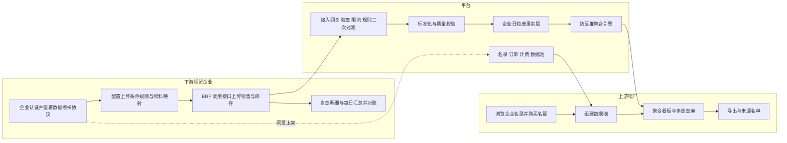
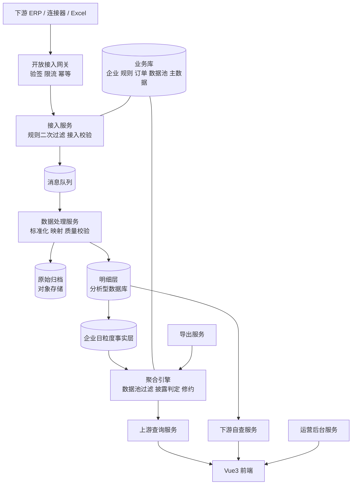

---
cursor:
  subagentId: "bc-231b2ae0-3297-531b-abc4-80bfa9280d3d"
---

# 钢贸上下游数据平台（货袋子平台·数据板块）需求文档

| 项 | 内容 |
|---|---|
| 文档版本 | V0.3（按 2026-11-25 原型评审规则修订） |
| 编写日期 | 2026-11-24 |
| 适用范围 | 货袋子平台新增“上下游数据板块”的产品功能需求、设计需求、技术方案约束 |
| 文档状态 | 部分已确认。第 21 章 24 项拍板事项中 12 项已确认、12 项待确认；已确认决策另引出 23 项新待确认事项（21.1 节）；2026-11-25 原型评审又确认 2 项规则并引出 5 项新待确认事项（21.2 节）；第 22 章 24 项货袋子现状问题均未答复 |

> **【已确认前提 D-01】** 原始需求中两次写到“上游企业”。业务方已于 2026-11-24 确认：
>
> - **下游钢贸企业（数据上传方）≥ 20,000 家**；
> - **上游钢厂（数据购买方）≥ 500 家**。

**修订记录**

| 版本 | 日期 | 内容 |
|---|---|---|
| V0.1 | 2026-11-24 | 需求评审稿 |
| V0.2 | 2026-11-24 | 按业务方决策修订（决策记录见同目录 `project-context.md`）。已确认 D-01、D-02、D-03、D-05、D-06、D-07、D-08、D-14、D-19、D-20、D-23、D-24。其中三项与原建议不同并已贯穿全文：D-06 下游可选上传价格和金额；D-19 行级与按日汇总两种上传粒度并存；D-24 全品类起步。D-02 新增收益分成 |
| V0.3 | 2026-11-25 | 按原型评审中确认的两项规则修订（记录见同目录 `project-context.md`）。R-01：订阅期内加购名额从新增下游企业生效日起计费，下单到生效之间不收费，新增企业仍在下一个数据池调整周期生效。R-02：价格功能未对上游开放时，选购名录和数据来源企业名单中的“是否提供价格数据”字段隐藏，开放后显示，UP-01 与 UP-70 的冲突按此统一。新增 8.9、21.2 和 BL-21 至 BL-23、N-24 至 N-28；修订条目见 21.2 |

**V0.2 修订约定**：原有章节编号、小节编号、需求编号均未改动。新增内容一律追加为各章末尾的新小节（3.12–3.14、6.8、7.7–7.9、8.7–8.8、9.8–9.9、10.4、12.7、14.6、16.3、21.1）或使用新的需求编号。少数原有需求的优先级随决策调整，已在该行注明。3.6 的小节标题随 D-06 改写，编号不变。

**V0.3 修订约定**：同样不改动任何原有编号。新增小节 8.9、21.2；被修订的原有条目在该处以“V0.3”标出。R-01、R-02 是本文档为两项评审规则自编的引用编号。

**阅读指引**

- 需求编号规则：`UP` 上游侧、`DN` 下游侧、`OP` 运营后台、`BL` 计费订单、`PV` 防反推、`MD` 主数据、`DQ` 数据质量、`API` 接口、`NFR` 非功能、`SEC` 安全合规、`INT` 平台融合。
- 优先级：**P0** 一期必须；**P1** 二期；**P2** 三期及以后。
- 文中“建议值”均为可在运营后台配置的参数默认值，不是写死的常量。
- 标注 **【行业判断】** 的内容，是从钢厂运营排产、营销管理经验出发对原始需求做的补充或矛盾判断。
- 标注 **【已确认 D-xx】** 的内容业务方已决策；标注 **【待拍板 D-xx】** 的内容仍待决策，暂按建议值设计；标注 **【新增待确认 N-xx】** 的内容由已确认决策引出。三类事项汇总在第 21 章。标注 **【已确认 R-xx】** 的内容是 2026-11-25 原型评审中确认的规则，见 21.2。

---

## 1. 背景、目标与范围

### 1.1 背景

货袋子平台已有业务不含“上下游数据服务”。本板块要在钢厂与钢贸商之间建立一个**数据中介**：下游钢贸企业通过 ERP 接口上传销售与库存数据；上游钢厂付费查看其所选下游企业的**聚合**数据，用于判断区域需求、渠道库存和资源投放。

### 1.2 双边价值主张

| 角色 | 核心诉求（行业视角） | 平台提供 |
|---|---|---|
| 上游钢厂（付费方） | 排产与资源投放缺少“社会库存、渠道动销”的真实样本；目前依赖经销商手工报表和第三方资讯样本，口径不一、滞后、不可下钻 | 按地区 × 品类规格的销量、库存聚合数据，可查询、可导出、可知样本构成 |
| 下游钢贸企业（数据提供方） | 担心钢厂借数据查窜货、压返利、绕过自己直供终端；担心同行看到自己的客户与量价 | 上传范围、上传粒度、是否上传价格都由自己定；上传内容自己可查；对外只以聚合形态出现；可随时暂停或退出；获得免费行业对标和收益分成 |
| 平台（货袋子） | 新增可持续收入；增强两端用户粘性 | 向上游按“下游企业数”收费，并按规则向下游分成 |

### 1.3 范围

**本期范围内**

- 下游数据接入（开放 API、上传条件规则、自查与每日汇总）；支持单据行级和按日汇总两种上传粒度（D-19）。
- 钢材成品全品类的销量、库存数据（D-24）；下游自愿上传的销售成交价格与金额（D-06）。
- 上游数据消费（聚合看板、多维查询、导出、数据来源企业名单、价格聚合指标）。
- 交易闭环（企业名录选购、批量购买、订单、支付、发票、续费）。
- 下游收益分成的计提、展示与结算（D-02）。
- 运营后台、主数据标准化、数据质量、防反推引擎。
- 与货袋子平台的账号、企业认证、权限、支付、菜单对接。

**本期范围外（建议）**

- 成本、毛利、库存金额，以及报价、意向价等未成交价格的采集与展示（理由见 3.6）。
- 终端客户名称等客户身份信息的采集（理由见 3.5）。
- 钢坯、生铁、废钢、铁合金等原料类商品（见【新增待确认 N-10】）。
- 基于数据的预测、定价建议等智能分析（可作为三期增值能力）。
- 下游企业之间的数据交易。

### 1.4 成功标准（建议的验收口径）

| 维度 | 指标 |
|---|---|
| 供给 | 稳定上传（近 30 日上传天数 ≥ 20）的下游企业数、覆盖的地级市数、覆盖的品类数 |
| 需求 | 付费钢厂数、在订名额数（企业·月）、续费率 |
| 数据质量 | 分品类的标准映射率、上传及时率、校验通过率、选填字段（流向地、客户类型、价格）填报率 |
| 信任 | 下游企业主动暂停或退出率、数据相关投诉数、反推测试用例通过率 100% |

---

## 2. 术语

| 术语 | 定义 |
|---|---|
| 上游 / 购买方 | 钢铁生产企业（钢厂），付费查看聚合数据 |
| 下游 / 提供方 | 钢贸企业，通过 ERP 上传销售、库存数据 |
| 企业名录 | 已同意上架、可被上游选购的下游企业清单及其画像 |
| 名额 | 计费单位。1 个名额在 1 个计费周期内对应 1 家下游企业的数据使用权 |
| 数据池 | 某上游企业当前已购且生效的下游企业集合，是其所有聚合计算的范围 |
| 单元格 | 一次查询中由一组维度取值确定的一个聚合结果（如“苏州 × 螺纹钢 Φ16–25 × 2026-11-20 的销量”） |
| 贡献企业数 | 对某单元格数值有非零贡献的下游企业数量 |
| k 门槛 | 单元格可披露所需的最小贡献企业数 |
| 优势度 | 单元格中最大一家（或前两家）企业贡献占单元格总量的比例 |
| 屏蔽 | 单元格不满足披露条件时不展示数值的处理 |
| 上传条件规则 | 下游企业自行配置的、决定哪些数据可以上传到平台的条件 |
| T+1 | 业务日期的数据在次日对上游可见 |
| 旬 | 钢铁行业常用统计周期，每月上、中、下旬 |
| 行级模式 | 下游按销售出库单据的每一行上传 |
| 日汇总模式 | 下游在 ERP 侧先按日和规定维度汇总，再上传汇总记录，平台不接收单据 |
| 有价样本 | 某单元格内上传了价格或金额的那部分销售数据 |
| 加权均价 | 有价样本的含税金额合计 ÷ 有价样本的结算重量合计，单位元/吨 |
| 名额日台账 | 按“名额 × 自然日”记录该名额当天对应哪家下游企业、是否生效、对应多少实收金额，是收入确认和分成计提的依据 |
| 收益分成 | 平台把上游支付的数据服务费按规则分给被订阅的下游企业 |

---

## 3. 对原始需求的关键判断（行业视角）

本章集中写明对原始需求的补充和矛盾判断。每项包含：问题、理由、建议方案。

### 3.1 “能看到数据来源企业”与“看不到单家企业详情”存在反推风险

**问题**：若上游既知道数据来自哪几家，又能任意切片，就可以把聚合数拆回单家。典型手法：

1. **小池反推**：只买 1–3 家，聚合数等于或接近单家数。
2. **差分反推**：先看 A、B、C、D、E 五家合计，再把 E 换成 F，或用“全部”减“除某市以外”，两次结果相减得到单家或单市数据。
3. **维度穷举**：池内只有一家企业在兰州有仓库，筛选“兰州”即为该企业数据。
4. **优势度反推**：池内 20 家中 1 家占 90% 的量，聚合数基本就是这家的数。
5. **成员关系泄露**：如果每个单元格都列出贡献企业名称，筛选“竞品品牌 × 某地区”就能直接看到“哪些代理商在卖竞品、在跨区销售”。**这恰恰是钢贸商最怕的窜货稽查场景**，即使不暴露任何数值，名单本身就是敏感信息。
6. **结合自有信息**：钢厂掌握自己发给每家代理商的发货量，可与聚合数交叉推断。

**建议方案**（细则见第 9 章）：

- “数据来源企业名单”只在**数据池级别**展示（“你的数据来自这 N 家”），**单元格级别只展示贡献企业数区间**，不展示名称。
- 设最小数据池规模、单元格 k 门槛、优势度门槛、补充屏蔽、数据池变更约束、数值修约、查询审计七道防线。
- 残余风险（第 6 种）无法靠技术完全消除，通过合同约束（禁止再识别条款及违约责任）和下游知情同意处理。

### 3.2 “上游自选企业”要求下游身份在购买前可见，必须取得下游的上架同意

**理由**：上游要“看哪些家的数据就付哪些家的费”，就必须在购买前看到候选企业。企业名称出现在名录里本身是一次对外披露。

**建议方案**：下游入驻时在《数据授权协议》中选择上架方式：**实名上架** / **匿名上架**（只展示地区、主营品类、规模档等画像，不展示名称）/ **定向可见**（只对指定钢厂可见；“对指定钢厂不可见”不在本次确认范围内，暂列二期）。名录画像一律采用**企业自主申报并确认**的信息，不由上传数据自动推导后直接展示。**【已确认 D-03】** 由下游在实名上架、匿名上架、只对指定钢厂可见三种方式中自选。

### 3.3 “下游可自设上传条件”会削弱数据代表性，需要让上游知情

**理由**：下游若只上传部分品类、部分仓库，上游看到的“销量”不是该企业的全量。钢厂做资源投放判断时若把部分样本当全量，会误判。

**建议方案**：

- 名录中展示粗粒度的“数据覆盖声明”（覆盖哪些大类、是否全量），不展示规则细节。**【待拍板 D-10】**
- 看板固定标注“本数据为所购样本企业上传数据的聚合，不代表区域全市场”。
- 平台提供企业级“数据质量与连续性评级”，作为上游选购依据。

### 3.4 原始需求未提下游的上传动力，这是业务能否启动的首要风险

**理由**：下游承担改造 ERP 的成本和数据泄露的心理风险，但收费只面向上游。20,000 家规模靠“放心”不够，需要“有利”。

**【已确认 D-02】** 采用三项激励组合：钢厂带动经销商入驻、免费行业对标数据、收益分成。

| 方案 | 说明 | 适用 | 状态 |
|---|---|---|---|
| 钢厂带动 | 钢厂邀请自己的经销商入驻并上传，写入年度代理协议的数据报送条款。行业内钢厂向代理商要进销存报表本就是常规做法，平台把手工报表变成接口 | 冷启动主路径 | 已确认 |
| 对标回馈 | 下游免费获得“本企业 vs 所在区域聚合水平”的对标看板（同样受 k 门槛保护） | 所有下游 | 已确认提供；提供时点与范围见【新增待确认 N-22】 |
| 收益分成 | 上游支付的数据服务费按规则分给被订阅的下游企业。模型见 8.7，行业判断见 3.14 | 所有被订阅的下游 | 已确认；比例等参数待定 |
| 平台权益 | 与货袋子现有业务挂钩的权益 | — | 本次未采纳 |

### 3.5 不采集客户名称，改采“客户类型”和“流向地区”

**理由**：

- 客户名单是钢贸商的核心商业秘密，采集会直接劝退。
- 但只有销量没有流向，对钢厂价值有限。钢厂最关心的是**货最终去了哪个区域、去了终端还是在贸易商之间流转**。
- 贸易商之间的转手交易（一批货在同一仓库内多次过户）会使“销量”虚增。若池内既有一级代理又有二级分销，同一批货会被计多次。

**建议方案**：销售数据不含客户名称，但包含可选字段 **客户类型**（终端 / 贸易商）、**下游行业**（房建、基建、机械、汽车、家电等）、**流向地区**（收货地，到地级市）。看板提供“终端销量”和“流通销量”两个口径。**【已确认 D-07】** 三个字段均为选填，填报率计入数据质量评分。

### 3.6 价格和金额：下游可选上传（已确认，与原建议不同）

**【已确认 D-06】** 下游可以选择上传价格和金额。原建议是一期不采集，现按决策调整，并保留原判断中的两项风险作为设计约束。

**仍然成立的两项风险**：

- 价格是下游最敏感的数据。强制或默认上传会降低整体上传意愿。
- 平台向存在竞争关系的多家钢厂提供成交价格信息，存在《反垄断法》下“为经营者达成垄断协议提供实质性帮助”的合规风险。风险随数据的即时性、细颗粒度、可归属到具体企业的程度上升。

**【行业判断】** 钢材“价格”不是一个数，不统一口径就不可比。同一天同一规格的成交价会因以下条件不同而相差几十到上百元每吨：是否含税、理计还是磅计、仓库自提价还是送到价（含运费）、现款还是账期（含资金成本）、是否为后结算的暂估价。

**方案**：

| 方面 | 设计 | 位置 |
|---|---|---|
| 自愿原则 | 价格上传默认关闭，由下游企业管理员主动开启；可按品类、品牌、仓库限定上传价格的范围；可随时关闭 | 7.7 |
| 采集范围 | 只采集销售成交的单价与金额。不采集成本、毛利、库存金额、报价 | 12.3、12.7、【新增待确认 N-01】 |
| 口径字段 | 是否含税、价格条件（自提 / 送到）、是否暂估价、计重方式，随价格一并上传。默认聚合口径为含税、自提、非暂估 | 12.3、附录 A、【新增待确认 N-05】 |
| 上游指标 | 只提供加权均价及其涨跌、价格覆盖率区间。不提供金额合计、最高最低价、价格分布 | 6.8 |
| 防反推 | 价格指标采用比量指标更严的门槛，并禁止通过“总销量 − 有价销量”反推未上传价格企业的销量 | 9.8 |
| 合规缓解 | 上游价格指标设法务闸口，默认关闭，取得法务意见后由运营后台开启；延迟披露、修约、竞品品牌合并、合同禁止用于协同定价 | 16.3、【新增待确认 N-02】 |

### 3.7 “地区”需要明确口径

**理由**：“各地区的销售量”至少有三种理解：企业注册地、出库仓库所在地、货物流向地。三者对钢厂的意义不同：仓库所在地反映**渠道库存分布**，流向地反映**终端需求分布**。钢材跨市、跨省销售普遍，三者差异很大。

**建议方案**：

- 销量默认按**出库仓库所在地**统计（必填、最可靠），同时支持按**流向地**统计（选填，填报率作为质量指标）。
- 库存按**仓库所在地**统计。
- 行政区划采用国家标准代码，到地级市；并支持上游自定义“销售大区”分组（各钢厂的大区划分不同）。

**【已确认 D-20】** 销量默认按仓库所在地统计，支持切换到流向地。

### 3.8 销量与库存需要统一统计口径

| 口径问题 | 建议 |
|---|---|
| 上传粒度 | 行级与日汇总两种模式并存（D-19）。两种模式在“企业日粒度事实层”归一，上游看到的口径完全相同（见 3.12） |
| 价格口径 | 加权均价默认按含税、自提、非暂估的有价样本计算（见 3.6、附录 A） |
| 销量按订单还是按出库 | 以**销售出库（实提）**为主口径；退货冲减。订单口径不采集 |
| 计重方式 | 螺纹钢等品种存在理计与磅计差异。上传 ERP 结算重量并带计重方式标识，一期不做换算，只在口径说明中标注 |
| 库存类型 | 主口径为**货权属于本企业的账面实物库存**；可选拆分“已售未提”“在途”。代管他人货物不计入 |
| 库存采集方式 | **每日日末全量快照**（按仓库 × 物料）。不靠出入库流水反算，避免期初不准和漏单 |
| 时间粒度 | 日、周、**旬**、月。旬是钢厂定价与结算的常用周期 |
| 同比环比失真 | 新接入企业没有去年数据，同比会虚高。二期提供“固定样本”口径 |

### 3.9 品牌（钢厂）维度是价值最高也最敏感的维度

**理由**：钢厂最想看“本厂资源在各区域的动销与渠道库存”以及“竞品份额”。但对下游，按品牌切片会暴露其代理结构；对其他钢厂客户，自家品牌销量被竞争对手查看会引发抵触；对平台，有 3.6 所述合规风险。

**【已确认 D-08】** 本厂品牌实名展示，其他品牌合并为“其他品牌”。该规则同样适用于价格指标：上游只能看到本厂品牌均价和“其他品牌”合并均价，看不到任何一家竞品钢厂的品牌均价。

### 3.10 20,000 家下游多数是中小贸易商，IT 能力弱，只有开放 API 不够

**理由**：中小钢贸商普遍使用通用进销存或行业 ERP 的标准版，没有自研能力，无法自行对接 API。

**建议方案**：接入方式分三层，一期做第一层，二期起补齐：

1. 开放 API（有开发能力的企业或 ERP 厂商调用）。
2. ERP 厂商预置连接器（平台与主流钢贸 ERP 厂商合作，客户在 ERP 内一键开通）。
3. Excel 模板导入（兜底，适合过渡期和小微企业）。

具体合作哪些 ERP 厂商需结合货袋子现有下游用户的 ERP 分布确定。**【待拍板 D-13】**

### 3.11 购买资格需要限定

**理由**：如果贸易商也能以“上游”身份购买，就能看到同行的聚合数据；钢厂集团下属多个法人分别购买不同数据池，可以互相差分。

**建议方案**：购买资格限定为经认证的钢铁生产企业；同一集团的关联企业视为**同一购买主体**，共用一个数据池校验口径。**【待拍板 D-04】**

### 3.12 行级与日汇总两种上传粒度并存（已确认，与原建议不同）

**【已确认 D-19】** 单据行级和按日汇总两种粒度都支持，由下游自选。原建议是一期只做行级。

**【行业判断】** 日汇总模式让数据在离开企业前就失去单据形态，对下游的安全感提升明显，对中小贸易商的对接也更简单。代价有三项，需要用设计补上：

| 问题 | 理由 | 设计 |
|---|---|---|
| 同一天的数据被两种模式各传一次，销量翻倍 | 企业切换模式或多套系统并行时容易发生 | 粒度按“企业 + 来源系统”设置，按业务日期切换；同一来源系统同一业务日期只接受一种粒度（DN-82、DQ-11） |
| 平台无法对汇总数据做单据级校验 | 没有单据号就无法去重，也无法判断单笔异常 | 日汇总采用“按日整批替换”语义；增加批内维度唯一性、控制总数对账、相对自身历史的合理性校验（12.7、DQ-10） |
| 部分上传条件规则平台无法兜底 | 单笔吨位上下限、按客户或部门编码排除，只能在汇总之前执行 | 这类条件在日汇总模式下标注为“仅在 ERP 端执行”，平台二次过滤只覆盖汇总记录里存在的维度（DN-83） |

**口径一致性原则**：日汇总记录的维度不得粗于企业日粒度事实层的必备维度（日、仓库所在市、品名、材质、规格、钢厂）。两种模式的数据在事实层合并后，上游的任何出口都不区分、也不能按上传粒度筛选（PV-60）。最低维度要求是否放宽见【新增待确认 N-07】。

### 3.13 全品类起步（已确认，与原建议不同）

**【已确认 D-24】** 首批覆盖全品类。原建议是先做建筑钢材和热轧板卷。

**【行业判断】** 各品类的标准化难度差别很大。建筑钢材的牌号和规格只有几十种组合；优特钢和不锈钢的牌号在千级，同一钢种有国标、美标、日标、欧标多种写法，还带交货状态、表面等属性；管材和型钢的规格组合多，且常按支、米计量而不是按吨。如果要求所有品类上线时都做到规格级标准化，主数据会成为一期的瓶颈。

**方案：全品类接入，分级标准化**（细则见 10.4）

- 上线时所有品类都能上传、都能在**品名级**聚合披露。
- 标准化深度按品类分级推进：贸易量大、标准化程度高的品类先做到规格段，长尾品类先做到品名或材质级，再逐步加深。
- 上游可查询的最细粒度随该品类的标准化深度开放，未达到的层级不提供下钻。

**连带影响**：

- 品类越多，单元格越稀疏。特钢、不锈钢等品类在单个城市往往只有几家贸易商，屏蔽率会明显高于建材。这些品类的默认披露粒度应更粗（如到省、到旬或月），见 PV-61。
- 数据质量规则必须分品类配置（规格取值范围、单行吨位上限、价格合理区间、计量单位），见第 11 章。
- “全品类”的边界需要明确，见【新增待确认 N-10】。

### 3.14 收益分成（已确认，新增）

**【已确认 D-02】** 下游激励包含收益分成。分成比例等数值由业务方另行确定，本文档只定义结构（8.7）。

**【行业判断】** 分成会带来四个需要提前设计的问题：

| 问题 | 理由 | 设计 |
|---|---|---|
| 刷量和造假 | 上传即有收益，会诱发编造数据或拆分主体多开账号 | 设分成资格门槛，分成与质量评级挂钩，可冻结和追回（BL-16、DQ-09 提前到二期） |
| 分成金额泄露上游信息 | 若按上游实付金额分成，下游可从每名额金额推断订阅方拿到的折扣档位，进而推断其购买规模 | 分成基数是按“实收摊分”还是按“目录价”需要拍板（【新增待确认 N-14】）；收益页面只显示订阅家数，不显示钢厂名称（与 D-05 一致） |
| 选择性上传与分成的矛盾 | 只上传少量数据也拿同样分成，对全量上传的企业不公平 | 设数据丰富度系数（是否全量、是否含流向与价格等），是否启用见【新增待确认 N-15】 |
| 财税处理 | 平台向下游付款需要对方开票，涉及税务和付款流程 | 结算单确认、开票、对公付款的流程见 8.7；税务处理见【新增待确认 N-17】 |

---

## 4. 角色与权限

### 4.1 角色定义

| 侧 | 角色 | 主要权限 |
|---|---|---|
| 上游企业 | 企业管理员 | 成员与角色管理、购买与续费、数据池调整、查看全部数据、导出 |
| 上游企业 | 数据分析员 | 看板、多维查询、导出（受配额约束）、保存查询方案 |
| 上游企业 | 只读成员 | 看板与查询，不可导出 |
| 上游企业 | 财务 | 订单、支付、发票，不可看数据 |
| 下游企业 | 企业管理员 | 签署授权协议、上架方式、成员管理、暂停与退出；开关价格上传、选择上传粒度（V0.2 新增） |
| 下游企业 | 数据管理员 | 上传条件规则、物料映射、查看每日汇总与明细、对账 |
| 下游企业 | 接口对接员 | 应用密钥、IP 白名单、沙箱调试、查看接口日志，默认不可看业务明细 |
| 下游企业 | 只读成员 | 查看每日汇总 |
| 下游企业 | 财务（V0.2 新增） | 收益总览、结算单确认、开票、收款账户；不可看业务明细 |
| 平台 | 运营 | 企业审核、名录管理、接入辅导、断传跟进 |
| 平台 | 主数据管理员 | 品类、材质、规格、钢厂、地区、仓库字典及映射审核 |
| 平台 | 数据质量专员 | 质量监控、异常数据隔离与处置 |
| 平台 | 财务 | 定价、订单、对公到账核销、发票、退款、分成结算 |
| 平台 | 安全审计员 | 审计日志、防反推参数、异常查询处置。与运营角色互斥 |
| 平台 | 超级管理员 | 系统配置与授权 |
| 第三方 | ERP 服务商（P2） | 代多家下游企业管理接入，需逐家获得企业授权 |

### 4.2 权限设计要求

| 编号 | 需求 | 优先级 |
|---|---|---|
| AUTH-01 | 采用“企业（租户）+ 角色 + 数据范围”三层权限。所有数据访问强制带企业标识，后端校验，不信任前端参数 | P0 |
| AUTH-02 | 一家企业可同时具有上游、下游身份（如钢厂的销售子公司）。两种身份的菜单与数据完全隔离，切换身份需显式操作 | P0 |
| AUTH-03 | 关联关系管理：同一集团的企业登记为关联企业。购买主体按集团归并；钢厂关联的贸易公司在名录中标注“关联企业” | P1 |
| AUTH-04 | 平台人员默认**不可查看下游企业上传明细**。排障需要时走工单申请，下游企业授权后限时开放，全程留痕并在下游侧可见 | P0 |
| AUTH-05 | 上游成员的导出、数据池调整等敏感操作支持二次验证（短信或企业管理员审批），可配置 | P1 |
| AUTH-06 | 账号、企业认证、基础角色体系复用货袋子平台，本板块只扩展板块内角色和数据权限（见第 17 章） | P0 |
| AUTH-07 | 下游侧“查看价格与金额”为独立权限点，默认只授予企业管理员，可由其授予数据管理员。未授权成员在明细和汇总中看不到价格列 | P0 |
| AUTH-08 | 下游侧收益、结算单、收款账户只对企业管理员和财务可见；修改收款账户需二次验证 | P1 |

---

## 5. 业务流程总览

主流程说明：

1. **下游入驻**：认证 → 签协议并选择上架方式 → 选择上传粒度（行级或日汇总）和是否上传价格 → 申请应用密钥 → 沙箱联调 → 配置规则与映射 → 正式上传。
2. **数据处理**：接入网关验签、限流 → 按企业规则二次过滤 → 标准化映射 → 质量校验 → 写入明细层（行级表或日汇总表）→ 每日生成企业日粒度事实（两种粒度在此归一）→ 供聚合引擎使用。
3. **上游购买**：认证 → 浏览名录 → 选企业或买名额包 → 池可用性预估 → 下单支付 → 数据池生效。
4. **上游使用**：看板 → 多维查询 → 导出 → 查看数据池来源名单。
5. **持续运营**：断传预警、名额补偿、续费提醒、数据池周期调整。
6. **收益分成**（V0.2 新增）：名额日台账按日记录 → 按周期计提各下游企业的分成 → 生成结算单 → 下游确认并开票 → 平台对公付款。

---

## 6. 上游侧功能需求

### 6.1 企业名录与选购

| 编号 | 需求 | 优先级 |
|---|---|---|
| UP-01 | 名录列表：展示已上架下游企业。字段：企业名称（匿名上架显示为编号，如“华东·建材·A0321”）、所在省市、主营大类、规模档（企业自主申报的年销量区间）、数据覆盖声明、接入时长、数据质量评级、近 3 个月活跃等级。另有“是否提供价格数据”一列（企业确认后的申报信息）：**仅在价格功能已对上游开放（UP-70 闸口开启）时显示，未开放时隐藏**（V0.3，已确认 R-02） | P0 |
| UP-02 | 名录筛选：地区、主营大类、代理品牌（企业自主申报）、规模档、质量评级、接入时长、是否已在我的数据池中 | P0 |
| UP-03 | 名录中**不展示**任何由上传数据计算的企业级数值（销量、库存、每日是否上传）。活跃度只给月度等级（活跃 / 一般 / 停更），不给日级状态 | P0 |
| UP-04 | 购物清单：勾选企业加入清单，实时显示已选家数、适用价格阶梯、应付金额 | P0 |
| UP-05 | 池可用性预估：下单前按“已选企业 + 现有数据池”预估**标准维度组合下可披露单元格比例**，并提示“再增加 X 家某地区企业可使该地区可披露”。不展示任何实际数值 | P1 |
| UP-06 | 条件圈选：按筛选条件一键全选（如“江苏省全部建材类企业”），配合名额包使用 | P0 |
| UP-07 | 平台预置组合包：按区域、品类编排的推荐组合（如“华东建材样本包”），由运营维护 | P1 |
| UP-08 | 上游可提交“希望接入的企业”线索（如自己的经销商名单），由平台运营跟进邀请 | P1 |

### 6.2 数据池管理

| 编号 | 需求 | 优先级 |
|---|---|---|
| UP-10 | 数据池页面：展示当前生效企业名单（即“数据来源企业名单”）、每家的生效起止日期、状态、名额占用 | P0 |
| UP-11 | 数据池不满足最小规模（建议 20 家）时，不提供聚合数据，页面提示差多少家 | P0 |
| UP-12 | 数据池调整（替换、增加、减少）按第 9.5 节规则执行：按周期生效、成员按日期版本化、历史默认不重算。V0.3（已确认 R-01）：加购新增的企业同样在下一个调整周期生效；生效前在数据池页面以“待生效”列出并显示计划生效日，不参与聚合；计费见 8.9 | P0 |
| UP-13 | 数据池变更记录：每次变更的时间、操作人、变更企业数、生效日期 | P0 |
| UP-14 | 池内企业状态异常（断传、暂停、退出）时通知上游，并按 8.6 节规则补偿 | P0 |

### 6.3 聚合看板

| 编号 | 需求 | 优先级 |
|---|---|---|
| UP-20 | 概览：数据池企业数、数据日期、昨日销量、昨日日末库存、近 7 日日均销量、库存可销天数，以及各项的环比与同比 | P0 |
| UP-21 | 地区分布：省、市两级地图热力与排行，指标可切换销量、库存、可销天数 | P0 |
| UP-22 | 品类结构：大类 → 品名 → 规格段的销量与库存占比，可下钻 | P0 |
| UP-23 | 趋势：销量、库存的日、周、旬、月趋势，可叠加同比 | P0 |
| UP-24 | 本厂品牌视图：本厂品牌在各地区、各规格段的销量、渠道库存、可销天数，及占数据池总量的份额。其他品牌合并为“其他品牌”（已确认 D-08） | P0 |
| UP-25 | 流向视图：销量按流向地区、客户类型、下游行业分布。依赖下游填报率，页面显示填报覆盖率（已确认 D-07、D-20） | P1 |
| UP-26 | 自定义销售大区：把省市组合成本厂的销售大区，看板与查询可按大区聚合。大区内企业数仍受 k 门槛约束 | P1 |
| UP-27 | 预警订阅：对指定地区 × 品类的库存可销天数、销量环比设阈值，触达站内信、短信、邮件 | P2 |
| UP-28 | 所有图表固定展示：数据日期、样本企业数、口径说明、“样本聚合数据，不代表全市场”提示；被屏蔽的数据点显示为“—”并可悬停查看原因 | P0 |
| UP-29 | 数据池变更日在趋势图上显示“口径变更”标记 | P0 |

### 6.4 多维查询

| 编号 | 需求 | 优先级 |
|---|---|---|
| UP-30 | 维度：时间（日、周、旬、月、自定义区间）、仓库所在地（省、市）、流向地（省、市）、大类、品名、材质、规格段、品牌（本厂 / 其他）、客户类型、下游行业 | P0（流向地、客户类型、行业为 P1） |
| UP-31 | 指标：销量、库存量、日均销量、库存可销天数、环比、同比、贡献企业数区间、占比。价格类指标见 6.8 | P0 |
| UP-32 | 交互：维度拖拽为行、列，逐级下钻与上卷，排序，结果以表格和图表两种形式展示 | P0 |
| UP-33 | **不提供“按企业”维度，不提供按企业筛选或排除的条件** | P0 |
| UP-34 | 筛选只支持层级选择和多选包含，不支持“排除某项”。多选时，自身不满足披露条件的成员不计入结果并提示（规则见 9.4） | P0 |
| UP-35 | 保存查询方案、设为看板卡片、定时发送到邮箱（发送内容同样受导出规则约束） | P1 |
| UP-36 | 固定样本口径开关：只统计对比期和本期都有数据的企业。固定样本集合与全池的差集须为 0 或 ≥ k | P1 |
| UP-37 | 查询结果行数上限与分页；超过上限引导使用导出 | P0 |

### 6.5 导出

| 编号 | 需求 | 优先级 |
|---|---|---|
| UP-40 | 支持导出当前查询结果和看板数据，格式 Excel、CSV | P0 |
| UP-41 | 导出内容与页面展示完全一致：同样的屏蔽、修约、口径说明。不存在“导出能看到更细数据”的路径 | P0 |
| UP-42 | 大数据量导出异步生成，在“导出中心”下载，文件保留期可配置（建议 7 天） | P0 |
| UP-43 | 导出文件带水印信息（企业、账号、时间、导出编号）和使用条款页 | P0 |
| UP-44 | 导出配额：按企业、按账号设日次数与行数上限，超限需企业管理员审批 | P1 |
| UP-45 | 数据来源企业名单可导出，内容只有名单及画像字段，不含任何数值。V0.3：导出的画像字段与页面一致，“是否提供价格数据”同样只在 UP-70 闸口开启时导出 | P0 |
| UP-46 | 面向钢厂自有 BI 系统的聚合数据拉取接口，规则同导出 | P2 |
| UP-47 | 所有导出记录审计日志：谁、何时、查询条件、行数、文件指纹 | P0 |

### 6.6 数据来源企业名单

| 编号 | 需求 | 优先级 |
|---|---|---|
| UP-50 | 数据池级名单：展示全部在池企业的名称（或匿名编号）、地区、主营大类、覆盖声明、生效期。V0.3（已确认 R-02）：UP-70 闸口开启时增加“是否提供价格数据”一列，闸口关闭时隐藏 | P0 |
| UP-51 | 单元格级只展示**贡献企业数区间**（如 5–9、10–19、20–49、50+），不展示名称，不展示精确家数 | P0 |
| UP-52 | 看板和导出文件的口径说明中列出“本数据池共 N 家企业，名单见数据池页面” | P0 |

**设计理由**：见 3.1。精确家数配合新企业加入时间也可用于差分，因此用区间。

### 6.7 订单与账务（上游视角）

| 编号 | 需求 | 优先级 |
|---|---|---|
| UP-60 | 我的订单：订单列表、详情、支付状态、合同下载 | P0 |
| UP-61 | 名额总览：已购名额数、已分配数、未分配数、各批次到期日。V0.3：另列待生效名额数及其计划生效日（即计费起始日） | P0 |
| UP-62 | 续费与扩容：到期前提醒（建议提前 30、7、1 天），一键续费，周期内加购名额。V0.3（已确认 R-01）：加购从新增企业生效日起计费，下单到生效之间不收费；下单页展示计划生效日、计费起止日、计费天数和应付金额（8.9、BL-21） | P0 |
| UP-63 | 发票申请与下载 | P0 |
| UP-64 | 试用：未购买时可查看基于模拟数据的演示看板。不提供真实数据试用（已确认 D-23） | P0 |

### 6.8 价格聚合指标（V0.2 新增，对应 D-06）

价格指标只基于下游自愿上传的有价样本。防反推规则见 9.8，合规要求见 16.3。

| 编号 | 需求 | 优先级 |
|---|---|---|
| UP-70 | 功能闸口：上游侧全部价格功能由运营后台的统一开关控制，**默认关闭**。关闭时上游侧不显示任何价格入口、指标和导出列。V0.3（已确认 R-02）：闸口范围包含选购名录（UP-01）、数据来源企业名单（UP-10、UP-50）及其导出（UP-45）中的“是否提供价格数据”字段，关闭时该字段隐藏，也不提供按它的筛选和排序；由后端控制，关闭时接口不返回该字段。闸口开启后显示，再次关闭后恢复隐藏。开启条件见【新增待确认 N-02】 | P0 |
| UP-71 | 指标范围：加权均价（元/吨）、均价环比涨跌额与涨跌幅、价格覆盖率区间、有价企业数区间。**不提供**销售金额合计、最高价、最低价、价格分布、有价样本的精确销量 | P0 |
| UP-72 | 可用维度：时间（日、周、旬、月）、仓库所在地（省、市）、大类、品名、材质、规格段、品牌（本厂 / 其他品牌）。按客户类型（终端价与贸易商价）拆分为二期能力 | P0（客户类型为 P1） |
| UP-73 | 价格口径：默认含税、自提、非暂估。可按计重方式（理计、磅计）分别查看。送到价作为独立口径在二期提供，不与自提价混算 | P0（送到价为 P1） |
| UP-74 | 量价联动视图：同一图中展示销量与加权均价的趋势；展示本厂品牌均价与“其他品牌”合并均价的价差；可叠加库存可销天数 | P0 |
| UP-75 | 展示要求：价格取整到 10 元/吨；每个价格数旁显示价格覆盖率区间；固定提示“样本成交均价，不是市场报价”；被屏蔽的价格显示“—” | P0 |
| UP-76 | 导出、定时发送、数据拉取接口中的价格内容与页面完全一致，同样受闸口和防反推规则约束 | P0 |
| UP-77 | 若价格数据单独计价（【新增待确认 N-04】），未购买价格权益的上游不显示价格入口，并在入口位置提供购买引导 | P1 |
| UP-78 | 使用条款确认：上游成员首次进入价格视图须确认使用条款（不得用于与其他经营者协同定价，不得对外传播） | P0 |

说明：UP-70 至 UP-78 的优先级指功能建设的期次。即使一期建成，是否对上游开放仍取决于 UP-70 的闸口。

---

## 7. 下游侧功能需求

### 7.1 入驻与授权

| 编号 | 需求 | 优先级 |
|---|---|---|
| DN-01 | 复用货袋子企业认证；本板块另需在线签署《数据授权协议》，明确数据权属、使用范围、聚合披露规则、撤回权利 | P0 |
| DN-02 | 上架设置（已确认 D-03）：实名上架 / 匿名上架 / 只对指定钢厂可见，三种方式由下游自选。“对指定钢厂不可见”（黑名单）不在已确认范围内，暂列二期。“不上架（只上传不出售，仅用于自身对标）”是否保留见【新增待确认 N-21】 | P0（V0.2 调整：只对指定钢厂可见由 P1 提前到 P0；黑名单为 P1） |
| DN-03 | 企业画像自主申报：所在地、主营大类、代理品牌、规模档、覆盖声明、是否提供价格数据。上架前企业确认，修改需重新确认。V0.3（已确认 R-02）：“是否提供价格数据”在价格功能对上游开放之前不对上游展示，下游侧画像页在该项旁标明“暂不对上游展示” | P0 |
| DN-04 | 入驻引导：分步清单显示完成进度（认证 → 协议 → 粒度与价格设置 → 密钥 → 联调 → 规则 → 映射 → 首次上传） | P0 |

### 7.2 ERP 接口接入

| 编号 | 需求 | 优先级 |
|---|---|---|
| DN-10 | 应用管理：创建应用，获取应用标识和密钥；密钥只在创建时完整展示一次；支持轮换（新旧并行期可配置）和停用 | P0 |
| DN-11 | IP 白名单配置（可选开启） | P0 |
| DN-12 | 沙箱环境：独立地址和密钥，数据不进入正式库；提供在线调试页、示例报文、签名校验工具 | P0 |
| DN-13 | 接口文档中心：在线文档、字段字典、错误码、变更日志；Java 和 .NET 示例代码 | P0 |
| DN-14 | 接口调用日志：近 N 天每次调用的时间、接口、批次号、条数、结果，可按批次查看逐行处理结果 | P0 |
| DN-15 | Excel 模板导入：下载模板、上传、预校验、确认入库。与接口走同一套规则过滤与质量校验 | P1 |
| DN-16 | ERP 厂商连接器：厂商在 ERP 内集成，企业在平台授权某连接器代为上传 | P1 |
| DN-17 | 多 ERP 来源：一家企业可登记多个来源系统（如总部和分公司用不同 ERP），按来源系统区分幂等键 | P1 |

### 7.3 上传条件规则配置

**【行业判断】** 规则在哪里执行决定了下游的安全感。“ERP 发了全部数据、平台说没存”不如“不符合条件的数据根本没离开企业”。建议双层执行：

- **源头过滤（推荐）**：ERP 或连接器调用规则拉取接口，在本地过滤后只发送符合条件的数据。
- **平台入口二次过滤（兜底）**：接入网关在落库前按同一规则再过滤一次。不符合规则的数据**不落盘**，只记录被过滤条数用于汇总展示。

| 编号 | 需求 | 优先级 |
|---|---|---|
| DN-20 | 规则按数据类型分别配置：销售、库存 | P0 |
| DN-21 | 可用条件维度：大类、品名、材质、规格范围、品牌（钢厂）、仓库、仓库所在地、流向地、客户类型、业务日期起点（只上传某日之后的数据）、单笔吨位上下限。日汇总模式下各条件的执行位置见 DN-83；价格字段的上传范围单独在 7.7 配置 | P0 |
| DN-22 | 规则模式：白名单（只上传符合条件的）和黑名单（排除符合条件的）；多条规则可组合，优先级为“排除优先” | P0 |
| DN-23 | 按 ERP 内部编码排除：可填入 ERP 的客户编码、部门编码、业务员编码清单，匹配到的单据不上传。平台只保存这些编码的不可逆摘要，接口不接收对应的名称 | P1 |
| DN-24 | 规则试算：保存前显示“按新规则，近 7 日已上传数据中将有 X 条、Y 吨不再上传”，或上传样例文件试算 | P0 |
| DN-25 | 规则版本与生效：每次修改生成新版本，可指定生效时间；版本历史可查、可回滚 | P0 |
| DN-26 | 规则变更只影响生效后上传的数据。是否同时清理已上传的历史数据由企业单独操作（见 DN-45） | P0 |
| DN-27 | 规则模板：提供“全量上传”“仅建材”“仅指定品牌”“仅指定仓库”等预置模板 | P1 |
| DN-28 | 规则变更导致覆盖范围明显变化时，提示企业同步更新名录中的覆盖声明 | P1 |
| DN-29 | 规则的任何变更写入审计日志，企业管理员可见 | P0 |

### 7.4 上传数据自查

| 编号 | 需求 | 优先级 |
|---|---|---|
| DN-30 | 明细查询：按业务日期、上传日期、数据类型、单据号、仓库、品名、材质、规格、品牌、状态（已入库、校验失败、待映射、已作废）查询本企业上传的数据。行级模式展示单据行；日汇总模式展示汇总记录，无单据号（见 DN-86）。有权限的成员可见价格与金额列（见 DN-75） | P0 |
| DN-31 | 明细同时展示“原始上传值”和“平台标准化后的值”（如 ERP 品名 → 标准品名），让企业知道平台如何理解其数据 | P0 |
| DN-32 | 批次查询：每个上传批次的接收条数、入库条数、过滤条数、失败条数及失败原因，可下载失败明细 | P0 |
| DN-33 | 本企业数据导出（Excel、CSV），仅本企业授权角色可操作 | P0 |
| DN-34 | 手动作废：对已上传的单条或批量记录发起作废，作废后不再参与后续聚合计算。仅适用于行级模式；日汇总模式通过重传当日批次更正（见 DN-85） | P1 |

### 7.5 每日上传汇总

| 编号 | 需求 | 优先级 |
|---|---|---|
| DN-40 | 日汇总页：选定日期，展示当日上传批次数、接收条数、入库条数与吨位、规则过滤条数、校验失败条数、待映射条数。页面标明当前上传粒度；日汇总模式下“条数”指汇总记录数，若上传了单据行数则一并展示。开启价格上传的企业另展示带价格的条数占比、金额合计、当日均价 | P0 |
| DN-41 | 日汇总分组：按品类、仓库、地区、品牌展示当日销量吨位和日末库存吨位；有价格权限的成员可见各分组的金额与均价 | P0 |
| DN-42 | 对账：ERP 可通过接口申报当日控制总数（条数、吨位、金额），平台与实际入库数比对，显示“一致 / 差异”及差异明细入口。日汇总模式没有单据级校验，对账是主要的完整性保障 | P0（V0.2 调整：由 P1 提前） |
| DN-43 | 日历视图：按月显示每天的上传状态（正常、部分失败、未上传），点击进入当日汇总 | P0 |
| DN-44 | 每日汇总推送：每日固定时间通过站内信、短信、邮件或微信推送摘要；未上传或失败率超过阈值时发告警 | P0（微信为 P1） |
| DN-45 | 月度报告：当月上传天数、总量、质量评分、被订阅情况 | P1 |

### 7.6 信任与安全感机制

| 编号 | 机制 | 说明 | 优先级 |
|---|---|---|---|
| DN-50 | 字段最小化 | 接口不设客户名称、业务员、成本、毛利字段，收到直接丢弃并提示。价格与金额字段仅在企业主动开启价格上传且在其设定范围内时才接收，否则同样丢弃不落盘（见 7.7） | P0 |
| DN-51 | 上游视角预览 | 下游可查看“钢厂能看到什么”的示例页面：只有聚合数、区间企业数、被屏蔽的单元格 | P0 |
| DN-52 | 披露规则公示 | 在下游侧固定入口公示当前生效的 k 门槛、优势度门槛、最小数据池规模。参数调整前通知全部下游 | P0 |
| DN-53 | 数据使用透明账本 | 展示本企业当前被多少家上游订阅、历史订阅变化。**【已确认 D-05】** 只显示订阅的钢厂家数，不显示名称 | P0 |
| DN-54 | 暂停上传 | 一键暂停，暂停期间接口拒收数据；已上传数据保留 | P0 |
| DN-55 | 退出与数据撤回 | 申请退出后停止对外提供，并按协议删除明细数据。已生成并已披露的历史聚合结果不回溯修改（见 **【待拍板 D-12】**） | P0 |
| DN-56 | 延迟披露 | 企业可选择本企业数据延迟若干天才进入聚合（建议可选 T+1、T+3、T+7） | P2 |
| DN-57 | 访问留痕可见 | 平台人员经授权查看本企业明细的每次记录，对企业可见 | P0 |
| DN-58 | 安全资质展示 | 展示平台安全等级保护备案、加密与审计措施、协议文本 | P0 |
| DN-59 | 行业对标看板 | 本企业销量、库存可销天数与所在地区、品类聚合水平的对比。对标群体同样须满足 k 门槛。已确认提供（D-02）；是否提前到一期、是否包含价格对标见【新增待确认 N-22】 | P1 |
| DN-60 | 收益查看 | 已确认采用分成（D-02）。展示被订阅名额数、应得收益、结算记录，详细需求见 7.9 | 见 7.9（V0.2 调整：由 P2 提前） |

### 7.7 价格与金额上传控制（V0.2 新增，对应 D-06）

| 编号 | 需求 | 优先级 |
|---|---|---|
| DN-70 | 价格上传开关：企业级，**默认关闭**。仅企业管理员可开启，开启时须阅读并确认价格数据授权条款（用途、披露形式、披露门槛） | P0 |
| DN-71 | 价格上传范围：开启后可按大类、品名、品牌、仓库限定哪些数据带价格。范围外的数据即使 ERP 传了价格字段，平台也丢弃不落盘 | P0 |
| DN-72 | 开关关闭时，接口收到价格、金额字段一律丢弃不落盘，并在批次结果中提示“价格字段未接收” | P0 |
| DN-73 | 披露用途选择：企业可选择价格“参与对上游的聚合披露”或“仅用于本企业自查与行业对标”（【新增待确认 N-06】） | P1 |
| DN-74 | 关闭与清除：可随时关闭，关闭后不再接收价格。可一键清除已上传数据中的价格与金额字段，销量数据保留。已披露的历史价格聚合不回溯修改 | P0 |
| DN-75 | 自查中的价格：明细、每日汇总中展示本企业上传的单价、金额、均价、带价格的条数占比。只有具备“查看价格与金额”权限的成员可见（AUTH-07） | P0 |
| DN-76 | 价格口径默认值：企业可设置本企业默认的是否含税、价格条件（自提 / 送到）、计重方式。接口未传对应字段时按默认值处理 | P0 |
| DN-77 | 上游视角预览中增加价格示例，说明价格只以加权均价和区间形式出现，且受更严的披露门槛保护 | P0 |
| DN-78 | 开关、范围、用途的每次变更写入审计日志并通知企业管理员 | P0 |

### 7.8 上传粒度（V0.2 新增，对应 D-19）

| 编号 | 需求 | 优先级 |
|---|---|---|
| DN-80 | 粒度选择：按“企业 + 来源系统”选择**行级模式**或**日汇总模式**。入驻引导中并列说明两者差异：上传什么、平台能看到什么、可用的规则条件、自查能看到什么 | P0 |
| DN-81 | 库存：库存本身是日末快照，两种模式的接口相同。日汇总模式下可只报仓库所在市，不报仓库编码与名称（【新增待确认 N-07】） | P0 |
| DN-82 | 防重复：同一来源系统、同一业务日期只接受一种粒度的销售数据，另一种粒度的数据拒收并返回明确错误码 | P0 |
| DN-83 | 规则适用性：规则配置页按当前粒度标识每个条件的执行位置，“ERP 端与平台双重执行”或“仅 ERP 端执行”。日汇总模式下，单笔吨位上下限、按内部编码排除只能在 ERP 端执行 | P0 |
| DN-84 | 粒度切换：切换须指定生效业务日期（不早于次日）。生效日之前的数据保持原粒度。切换记录留痕。切换频率限制见【新增待确认 N-09】 | P0 |
| DN-85 | 日汇总模式的更正：重传该业务日期的完整汇总批次，平台整批替换。不支持单条作废 | P0 |
| DN-86 | 自查差异：行级模式展示单据行；日汇总模式展示汇总记录及其来源批次。自查和每日汇总页面顶部显示当前粒度 | P0 |
| DN-87 | 上传粒度不作为上游的维度或筛选条件（PV-60）。是否在企业名录中展示见【新增待确认 N-08】 | P0 |

### 7.9 收益分成：下游侧（V0.2 新增，对应 D-02）

分成模型见 8.7。各项优先级按“计提与展示在一期、结算与付款在二期”暂定，见【新增待确认 N-20】。

| 编号 | 需求 | 优先级 |
|---|---|---|
| DN-90 | 收益总览：本期预计收益、待结算金额、累计已结算金额、当前被订阅家数 | P0 |
| DN-91 | 收益明细：按月展示被订阅的名额天数、订阅家数、适用系数、计提金额。**只显示订阅家数，不显示钢厂名称，不按钢厂拆分金额**（与 D-05 一致） | P0 |
| DN-92 | 规则说明：展示当前生效的分成规则（比例、系数、资格门槛、结算周期）。规则调整提前通知 | P0 |
| DN-93 | 结算单：按周期生成。状态：待确认、待开票、待付款、已付款、有异议、已冻结。下游可确认或提出异议 | P1 |
| DN-94 | 开票与收款账户：上传发票；维护对公收款账户，户名须与认证企业主体一致；修改账户需二次验证 | P1 |
| DN-95 | 提升收益指引：展示影响本企业分成的因素（质量评级、有效上传天数、选填字段填报率、是否上传价格等）及当前状态 | P1 |
| DN-96 | 资格状态：展示本企业是否满足分成资格，不满足时给出原因。被冻结或追回时展示原因和申诉入口 | P1 |
| DN-97 | 不上架的企业不参与分成，页面明确提示 | P0 |

---

## 8. 计费与订单模型

### 8.1 计费原则

- **只向上游收费**，计费依据是数据池内下游企业数量。
- 计费单位：**企业·周期**（1 个名额 = 1 家下游企业 × 1 个计费周期）。
- 采用**订阅制**而非一次性买断。理由：数据持续产生；订阅可随下游退出、断传做调整；便于续费收入预测。**【已确认 D-14】** 订阅制，年付为主，批量购买为名额包加数量阶梯。
- 平台按规则把部分收入分给被订阅的下游企业（**已确认 D-02**）。分成是平台的成本项，不改变上游的计费单位和购买流程。模型见 8.7。

### 8.2 商品形态

| 商品 | 说明 | 优先级 |
|---|---|---|
| 单选订阅 | 从名录中逐家选择，按家数 × 周期计费 | P0 |
| 名额包（批量购买） | 一次购买 N 个名额，有效期内自由分配给名录中的企业；N 越大单价越低 | P0 |
| 预置组合包 | 平台编排的区域或品类组合，整体定价 | P1 |
| 全量包 | 订阅全部已上架企业，新上架企业自动加入 | P1 |
| 试用 | 只提供模拟数据的演示看板，不提供真实数据试用（已确认 D-23） | P0 |
| 价格数据权益（V0.2 新增） | 上游查看价格聚合指标的权益。包含在名额价格内还是单独加价，见【新增待确认 N-04】 | 随 UP-70 闸口 |

### 8.3 价格结构（参数由业务方确定，【待拍板 D-15】）

应付金额 = Σ（名额数 × 周期数 × 该阶梯单价 × 企业等级系数）− 优惠

| 参数 | 说明 | 建议 |
|---|---|---|
| 基础单价 | 每名额每月价格 | 业务方定 |
| 周期 | 月、季、年 | 年付为主，给折扣 |
| 数量阶梯 | 按名额数分档折扣 | 档位示例：20–49、50–99、100–199、200–499、500–999、1000+ |
| 企业等级系数 | 头部样本企业可设更高系数 | 一期统一为 1，保留字段 |
| 最小购买量 | 首次购买的最少名额数 | 等于最小数据池规模（建议 20） |
| 历史数据深度 | 购买后可回看多久的历史 | 建议随订阅赠送 12 个月，更长另计 |
| 价格数据加价（V0.2 新增） | 查看价格指标是否加价及加价方式 | 待定（N-04） |

V0.2 说明：收益分成已确认，定价时需要把分成成本计入（见 8.8）。

### 8.4 订单与名额状态

**订单状态**：待支付 → 已支付（待生效）→ 生效中 → 已到期；分支：已取消、退款中、已退款。

**名额状态**：未分配 → 已分配（待生效）→ 生效中 → 冻结（对应企业暂停或断传）→ 已释放（可重新分配）→ 已到期。

V0.3 说明（已确认 R-01）：加购名额在“已分配（待生效）”期间不计费、不计提分成，对应企业的数据不进入聚合；加购订单在“已支付（待生效）”期间同理。计费起始日等于生效日（8.9）。

| 编号 | 需求 | 优先级 |
|---|---|---|
| BL-01 | 下单：支持购物清单下单和名额包下单；生成订单与电子合同 | P0 |
| BL-02 | 支付：在线支付走货袋子支付能力；支持对公转账（上传凭证，平台财务核销后生效）。钢厂采购以对公转账和合同付款为主 | P0 |
| BL-03 | 发票：增值税发票申请、开具状态、下载；能力优先复用货袋子 | P0 |
| BL-04 | 续费：到期前续费保持数据池不变；到期未续费则数据池失效，停止访问 | P0 |
| BL-05 | 周期内扩容（V0.3 按已确认 R-01 改写）：加购名额**从新增下游企业的生效日起计费，下单日到生效日之间不收费**；按日折算，计费天数为生效日至原订单到期日（含首尾）；到期日与原订单对齐。新增企业按数据池调整规则在下一个调整周期生效。细则见 8.9 | P0 |
| BL-06 | 降配：只能在续费时减少名额，下一周期生效 | P1 |
| BL-07 | 退款：未生效订单可全额退；已生效订单的退款规则由业务方确定并写入合同 | P0 |
| BL-08 | 优惠：折扣码、合同价（大客户一客一价），由运营后台配置 | P1 |
| BL-09 | 账单与对账：按月出具账单，支持导出 | P1 |
| BL-10 | 下游分成结算：已确认采用（D-02）。本条由 8.7 的 BL-11 至 BL-20 细化取代 | 见 8.7（V0.2 调整：由 P2 提前） |

### 8.5 名额分配与替换规则

- 名额包购买后可分批分配；未分配名额不延长有效期。
- V0.3 说明：把已购名额包内的未分配名额分配给企业不属于加购，不产生新费用；这些名额的费用自名额包订单生效日起已经计算，分配后同样在下一个调整周期生效。它与加购的计费起点不同，是否保持这一差别见【新增待确认 N-26】。
- 替换（把名额从企业 A 改给企业 B）受数据池变更规则约束（9.5 节）：按周期统一生效，不可随时替换。替换不产生新费用。
- V0.3（已确认 R-01）：增加（加购）同样按周期统一生效，计费自生效日起算（8.9）。加购是新增名额而不是替换，不占用下面的替换比例额度。
- 减少只能在续费时进行（BL-06）。
- 每周期可替换比例设上限（建议不超过在用名额的 20%），防止用“轮换”方式低成本遍历全部企业。**【待拍板 D-16】**

### 8.6 下游状态变化时的补偿规则

| 情形 | 判定 | 处理 |
|---|---|---|
| 下游断传 | 连续 N 天无有效上传（建议 N=10） | 名额冻结；上游可免费替换（不占替换额度），或剩余天数顺延 |
| 下游主动暂停 | 企业点击暂停 | 同上 |
| 下游退出平台 | 完成退出流程 | 名额释放，上游可免费替换 |
| 下游收紧上传规则 | 覆盖声明降级 | 通知上游；是否触发免费替换由业务方定 |
| 数据池因上述原因低于最小规模 | 池内有效企业数 < 最小规模 | 聚合数据暂停提供，通知上游补足；暂停天数顺延 |

### 8.7 收益分成模型（V0.2 新增，对应 D-02）

本节只定义结构。**分成比例等所有数值均为待定参数，由业务方确定。**

#### 结构

1. **分成对象**：已上架（实名、匿名或只对指定钢厂可见）、被至少一家上游订阅、且当期满足资格门槛的下游企业。
2. **计提依据**：名额日台账。每个名额自其计费起始日起，每个自然日记录一行：所属订单、当日对应的下游企业、状态（生效、冻结、未分配、待生效）、当日分成基数。V0.3：加购名额的计费起始日等于生效日，台账从生效日开始生成，因此计费与计提同日起算（8.9）；“待生效”状态只出现在已付费名额包内的名额分配给企业后等待下一个调整周期的期间。
3. **计算公式**：

   某下游企业当期分成 = 对当期每一天、当天订阅该企业且处于生效状态的每个名额求和（日分成基数 × 分成比例 × 质量系数 × 丰富度系数）

4. **日分成基数**有两种方案，需拍板（N-14）：
   - 方案 A 实收摊分：该名额所属订单的实收金额 ÷ 订单名额数 ÷ 服务天数。下游收益随上游折扣变动。V0.3 明确：服务天数指该订单的计费天数。加购订单为生效日至到期日，不是下单日至到期日；否则日基数会被摊薄，台账合计小于实收。
   - 方案 B 目录价：按基础单价折算到日（折算口径与计费一致，见 N-24），与上游的实际折扣无关。折扣由平台承担，下游无法从收益反推上游的折扣档位。
5. **调节系数**：质量系数按企业质量评级分档；丰富度系数反映是否全量上传、选填字段填报率、是否上传价格等。不启用时取 1（N-15）。
6. **不计提的情形**：名额未分配；名额已分配但尚未生效（V0.3 补充）；名额处于冻结状态（对应企业断传或暂停）；下游已退出；订单未实收；模拟数据演示；企业不满足资格门槛的期间。
7. **组合包与全量包**：订单实收金额按包内各企业的生效名额日数摊分。
8. **结算流程**：按周期生成结算单 → 下游确认或提出异议 → 下游开票 → 平台对公付款。低于起付金额的结转到下期。
9. **冲正**：上游退款、订单取消导致已计提金额变化时，自动生成冲正记录，已付部分从后续结算中扣减（N-23）。

#### 待定参数

| 参数 | 含义 | 取值 |
|---|---|---|
| 分成比例 | 分成基数中分给下游的比例 | 待定（N-14） |
| 分成基数 | 实收摊分或目录价 | 待定（N-14） |
| 质量系数 | 按质量评级分档的系数及上下限 | 待定（N-15） |
| 丰富度系数 | 全量上传、流向与客户类型填报、价格、上传粒度各占多少 | 待定（N-15） |
| 资格门槛 | 最低质量评级、当期最少有效上传天数 | 待定（N-18） |
| 结算周期 | 月或季 | 待定（N-16） |
| 起付金额 | 低于该金额结转下期 | 待定（N-16） |
| 支付方式 | 对公转账，或抵扣货袋子平台其他服务费 | 待定（N-16） |
| 发票与税务 | 下游开具何种发票、税费由谁承担 | 待定（N-17） |
| 追回期限 | 查实造假后可追回多长期间的分成 | 待定（N-18） |
| 关联方订阅 | 钢厂订阅自己关联贸易公司的名额是否计提 | 待定（N-19） |

#### 功能需求

| 编号 | 需求 | 优先级 |
|---|---|---|
| BL-11 | 名额日台账：每日生成，记录名额、所属订单、对应下游企业、状态、日分成基数。台账是收入确认和分成计提的唯一依据，不可修改，只能冲正。V0.3：台账自名额的计费起始日起生成；加购名额自生效日起生成，下单到生效之间没有台账行 | P0 |
| BL-12 | 分成规则配置与版本：比例、基数、系数、门槛、周期均可配置并带生效日期。历史期间按当时生效的规则计算 | P0 |
| BL-13 | 每日计提：按台账和规则计算各下游企业的日计提金额，每笔可追溯到具体名额日 | P0 |
| BL-14 | 组合包、全量包的实收摊分 | P1 |
| BL-15 | 结算单：按周期汇总计提，状态流转（待确认、待开票、待付款、已付款、有异议、已冻结）；低于起付金额自动结转 | P1 |
| BL-16 | 资格、冻结与追回：不满足资格门槛的期间不计提；涉嫌造假时可冻结待付金额；查实后追回已付分成，从后续结算扣减 | P1 |
| BL-17 | 冲正：退款、订单取消、名额补偿导致台账变化时自动生成分成冲正 | P1 |
| BL-18 | 付款：对公付款到与认证主体一致的账户；付款批次、失败重付、付款凭证 | P1 |
| BL-19 | 发票：下游开票后方可付款（具体规则见 N-17）；发票校验与归档 | P1 |
| BL-20 | 分成报表：平台收入、分成成本、净收入，可按期间、上游、下游、商品分析 | P1 |

### 8.8 收益分成对计费模型的影响（V0.2 新增）

| 影响点 | 说明 |
|---|---|
| 上游计费不变 | 计费单位、商品形态、购买流程不变。分成是平台成本，D-15 的价格参数需要把分成成本计入 |
| 名额管理细化到日 | 原模型按周期管理名额即可。分成要求知道每个名额每一天对应哪家企业、是否生效，因此新增名额日台账（BL-11） |
| 折扣与合同价 | 采用方案 A 时，上游折扣越大，下游分得越少；采用方案 B 时，折扣全部由平台承担。两种方案下平台毛利的波动方式不同 |
| 未分配名额 | 名额包中未分配的名额不计提，对应收入全部归平台 |
| 订阅期内加购（V0.3 新增） | 加购名额的计费起始日、台账起始日、分成计提起始日都是新增企业的生效日。下单到生效之间既无收入也无分成，不产生“已收费但不计提”的期间（8.9） |
| 补偿规则（8.6） | 冻结期间不计提；免费替换后计提对象随之变更；顺延的天数继续计提 |
| 数据池替换（D-16） | 替换比例上限同时决定了下游收益的稳定性。上限越高，下游收益波动越大 |
| 退款（D-18） | 退款需同步冲正已计提的分成；已付给下游的部分如何处理见 N-23 |
| 企业等级系数 | 8.3 中保留的企业等级系数若启用（头部企业加价），对应企业的分成基数是否同步提高，需与 N-15 一并确定 |
| 价格数据加价 | 若价格数据单独计价（N-04），这部分收入建议只在上传了价格的下游企业之间分配 |
| 财务核算 | 收入确认需细化到日；新增对下游的应付款核算和进项发票管理（见 Q-23、Q-24） |

### 8.9 订阅期内加购名额的计费规则（V0.3 新增，对应评审规则 R-01）

**【已确认 R-01】**（2026-11-25 原型评审）订阅期内加购名额，从新增下游企业的生效日起计费，下单日到生效日之间不收费。新增企业仍按数据池调整规则在下一周期生效。

这里的“周期”指**数据池调整周期**（9.1 的池变更频率，D-16 的建议值为每自然月一次，D-16 仍待确认），不是订单的计费周期。

#### 规则

| 项 | 规则 |
|---|---|
| 适用范围 | 订阅生效期内新增名额并用于新增下游企业。不改变首次购买和续费的起止日。已购名额包内未分配名额的后续分配、替换、补偿性免费替换都不属于加购，不产生新费用（8.5、8.6） |
| 生效日 | 新增企业在下一个数据池调整周期的生效日进入数据池（PV-35）。按 D-16 的建议值即下一个自然月的首日 |
| 计费起始日 | 等于生效日。下单日至生效日前一日不计费 |
| 计费终止日 | 原订单到期日，到期日对齐 |
| 计费天数 | 生效日至原订单到期日，含首尾两日 |
| 应付金额 | 加购名额数 × 适用日单价 × 计费天数 × 企业等级系数 − 优惠。日单价的折算口径见【新增待确认 N-24】，适用的数量阶梯见【新增待确认 N-25】 |
| 支付与生效 | 款项须在该调整周期的截单时点前完成支付或对公核销，新增企业才能在计划生效日生效。逾期的顺延到下一个生效日，并按新的生效日重新计算计费天数和金额。截单时点和差额处理见【新增待确认 N-27】 |
| 待生效期间 | 名额状态为“已分配（待生效）”。新增企业的数据不进入聚合，上游看不到；不计费；不计提分成；下游侧的被订阅家数和名额天数（DN-53、DN-91）不增加 |
| 生效前取消 | 生效日之前可取消，全额退款（BL-07）。此时没有台账行，也不产生分成冲正 |
| 生效后的历史数据 | 新增企业的数据从生效日起计入聚合，生效日之前的历史不重算（PV-32）。上游在生效日之前得不到该企业的任何数据，这是从生效日起计费的依据 |
| 临近到期 | 下一个生效日晚于原订单到期日时不提供加购，引导在续费时扩容 |
| 替换额度 | 加购不占用 8.5 的替换比例额度 |
| 加购时未指定企业 | 规则以“新增下游企业的生效日”为计费起点，因此暂按“加购下单时须指定新增企业”设计，金额在下单时即可确定。是否允许加购未指定企业的名额见【新增待确认 N-26】 |

#### 示例

日期按 D-16 的建议值（每自然月调整一次，次月首日生效）举例，不含价格数值。

- 原订单服务期：2026-07-01 至 2027-06-30。
- 2026-11-10 下单加购 10 个名额并指定 10 家企业，截单时点前完成支付。
- 生效日和计费起始日：2026-12-01。
- 不收费期间：2026-11-10 至 2026-11-30，共 21 天。
- 计费天数：2026-12-01 至 2027-06-30，共 212 天。
- 应付金额 = 10 × 适用日单价 × 212（未计企业等级系数和优惠）。

#### 与分成计提（8.7）的一致性核对

| 核对点 | 结论 | 处理 |
|---|---|---|
| 计提起算日 | 一致。8.7 的公式只对“处于生效状态的名额”计提，加购名额在生效日之前不计提 | 无需改公式 |
| 台账状态 | 不完整。原状态只有生效、冻结、未分配，没有待生效 | 已在 8.7 第 2 条补充，并写明加购名额的台账自生效日起生成（BL-11） |
| 方案 A 的“服务天数” | 原文未定义。若按下单日起算，日分成基数会被摊薄，台账合计小于订单实收，违反 NFR-16 的勾稽要求 | 已在 8.7 第 4 条明确为计费天数 |
| 不计提情形 | 原清单未列“已分配但尚未生效” | 已在 8.7 第 6 条补充 |
| 折算口径 | 计费的日单价和分成的日基数必须用同一种按日折算方法，否则两者合计对不上 | 口径待定（N-24），两处引用同一参数 |

#### 功能需求

| 编号 | 需求 | 优先级 |
|---|---|---|
| BL-21 | 加购计价：下单页展示计划生效日、计费起止日、计费天数、适用单价和应付金额，并明示“下单日至生效日之间不收费”。订单和合同记载上述日期 | P0 |
| BL-22 | 逾期顺延：截单时点前未完成支付或核销的加购订单，自动顺延到下一个生效日并重新计价，通知上游。已付金额与重算金额的差额处理见 N-27 | P0 |
| BL-23 | 计费与台账同日起算：加购名额的名额日台账自生效日起生成，台账行数等于计费天数，作为每日勾稽校验项 | P0 |

---

## 9. 数据聚合与防反推规则

本章是整个板块的信任基础。所有面向上游的数据出口（看板、查询、导出、定时邮件、拉取接口）**必须经过同一个聚合引擎**，不允许任何绕过引擎直接访问企业级数据的路径。

### 9.1 参数总表（均可配置，【待拍板 D-09】）

| 参数 | 含义 | 建议默认值 |
|---|---|---|
| N_min | 最小数据池企业数 | 20 |
| k | 单元格最小贡献企业数 | 5 |
| 优势度 1 | 单元格内最大一家占比上限 | 50% |
| 优势度 2 | 单元格内前两家合计占比上限 | 80% |
| 最细时间粒度 | 上游可查询的最细时间 | 日，T+1 |
| 最细地区粒度 | 上游可查询的最细地区 | 地级市 |
| 最细规格粒度 | 上游可查询的最细规格 | 规格段（满足门槛时可到单规格） |
| 数值修约 | 吨位展示精度 | 取整到 1 吨 |
| 企业数展示 | 单元格贡献企业数 | 区间：5–9、10–19、20–49、50+ |
| 池变更频率 | 数据池调整生效频率 | 每自然月 1 次，下一周期起生效 |
| 最小变更批量 | 触发历史重算所需的差集企业数 | 10 |

V0.2 新增的价格类参数（对应 D-06，取值见【新增待确认 N-03】）：

| 参数 | 含义 | 建议默认值 |
|---|---|---|
| k_价 | 价格单元格最小有价企业数 | 8，且不得低于 k |
| 价格优势度 | 按有价销量计算的最大一家、前两家占比上限 | 50%、80%，可单独收紧 |
| 其他品牌构成 | “其他品牌”合并价格至少包含的品牌数 | 3 个，且单一品牌占比不超过 50% |
| 价格最细时间粒度与延迟 | 上游可查询价格的最细时间与发布延迟 | 日，T+1；备选为 T+3 或只到周、旬，待法务意见 |
| 价格修约 | 均价展示精度 | 取整到 10 元/吨 |
| 价格覆盖率展示 | 有价销量占总销量的比例 | 区间：低于 30%、30%–60%、高于 60% |

### 9.2 披露判定（每个单元格都要判定）

| 编号 | 规则 | 优先级 |
|---|---|---|
| PV-01 | 数据池有效企业数 < N_min 时，不提供任何聚合数据 | P0 |
| PV-02 | 单元格贡献企业数 < k 时屏蔽 | P0 |
| PV-03 | 单元格内最大一家占比 > 优势度 1，或前两家合计占比 > 优势度 2 时屏蔽 | P0 |
| PV-04 | 比率类指标（可销天数、占比、同比环比）的分子、分母任一被屏蔽，则该指标屏蔽 | P0 |
| PV-05 | 销量与库存分别判定；库存按库存吨位计算优势度 | P0 |
| PV-06 | 屏蔽的单元格显示“—”，提示“样本不足，不予披露”，不区分是因 k 还是因优势度（避免泄露结构信息） | P0 |

### 9.3 补充屏蔽（防止用合计倒推）

| 编号 | 规则 | 优先级 |
|---|---|---|
| PV-10 | 同一层级内若只有 1 个单元格被屏蔽，且合计值可见，则该单元格可由“合计 − 其余”推出。此时须追加屏蔽：把被屏蔽项与该层级内最小的可见项合并为“其他（合并披露）”一行展示 | P0 |
| PV-11 | “其他（合并披露）”行本身也须满足 PV-02、PV-03；仍不满足则继续合并下一个最小项 | P0 |
| PV-12 | 合并规则在表格、图表、导出中一致 | P0 |

### 9.4 查询形态约束（防止差分）

| 编号 | 规则 | 优先级 |
|---|---|---|
| PV-20 | 不提供企业维度、企业筛选、企业排除 | P0 |
| PV-21 | 筛选不支持“排除某项”，只支持层级选择与多选包含 | P0 |
| PV-22 | 多选包含时，自身被屏蔽的成员不计入求和，并提示“所选项中有 X 项因样本不足未计入”。只有当整个上级层级被完整选中时，才按上级层级整体计算 | P0 |
| PV-23 | 自定义分组（如销售大区）视为新的层级成员，按分组整体判定；同一上游的两个自定义分组若只相差少量成员，差集须满足 k 和优势度，否则后创建的分组不可用 | P1 |
| PV-24 | 时间区间查询同理：任意两个可查区间的差（如“1–20 日”减“1–19 日”）就是某一天的数据，因此日粒度本身须满足披露条件，否则该日数据只并入更长周期展示 | P0 |
| PV-25 | 展示与导出的吨位取整，降低用多次查询做精确差分的可行性 | P0 |

### 9.5 数据池变更约束（防止跨版本差分）

**【行业判断】** 这是最容易被忽视的漏洞：上游今天导出 20 家的历史数据，明天把其中 1 家换掉再导出一遍，两份相减就是被换企业的全部历史。

| 编号 | 规则 | 优先级 |
|---|---|---|
| PV-30 | 每个购买主体（含其关联企业）同一时间只有一个生效数据池 | P0 |
| PV-31 | 数据池成员**按日期版本化**：某业务日期的聚合值，只按该日期当天生效的成员集合计算 | P0 |
| PV-32 | 池变更默认**不重算历史**：变更生效日之前的数据仍按旧成员集合展示，趋势图标注口径变更点 | P0 |
| PV-33 | 仅当新旧成员集合的差集企业数 ≥ 最小变更批量，且差集整体满足优势度门槛时，允许上游选择“按新成员重算历史” | P1 |
| PV-34 | 首次购买的数据池，按初始成员计算所赠送历史期的数据 | P0 |
| PV-35 | 池变更按周期集中生效，周期内不可反复调整 | P0 |
| PV-36 | 下游退出或暂停造成的被动减员，同样按日期版本化处理，不重算历史 | P0 |

### 9.6 审计与对抗

| 编号 | 规则 | 优先级 |
|---|---|---|
| PV-40 | 记录上游每次查询的条件、命中单元格数、屏蔽单元格数 | P0 |
| PV-41 | 异常模式识别：短时间内大量仅相差一个筛选项的查询、高比例命中屏蔽边界的查询。触发后限流并通知安全审计员 | P1 |
| PV-42 | 上游合同含“禁止再识别”条款：不得通过任何方式推算单家企业数据，违约可终止服务并追责 | P0 |
| PV-43 | **反推测试用例集**作为上线验收项：覆盖小池、单维穷举、合计倒推、多选差分、时间差分、池变更差分、自定义分组差分、导出与页面不一致八类场景，全部通过方可上线；参数或引擎变更后回归 | P0 |

### 9.7 残余风险说明

- 钢厂结合自己掌握的对代理商发货量做推断，技术上无法完全阻止。k 和优势度门槛保证其推断不能精确到单家。
- 屏蔽会让小地区、小品类“买了看不到”。通过池可用性预估（UP-05）在购买前告知，并引导扩大数据池。**这同时是批量购买的自然驱动力。**
- V0.2 补充：全品类起步（D-24）后，特钢、不锈钢、管材等品类的屏蔽率会明显高于建材。UP-05 的池可用性预估需要分品类给出。
- V0.2 补充：钢厂知道自己给代理商的结算价，把它与“本厂品牌均价”对比，可以估算渠道的平均加价水平。这是价格数据对钢厂的价值所在，也是下游的顾虑所在。k_价与优势度门槛保证这种估算不能落到单家企业。

### 9.8 价格指标的防反推规则（V0.2 新增，对应 D-06）

| 编号 | 规则 | 优先级 |
|---|---|---|
| PV-50 | 价格单元格独立判定。只统计上传了价格且同意参与披露的企业。有价企业数 < k_价时屏蔽 | P0 |
| PV-51 | 价格优势度按有价销量计算。最大一家或前两家占比超过上限时屏蔽 | P0 |
| PV-52 | **不披露有价样本的精确销量和金额合计，价格覆盖率只以区间展示。** 理由：若同时给出全部销量和有价销量，两者相减就是“未上传价格的企业”的销量，等于凭空多出一个可差分的企业子集 | P0 |
| PV-53 | 量指标被屏蔽的单元格，价格一并屏蔽。价格被屏蔽不影响量指标披露 | P0 |
| PV-54 | 9.3 补充屏蔽、9.4 查询形态约束、9.5 数据池变更约束同样适用于价格指标。涨跌额、价差等派生指标的任一操作数被屏蔽，则派生指标屏蔽 | P0 |
| PV-55 | 均价取整到 10 元/吨；涨跌幅保留一位小数 | P0 |
| PV-56 | 价格的最细时间粒度和发布延迟独立配置，不得比量指标更细、更早 | P0 |
| PV-57 | 品牌维度只有“本厂”和“其他品牌”（D-08）。“其他品牌”的价格须由不少于规定数量的品牌构成且无单一品牌占优，否则屏蔽。理由：某城市若只有两家钢厂的货在流通，“其他品牌均价”就是那一家竞品的渠道成交价 | P0 |
| PV-58 | 有价企业集合按日期版本化。下游开启、关闭价格上传或清除历史价格，都不回溯已披露的历史价格聚合。理由与 PV-31、PV-32 相同，防止用开关前后的差异反推单家价格 | P0 |
| PV-59 | 反推测试用例集增加价格类用例（附录 C），与 PV-43 一同作为上线验收项 | P0 |

### 9.9 上传粒度与全品类相关的披露规则（V0.2 新增，对应 D-19、D-24）

| 编号 | 规则 | 优先级 |
|---|---|---|
| PV-60 | 上传粒度不作为上游可见的维度、筛选条件或单元格属性。理由：按粒度筛选等于把数据池切成两个企业子集，可用于差分 | P0 |
| PV-61 | 分品类配置披露粒度：各品类最细可查的地区、时间、规格层级可单独配置。样本稀疏的品类默认更粗（如地区到省、时间到旬）。上游下钻到未开放层级时提示“该品类暂不提供此粒度” | P0 |
| PV-62 | 两种上传粒度的数据在企业日粒度事实层合并后再做披露判定，判定逻辑不区分数据来源粒度 | P0 |
| PV-63 | 规格层级的开放与该品类的标准化深度挂钩（MD-11）。未完成规格段标准化的品类不开放规格段下钻 | P0 |

---

## 10. 主数据标准化

### 10.1 为什么是重点

各家 ERP 对同一货物的写法不同（如“螺纹钢 HRB400E Φ20×9m”“三级螺纹 20 9 米”“抗震螺纹 20mm”）。不做标准化，聚合没有意义。主数据是本板块工作量最大、最依赖行业知识的部分。

**【已确认 D-24】** 首批覆盖全品类。主数据的范围从原建议的两个大类扩大到全部大类，采用“全品类接入、分级标准化”的方式推进，范围、分级和工作量见 10.4。

### 10.2 标准模型

| 主数据 | 结构 | 说明 |
|---|---|---|
| 品类树 | 大类 → 品名 | 大类示例：建筑钢材、热轧板卷、冷轧及涂镀、中厚板、型钢、管材、优特钢、不锈钢。品名示例：螺纹钢、盘螺、高线、热轧卷板、中厚板、H 型钢、无缝管 |
| 材质（牌号） | 品名下的可选值 + 别名库 | 示例：HRB400E、HRB500E、HPB300、Q235B、Q355B、SPHC、DC01、45#、40Cr |
| 规格属性模板 | 按品名定义属性 | 螺纹钢：直径、长度；板卷：厚度、宽度；型钢：型号；管材：外径、壁厚；涂镀：另含镀层重量、表面处理；不锈钢：另含表面、边部状态；优特钢棒材：另含交货状态 |
| 计量单位与理论重量（V0.2 新增） | 按品名定义计量单位与换算规则 | 型钢、管材常按支或米计量，不锈钢板常按张计量。聚合统一用吨，需要换算规则 |
| 规格段 | 按品名定义的分段 | 用于聚合披露的默认规格粒度。示例（以主数据评审为准）：螺纹钢 Φ12–14、Φ16–25、Φ28–40；热轧卷板按厚度分段 |
| 钢厂与品牌 | 钢厂标准名 + 简称、别名 | 与上游企业主体关联，用于“本厂品牌”识别 |
| 地区 | 省 → 市 → 区县 | 采用国家行政区划代码；另维护上游自定义大区 |
| 仓库 | 标准仓库库（名称、地址、所在市） | 钢贸多用第三方仓库，多家企业共用同一仓库，建平台级标准仓库库 |
| 枚举字典 | 客户类型、下游行业、计重方式、库存类型、单据类型 | 平台统一定义 |

### 10.3 功能需求

| 编号 | 需求 | 优先级 |
|---|---|---|
| MD-01 | 主数据维护：增删改、启停、版本号、生效时间；变更日志 | P0 |
| MD-02 | 别名库：每个标准值可维护多个别名，用于自动匹配 | P0 |
| MD-03 | 企业侧映射：下游把 ERP 的品名、材质、钢厂、仓库映射到平台标准值。支持 ERP 物料档案批量导入后映射，也支持对上传数据中出现的新值逐个映射 | P0 |
| MD-04 | 自动匹配：按别名库和规则给出推荐映射与置信度；高置信度自动生效，低置信度待企业或平台确认。阈值可配置 | P0 |
| MD-05 | 规格解析：从规格文本中解析直径、厚度、宽度、长度等数值；接口也支持直接传结构化规格属性（优先采用） | P0 |
| MD-06 | 待映射队列：无法映射的数据进入“待映射”，**不参与聚合**；映射完成后自动回补 | P0 |
| MD-07 | 映射率作为企业质量指标，在下游侧与运营后台展示 | P0 |
| MD-08 | 字典下发：接口提供字典查询与版本比对，供 ERP 端同步 | P0 |
| MD-09 | 主数据变更影响评估：合并、拆分标准值前，展示受影响的企业数与数据量，变更后触发重算 | P1 |
| MD-10 | 智能映射辅助（基于文本相似度或大模型的映射建议），人工确认后入别名库 | P1（V0.2 调整：全品类后单家企业的映射量大幅增加，由 P2 提前） |
| MD-11 | 分级标准化：每个品类维护当前标准化深度（品名、材质、规格段、单规格），该深度决定此品类可聚合和可下钻的层级。深度提升后自动对历史数据回补并重算 | P0 |
| MD-12 | 计量单位与理论重量：维护各品名的计量单位和理论重量换算规则。上传只有支数、米数、张数而没有重量时，按规则换算并标记为“换算重量”（是否允许见【新增待确认 N-13】） | P1 |
| MD-13 | 兼容性规则：维护品名、材质、规格属性之间的合法组合（如螺纹钢可用的材质集合和直径取值范围），用于映射推荐和质量校验 | P0 |
| MD-14 | 多标准牌号对照：维护国标、美标、日标、欧标牌号之间的对照关系，归并到统一钢种 | P1 |
| MD-15 | 长尾归口：每个大类设“其他品名”标准值，接收暂时无法归类的品名。归口项参与大类级聚合，不开放下钻。运营定期从中拆出新的标准品名 | P0 |
| MD-16 | 品类受理范围：平台定义受理的商品范围，范围外的商品（如原料）拒收并提示（范围见【新增待确认 N-10】） | P0 |

### 10.4 全品类起步的标准化范围、分级与工作量（V0.2 新增，对应 D-24）

#### 标准化深度分级

| 级别 | 含义 | 对上游的意义 |
|---|---|---|
| L1 | 大类 | 可按大类聚合 |
| L2 | 品名 | 可下钻到品名。**所有品类上线时必须达到** |
| L3 | 材质（钢种） | 可下钻到材质 |
| L4 | 规格段 | 可下钻到规格段 |
| L5 | 单规格 | 满足披露门槛时可看单规格 |

#### 各大类的难点与上线时的建议深度

建议深度为初步判断，以主数据评审为准（【新增待确认 N-11】）。

| 大类 | 标准化难点 | 上线时建议深度 |
|---|---|---|
| 建筑钢材 | 牌号与规格组合少；理计与磅计并存 | L4，可到 L5 |
| 热轧板卷 | 厚度与宽度组合多，需要分段 | L4 |
| 中厚板 | 专用板种类多（船板、容器板、桥梁板等）；有交货状态属性 | L3 至 L4 |
| 冷轧及涂镀 | 镀层重量、表面处理、涂层颜色等附加属性多 | L3 |
| 型钢 | 型号体系多（国标、日标、欧标并存）；常按支计量 | L3 至 L4 |
| 管材 | 外径与壁厚组合极多；无缝与焊接、各类专用管标准多；常按支或米计量 | L3 |
| 优特钢 | 牌号数量大；多国标准并存；有交货状态属性 | L2 至 L3 |
| 不锈钢 | 钢种系列、表面、边部状态；常按张或卷计量 | L2 至 L3 |

#### 工作量构成

按工作项和量级描述。量级为预估，需在主数据评审时校准。

| 工作项 | 量级预估 | 说明 |
|---|---|---|
| 品名字典 | 百级 | 覆盖全部大类 |
| 牌号字典与别名库 | 牌号千级，别名万级 | 优特钢和不锈钢占大部分 |
| 规格属性模板 | 十余套 | 每个品名族一套 |
| 规格段方案 | 每个做到 L4 的品名一套 | 需要行业经验确定分段点 |
| 多标准牌号对照 | 集中在优特钢、不锈钢、管材 | 见 MD-14 |
| 理论重量换算规则 | 集中在型钢、管材、不锈钢板 | 见 MD-12 |
| 兼容性规则 | 每个品名一组 | 见 MD-13 |
| 分品类质量阈值 | 每个大类一组，重点品名单独设 | 见 DQ-13 |
| 企业侧映射 | 每家下游企业对自己的物料档案做一次映射，之后只处理新增物料 | 全品类后单家映射量显著增加，自动匹配（MD-04、MD-10）的效果直接决定接入速度 |

#### 推进方式

- **基础字典来源**：货袋子已有主数据（Q-17）、国家和行业标准、首批种子企业的物料档案（用于积累别名）、外部采购。来源与评审资源见【新增待确认 N-12】。
- **评审机制**：品类树、规格段方案、兼容性规则上线前须经熟悉该品类的业务人员评审。
- **上线门槛**：按品类设标准映射率门槛，未达标的品类只开放到品名级（【新增待确认 N-11】）。
- **持续运营**：长尾归口项（MD-15）和待映射队列（MD-06）的处理量作为运营日常指标。

---

## 11. 数据质量校验

### 11.1 校验分层

| 层 | 时机 | 内容 | 不通过的处理 |
|---|---|---|---|
| 接入校验 | 同步，接口返回前 | 签名、时间戳、报文格式、批量大小、必填项、数据类型 | 整批拒绝，返回错误码 |
| 字段校验 | 异步，逐行 | 字典有效性、数值范围（吨位 > 0 且不超过单行上限）、日期合理性（不晚于当前、不早于允许的补传窗口） | 该行标记失败，进失败明细 |
| 映射校验 | 异步，逐行 | 品名、材质、钢厂、仓库是否能映射到标准值 | 该行进待映射队列 |
| 业务校验 | 异步，按日 | 重复数据、同一单据反复修改、销量或库存相对自身历史的突变（如超过近 30 日均值的若干倍）、库存快照缺失 | 标记可疑并隔离，通知企业确认；确认前不参与聚合 |
| 一致性校验 | 按日 | 与 ERP 申报的控制总数比对；（P2）若采集入库数据，校验“期初 + 入库 − 出库 = 期末” | 生成差异提示 |

V0.2 新增的校验对象（对应 D-06、D-19、D-24）：

| 对象 | 校验内容 | 不通过的处理 |
|---|---|---|
| 日汇总记录 | 批内维度组合唯一；分片完整（有末片标记）；净重可为负（退货多于出库）但绝对值受限；单据行数不小于 1（如上传）；相对本企业近期日均的突变；与控制总数比对 | 整批不完整时不生效，沿用上一个完整批次；单条异常进隔离区 |
| 粒度冲突 | 同一来源系统、同一业务日期出现两种粒度的销售数据 | 与当前设置不符的一方拒收 |
| 价格与金额 | 单价与金额至少传一项；两者都传时金额与“单价 × 重量”的偏差在容差内；单价落在该品名的合理区间内；与本企业近期均价的偏离；口径字段完整 | **只隔离价格字段，该行销量照常入库**；提示企业确认或更正 |
| 分品类规则 | 规格属性取值范围；品名与材质是否兼容；单行吨位上限按品类设定；计量单位与重量是否齐全 | 按严重程度标记失败或进待映射队列 |

### 11.2 功能需求

| 编号 | 需求 | 优先级 |
|---|---|---|
| DQ-01 | 校验规则可配置（阈值、启停、严重级别），按品类可差异化 | P0 |
| DQ-02 | 幂等与去重：以“企业 + 来源系统 + 单据号 + 行号”为业务主键，重复上传按更新时间取最新 | P0 |
| DQ-03 | 更正与作废：支持对已上传数据更新、作废；影响到的日期自动重算聚合 | P0 |
| DQ-04 | 补传窗口：允许补传或更正最近 N 天的数据（建议 90 天）；更早的需运营审批 | P0 |
| DQ-05 | 可疑数据隔离：隔离区数据不参与聚合；企业确认“属实”或“更正”后释放 | P0 |
| DQ-06 | 企业质量评分：由及时率、连续性、映射率、校验通过率、可疑率、选填字段（流向地、客户类型、下游行业）填报率构成（已确认 D-07），生成评级，用于名录展示、运营跟进和分成系数。价格为自愿上传，不计入质量评分 | P0（V0.2 调整：名录展示和分成都依赖评级，由 P1 提前） |
| DQ-07 | 断传监控：超过设定天数未上传自动预警给企业和运营 | P0 |
| DQ-08 | 质量看板（运营）：全平台及单企业的质量指标趋势、问题排行 | P1 |
| DQ-09 | 反刷量校验（收益分成已确认）：数据与企业规模档严重不符、整数吨位占比异常、同一实际控制人多主体重复上传相同数据等。命中后进入人工核查，可触发分成冻结（BL-16） | P1（V0.2 调整：由 P2 提前） |
| DQ-10 | 日汇总模式校验：批内维度组合唯一、分片完整、整批替换生效、净重与单据行数合理性、相对自身历史的突变检测 | P0 |
| DQ-11 | 粒度防重：同一来源系统、同一业务日期只保留一种粒度的销售数据参与聚合。粒度切换生效日前后各自按当时的粒度处理 | P0 |
| DQ-12 | 价格校验：金额与单价、重量的一致性；分品名的合理价格区间（由运营维护并随行情调整）；与本企业近期均价的偏离阈值；暂估价、送到价按标识分流，不进入默认口径 | P0 |
| DQ-13 | 分品类规则集：校验阈值、规格取值范围、单行吨位上限、价格区间均可按大类和品名配置。未单独配置的品名继承大类规则 | P0 |
| DQ-14 | 计量单位校验：重量为必填；只有支数、米数、张数时，按 MD-12 换算或拒收（取决于 N-13）；换算重量在明细中有标识，并可统计占比 | P1 |
| DQ-15 | 分品类质量看板：映射率、失败率、隔离率、待映射积压按大类展示，用于判断某品类能否提升标准化深度 | P1 |

---

## 12. 接口规范

### 12.1 通用约定

| 项 | 约定 |
|---|---|
| 协议 | HTTPS（TLS 1.2 及以上），REST 风格，JSON，UTF-8 |
| 环境 | 正式环境与沙箱环境，地址与密钥独立 |
| 版本 | 路径中带版本号，如 `/openapi/v1/...`；不兼容变更升大版本，旧版本保留期提前公告 |
| 鉴权 | 应用标识 + 密钥，HMAC-SHA256 签名。请求头：`X-App-Key`、`X-Timestamp`、`X-Nonce`、`X-Signature` |
| 签名串 | 请求方法 + 路径 + 时间戳 + 随机串 + 请求体摘要，用密钥做 HMAC-SHA256 |
| 防重放 | 时间戳偏差超过 5 分钟拒绝；随机串在有效期内不可重复 |
| 幂等 | 批量接口带 `X-Idempotency-Key`（批次号），同一批次号重复提交返回首次结果 |
| 批量限制 | 单次不超过 1000 行且报文不超过 5 MB（建议值） |
| 限流 | 按应用限流（建议默认每秒 20 次，可按企业调整）；超限返回 429 并带 `Retry-After` |
| 处理方式 | 同步完成接入校验后返回 202 和批次号；逐行处理结果通过批次查询接口获取 |
| 时间 | 日期用 `yyyy-MM-dd`，时间用 ISO 8601 带时区 |
| 重量 | 单位吨，最多 3 位小数 |
| 价格与金额（V0.2 新增） | 单价单位元/吨，金额单位元，最多 2 位小数。仅在企业开启价格上传时接收 |
| 可选增强 | 报文体加密、国密算法支持（P2，视客户要求） |

### 12.2 接口清单

| 接口 | 方法与路径 | 说明 | 优先级 |
|---|---|---|---|
| 连通性与鉴权检查 | `GET /openapi/v1/ping` | 校验密钥与签名是否正确 | P0 |
| 销售出库批量上传 | `POST /openapi/v1/sales/batch` | 行级模式：新增、更新、作废销售出库与退货明细 | P0 |
| 销售日汇总上传（V0.2 新增） | `POST /openapi/v1/sales/daily-summary` | 日汇总模式：按业务日期分片上传当日汇总记录，末片带结束标记，整批替换。字段见 12.7 | P0 |
| 上传设置查询（V0.2 新增） | `GET /openapi/v1/settings` | 返回当前来源系统的上传粒度、粒度生效日期、价格上传开关与范围，供 ERP 端据此组织报文 | P0 |
| 库存快照上传 | `POST /openapi/v1/inventory/snapshot` | 按快照日期分片上传日末库存，末片带结束标记 | P0 |
| 批次结果查询 | `GET /openapi/v1/batches/{batchId}` | 查询处理状态与逐行结果 | P0 |
| 生效规则拉取 | `GET /openapi/v1/rules/effective` | 获取当前生效的上传条件规则，供 ERP 端源头过滤 | P0 |
| 字典查询 | `GET /openapi/v1/dicts/{type}` | 品类、材质、钢厂、地区、枚举；支持版本比对 | P0 |
| 物料档案上报 | `POST /openapi/v1/items/batch` | 上报 ERP 物料档案用于预映射 | P1 |
| 每日汇总查询 | `GET /openapi/v1/summary/daily` | 供 ERP 内展示上传汇总 | P1 |
| 每日对账申报 | `POST /openapi/v1/reconcile/daily` | 申报当日条数、吨位、金额（如上传价格）控制总数。两种粒度通用 | P0（V0.2 调整：由 P1 提前） |

### 12.3 销售出库明细字段

| 字段 | 必填 | 说明 |
|---|---|---|
| sourceSystem | 是 | 来源系统标识，企业自定义 |
| docNo | 是 | 单据号。仅用于幂等与自查，企业可传脱敏后的值，只要稳定唯一 |
| lineNo | 是 | 行号 |
| opType | 是 | UPSERT 新增或更新；VOID 作废 |
| docType | 是 | SALE_OUT 销售出库；SALE_RETURN 销售退货 |
| bizDate | 是 | 出库日期 |
| warehouseCode / warehouseName | 是 | ERP 仓库编码与名称，用于映射标准仓库 |
| warehouseRegionCode | 否 | 仓库所在地行政区划代码；未传则由仓库映射得出 |
| destRegionCode | 否 | 流向地（收货地）行政区划代码，到市 |
| deliveryMode | 否 | 自提、配送、厂家直发 |
| itemCode | 否 | ERP 物料编码，用于命中已建立的映射 |
| categoryName / productName | 是 | ERP 品类、品名原文 |
| material | 是 | 材质（牌号）原文 |
| spec | 是 | 规格原文 |
| specAttrs | 否 | 结构化规格：直径、厚度、宽度、长度、型号等 |
| millName | 是 | 产地（钢厂或品牌）原文 |
| weight | 是 | 结算重量，吨 |
| weightMode | 否 | 理计、磅计 |
| quantity / quantityUnit | 否 | 件数、支数及单位 |
| customerType | 否 | 终端、贸易商 |
| customerIndustry | 否 | 下游行业枚举 |
| updatedAt | 是 | ERP 中该行最后修改时间，用于多版本取最新 |

**价格与金额字段**（V0.2 新增，对应 D-06。全部选填，仅在企业开启价格上传且该行在其设定范围内时接收）：

| 字段 | 说明 |
|---|---|
| unitPrice | 成交单价，元/吨 |
| amount | 成交金额，元。与 unitPrice 至少传一项；都传时校验一致性 |
| taxIncluded | 是否含税。未传时取企业默认值（DN-76） |
| taxRate | 税率。不含税价格换算为含税时使用，未传时取平台配置的默认税率 |
| priceTerm | 价格条件：EX_WAREHOUSE 仓库自提价；DELIVERED 送到价（含运费） |
| provisional | 是否暂估价（后结算、未最终定价）。暂估价不进入默认口径 |
| paymentTerm | 结算方式：现款、账期。选填，二期用于区分口径 |

本节适用于行级模式。日汇总模式的字段见 12.7。

**禁止字段**：客户名称、客户联系方式、业务员姓名、成本价、毛利、报价（未成交价格）。接口收到禁止字段和未定义字段一律丢弃且不落盘，并在批次结果中提示。企业未开启价格上传时，价格与金额字段按同样方式处理。

### 12.4 库存快照字段

| 字段 | 必填 | 说明 |
|---|---|---|
| snapshotDate | 是 | 快照日期（日末） |
| snapshotBatchNo / seq / isLast | 是 | 快照批次号、分片序号、是否末片。同一日期重复上传以最新完整批次为准 |
| warehouseCode / warehouseName | 是 | 同上 |
| itemCode、categoryName、productName、material、spec、specAttrs、millName | 同销售 | 同上 |
| weight | 是 | 库存重量，吨 |
| quantity / quantityUnit | 否 | 件数 |
| stockType | 否 | 自有现货（默认）、已售未提、在途 |
| ageBand | 否 | 库龄段，如 0–30、31–60、61–90、90 天以上 |

V0.2 说明：库存快照不设价格、金额、成本字段（范围见【新增待确认 N-01】）。日汇总模式的企业可不传 warehouseCode 和 warehouseName，改为必传 warehouseRegionCode（到市），是否允许见【新增待确认 N-07】。

### 12.5 返回结构与错误码

统一返回：`code`、`message`、`requestId`、`data`。

| 错误码段 | 类别 | 示例 |
|---|---|---|
| 0 | 成功 | 已受理 |
| 1xxx | 鉴权与签名 | 密钥无效、签名错误、时间戳过期、IP 不在白名单 |
| 2xxx | 请求格式 | 报文超限、必填缺失、类型错误 |
| 3xxx | 业务状态 | 企业未签协议、已暂停上传、超出补传窗口、上传粒度与当前设置不符（V0.2 新增）、商品不在受理范围内（V0.2 新增） |
| 4xxx | 限流与配额 | 调用过于频繁 |
| 5xxx | 平台内部 | 可重试，建议指数退避 |

逐行结果状态：ACCEPTED 已入库、FILTERED 被规则过滤、REJECTED 校验失败（附原因码）、PENDING_MAPPING 待映射、QUARANTINED 隔离待确认。

V0.2 新增的逐行提示（不改变行状态）：PRICE_DROPPED 价格字段未接收（开关关闭或超出范围）；PRICE_QUARANTINED 价格字段隔离待确认，销量已入库；WEIGHT_CONVERTED 重量由件数换算得出。

### 12.6 内部接口（面向前端）

面向 Vue3 前端的接口遵循货袋子平台现有的网关、鉴权、返回格式约定（待确认）。本板块的额外要求：上游查询接口**只接受语义化查询参数（维度、指标、筛选）**，不接受任何形式的自由查询语句；所有上游查询接口必须经过聚合引擎。

### 12.7 销售日汇总接口的字段与语义（V0.2 新增，对应 D-19）

**语义**

- 一条记录代表“某业务日期、某一组维度取值”下的销售净量。同一企业、同一来源系统、同一业务日期内，维度组合不得重复。
- 采用**按日整批替换**：每次上传某业务日期的数据都是该日的完整集合，以最新的完整批次为准。更正即重传当日。没有单条更新和单条作废。
- 维度不得粗于企业日粒度事实层的必备维度：业务日期、仓库所在市、品名、材质、规格、钢厂。选填维度未传的，在聚合中归入“未填报”。
- 上传条件规则中依赖单据信息的条件（单笔吨位上下限、按内部编码排除）必须在 ERP 端汇总之前执行。
- 补传窗口、限流、签名、分片大小与行级接口相同。

**字段**

| 字段 | 必填 | 说明 |
|---|---|---|
| sourceSystem | 是 | 来源系统标识 |
| bizDate | 是 | 业务日期（出库日期） |
| summaryBatchNo / seq / isLast | 是 | 汇总批次号、分片序号、是否末片 |
| warehouseRegionCode | 是 | 仓库所在地行政区划代码，到市 |
| warehouseCode / warehouseName | 否 | 可不传，以减少暴露；传了则可用于仓库级自查 |
| destRegionCode | 否 | 流向地，到市 |
| deliveryMode | 否 | 自提、配送、厂家直发 |
| itemCode | 否 | ERP 物料编码 |
| categoryName / productName | 是 | 品类、品名原文 |
| material | 是 | 材质原文 |
| spec | 是 | 规格原文 |
| specAttrs | 否 | 结构化规格 |
| millName | 是 | 钢厂或品牌原文 |
| weightMode | 否 | 理计、磅计 |
| customerType | 否 | 终端、贸易商 |
| customerIndustry | 否 | 下游行业枚举 |
| netWeight | 是 | 净销量 = 出库重量 − 退货重量，吨。可为负 |
| outWeight / returnWeight | 否 | 出库重量、退货重量分列 |
| quantity / quantityUnit | 否 | 件数及单位 |
| lineCount | 否 | 本条汇总所包含的单据行数，仅用于合理性校验和每日汇总展示 |
| amount | 否 | 净销售金额，元。仅在开启价格上传时接收。均价由金额 ÷ 净重得出 |
| taxIncluded / priceTerm / provisional | 否 | 价格口径。上传金额时，这三项与其他维度一起构成维度组合；未传取企业默认值 |

**与行级接口的差异**

| 方面 | 行级 | 日汇总 |
|---|---|---|
| 幂等与更新 | 按“企业 + 来源系统 + 单据号 + 行号”，取最新版本 | 按“企业 + 来源系统 + 业务日期”整批替换 |
| 作废 | 单行作废 | 重传当日 |
| 平台可执行的规则 | 全部条件 | 仅汇总记录中存在的维度 |
| 平台可做的校验 | 单据去重、单行异常、突变 | 批内唯一、批完整、突变、控制总数 |
| 下游自查 | 单据行 | 汇总记录 |
| 对上游的聚合结果 | 相同 | 相同 |

---

## 13. 技术架构与存储选型

### 13.1 设计原则

1. **写入与查询分离**：下游高频写入和上游分析查询使用不同的服务与存储，互不影响。
2. **明细与聚合隔离**：上游查询服务在部署、数据库账号上都无权读取下游明细表。
3. **防反推规则集中在一个引擎**：所有上游数据出口共用，便于审计和测试。
4. **先简后繁**：一期用“消息队列 + Java 消费者 + 分析型数据库内计算”即可满足，流计算框架等二期按需引入。
5. **服从货袋子现有技术体系**：框架版本、注册中心、网关、消息队列优先与现有平台一致（待确认）。

### 13.2 逻辑架构

### 13.3 后端服务划分（Java）

| 服务 | 职责 |
|---|---|
| 开放接入网关 | 面向 ERP 的独立入口：验签、防重放、限流、IP 白名单、幂等 |
| 接入服务 | 规则二次过滤、接入校验、写消息队列、批次管理 |
| 数据处理服务 | 标准化映射、字段与业务校验、隔离、写明细层、归档 |
| 规则服务 | 上传条件规则的配置、版本、试算、下发 |
| 主数据服务 | 字典、别名、映射、规格解析 |
| 聚合引擎 | 数据池成员版本、披露判定、补充屏蔽、修约、查询审计 |
| 上游查询服务 | 看板、多维查询、保存方案 |
| 下游自查服务 | 明细查询、每日汇总、对账、透明账本 |
| 交易服务 | 名录、购物清单、订单、名额、数据池、计费、对接支付与发票 |
| 分成结算服务（V0.2 新增） | 名额日台账、分成规则、每日计提、结算单、冲正、付款与发票对接 |
| 导出服务 | 异步导出、水印、文件管理 |
| 通知服务 | 站内信、短信、邮件、微信，优先复用货袋子 |
| 运营后台服务 | 审核、配置、监控、审计查询 |

### 13.4 技术选型建议

| 层 | 建议 | 理由与备选 |
|---|---|---|
| 后端语言与框架 | Java 17 或 21，Spring Boot 3，Spring Cloud | 版本与微服务组件以货袋子现状为准 |
| 前端 | Vue 3 + TypeScript + Vite + Pinia + Vue Router；图表用 ECharts（含地图）；大表格用支持虚拟滚动的表格组件 | 组件库与货袋子现有前端保持一致 |
| 前端融合方式 | 作为货袋子前端工程的一个路由模块，或以微前端子应用接入 | 取决于货袋子前端架构（待确认） |
| 业务数据库 | MySQL 或 PostgreSQL | 存企业、规则、订单、数据池、主数据、审计索引；与货袋子一致 |
| 分析型数据库 | StarRocks 或 Apache Doris | 兼容 MySQL 协议，Java 团队上手成本低；支持主键模型更新（满足更正、作废）、物化视图、位图去重（计算贡献企业数）、较高并发。备选 ClickHouse：单表性能强，但更新、关联查询、并发与运维对团队要求更高 |
| 消息队列 | Kafka 或 RocketMQ | 削峰、解耦；与货袋子一致 |
| 缓存 | Redis | 限流、幂等键、防重放、字典缓存、热点查询结果缓存 |
| 原始归档 | 对象存储（列式压缩文件） | 低成本长期保存、可重放 |
| 任务调度 | 分布式调度（如 XXL-Job、DolphinScheduler） | 每日聚合、质量评分、名额到期、通知 |
| 流计算 | 一期不引入；二期按需引入 Flink | 一期 T+1 口径下用消费者 + 库内批计算即可 |
| 可观测性 | 指标监控、链路追踪、集中日志 | 复用货袋子现有体系 |
| 密钥管理 | 密钥管理服务，应用密钥加密存储 | — |

### 13.5 数据分层

| 层 | 内容 | 粒度 | 存储 | 访问方 |
|---|---|---|---|---|
| 原始归档层 | 通过规则过滤后的原始报文 | 报文 | 对象存储 | 仅数据处理服务（重放用） |
| 明细层 | 标准化后的销售行、销售日汇总记录（V0.2 新增，独立成表）、库存快照行 | 单据行 / 日汇总记录 / 快照行 | 分析型数据库，按日分区、按企业分桶 | 下游自查服务、聚合计算任务 |
| 企业日粒度事实层 | 企业 × 日 × 仓库所在市 × 流向市 × 标准物料（到规格）× 品牌 × 客户类型。度量：销量、库存量；V0.2 新增有价销量、含税金额（按价格口径分列） | 企业日 | 分析型数据库 | 仅聚合引擎 |
| 数据池预聚合层 | 每个数据池的常用看板指标 | 数据池 × 日 × 常用维度 | 分析型数据库（物化或定时生成） | 聚合引擎（看板加速） |
| 披露结果缓存 | 已通过披露判定的查询结果 | 查询 | Redis | 上游查询服务 |

### 13.6 聚合引擎设计要点

1. **数据池过滤**：查询时以数据池成员版本表（企业、生效日、失效日）关联企业日粒度事实层。
2. **两级聚合**：先按“单元格 + 企业”聚合得到每家贡献，再按单元格聚合，同时得到合计、贡献企业数、最大值、前两大之和，用于 k 与优势度判定。
3. **看板加速**：对每个数据池每日预计算常用维度组合及其披露判定结果；即席查询走实时两级聚合。
4. **一致性**：同一数据池、同一数据日期、同一查询条件，任何时间、任何出口得到的结果必须相同（除非下游更正数据触发重算，重算要有版本记录）。
5. **重算**：下游补传、更正、作废后，受影响日期的企业日粒度事实和预聚合自动重算。
6. **审计**：引擎层统一记录查询日志。
7. **多粒度归一**（V0.2 新增）：行级表和日汇总表各自按相同的维度和口径生成企业日粒度事实。同一企业、同一来源系统、同一业务日期只取当时生效粒度的那张表。事实层不保留“来源粒度”作为可查询维度。
8. **价格聚合**（V0.2 新增）：均价由事实层的含税金额与有价销量求和后相除得到，不对均价再取平均。价格的两级聚合只统计有价企业，判定用 k_价和价格优势度。价格度量与量度量分开判定、分开缓存。
9. **分品类披露配置**（V0.2 新增）：引擎按品类读取最细可查的地区、时间、规格层级（PV-61、PV-63）。

### 13.7 多租户与隔离

- 下游：所有明细查询强制带企业标识，由服务端从登录态取值。
- 上游：只能通过聚合引擎取数；上游查询服务的数据库账号对明细层无权限。
- 开放接入入口与平台业务入口在网络和部署上分开，避免上传高峰影响页面访问。
- V0.2 新增：价格与金额列做字段级保护。下游自查服务按 AUTH-07 的权限点决定是否返回价格列；价格上传关闭或超出范围时，接入服务在写消息队列之前就丢弃价格字段，原始归档中也不保留。
- V0.2 新增：分成结算服务与数据服务分库，结算数据不含任何业务明细，只引用名额、订单和企业标识。

---

## 14. 容量估算

以下为**规划用估算**，各项假设需在接入首批企业后用实际数据校准。企业规模已确认（D-01）。14.2 至 14.5 按“全部企业采用行级模式”估算，是容量上限；两种粒度并存、价格字段、全品类、分成台账带来的变化见 14.6。

### 14.1 假设

| 项 | 假设 |
|---|---|
| 下游企业数 | 基线 20,000 家；设计余量 50,000 家 |
| 企业规模结构 | 小型 70%、中型 25%、大型 5% |
| 日销售出库行数 | 小型 30、中型 250、大型 1,300；加权平均约 150 行/家/日 |
| 日库存快照行数 | 小型 200、中型 1,500、大型 6,000；加权平均约 800 行/家/日 |
| 上游企业数 | 基线 500 家；设计余量 2,000 家 |
| 上游账号 | 平均每家 10 个，共约 5,000 个 |
| 下游账号 | 平均每家 3 个，共约 60,000 个 |

### 14.2 数据量

| 项 | 基线（20,000 家） | 设计余量（50,000 家） |
|---|---|---|
| 销售明细 | 300 万行/日；约 11 亿行/年 | 750 万行/日；约 27 亿行/年 |
| 库存快照 | 1,600 万行/日；约 58 亿行/年 | 4,000 万行/日；约 146 亿行/年 |
| 明细合计 | 1,900 万行/日；约 69 亿行/年 | 4,750 万行/日；约 173 亿行/年 |
| 企业日粒度事实（按明细压缩约一半估） | 约 950 万行/日；约 35 亿行/年 | 约 2,400 万行/日；约 87 亿行/年 |

**存储估算**（基线）：

- 原始报文：按每行约 400 字节，约 7.6 GB/日，约 2.8 TB/年；压缩归档后约 0.4–0.6 TB/年。
- 分析型数据库明细层：按列存压缩后每行约 50 字节，约 350 GB/年（单副本），三副本约 1 TB/年。
- 加上事实层与预聚合层，三年在线数据约 4 TB 量级；按 50,000 家余量约 10 TB 量级。

结论：数据量属于“十亿到百亿行”级别，分析型数据库的中小规模集群可以承载，**无需引入更重的大数据平台**。库存快照占明细量的八成以上，是优化重点（二期可评估“仅上传变化 + 平台补全快照”）。

### 14.3 写入吞吐

| 场景 | 估算 |
|---|---|
| 夜间集中批量上传 | 假设 60% 日数据在 2 小时内到达：平均约 1,600 行/秒；考虑整点定时任务扎堆的 10 倍突发，约 16,000 行/秒 |
| 白天单笔实时推送 | 假设销售明细全部逐笔推送且集中在 10 个工作小时：平均约 83 次/秒，峰值按 5 倍约 420 次/秒 |
| 设计目标 | 接入入口可持续处理 ≥ 1,000 次请求/秒、≥ 30,000 行/秒，可水平扩展；消息队列削峰后，处理延迟在高峰期不超过 30 分钟 |

### 14.4 查询并发

| 场景 | 估算 |
|---|---|
| 上游 | 同时在线按账号数 10% 约 500 人；看板一次加载约 10 个查询；峰值查询约 100–200 次/秒（含缓存命中） |
| 下游 | 同时在线约 1,000–2,000 人；自查查询峰值约 100 次/秒 |
| 数据池预聚合 | 500 个数据池（余量 2,000 个）每日生成常用维度聚合，须在 T+1 发布时间前完成 |

### 14.5 初始资源规划方向

- 接入与业务服务：无状态部署，至少双实例，接入服务按峰值弹性扩容。
- 分析型数据库：三副本集群起步，具体节点规格通过压测确定；计算与存储余量按 14.2 的设计余量预留。
- 上线前须完成：按设计余量数据量的写入压测、查询压测、每日聚合任务时长测试。

### 14.6 已确认决策对容量的影响（V0.2 新增）

#### 两种上传粒度并存（D-19）

假设：日汇总后的销售记录数约为行级的一半（与 14.2 中企业日粒度事实层的压缩假设一致，需实测校准）。选择日汇总的企业占比未知，按三种情形估算（基线 20,000 家）：

| 情形 | 销售记录 | 明细合计 |
|---|---|---|
| 全部行级（上限） | 300 万行/日；约 11 亿行/年 | 1,900 万行/日；约 69 亿行/年 |
| 一半企业选日汇总 | 225 万行/日；约 8.2 亿行/年 | 1,825 万行/日；约 67 亿行/年 |
| 全部日汇总（下限） | 150 万行/日；约 5.5 亿行/年 | 1,750 万行/日；约 64 亿行/年 |

结论：

- 库存快照占明细量的八成以上，粒度选择对总量的影响不超过约 8%。**容量规划继续按全部行级的上限执行。**
- 写入形态会变化。日汇总企业不产生白天的逐笔推送，数据集中在日终之后上传，夜间高峰更集中。14.3 的夜间场景已按 10 倍突发考虑，设计目标不变。
- 日汇总的更正是整日重传，会带来重复写入。分析型数据库的日汇总表需要支持按“企业 + 来源系统 + 业务日期”整批替换。

#### 价格与金额字段（D-06）

- 销售明细增加单价、金额和口径标识列，估计每行压缩后的存储增加约两成。销售只占明细行数的约 16%，总存储增加约 3%。
- 企业日粒度事实层增加有价销量、含税金额两个度量。价格口径（含税、价格条件、是否暂估）会把部分事实行拆开，行数略有增加，需实测。
- 聚合引擎多一组价格的两级聚合；每个数据池的每日预聚合任务增加一组价格指标。每日聚合任务时长测试需要包含价格。

#### 全品类起步（D-24）

- **行数假设可能偏低**：14.1 的每家日均行数按综合型贸易商估计。专营管材、不锈钢、优特钢的贸易商单笔吨位小、规格多，库存物料数更多，库存快照行数可能高于加权平均的 800 行。按 50,000 家的设计余量规划，可覆盖约 2.5 倍的偏差。首批接入后需分品类校准。
- **维度基数上升**：标准物料到规格一级的数量预计比只做建材和热卷时高出一到两个数量级。事实层的压缩效果变差，数据池预聚合的维度组合数增加。预聚合只做到规格段及更粗的层级，单规格查询走即席计算。
- **映射表规模**：按小型企业约 300 个物料、中型约 3,000 个、大型约 20,000 个估算，加权平均约 2,000 个，20,000 家合计约 4,000 万条映射关系。业务库可以承载，需要按企业分区或分表。

#### 分成台账（D-02）

- 名额日台账的行数 = 在订名额数 × 天数。假设每家上游平均订阅 200 家下游（待业务校准），500 家上游约 10 万个名额，即约 10 万行/日、约 3,650 万行/年。
- 按设计余量（2,000 家上游、平均 500 个名额）约 100 万行/日、约 3.65 亿行/年。业务库分区表可以承载，也可放入分析型数据库。

---

## 15. 非功能需求

| 编号 | 类别 | 需求 |
|---|---|---|
| NFR-01 | 可用性 | 开放接入接口月可用性 ≥ 99.9%；上游、下游页面 ≥ 99.9% |
| NFR-02 | 接入性能 | 上传接口受理响应 P99 ≤ 1 秒（不含异步处理） |
| NFR-03 | 处理时效 | 常态下数据从受理到可在下游自查中查到 ≤ 5 分钟；高峰 ≤ 30 分钟 |
| NFR-04 | 数据发布时效 | T 日数据在 T+1 日固定时间前对上游可见（建议早 8 点前，匹配钢厂晨会与调度会节奏）**【待拍板 D-11】** |
| NFR-05 | 查询性能 | 看板首屏 P95 ≤ 3 秒；即席多维查询 P95 ≤ 5 秒、P99 ≤ 15 秒；下游明细查询 P95 ≤ 2 秒 |
| NFR-06 | 导出 | 10 万行以内 1 分钟内完成；更大数据量异步，完成后通知 |
| NFR-07 | 扩展性 | 不改架构可扩展到 50,000 家下游、2,000 家上游 |
| NFR-08 | 数据可靠性 | 已受理的数据不丢失；原始报文可重放；业务库恢复点目标 ≤ 5 分钟、恢复时间目标 ≤ 30 分钟 |
| NFR-09 | 数据一致性 | 下游每日汇总数与明细合计一致；上游各出口结果一致 |
| NFR-10 | 数据保留 | 明细在线保留期建议 3 年，之后归档；下游退出后按协议删除 **【待拍板 D-12】** |
| NFR-11 | 可观测性 | 接入成功率、处理延迟、队列积压、聚合任务时长、查询耗时均有监控与告警 |
| NFR-12 | 兼容性 | 浏览器支持主流现代浏览器近两个大版本；下游每日汇总和告警支持移动端查看 |
| NFR-13 | 可维护性 | 防反推参数、校验阈值、价格阶梯、通知模板均可在后台配置，无需发版 |
| NFR-14 | 可测试性 | 提供沙箱；提供模拟数据生成工具用于演示与压测；反推测试用例集可自动回归 |
| NFR-15 | 多粒度一致性（V0.2 新增） | 同一份业务数据分别以行级和日汇总两种方式上传，生成的企业日粒度事实和对上游的聚合结果必须完全一致。作为自动化回归用例 |
| NFR-16 | 分成准确性（V0.2 新增） | 每笔分成计提可追溯到名额日台账；台账合计与订单实收可勾稽；规则变更不影响已结算期间 |
| NFR-17 | 主数据扩展性（V0.2 新增） | 新增品名、调整规格段、提升某品类的标准化深度均通过后台配置完成，不需要发版；变更后的历史回补在每日聚合窗口内完成 |

---

## 16. 安全与合规

### 16.1 安全需求

| 编号 | 需求 | 优先级 |
|---|---|---|
| SEC-01 | 传输全程加密；应用密钥、敏感配置加密存储 | P0 |
| SEC-02 | 明细数据存储加密；数据库账号按服务最小授权；上游查询服务无明细层权限 | P0 |
| SEC-03 | 平台内部人员访问明细须经下游授权的工单流程，限时、留痕、对下游可见 | P0 |
| SEC-04 | 审计日志覆盖：登录、权限变更、规则变更、密钥操作、查询、导出、数据池变更、后台参数变更；日志不可篡改，保留不少于 6 个月（网络日志留存的法定最低要求），建议业务审计日志保留 3 年 | P0 |
| SEC-05 | 接口安全：签名、防重放、限流、IP 白名单、异常调用告警 | P0 |
| SEC-06 | 导出水印与文件指纹，支持泄露溯源 | P0 |
| SEC-07 | 页面水印（账号、时间），防截图外传 | P1 |
| SEC-08 | 常规应用安全：越权、注入、跨站等防护；上线前安全测试 | P0 |
| SEC-09 | 环境隔离：开发、测试环境不得使用真实下游数据，使用模拟或脱敏数据 | P0 |
| SEC-10 | 数据分类分级：下游明细为最高敏感级，企业日粒度事实次之，已披露聚合结果为受控共享级。V0.2 补充：价格与金额字段在各层都按最高敏感级管理 | P0 |
| SEC-11 | 价格字段保护（V0.2 新增）：价格与金额列单独加密存储；下游侧按权限点控制可见；平台人员查看含价格的明细须在工单中单独申请并经下游授权；所有价格查询和导出单独留痕 | P0 |
| SEC-12 | 分成资金安全（V0.2 新增）：分成规则修改、结算单审核、付款操作分别由不同角色完成并双人复核；收款账户变更有冷静期和通知；付款只能付到与认证主体同名的对公账户 | P1 |

### 16.2 合规要点（需法务确认）

| 主题 | 要点 |
|---|---|
| 数据权属与授权 | 《数据授权协议》明确：下游保留数据权属；平台获得加工与以聚合形态对外提供的授权；授权范围、期限、撤回方式 |
| 商业秘密 | 下游上传的经营数据属于商业秘密范畴。平台承担保密义务；上游合同含禁止再识别条款 |
| 个人信息 | 接口不采集个人信息（业务员、客户联系人）；账号体系涉及的个人信息沿用货袋子的隐私政策 |
| 反垄断 | 平台向多家有竞争关系的钢厂提供市场信息，须避免成为信息交换的通道。控制措施：仅聚合数据、T+1 及以上延迟、竞品品牌合并展示（已确认 D-08）。价格数据已确认可选上传（D-06），风险高于量数据，专项措施见 16.3。上线前须由法务出具评估意见 |
| 网络安全等级保护 | 本板块承载大量企业经营数据，建议按不低于货袋子现有定级执行，并评估是否需要提升定级 |
| 数据安全管理 | 建立数据安全管理制度、应急预案、数据泄露通知机制 |
| 合同体系 | 下游：《数据授权协议》，V0.2 需增加价格数据授权条款和收益分成条款（分成规则、结算、发票、冻结与追回）；上游：《数据服务协议》（含使用限制、禁止再识别、禁止转售、违约责任），V0.2 需增加价格数据使用限制条款；ERP 服务商：《接入合作协议》 |
| 分成的财税处理（V0.2 新增） | 平台向下游支付分成的业务性质、发票类型、税费承担需财务与法务确认（N-17） |

### 16.3 价格数据的合规风险与缓解措施（V0.2 新增，对应 D-06）

本节内容需法务确认，不构成法律意见。

**风险**

| 风险 | 说明 |
|---|---|
| 横向协同 | 多家有竞争关系的钢厂通过同一平台获得非公开的成交价格信息，平台可能被认定为组织经营者交换敏感信息，或为达成垄断协议提供实质性帮助。数据越即时、越细、越能对应到具体品牌，风险越高 |
| 纵向价格限制 | 钢厂若利用渠道成交价数据对经销商实施转售价格限制，属于钢厂自身的合规风险。平台提供可归属到单家经销商的价格信息会放大这一风险 |
| 商业秘密 | 成交价是下游的核心商业秘密，泄露后的责任和信任损失高于量数据 |
| 误导 | 有价样本只是自愿上传的部分企业，均价可能偏离市场。上游据此决策产生损失时可能向平台主张责任 |

**缓解措施**

| 措施 | 说明 | 对应需求 |
|---|---|---|
| 法务闸口 | 上游侧价格功能默认关闭，取得法务书面意见后由运营后台开启；开启记录留痕 | UP-70、OP-16 |
| 只披露聚合 | 更严的最小企业数和优势度门槛；不披露金额合计、最高最低价、价格分布 | UP-71、PV-50 至 PV-52 |
| 延迟与修约 | 价格不早于、不细于量指标发布；取整到 10 元/吨 | PV-55、PV-56 |
| 只采集成交价 | 不采集报价、意向价和任何面向未来的价格 | 12.3 |
| 竞品不可识别 | 其他品牌合并展示，且合并项须由多个品牌构成 | D-08、PV-57 |
| 使用限制 | 上游协议和首次进入价格视图时的条款确认：不得用于与其他经营者协同定价，不得用于对经销商实施转售价格限制，不得对外传播 | UP-78、16.2 |
| 自愿与可撤回 | 下游默认不上传价格，可限定范围，可随时关闭并清除 | 7.7 |
| 字段级保护 | 加密、独立权限点、独立审计 | SEC-11、AUTH-07 |
| 口径声明 | 价格旁固定标注“样本成交均价，不是市场报价”和价格覆盖率区间 | UP-75 |
| 定期复核 | 披露参数和使用情况由法务定期复核；监管要求变化时可通过闸口立即关闭 | OP-16 |

---

## 17. 与货袋子平台的融合设计

原则：本板块是货袋子平台的一个业务板块，**复用平台公共能力，不重复建设**。因缺少货袋子现状资料，下表只定义对接点和本板块的要求，现状信息见第 22 章待确认问题。

| 编号 | 对接点 | 本板块的要求 | 需对方提供 |
|---|---|---|---|
| INT-01 | 账号与登录 | 使用货袋子统一账号与登录态，不单独注册 | 登录与会话机制、用户标识 |
| INT-02 | 企业主体与认证 | 复用企业认证结果；本板块需额外识别企业类型（钢铁生产企业 / 钢贸企业）以确定上游、下游身份 | 企业认证字段、是否已有企业类型、是否有集团关联关系 |
| INT-03 | 角色权限 | 在平台权限体系中注册本板块的菜单、功能点和板块内角色；数据权限由本板块实现 | 权限模型、是否支持板块级自定义角色 |
| INT-04 | 菜单与门户 | 作为一级板块入口；上游、下游身份看到不同的子菜单；平台首页可放数据板块卡片 | 菜单配置方式、前端框架与接入方式 |
| INT-05 | 支付与收银 | 订单支付调用平台支付能力；需支持对公转账核销。V0.2 新增：分成需要平台向下游企业对公付款的能力（付款批次、状态回传、凭证） | 支付渠道、是否支持企业网银与对公转账、回调机制；是否已有向企业付款或分账的能力（Q-23） |
| INT-06 | 发票 | 复用平台开票能力。V0.2 新增：分成需要接收和管理下游开给平台的发票 | 是否已有电子发票能力；是否已有进项发票管理和付款审批流程（Q-24） |
| INT-07 | 订单中心 | 本板块订单是否进入平台统一订单中心 | 订单中心接入规范 |
| INT-08 | 消息通知 | 复用站内信、短信、邮件、微信通道 | 通知服务接口与模板管理 |
| INT-09 | 文件存储 | 导出文件、合同、凭证使用平台对象存储 | 存储服务与访问控制方式 |
| INT-10 | 电子签约 | 协议在线签署 | 是否已有电子签章能力 |
| INT-11 | 运营后台 | 本板块后台功能挂入平台运营后台 | 后台框架与权限 |
| INT-12 | 基础设施 | 网关、注册配置中心、监控、日志、发布流程与平台一致；开放接入入口独立域名 | 技术栈清单、部署环境 |
| INT-13 | 存量数据与用户 | 若货袋子已有钢贸商交易、库存类数据，评估在取得授权后作为冷启动数据源的可行性 | 现有用户规模与数据情况 |
| INT-14 | 设计规范 | 视觉与交互遵循货袋子设计规范 | 设计规范与组件库 |

---

## 18. 交互与界面设计需求

### 18.1 通用

- 遵循货袋子平台设计规范与组件库，保持一致的导航、表格、表单、消息样式。
- 上游、下游、运营三类用户的界面入口与菜单分离；双身份企业在顶部提供身份切换。
- 所有数值展示统一单位（吨）、千分位、修约规则；统一的日期与周期选择器（含旬）。
- 空状态、屏蔽状态、加载状态、无权限状态均有明确的文案与引导。

### 18.2 上游侧

| 页面 | 设计要点 |
|---|---|
| 看板 | 首屏回答三个问题：昨天卖了多少、现在渠道里有多少、够卖几天。顶部指标卡 + 地图 + 品类结构 + 趋势。固定显示数据日期、样本企业数、口径说明 |
| 多维查询 | 左侧维度与指标面板，中间结果区，支持表格与图表切换；被屏蔽单元格用“—”并可悬停查看说明；“其他（合并披露）”行有明确标识 |
| 企业名录 | 列表 + 筛选 + 购物清单侧栏；实时显示已选家数、阶梯价、应付金额；匿名企业的展示样式与实名企业有区分。V0.3：“是否提供价格数据”列随 UP-70 闸口显示或隐藏，隐藏时不留空列和占位 |
| 数据池 | 名单、生效期、状态一目了然；变更操作前给出“下一周期生效”“历史不重算”的明确提示。V0.3：加购的企业在生效前标为“待生效”并显示计划生效日；加购下单页明示计费起止日和“下单日至生效日之间不收费” |
| 导出中心 | 任务列表、进度、下载、过期时间；导出前显示使用条款确认 |
| 量价视图（V0.2 新增） | 销量柱与均价线同图；本厂品牌与“其他品牌”价差；每个价格数旁显示覆盖率区间和口径；闸口关闭时整个入口不出现。首次进入弹出使用条款确认 |
| 品类导航（V0.2 新增） | 全品类后品类树变深。提供大类切换和品名搜索；各品类当前可下钻到哪一级有明确标识，未开放的层级置灰并说明原因 |

### 18.3 下游侧

**设计目标是“让企业放心”**，界面上应处处体现“可控、可见、可退”。

| 页面 | 设计要点 |
|---|---|
| 接入引导 | 分步向导，每步有完成标记；技术步骤可转交给接口对接员 |
| 上传规则 | 条件用自然语言方式呈现（如“只上传：品类为建筑钢材，且仓库在上海市”）；保存前必经试算预览 |
| 每日汇总 | 日历 + 当日摘要卡 + 分组表；异常状态醒目；可一键查看失败明细 |
| 明细自查 | 原始值与标准值并列展示 |
| 数据安全中心 | 集中放置：披露规则公示、上游视角预览、使用透明账本、平台访问记录、暂停与退出入口、协议文本 |
| 上传设置（V0.2 新增） | 粒度选择用并列对比卡片呈现两种模式的差异；价格上传是独立的开关区，默认关闭，开启需确认条款，开启后展示当前上传范围和“清除已上传价格”入口 |
| 上传规则（V0.2 补充） | 日汇总模式下，每个条件旁标识“ERP 端与平台双重执行”或“仅 ERP 端执行” |
| 明细自查与每日汇总（V0.2 补充） | 页面顶部显示当前粒度；无价格权限的成员不显示价格列，也不显示“有隐藏列”的提示 |
| 物料映射（V0.2 补充） | 全品类后映射量大。按大类分组，优先展示销量占比高的未映射物料；支持批量确认系统推荐 |
| 我的收益（V0.2 新增） | 顶部为本期预计、待结算、累计已结算三个数；中部为按月明细，只出现订阅家数；下部为结算单和规则说明。提供“如何提高收益”的指引卡片 |

### 18.4 运营后台

- 以工作台形式聚合待办：待审核企业、待确认映射、断传企业、可疑数据、对公转账待核销、异常查询告警。V0.2 新增待办：待审核结算单、待付款批次、分成异议与冻结、价格隔离数据、各品类待映射积压。
- 防反推参数、价格等关键配置的修改需双人复核并留痕。V0.2 补充：上游价格功能闸口、分成规则同样需要双人复核。

---

## 19. 平台运营后台功能需求

| 编号 | 模块 | 需求 | 优先级 |
|---|---|---|---|
| OP-01 | 企业管理 | 上游、下游企业的板块准入审核、身份类型认定、关联企业维护、状态管理（正常、暂停、退出） | P0 |
| OP-02 | 名录管理 | 上架审核、画像审核、匿名编号生成、组合包编排、下架 | P0 |
| OP-03 | 接入管理 | 应用与密钥状态、限流配额调整、接入进度看板、ERP 服务商与连接器管理 | P0（服务商为 P1） |
| OP-04 | 主数据管理 | 见第 10 章 | P0 |
| OP-05 | 数据质量 | 质量看板、隔离数据处置、断传跟进、补传审批 | P0 |
| OP-06 | 商品与定价 | 商品形态、单价、阶梯、周期、优惠、合同价配置 | P0 |
| OP-07 | 订单与财务 | 订单查询、对公到账核销、退款审核、发票处理、收入报表 | P0 |
| OP-08 | 名额与数据池 | 查看各上游的名额与数据池、补偿处理（冻结、顺延、免费替换）、周期生效任务监控 | P0 |
| OP-09 | 防反推配置 | 参数配置（双人复核）、参数变更公告、反推测试用例执行与结果 | P0 |
| OP-10 | 审计与风控 | 查询与导出审计检索、异常查询告警处置、平台人员明细访问工单 | P0 |
| OP-11 | 运营分析 | 供给侧（接入数、活跃数、覆盖地区与品类）、需求侧（付费数、名额数、续费率）、供需匹配（哪些地区品类样本不足导致屏蔽率高） | P1 |
| OP-12 | 通知与公告 | 模板管理、定向通知、平台公告 | P0 |
| OP-13 | 工单与客服 | 接入问题、数据问题、账务问题的工单流转 | P1 |
| OP-14 | 分成结算 | 已确认采用分成（D-02）。结算单生成与审核、异议处理、发票核对、付款批次与付款记录、冲正记录、结转管理 | P1（V0.2 调整：由 P2 提前） |
| OP-15 | 分成规则与台账（V0.2 新增） | 分成比例、基数、系数、资格门槛、结算周期的配置（带生效日期，双人复核）；名额日台账查询；每日计提查询，可追溯到名额日；分成冻结与追回操作；收入、分成成本、净收入报表 | P0（规则、台账、计提）；P1（冻结、追回、报表） |
| OP-16 | 价格数据管控（V0.2 新增） | 上游价格功能闸口（开启、关闭、双人复核、留痕）；价格披露参数；分品名的合理价格区间维护；价格隔离数据处置；价格上传企业数和覆盖率监控。V0.3（已确认 R-02）：闸口状态同时控制上游名录和企业名单中“是否提供价格数据”字段的显示；开启前通知已申报提供价格数据的下游企业 | P0 |
| OP-17 | 上传粒度监控（V0.2 新增） | 各企业当前粒度与切换记录；粒度冲突拒收统计；日汇总企业的对账差异与批次不完整告警 | P0 |
| OP-18 | 全品类主数据运营（V0.2 新增） | 各品类标准化深度配置（MD-11）；分品类映射率与待映射积压；长尾归口项拆分；分品类披露粒度配置（PV-61）；品类受理范围维护（MD-16） | P0 |

---

## 20. 分期落地建议

按能力依赖关系分期，不按日历时间。每期给出范围、前置依赖和出口标准。

### 一期：最小可信闭环

**目标**：一批种子钢厂及其经销商跑通“上传 → 自查 → 购买 → 聚合查看 → 导出”。

| 范围 | 内容 |
|---|---|
| 下游 | 入驻授权（含三种上架方式）、应用密钥、沙箱、销售与库存上传接口、规则配置（核心维度 + 试算 + 版本）、明细自查、每日汇总与推送、暂停与退出、数据安全中心（公示、预览、账本） |
| 上游 | 名录、单选订阅与名额包、数据池、看板（概览、地区、品类、趋势、本厂品牌）、多维查询（核心维度）、导出、来源名单 |
| 平台 | 防反推引擎（PV-01 至 PV-12、PV-20 至 PV-25、PV-30 至 PV-36、PV-40、PV-43）、主数据与映射、质量校验基础项、订单支付发票、运营后台核心模块 |
| 融合 | 账号、企业认证、菜单、支付、通知对接 |

**V0.2 按已确认决策增加的一期范围**

| 决策 | 一期增加的内容 |
|---|---|
| D-19 两种粒度 | 销售日汇总接口与上传设置查询接口（12.2、12.7）；粒度选择与切换、防重复、规则适用性标识（7.8）；日汇总校验与粒度防重（DQ-10、DQ-11）；对账申报提前到一期（DN-42）；多粒度归一与一致性回归（13.6、NFR-15）；PV-60、PV-62 |
| D-06 价格与金额 | 价格字段采集、下游开关与范围、自查中的价格、清除（7.7、12.3）；价格校验（DQ-12）；价格字段保护（SEC-11、AUTH-07）；上游价格指标与价格防反推规则建成（6.8、9.8），**是否对上游开放取决于法务闸口**（UP-70、OP-16） |
| D-24 全品类 | 全部大类的品名字典和长尾归口，所有品类达到品名级可聚合（10.4、MD-11、MD-15、MD-16）；重点品类达到规格段；兼容性规则（MD-13）；分品类质量规则与披露粒度（DQ-13、PV-61、PV-63）；主数据运营工作台（OP-18） |
| D-02 收益分成 | 协议中的分成条款；名额日台账、分成规则配置、每日计提（BL-11 至 BL-13、OP-15）；下游收益总览、明细、规则说明（DN-90 至 DN-92、DN-97）；质量评级提前到一期（DQ-06） |
| D-03 上架方式 | “只对指定钢厂可见”提前到一期（DN-02） |

**前置依赖**：第 21 章仍待拍板的事项中标注“一期前”的项；21.1 节新增待确认事项中标注“一期前”的项；第 22 章货袋子现状确认；协议文本法务定稿（含价格数据授权条款和分成条款）；全品类品名字典评审和重点品类的规格段评审；价格功能的法务意见（不影响一期其他功能上线，只影响上游价格入口是否开放）。

**出口标准**：反推测试用例（含价格类）全部通过；同一数据以两种粒度上传的聚合结果一致；全部大类达到品名级且映射率达到门槛；按设计余量完成写入与查询压测；名额日台账与订单实收勾稽一致；种子企业连续稳定上传并完成首笔付费订单。

**主要风险**：

- 一期范围比 V0.1 明显扩大。四项决策各自增加了接口、校验、页面和后台，且互相交叉（如日汇总模式下的价格、全品类下的价格区间）。
- 全品类主数据是关键路径。品名字典和重点品类规格段评审不到位，全品类上线后会出现大面积待映射和屏蔽。
- 防反推引擎增加了价格判定和分品类配置，测试用例数量和组合显著增加。
- 种子下游的 ERP 对接能力；两种粒度并存时 ERP 侧实现错误导致的重复或漏传。

**缓解建议**：一期内部按依赖顺序推进，先完成“全品类品名级 + 行级与日汇总 + 量指标”的主干，再叠加价格和分成计提。价格的上游入口由闸口控制，不阻塞主干上线。

### 二期：规模化接入与体验完善

| 范围 | 内容 |
|---|---|
| 接入扩展 | ERP 厂商连接器、Excel 导入、多来源系统。V0.2 调整：对账申报已提前到一期 |
| 上游增强 | 流向与客户类型视图、自定义销售大区、固定样本口径、池可用性预估、保存方案与定时发送、导出配额、预置组合包与全量包 |
| 下游增强 | 对指定钢厂不可见（黑名单）、按内部编码排除、行业对标看板（是否提前见 N-22）、月度报告。V0.2 调整：只对指定钢厂可见已提前到一期 |
| 平台 | 质量评分完善、异常查询识别、运营分析、历史重算（PV-33）、工单 |

**V0.2 按已确认决策增加的二期范围**

| 决策 | 二期增加的内容 |
|---|---|
| D-02 收益分成 | 结算单、开票、对公付款、冲正、冻结与追回、分成报表（BL-14 至 BL-20、DN-93 至 DN-96、OP-14）；反刷量校验（DQ-09）；分成资金安全（SEC-12） |
| D-24 全品类 | 长尾品类标准化深度逐步提升到材质和规格段；多标准牌号对照（MD-14）；理论重量换算（MD-12、DQ-14）；智能映射辅助（MD-10）；分品类质量看板（DQ-15） |
| D-06 价格与金额 | 按客户类型拆分价格、送到价口径（UP-72、UP-73）；下游披露用途选择（DN-73）；价格数据单独计价（UP-77，取决于 N-04） |

**前置依赖**：一期数据量与实际分布校准容量模型；ERP 厂商合作落地；分成的结算周期、支付方式、发票与税务处理已确定（N-16、N-17）；货袋子的对公付款与发票管理能力已确认（Q-23、Q-24）。

**主要风险**：下游规模化的获客与激励机制是否有效；分成启动后的刷量与造假。

### 三期：增值与生态

| 范围 | 内容 |
|---|---|
| 增值能力 | 预警订阅、上游数据拉取接口、延迟披露选项。V0.2 调整：智能映射、下游分成结算已提前到二期 |
| 数据扩展（需拍板） | 入库与采购数据、库龄、在途。V0.2 调整：销售价格与金额已提前到一期（D-06） |
| 分析能力 | 需求预测、资源投放建议等 |

---

## 21. 需业务方拍板事项汇总

V0.2 状态：24 项中 **12 项已确认**（2026-11-24，决策记录见同目录 `project-context.md`），**12 项待确认**并暂按建议值设计。已确认决策引出的新待确认事项见 21.1。

“时点”列：**一期前** 表示不确定则一期无法开工或上线。

| 编号 | 事项 | 状态 | 决策（已确认项）或建议（待确认项） | 与原建议 | 时点 |
|---|---|---|---|---|---|
| D-01 | 上下游规模 | **已确认** | 下游至少 20,000 家，上游至少 500 家 | 一致 | — |
| D-02 | 下游上传的激励机制 | **已确认** | 钢厂带动经销商入驻 + 免费行业对标数据 + 收益分成 | 新增收益分成（原建议仅头部企业试点） | — |
| D-03 | 下游企业名称对上游的可见性 | **已确认** | 由下游自选：实名、匿名上架、只对指定钢厂可见 | 一致 | — |
| D-04 | 购买资格 | 待确认 | 建议：仅钢铁生产企业，集团关联企业归并为一个购买主体。备选：放开给大型贸易商、资讯机构等 | — | 一期前 |
| D-05 | 下游能否看到谁订阅了自己 | **已确认** | 只显示订阅的钢厂家数 | 一致 | — |
| D-06 | 价格与金额 | **已确认** | 下游可选择上传价格和金额 | **不一致**（原建议不采集）。影响见 3.6、6.8、7.7、9.8、11、12.3、12.7、16.3 | — |
| D-07 | 客户类型、下游行业、流向地 | **已确认** | 选填，填报率计入数据质量评分 | 一致 | — |
| D-08 | 品牌维度 | **已确认** | 本厂品牌实名，其他品牌合并为“其他品牌” | 一致 | — |
| D-09 | 防反推参数取值 | 待确认 | 建议：最小池 20、k=5、优势度 50% / 80%、最细到市和日。价格类参数见 N-03 | — | 一期前 |
| D-10 | 是否向上游披露下游的数据覆盖声明 | 待确认 | 建议：披露粗粒度声明（需下游确认）。备选：不披露 | — | 一期前 |
| D-11 | 数据时效 | 待确认 | 建议：T+1，早 8 点前发布。备选：日内准实时 | — | 一期前 |
| D-12 | 下游退出后的数据处理 | 待确认 | 建议：仅删除明细，已披露聚合不回溯（回溯重算本身会造成差分泄露）。备选：连同历史聚合一并重算 | — | 一期前 |
| D-13 | 接入方式与 ERP 厂商合作策略 | 待确认 | 建议：开放接口、连接器、Excel 三种都做，连接器优先覆盖下游用户最多的 ERP | — | 二期前 |
| D-14 | 收费模式 | **已确认** | 订阅制，年付为主，批量购买为名额包加数量阶梯 | 一致 | — |
| D-15 | 价格参数 | 待确认 | 结构见 8.3，数值由业务方定。V0.2 补充：需计入分成成本，并确定价格数据是否加价（N-04）。V0.3 补充：加购的按日折算口径和适用阶梯见 N-24、N-25 | — | 一期前 |
| D-16 | 数据池调整规则 | 待确认 | 建议：每月一次、下周期生效、替换不超过 20%。V0.2 补充：替换上限同时影响下游收益稳定性。V0.3 补充：加购的新增企业在下一周期生效已确认（R-01），调整频率和替换比例上限仍待确认 | — | 一期前 |
| D-17 | 下游断传、退出时对上游的补偿 | 待确认 | 建议：免费替换为主，无可替换时顺延。备选：按比例退款 | — | 一期前 |
| D-18 | 已生效订单的退款政策 | 待确认 | 建议：平台原因可按比例退，其余不退。V0.2 补充：退款需同步冲正分成（N-23） | — | 一期前 |
| D-19 | 上传粒度 | **已确认** | 单据行级和按日汇总两种都支持，由下游自选 | **不一致**（原建议一期仅行级）。影响见 3.12、7.8、9.9、11、12.7、13.5、13.6、14.6 | — |
| D-20 | 销量地区口径 | **已确认** | 默认仓库所在地，支持切换到流向地 | 一致 | — |
| D-21 | 是否向下游提供免费的行业对标数据 | 待确认 | 建议：提供。说明：D-02 的决策已包含“免费行业对标数据”，本项实质上只剩提供时点和范围未定，见 N-22 | — | 二期前 |
| D-22 | 钢厂关联贸易公司的数据是否可被其他钢厂购买 | 待确认 | 建议：由该企业按“只对指定钢厂可见”自行控制，名录标注关联关系。V0.2 补充：关联方订阅是否分成见 N-19 | — | 二期前 |
| D-23 | 试用 | **已确认** | 只提供模拟数据的演示看板 | 一致 | — |
| D-24 | 首批品类 | **已确认** | 全品类 | **不一致**（原建议先建筑钢材和热轧板卷）。影响见 3.13、9.9、10.4、11、14.6、第 20 章 | — |

### 21.1 已确认决策引出的新待确认事项（V0.2 新增）

| 编号 | 来源 | 事项 | 可选方案 | 建议 | 时点 |
|---|---|---|---|---|---|
| N-01 | D-06 | 价格的采集范围 | 仅销售成交单价与金额；另含库存金额或成本 | 仅销售成交单价与金额，不采集成本、毛利、库存金额、报价 | 一期前 |
| N-02 | D-06 | 上游价格指标的开放条件与时点 | 取得法务书面意见后开放；随一期直接开放；二期再开放 | 一期建成功能，取得法务书面意见后通过闸口开放。需明确由谁出具意见、谁批准开启 | 一期前 |
| N-03 | D-06 | 价格披露参数 | 见 9.1 价格类参数 | 最小有价企业数 8、优势度 50% / 80%、其他品牌至少 3 个、日粒度 T+1、取整到 10 元/吨、覆盖率用区间。时间粒度和延迟以法务意见为准 | 一期前 |
| N-04 | D-06 | 价格数据是否单独计价 | 包含在名额价格内；作为加价项 | 由业务方定。若加价，建议这部分收入只在上传价格的下游之间分成。V0.3：若加价，“是否提供价格数据”字段对未购买价格权益的上游是否显示见 N-28 | 一期前 |
| N-05 | D-06 | 价格口径标准 | 默认口径取含税自提价；送到价、账期价、暂估价的处理 | 默认口径为含税、自提、非暂估；送到价单独口径；暂估价不参与；账期价一期不区分 | 一期前 |
| N-06 | D-06 | 下游能否选择价格“只用于自身对标，不对上游披露” | 允许；不允许 | 允许。降低开启价格上传的心理门槛 | 二期前 |
| N-07 | D-19 | 日汇总模式的最低维度要求 | 不得粗于日、仓库所在市、品名、材质、规格、钢厂；允许更粗（如只到品名）；库存是否可不报仓库 | 按不得粗于事实层必备维度执行；库存允许只报仓库所在市。若允许更粗，这些企业的数据只能参与更粗层级的聚合，会增加口径复杂度 | 一期前 |
| N-08 | D-19 | 上传粒度是否在名录中对上游展示，是否影响质量评级和分成系数 | 不展示且不影响；展示；计入系数 | 不对上游展示。是否计入分成的丰富度系数与 N-15 一并确定 | 一期前 |
| N-09 | D-19 | 粒度切换规则 | 切换频率限制；是否允许不同来源系统用不同粒度 | 允许按来源系统分别设置；同一来源系统每月最多切换一次，按业务日期生效 | 一期前 |
| N-10 | D-24 | “全品类”的边界 | 钢材成品；是否含不锈钢；是否含钢坯、生铁、废钢、铁合金等原料；是否含有色金属、深加工件 | 钢材成品（含不锈钢），不含钢坯及原料、有色金属、深加工件 | 一期前 |
| N-11 | D-24 | 是否接受分级标准化，以及各品类的上线门槛 | 全部品类上线时都到规格段；分级推进 | 分级推进：全部品类到品名级，重点品类到规格段。按品类设映射率门槛，数值由业务方与主数据评审确定 | 一期前 |
| N-12 | D-24 | 主数据基础字典的来源和行业评审资源 | 货袋子已有主数据；自建；外部采购；谁负责评审 | 先确认货袋子现有主数据（Q-17），不足部分自建并由熟悉各品类的业务人员评审 | 一期前 |
| N-13 | D-24 | 按支、米、张计量的品类是否必须换算成吨上传 | 必须由下游换算；平台按理论重量换算 | 一期要求下游上传重量；二期提供平台换算并标记 | 一期前 |
| N-14 | D-02 | 分成比例和分成基数 | 基数：实收摊分或目录价；比例数值 | 比例由业务方定。基数建议目录价，下游收益稳定且不泄露上游折扣；代价是折扣由平台承担 | 一期前 |
| N-15 | D-02 | 是否启用调节系数 | 质量系数；丰富度系数（全量、流向与客户类型、价格、粒度）；系数上下限 | 启用质量系数；丰富度系数先只考虑是否全量和选填字段填报率。数值由业务方定 | 一期前 |
| N-16 | D-02 | 结算周期、起付金额、支付方式 | 月结或季结；对公转账或抵扣货袋子其他服务费 | 由业务方定。支付方式取决于货袋子的付款能力（Q-23） | 二期前 |
| N-17 | D-02 | 分成的发票与税务处理 | 下游开具何种发票；税费由谁承担；能否不开票 | 需财务与法务确定 | 二期前 |
| N-18 | D-02 | 分成资格门槛、冻结与追回规则 | 最低质量评级；当期最少有效上传天数；追回期限 | 设门槛并在协议中写明冻结与追回条款。数值由业务方定 | 一期前（写入协议） |
| N-19 | D-02 | 钢厂订阅自己关联贸易公司的名额是否分成 | 照常分成；不分成 | 不分成，避免集团内部左手倒右手套取分成。与 D-04、D-22 一并确定 | 一期前 |
| N-20 | D-02 | 分成的起算时点和分期 | 一期起计提并付款；一期计提、二期结算付款；二期才开始计提 | 一期起计提并展示，二期开始结算付款 | 一期前 |
| N-21 | D-02、D-03 | “不上架，只上传用于自身对标”的方式是否保留 | 保留；取消 | 保留，但不参与分成，且对标数据的范围可少于上架企业 | 一期前 |
| N-22 | D-02、D-21 | 行业对标的提供时点和范围 | 一期提供；二期提供；是否包含价格对标 | 作为已确认的激励，建议基础版提前到一期；价格对标与上游价格指标同受法务闸口控制 | 一期前 |
| N-23 | D-02、D-18 | 上游退款或补偿时，已计提和已支付分成的处理 | 冲正并从后续结算扣减；已付不追 | 未付部分冲正；已付部分从后续结算扣减。与 D-18 一并确定 | 二期前 |

### 21.2 原型评审中确认的规则及其引出的待确认事项（V0.3 新增）

**已确认的规则**（2026-11-25，记录见同目录 `project-context.md`；R 编号为本文档自编）

| 编号 | 规则 | 落点 |
|---|---|---|
| R-01 | 订阅期内加购名额：从新增下游企业的生效日起计费，下单日到生效日之间不收费。新增企业仍按数据池调整规则在下一周期生效 | 新增 8.9（含 BL-21 至 BL-23）；修订 UP-12、UP-61、UP-62、8.4 名额状态说明、BL-05、8.5、8.7 第 2、4、6 条、BL-11、8.8、18.2 数据池、附录 B 订单与名额、D-15 与 D-16 两行 |
| R-02 | 价格功能尚未对上游开放时，企业名单和选购名录里的“是否提供价格数据”字段隐藏，开放后显示。UP-01 与 UP-70 的冲突按此统一 | 修订 UP-01、UP-45、UP-50、UP-70、DN-03、OP-16、18.2 企业名录、附录 B 下游上架信息、附录 C 闸口用例、N-04 |

**引出的待确认事项**

| 编号 | 来源 | 事项 | 可选方案 | 建议 | 时点 |
|---|---|---|---|---|---|
| N-24 | R-01 | 加购的按日折算口径 | 日单价 = 年价 ÷ 365；= 年价 ÷ 原订单服务期实际天数；= 月价 ÷ 当月天数。首尾日是否都计 | 日单价 = 原订单适用的周期价 ÷ 原订单服务期实际天数，首尾日都计。分成的日基数用同一口径 | 一期前 |
| N-25 | R-01、D-15 | 加购适用的数量阶梯 | 按本次加购数量单独定档；按加购后的累计名额数定档，只用于加购部分；按累计数定档并对存量名额重新计价 | 与 D-15 一并确定。需要注意：加购不为等待期付费，若加购还能享受累计阶梯价，一次性多买名额包的理由会变弱 | 一期前 |
| N-26 | R-01 | 未指定企业的名额从何时起计费 | 加购时必须指定企业；允许加购未指定企业的名额，从订单生效日起计费；允许，且从各企业生效日起分别计费。已购名额包内未分配的名额是否仍自名额包订单生效日起计费 | 加购时须指定企业（文档暂按此设计）。已购名额包维持现设计，未分配期间照常计费 | 一期前 |
| N-27 | R-01 | 加购的截单时点和逾期支付处理 | 截单时点（生效日前多久完成支付或核销）；逾期后自动顺延并重新计价，或取消订单；款项在截单后到账时多付差额退回或抵扣续费 | 逾期自动顺延到下一个生效日并重新计价（文档暂按此设计）。截单时点和差额处理由业务方与财务确定 | 一期前 |
| N-28 | R-02、N-04 | 价格功能开放后，“是否提供价格数据”字段的显示范围 | 对全部上游显示；只对已购买价格权益的上游显示 | 只在价格数据单独计价（N-04）时才有区别。建议对全部上游显示，便于判断是否值得购买价格权益。文档暂按平台闸口统一控制 | 随 N-04 |

---

## 22. 待确认问题（货袋子平台现状）

| 编号 | 问题 | 影响 |
|---|---|---|
| Q-01 | 货袋子平台当前的主营业务与核心功能是什么？ | 板块定位、入口设计、下游激励设计 |
| Q-02 | 现有注册企业中，钢厂、钢贸商各有多少？活跃度如何？ | 冷启动策略、容量规划 |
| Q-03 | 是否已有钢贸商的交易、库存、物流类数据？数据授权状况如何？ | 是否可作为冷启动数据源 |
| Q-04 | 现有下游用户主要使用哪些 ERP 或进销存软件？ | 连接器优先级 |
| Q-05 | 账号体系：是否企业与个人账号分离？登录方式与会话机制？是否支持一人多企业？ | INT-01、双身份切换 |
| Q-06 | 企业认证：认证哪些信息？是否区分企业类型（生产、贸易）？是否有集团关联关系数据？ | INT-02、购买资格、关联归并 |
| Q-07 | 权限模型：是否基于角色？是否支持业务板块自定义角色与数据权限？ | INT-03 |
| Q-08 | 支付能力：支持哪些支付方式？是否支持企业网银、对公转账核销？是否有收银台与统一订单中心？ | INT-05、INT-07 |
| Q-09 | 发票与电子签约：是否已有电子发票与电子签章能力？ | INT-06、INT-10 |
| Q-10 | 消息通知：已有哪些通道（站内信、短信、邮件、微信）？ | INT-08 |
| Q-11 | 后端技术栈：Java 版本、Spring 版本、是否微服务、注册配置中心、网关、消息队列、数据库、缓存分别是什么？ | 第 13 章选型对齐 |
| Q-12 | 前端技术栈：Vue 版本、组件库、是否 TypeScript、是否微前端、工程组织方式？ | 前端融合方式 |
| Q-13 | 是否已有大数据或分析型数据库基础设施？ | 是否复用还是新建 |
| Q-14 | 部署环境：公有云（哪家）还是自建机房？是否容器化？现有运维与监控体系？ | 部署与成本 |
| Q-15 | 是否已有对外开放平台或开放接口体系（应用密钥、签名规范）？ | 开放接入入口复用或新建 |
| Q-16 | 现有运营后台的框架与权限体系？ | INT-11 |
| Q-17 | 是否已有品类、规格、钢厂、仓库等主数据？ | 主数据复用与对齐 |
| Q-18 | 平台当前的网络安全等级保护定级与测评情况？ | 合规要求 |
| Q-19 | 现有用户协议、隐私政策中关于数据使用的约定？ | 协议体系设计 |
| Q-20 | 设计规范与组件库是否成文？是否有设计资源支持？ | 第 18 章 |
| Q-21 | 现有平台是否有会员、增值服务等收费项？与本板块是否需要打通权益？ | 计费模型、下游激励 |
| Q-22 | 研发团队对分析型数据库、消息队列、流计算的经验情况？ | 选型与分期节奏 |
| Q-23 | （V0.2 新增）货袋子是否已有向企业付款、分账或余额抵扣的能力？付款的审批流程是什么？ | 分成的支付方式与结算流程（8.7、INT-05、N-16） |
| Q-24 | （V0.2 新增）货袋子是否已有接收和管理供应商发票（进项）的流程？ | 分成的开票与付款（BL-19、INT-06、N-17） |

---

## 23. 主要风险

| 风险 | 影响 | 应对 |
|---|---|---|
| 下游不愿上传或上传后收紧规则 | 供给不足，上游看到的多为屏蔽 | 激励机制（3.4）、钢厂带动、信任机制（7.6）、供需匹配分析（OP-11） |
| 防反推存在漏洞 | 一次泄露即可摧毁下游信任 | 单一引擎出口、反推测试用例验收、参数保守起步、合同约束 |
| 屏蔽率高导致上游觉得不值 | 续费率低 | 池可用性预估、引导扩大数据池、预置组合包 |
| 主数据映射质量差 | 聚合结果失真 | 已确认全品类起步（D-24）：分级标准化（10.4）、长尾归口、分品类映射率门槛、别名库持续积累、映射率纳入质量评分 |
| 全品类使主数据成为一期关键路径（V0.2 新增） | 上线后大面积待映射；长尾品类屏蔽率高，上游觉得“看不到” | 全部品类先到品名级；分品类披露粒度（PV-61）；智能映射提前到二期；基础字典来源尽早确定（N-12） |
| 中小贸易商无力对接 | 达不到 20,000 家 | ERP 连接器与 Excel 导入；日汇总模式降低对接复杂度（D-19） |
| 合规风险（反垄断、商业秘密） | 法律责任与声誉 | 延迟披露、竞品合并、法务评估。价格已确认可选上传（D-06），专项缓解措施见 16.3 |
| 价格数据劝退下游或引发争议（V0.2 新增） | 下游因担心价格被强制采集而整体不愿接入 | 价格默认关闭、自愿开启、可限定范围、可清除；在入驻引导和协议中明确“价格上传不是接入的前提” |
| 两种粒度并存导致重复或漏传（V0.2 新增） | 销量翻倍或缺失，聚合失真 | 同一来源系统同一业务日期只收一种粒度；整批替换；控制总数对账；多粒度一致性回归 |
| 日汇总数据可验证性弱（V0.2 新增） | 平台无法发现汇总环节的错误或造假 | 对账申报、突变检测、是否把粒度计入分成系数（N-08、N-15） |
| 数据造假或刷量 | 数据可信度下降；分成启动后动机更强 | 质量校验、可疑隔离、反刷量规则；分成资格门槛、冻结与追回（BL-16） |
| 分成的财税与资金风险（V0.2 新增） | 付款差错、发票不合规、税务风险 | 结算单确认、开票后付款、双人复核、只付同名对公账户；财务与法务确认处理方式（N-17） |
| 一期范围扩大（V0.2 新增） | 四项决策叠加，主干功能上线被拖累 | 一期内部按主干优先推进，价格的上游入口由闸口控制，不阻塞主干（见第 20 章） |
| 贸易商间转手导致销量虚增 | 钢厂误判需求 | 客户类型字段、终端与流通双口径 |

---

## 附录 A：核心指标口径

| 指标 | 口径 |
|---|---|
| 销量（吨） | 统计期内销售出库重量 − 销售退货重量，按出库日期归属 |
| 终端销量 | 客户类型为“终端”的销量。未填客户类型的计入“未分类” |
| 库存量（吨） | 统计日日末、货权属于上传企业的账面实物库存；区间查询取期末日 |
| 日均销量 | 统计期销量 ÷ 统计期自然日数 |
| 库存可销天数 | 期末库存量 ÷ 近 N 日日均销量（N 默认 7，可选 30） |
| 环比 | 与上一个同长度周期比较 |
| 同比 | 与上年同期比较；默认全样本，二期可选固定样本 |
| 份额 | 某维度成员的量 ÷ 同层级合计量 |
| 贡献企业数 | 在该单元格有非零数据的在池企业数，对上游以区间展示 |
| 加权均价（V0.2 新增） | 有价样本的含税金额合计 ÷ 有价样本的结算重量合计，元/吨。默认口径：含税、自提、非暂估；退货同时冲减金额和重量。不含税价格按上传的税率换算为含税。不对各企业的均价再取平均 |
| 均价涨跌（V0.2 新增） | 本期加权均价 − 上期加权均价；涨跌幅 = 涨跌额 ÷ 上期加权均价。任一期被屏蔽则不展示 |
| 价格覆盖率（V0.2 新增） | 有价样本销量 ÷ 全部销量。对上游只以区间展示 |
| 有价企业数（V0.2 新增） | 在该单元格上传了价格且同意参与披露的在池企业数，对上游以区间展示 |

口径说明（V0.2 新增）：行级模式和日汇总模式上传的数据按完全相同的口径计入上述指标。日汇总模式下的选填维度未传时归入“未填报”。

## 附录 B：核心业务实体

| 实体 | 关键属性 |
|---|---|
| 企业板块档案 | 企业标识、身份类型（上游 / 下游）、关联集团、板块状态、协议签署记录 |
| 下游上架信息 | 上架方式、匿名编号、画像（地区、主营大类、代理品牌、规模档、覆盖声明、是否提供价格数据）、定向可见名单。V0.3：“是否提供价格数据”对上游的可见性受 UP-70 闸口控制 |
| 接入应用 | 应用标识、密钥（加密）、来源系统、IP 白名单、限流配额、状态 |
| 上传规则 | 企业、数据类型、条件集合、模式、版本号、生效时间、状态 |
| 上传批次 | 批次号、企业、接口、接收数、入库数、过滤数、失败数、状态 |
| 销售明细 / 库存快照 | 见 12.3、12.4，另含标准化后的品类、材质、规格、品牌、地区及处理状态。V0.2：销售明细增加价格与金额及口径字段 |
| 企业上传设置（V0.2 新增） | 企业、来源系统、上传粒度、粒度生效业务日期、价格上传开关、价格上传范围、价格披露用途、默认价格口径、变更记录 |
| 销售日汇总记录（V0.2 新增） | 见 12.7，另含汇总批次、是否当前生效批次、标准化后的各维度 |
| 品类标准化配置（V0.2 新增） | 品类、当前标准化深度、最细披露粒度（地区、时间、规格层级）、质量规则集、合理价格区间 |
| 映射关系 | 企业、映射类型、原始值、标准值、来源（自动 / 人工）、置信度 |
| 企业日粒度事实 | 企业、日期、仓库所在市、流向市、标准物料、品牌、客户类型、销量、库存量。V0.2：增加有价销量、含税金额及价格口径 |
| 名额日台账（V0.2 新增） | 名额、日期、所属订单、对应下游企业、状态、日分成基数 |
| 分成规则（V0.2 新增） | 比例、基数方案、系数表、资格门槛、结算周期、起付金额、生效日期、版本 |
| 分成计提（V0.2 新增） | 下游企业、日期、名额日数、适用系数、计提金额、规则版本、冲正标记 |
| 结算单（V0.2 新增） | 下游企业、结算期间、计提合计、冲正、结转、应付金额、状态、发票、付款记录 |
| 商品与价格 | 商品形态、周期、单价、阶梯、有效期 |
| 订单 | 订单号、购买主体、商品、名额数、周期、金额、支付方式、状态、合同。V0.3：增加订单类型（首次购买、续费、加购）、计划生效日、计费起止日 |
| 名额 | 所属订单、状态、分配的下游企业、生效与到期日。V0.3：增加计费起始日（加购名额等于生效日） |
| 数据池成员版本 | 购买主体、下游企业、生效日、失效日、变更批次 |
| 查询审计 | 账号、时间、查询条件、命中与屏蔽单元格数、出口类型 |
| 导出任务 | 任务号、账号、查询条件、行数、文件指纹、状态、过期时间 |

## 附录 C：防反推验收用例示例

| 类别 | 用例 | 期望结果 |
|---|---|---|
| 小池 | 数据池只有 19 家 | 不提供任何聚合数据 |
| 单维穷举 | 筛选到只有 3 家企业有数据的城市 | 该单元格屏蔽 |
| 优势度 | 某单元格 6 家贡献，其中 1 家占 70% | 屏蔽 |
| 合计倒推 | 某省下 10 个市仅 1 个市被屏蔽 | 被屏蔽市与最小可见市合并为“其他（合并披露）” |
| 多选差分 | 先查“苏州 + 无锡”，再查“无锡”，苏州自身不满足披露条件 | 第一次查询结果不含苏州并提示 |
| 时间差分 | 查“1–20 日”与“1–19 日”，20 日当天不满足披露条件 | 20 日数据不可单独得到，两次区间结果不能差出 20 日的值 |
| 池变更差分 | 替换 1 家企业后重新导出历史 | 变更日前的历史数据与替换前完全一致 |
| 分组差分 | 创建两个只相差 1 个市的自定义大区，该市不满足披露条件 | 第二个分组不可用 |
| 出口一致 | 同一查询分别在页面、导出、定时邮件获取 | 三者结果、屏蔽、修约完全一致 |
| 比率屏蔽 | 库存可披露但销量被屏蔽的单元格查看可销天数 | 可销天数屏蔽 |
| 价格小样本（V0.2 新增） | 某单元格 20 家有销量，其中只有 6 家上传了价格 | 销量披露，价格屏蔽 |
| 价格优势度（V0.2 新增） | 某单元格 10 家有价，其中 1 家占有价销量的 70% | 价格屏蔽 |
| 有价销量反推（V0.2 新增） | 尝试从页面、导出、接口获取有价样本的精确销量或金额合计 | 任何出口都得不到；覆盖率只有区间 |
| 其他品牌单一（V0.2 新增） | 某城市除本厂外只有 1 个品牌在流通，查看“其他品牌”均价 | 屏蔽 |
| 价格开关差分（V0.2 新增） | 某下游关闭价格上传并清除历史价格后，上游重新导出历史价格 | 历史价格聚合与此前导出的完全一致 |
| 闸口（V0.2 新增） | 运营后台关闭上游价格功能 | 上游侧页面、导出、定时发送、接口均不出现任何价格内容。V0.3：选购名录、数据来源企业名单及其导出中也不出现“是否提供价格数据”字段，接口响应中不含该字段 |
| 粒度筛选（V0.2 新增） | 尝试按上传粒度筛选或分组 | 不提供该维度 |
| 多粒度一致（V0.2 新增） | 同一份数据分别以行级和日汇总上传 | 聚合结果和披露判定完全一致 |
| 粒度重复（V0.2 新增） | 同一来源系统同一业务日期先后以两种粒度上传 | 与当前设置不符的一方被拒收，销量不翻倍 |
| 品类粒度（V0.2 新增） | 对只开放到省、到旬的品类下钻到市、到日 | 不提供，并提示原因 |
